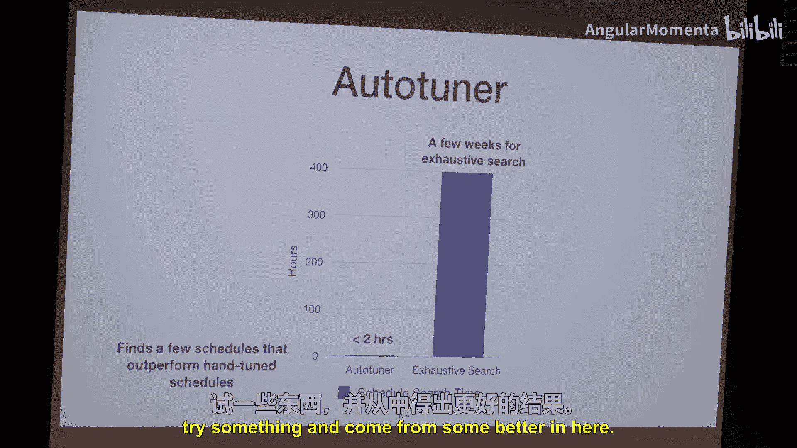
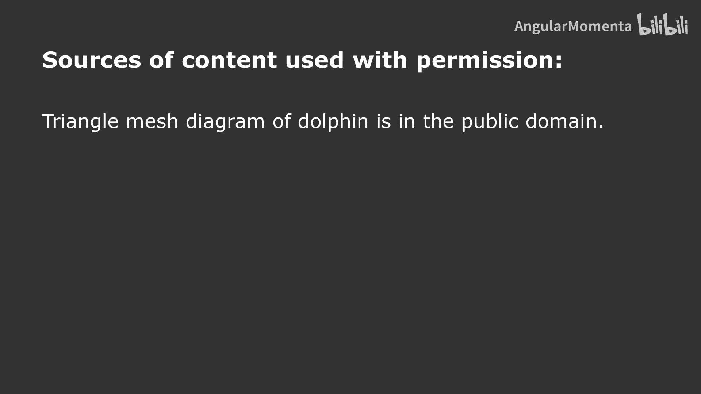

# 018：领域特定语言与自动调优

在本节课中，我们将学习领域特定语言和自动调优的概念。我们将探讨如何通过DSL简化特定领域的编程，以及如何利用自动调优技术自动寻找程序的最佳性能配置。课程将结合GraphIt和Halide两个具体的DSL案例，分析它们在处理图算法和图像处理管道时的优势，并揭示其背后共通的性能工程原理。

## 课程概述

本节课由麻省理工学院的Saman Amarasinghe教授主讲。他是EECS系的教授兼副系主任，在编译器、领域特定语言和自动调优方面是专家，也是大家在作业中使用的OpenTuner框架的设计者。他将介绍其在领域特定语言和自动调优方面的最新工作。

## 领域特定语言简介

我们日常使用的都是通用编程语言，它们被设计用来捕获编程中可能需要的各种广泛功能。

然而，很多时候存在特定的领域或模式，你希望实现具有某些有趣属性的代码。在通用语言中，描述这些属性非常困难，并且从编译器的角度来看，尤其难以利用这些属性，因为它必须为所有人工作。

领域特定语言具有很多工程上的优势，因为如果你知道你构建的东西具有某种特定的形态和属性集，而语言能够捕获这些信息，那么构建起来就会容易得多。它能带来更高的清晰度，更容易维护和测试。另一个好处是它更容易理解，因为领域非常明确。你可以构建一个库，但有人可能会在库中做一些奇怪的事情。如果它被内置于语言中，它就固化了，你不能随意更改。这使得多人编程更容易。

从我的角度来看，我真正喜欢的领域特定语言是那些我知道可以利用领域专家的知识来获得极佳性能的语言。

很多时候，领域表达允许进行特定的代数简化。这种代数可能只在该领域有效，很难将其复杂的代数规则放入C++中。但在该领域内，我可以编写代码，让你写出任何我可以简化的表达式。

此外，每个领域都有很多惯用法。例如，某个领域可能表示一个图。在普通的C++中，你可能使用一堆类来做非常复杂的事情，惯用法隐藏在其中。首先，C++不知道要寻找图。即使你寻找图，你也可以用数百万种方式尝试表示图。但如果语言提供了一流的支持，我就不需要费力地去提取它，我可以很容易地看到它，这样我的编译器大部分时间就可以在那里做有用的事情。

大多数时候，另一个好处是，如果你构建了一个领域特定语言，你可以将复杂的底层决策留给编译器。在C++中，你可能会忍不住说“我知道一些优化，让我在这里做点什么”。我一生都在研究优化，很多时候当你编写编译器优化过程时，你一半以上的时间都在撤销程序员所做的疯狂优化。

就像你们正在学习，你们认为自己更懂，然后去做一些事情，当时可能运行得很好。但相信我，那段代码20年后还存在，而20年后那看起来像是做了件非常愚蠢的事情。然后你看着它说，现在我必须在编译器中撤销一切，为当前的架构做正确的事情。因此，如果你捕获了正确的抽象层次，我会让编译器在这里完成工作。然后随着架构不断成熟，问题不断变化，我不必担心，也不必在这里撤销这些部分。

所以，我来到性能工程课，告诉你们把性能留给编译器，但好处是如果编译器能完成大部分工作，那会好得多。所以，不要怀疑编译器。

我将在这里讨论三个部分。这是三种不同的编程语言，领域特定语言GraphIt，然后是Halide，它不仅仅是一种语言，还是一个框架。在GraphIt和Halide之间，你会看到一些模式。然后我们将看看你是否发现了我们正在研究的模式。

## GraphIt：图算法的DSL

GraphIt是我和Julian合作的一个产品。所以如果今天之后你对GraphIt有任何问题，你绝对可以问Julian，他可能比这个星球上的任何人都更了解图和GraphIt。他是讨论图的绝佳资源。

### 图无处不在

如果你去像Google这样的地方进行搜索，Google将整个互联网的知识表示为一个巨大的图，背后有大量的图处理，这就是指导你搜索的方式。

或者如果你再去地图或像Uber这样的应用。它会为你找到路线。整个道路网络就是一个图，它试图在这个图中找到最短路径来给你地图。

如果你去推荐引擎获取电影推荐，如果你得到一部你真正喜欢的酷电影，那是因为在观看电影的所有人之间有一个巨大的图，他们观看和喜欢这些电影，系统正在将你与他们进行比较并推荐。所有这些都可以看作是图。

即使你去ATM机尝试进行交易。背后有一个非常快速的图分析，来判断这是否是欺诈交易。所以在钱实际从你的ATM机弹出之前的时间里，系统已经测试了一堆图处理来理解这似乎是一笔好的交易，所以实际上会给你钱。有时你会收到其他消息，这意味着图处理认为那里可能发生了一些奇怪的事情。所以很多事情，比如地图和交易，都有非常严格的延迟要求。你必须正确完成这件事，你必须非常快地得到下一个方向，尤其是在你转错弯之前。所以这些事情必须有效。其他事情，如推荐和Google搜索，是巨大的图，他们构建了整个网络或所有推荐，需要进行大量的处理。所以性能很重要。

在这些应用中，性能非常重要。

### 深入理解图处理

让我更深入地探讨一下图意味着什么，图处理意味着什么。

一个非常著名的图算法叫做PageRank。有人知道PageRank的历史吗？你们中有多少人听说过PageRank？好的。PageRank中的“Page”代表什么？Larry Page。所以Google做的第一个算法（我认为当时Google还不存在）就是这个PageRank算法。它追踪这些网页，但它是由Larry Page开发的，所以它要么是网页，要么是Larry Page，我们不知道，但人们认为是Larry Page，所以叫PageRank。如果你有一个图，这个图算法做的是进行一些迭代，直到达到最大迭代次数或某个收敛条件。

它首先做的是遍历所有邻居。然后基本上根据所有邻居计算一个新的排名。这意味着我的邻居有多好？他们的排名是什么？他们对我的贡献是什么？这意味着被一个好人认识并与一个非常知名的人（在这种情况下是网页）有联系，意味着我的排名很高。所以我更有影响力，因为我更接近某个事物。它基本上做的是计算某个值并传播给所有邻居，并聚合这些信息。整个图都参与其中。然后发生的是，每个节点将通过查看旧排名来计算其新排名，它会根据新排名进行一些修改，然后交换所有排名和新排名。这是你迭代进行的两个计算，你必须为整个图做这件事。

当然，如果你运行这个，它会运行得非常非常慢。所以如果你想获得性能，你就编写这段代码。这段代码基本上是巨大的，它在双核机器上比之前的图代码运行快23倍。它基本上是多线程的，所以获得了并行性能。它是负载均衡的，因为如你所知，图是非常不平衡的。如果你有非统一内存访问的机器，比如多插槽机器，它会利用这一点。它利用了缓存，这段代码中发生了很多事情。

但当然，你知道编写这段代码很难，但更糟的是，你可能不知道什么是正确的优化。你可能想尝试集成，你可能尝试很多事情，这非常困难。每次你改变一些东西，如果你说我想做一点不同的事情，我必须编写一个非常复杂的代码，让它全部正确，让一切正常工作，然后我才能在这里测试。

这就是为什么我们可以为这个使用DSL。

### 图算法的分类

让我稍微谈谈图算法，说说人们用图做什么？当我看到图算法时，我将稍微深入一点，向你展示表示图的类型。

有一类图算法被称为拓扑驱动算法，这意味着整个图都参与计算。

例如，Google搜索。在你进行Google搜索之前，它会收集所有网络链接，构建这个巨大的图，并进行大量处理，以便能够在这里进行搜索。推荐引擎也是如此，可能每隔几周或无论需要多长时间收集所有人的推荐数据，拥有这个巨大的数据，然后你将处理它并运行这个推荐引擎。这是应用于整个图的，有时需要数十亿甚至数万亿个节点参与计算。

另一类算法被称为数据驱动算法。这意味着你从某些节点开始，然后不断访问其邻居和邻居的邻居，在那里处理数据。

适合此类别的算法包括，如果你有一张地图，如果我必须找到最短路径，那意味着我可能有两个点。我不需要从这里的某个方向到波士顿，我不需要经过纽约的节点。我只需要经过我连接的邻居。所以我基本上是在某个区域及其连接上进行操作。

所以这些是数据驱动算法，我可能有一个巨大的图，但我的计算可能只作用于图的一个小区域或一小部分。

### 图遍历与优化策略

当你在图中遍历时，有多种方式进行图遍历，这就是优化困难的原因，因为有很多不同的方式，每种方式都有不同的结果集。

我假设很多图算法需要从我的邻居那里获取一些东西。从邻居那里获取东西的一种方式是，我可以计算我所有邻居可能需要什么，然后提供给其他邻居。

在那里，我可以去改变所有邻居来更新我的值。那么你认为这是好方法吗？如果我想更新每个人，我会计算我想做什么，然后去改变我所有的邻居。

这不是它可能达到的最并行状态。你正在做同样的事情。有趣。是的，但这是一个很好的观点。所以如果你正在进行数据驱动，如果我这样做不好，但如果每个人都对他们的邻居这样做，那么他们就有并行性。所以每个人可能都在更新他们的邻居，每个人都在更新他们的邻居。那么现在出现了另一个问题。如果每个人都试图更新他们的邻居，会出现什么问题？

那里存在竞争条件，因为每个人都要写入。所以如果你想正确完成这件事，你有一堆问题，你需要进行原子更新，因为你需要锁定那个东西，所以它必须原子性地更新。这很好，但我不需要遍历任何东西，因为我需要更新的每个人，我实际上去更新。这是一种很好的方式，特别是如果它不是全局性的。所以如果我正在传播，我将更新我的邻居，并且我可以将其传播下去。

另一种方法是拉取调度。这意味着如果每个人都询问他们的邻居：你有什么要给我的吗？我从所有邻居那里收集一切，然后更新我自己。

那么现在有竞争条件吗？有多少人说有竞争？有多少人说没有竞争？发生的情况是，我从所有邻居那里读取。每个人都从邻居那里读取，但我只更新我自己。因此，我是唯一写入我自己的人，所以我没有竞争。这很好，你没有竞争。但是，如果我正在进行数据驱动的转换，我可能不知道我需要被更新，因为更新来自那个人，这意味着我可能被安排任务，或者问你有什么要发送的吗？你可能会说没有。所以从这个意义上说，我可能基本上做了很多不必要的额外计算，因为我可能不知道我有数据需要获取，但我必须问你，我是否应该这样做？但我基本上不需要进行同步。

另一个有趣的事情是，我可以获取这个图。我可以基本上对图进行分区。一旦我对图进行了分区，我基本上可以说，这个核心获取这个图，这个核心获取这个图，这个处理器获取这个图。对图进行分区有什么优势？为什么我想将一个大图分割成小块？当然，你必须进行良好的分区。你不能进行任意分区。那么如果我进行良好的分区会发生什么？我不说出那个词，因为答案就在那里。好的，让我看看还有谁想回答。来吧，Bob，你上过课。如果我获取两个不同的组，将它们分开，并将这个给一个人，那个给另一个人，我会得到什么？我得到了并行性，但如果我有很多连接的东西进入你，这些连接的东西进入那个人，我还能得到什么？局部性，你在课上学过局部性吗？所以这意味着分区意味着我正在处理的东西，我只处理一小部分，如果我幸运的话，它可能在我的缓存中，那将非常好，每个人都需要访问这里的每个节点。

所以如果我正确分区，我会在这里获得良好的局部性，实际上那里已经写了，哎呀，好的。所以我的答案就在那里，所以包括局部性。但当然，现在我可能有一点额外的开销，因为我可能必须复制一些节点，因为它在两边都有。

在印度。所以，图的另一个有趣属性是，当你查看数据结构时，到目前为止，像数组这样的东西，大小很重要，不同的数组适合缓存等等。图在这里有一些其他属性。如果你去社交网络。社交网络是一个图。你在社交网络中观察到的有趣属性是什么？连通性。有像我这样的人，可能只有20个朋友，连接数非常少，然后有一些名人，他们有数百万的连接。有趣的是，如果你看一个社交网络图，你有一个称为幂律关系的关系，这意味着存在指数关系。有一些人，比如非常知名的名人，可能有数百万和数百万的用户连接，邻居数量巨大。所以像我这样坐在这里的人，与世界的连接非常少。人们通常观察到，大型社交网络类型的图具有这种指数关系。所以网络具有指数关系，社交网络在那里有这种关系。所以当你处理这些图时，你必须做非常有趣的事情，因为某些连接很重要，某些节点影响很大，比其他节点影响大得多。

然后还有其他图具有有界的度分布，比如道路网络。最大的连接可能是一个有六条道路交汇的十字路口，你不会有一百万条道路连接到一个地方，所以这不会发生。所以这更平坦，更多是有界度分布的图。由于当然剑桥的所有道路可能都连接在一起，但剑桥的道路可以与纽约市的道路分开，所以这些图具有良好的局部性。

所以，即使你说图的大小相同，图的形状在计算中很多时候都很重要。

### 性能权衡空间

那么，当你想对这些图进行操作时，你必须考虑三个有趣的属性。

一个属性是，我的算法试图对这个图做什么，将获得多少并行性。

这就像金发姑娘原则，你不想要太多的并行性。如果你说我的算法有巨大的并行性，但如果我不能利用它，那就没有用。所以你需要获得足够好的并行性，以便我实际可以使用它。

然后我真的很喜欢有局部性。因为如果我有局部性，我的缓存就会工作，一切都会在附近，我可以快速运行。如果我每次都必须从主内存获取东西，那可能会非常慢。所以我想要局部性。

但关于图的有趣之处在于，为了获得局部性和其中一些特性，你可能需要做一些额外的工作。所以如果你看到图被分成两个不同的图，我必须在其中添加额外的节点，我可能有一些额外的数据结构，所以做一些额外的计算。所以我可能必须在这里做一些额外的工作。所以在某些情况下，我可能没有那么高效。

所以我可能获得非常好的性能和局部性，但我做了太多的工作。例如，如果我想找到一个节点的邻居。获得良好并行性的方法是每个人都找到他们的邻居，但这效率不高。我的意思是大部分计算没有用。所以你可以做一些比必要更多的工作，然后可以获得更快的其他东西，但你必须小心这样做。所以你在这里有这个平衡。某些算法将适合这个权衡空间中的不同位置。所以推送算法将适合这里。例如，如果你去像拉取算法这样的东西，你可能会发现你做的效率较低，因为你可能多做了一点工作，但它在局部性和并行性方面可能更好，因为你不需要在这里加锁。

然后你做一些像分区的事情，在分区中获得非常好的局部性，但你正在做额外的工作，而且因为当你分区时，你可能会限制你的并行性。所以你可能有更少的并行性，但你获得了非常好的局部性。所以所有这些基本上都是一个大的权衡空间，然后当你不断添加更多可以做的事情时，它就适合这个大的权衡空间。

那么，你如何决定在权衡空间中做什么是一个非常重