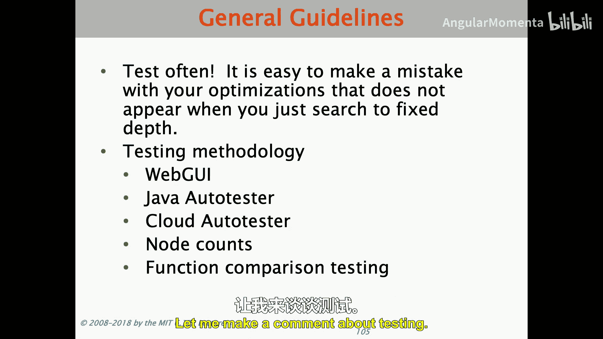
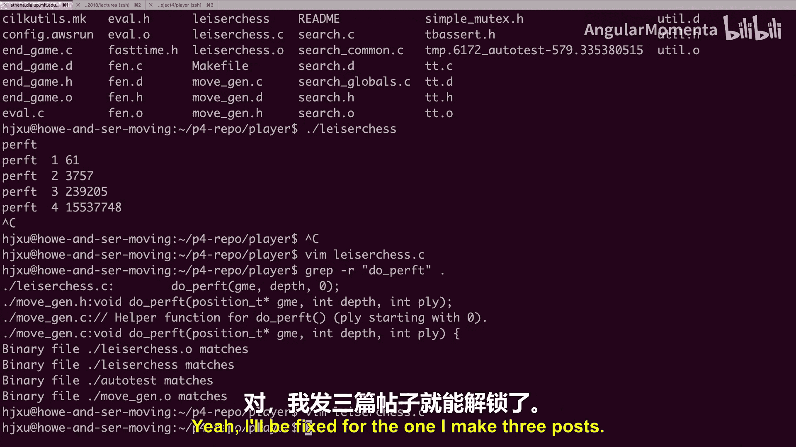
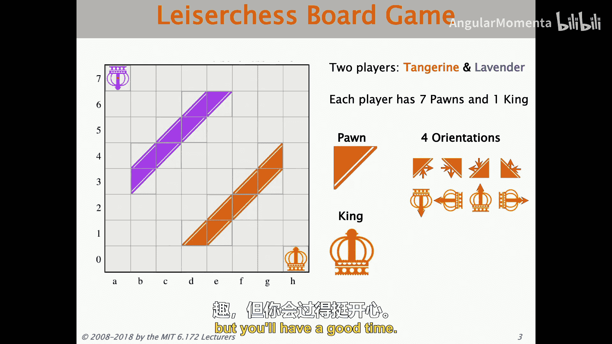
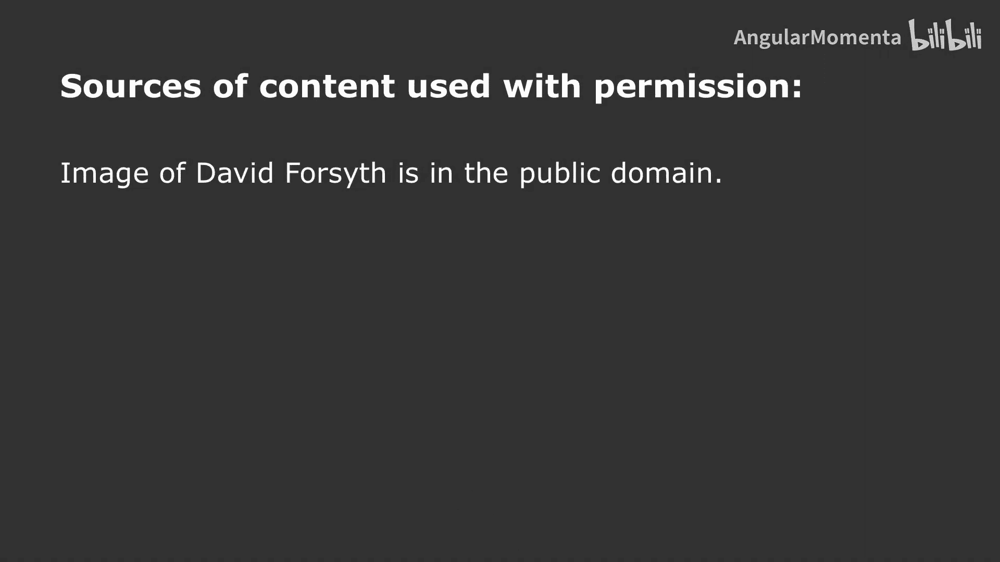

# 019：莱瑟国际象棋项目代码解读 🏁


在本节课中，我们将一起学习课程最终项目——莱瑟国际象棋（Laser Chess）的代码结构与核心机制。这是一个包含约4500行代码的复杂项目，我们将对其进行详细解读，帮助你理解游戏规则、代码组织、搜索算法以及性能优化的关键点。

## 项目概述与游戏规则 🎮

首先，我们来了解莱瑟国际象棋的基本规则。游戏中有两种棋子：**兵（三角形）** 和 **王（皇冠）**。双方（橙色和淡紫色）各有7个兵和1个王，初始布局如图所示。每个棋子有四个朝向（上、下、左、右）。

游戏开始时，橙色方先行，之后双方轮流行动。每回合包含两个部分：
1.  **移动**：玩家选择自己的一个棋子（王或兵）进行移动。
2.  **发射激光**：移动结束后，玩家的王必须发射激光。激光在棋盘上反射，若击中敌方兵的短边或敌方王，则消灭该棋子。

胜利条件是**击毙对方的王**。平局条件包括：双方各走15步且无兵被消灭、同一局面重复出现、或双方同意和棋。

游戏使用**菲舍尔计时法**，例如 `60+0.5` 表示初始时间60秒，每步棋完成后增加0.5秒。

## 代码表示与接口 📐

为了便于调试和表示游戏状态，项目使用了一种**边缘表示法**。这是一种用字符串描述棋盘位置的表示方法。

例如，起始位置的字符串表示如下（`/`分隔行，`1`代表空位，字母代表特定朝向的兵）：
```
1a1aaa1a/11111111/11111111/11111111/11111111/11111111/11111111/A1AAA1A1 w
```
字符串末尾的 `w` 表示轮到白方（橙色）走棋。这种表示法允许我们快速设置任何棋盘状态进行测试。

游戏记录（棋谱）使用类似 `E6E7`（从E6移动到E7）、`B3L`（将B3的棋子向左旋转90度）、`D5E4F5`（D5的棋子与E4的棋子交换，然后将来自E4的棋子移动到F5）的格式记录每一步。

## 项目组织结构与测试 🗂️

项目代码库包含多个目录，其组织结构如下：

*   **`doc/`**：包含游戏规则和接口文档。
*   **`autotester/`**：Java本地自动测试器。当云端测试队列较长时，可用于本地或夜间测试。
*   **`pgm-stats/`**：解析自动测试结果，生成胜率等统计数据。
*   **`tests/`**：测试配置文件目录。你可以在此指定要运行的测试对局数、使用的AI程序、时间控制等。
*   **`player/`**：**这是你需要优化的核心部分**，包含游戏AI的代码。
*   **`webgui/`**：本地Web图形界面。你可以用它来观看对局，甚至亲自与AI对战，以更好地理解游戏。

你可以通过**云端自动测试器**进行大规模测试。在Athena终端中运行类似以下命令：
```bash
autotest-run blitz 100 ./laserchess-ref ./laserchess-mybranch
```
这条命令会使用“快棋”时间控制，运行100局比赛，对战双方分别是参考AI和你分支上的AI。测试完成后，你会获得一个链接查看结果和ELO等级分。

此外，还有**练习服务器**，你可以在此挑战其他同学或助教的AI，实时观看对局。

## 棋盘表示与走法生成 ♟️

上一节我们介绍了项目的整体结构，本节中我们来看看AI如何“看到”和“思考”棋盘。

### 棋盘表示
参考实现使用一个 `16x16` 的数组来表示 `8x8` 的实际棋盘。外围的深色格子是**哨兵**，用于便捷地检测棋盘边界。内部 `8x8` 的格子才是真正的棋盘。

棋盘状态由一个 `Position` 结构体表示，其关键字段包括：
*   `board`：存储棋盘的数组。
*   `history`：到达当前局面的历史记录。
*   `key`：用于置换表的哈希键。
*   `ply`：步数索引，偶数表示白方（橙色）回合，奇数表示黑方（淡紫色）回合。
*   `last_move`：上一步棋。
*   `victim`：被激光消灭的棋子。
*   `king_square[2]`：双方王的位置。

### 走法表示与生成
一个“走法”使用28位整数打包表示，包含以下信息：
*   棋子类型（空、兵、王、无效）
*   棋子朝向
*   起始格
*   中间格（用于交换走法）
*   目标格

走法生成在 `mgen.c` 中实现。给定一个局面，AI会遍历整个棋盘，为当前行棋方找到所有可能的走法。**走法生成必须保持正确性**，任何优化都不能改变生成的合法走法集合。

调试走法生成可以使用 **Perft** 函数，它枚举指定深度内的所有走法节点数，是验证走法生成正确性的重要工具。

## 静态局面评估 ⚖️

生成了所有可能走法后，AI需要判断哪个走法更好。这通过**静态评估函数**（`eval.c` 中的 `eval` 函数）实现。该函数根据一系列启发式规则为局面打分。

以下是参考实现中的主要启发式规则（建议先优化现有评估，再尝试创造新规则）：

**与王相关的评估：**
*   **`K_FACED`**：己方王朝向对方王时获得奖励。
*   **`K_AGGRESSIVE`**：己方王靠近棋盘中心时获得奖励。
*   **`MOBILITY`**：计算己方王周围空闲格子的数量，可移动性越高越好。

**与兵相关的评估：**
*   **`P_CENTRAL`**：兵靠近棋盘中心时获得奖励。
*   **`P_BETWEEN`**：在以双方王为对角形成的矩形框内，己方兵的数量越多越好。

**基于激光覆盖的评估：**
*   **`L_COVERAGE`**：模拟所有可能走法后的激光路径，评估己方对棋盘的控制能力。这是最复杂的启发式规则。

当前评估函数通过遍历整个棋盘来计算分数，这是一个明显的性能瓶颈。优化思路包括：改用更高效的数据结构（如位棋盘或棋子位置列表）来避免全盘遍历。

## 搜索算法：极小化极大与Alpha-Beta剪枝 🌳

知道了如何评估一个静止局面后，AI需要通过搜索未来的可能走法序列来做出决策。这就是**游戏搜索树**。

最朴素的搜索是展开所有可能走法直到深度D，然后在叶子节点进行评估。但这样需要评估的节点数是分支因子B的D次方，计算量巨大。

### 极小化极大搜索
双方交替行棋，一方（Max）试图最大化评估分数，另一方（Min）试图最小化评估分数。从根节点（当前局面）开始，递归地进行“我方选择最大分数，对方选择最小分数”的推导。

### Alpha-Beta剪枝
Alpha-Beta剪枝是对极小化极大搜索的优化。它在搜索时维护一个窗口 `[alpha, beta]`：
*   `alpha`：当前层Max方至少能保证得到的分值。
*   `beta`：当前层Min方至多允许Max方得到的分值。

在搜索Min节点时，如果某个子节点的返回值 `v <= alpha`，说明Min方在这个分支可以迫使局面价值不超过alpha（这对Max方不够好），因此可以停止搜索该节点的其他子节点（**Beta截断**）。

伪代码如下：
```c
int alphaBeta(Position pos, int depth, int alpha, int beta) {
    if (depth == 0) return evaluate(pos);
    generateMoves(pos);
    for (each move) {
        makeMove(pos, move);
        int score = -alphaBeta(pos, depth-1, -beta, -alpha); // 注意取负和参数交换
        unmakeMove(pos, move);
        if (score >= beta) return beta; // Beta截断
        if (score > alpha) alpha = score;
    }
    return alpha;
}
```
理论证明，在**最佳走法优先**排序的情况下，Alpha-Beta搜索能将搜索节点数从 `B^D` 减少到大约 `B^(D/2)`，相当于**将有效搜索深度翻倍**。



### 主要变例搜索
这是Alpha-Beta的进一步优化，也称为**PVS**或** Scout搜索**。其核心思想是：假设第一个搜索的走法是最好的（主要变例），然后用一个**零窗口搜索**（`[alpha, alpha+1]`）快速检验其他走法是否可能更好。如果零窗口搜索返回的值超过窗口，则证明该走法更好，需要对其进行完整窗口的重新搜索；否则，可以安全地剪掉该分支。

## 搜索优化技术 🚀

为了进一步提升搜索效率，项目实现了多种优化技术：

*   **置换表**：象棋程序在搜索中经常会重复遇到相同的局面。置换表将这些局面的搜索结果（估值、最佳走法、搜索深度等）存储起来，避免重复搜索。它使用 **Zobrist哈希** 来快速生成局面的唯一哈希键，并且哈希值可以随着走棋/悔棋而增量更新。
*   **杀手启发**：记录在特定深度引发过Beta截断的“杀手”走法，在后续搜索同深度时优先尝试这些走法。
*   **历史启发**：根据历史对局信息，给那些在不同局面中频繁引发截断的走法赋予更高优先级。
*   **空着裁剪**：先尝试“不走棋”，并进行一次浅层搜索。如果结果仍然很好，说明即使让对手连走两步，局面也对己方有利，因此可以裁剪掉这个分支的深层搜索。
*   ** futility裁剪**：在搜索深度很浅时，如果某个走法即使能获得最大可能收益（ futility边际），其估值仍无法超过当前alpha值，则提前裁剪该走法。
*   **迟后走法削减**：对排序靠后的走法（认为其质量较低）使用更浅的深度进行搜索。

## 开局库与残局库 📚

除了优化搜索过程，预先计算好的知识库也能极大提升AI强度。

*   **开局库**：存储经过预先分析和评估的初始阶段走法序列。使用开局库可以避免在开局阶段进行耗时的深度搜索，并直接引导AI进入有利的中局。参考实现提供了一个基础的开局库，但内容有限，扩展它是很好的优化方向。
*   **残局库**：对于棋子所剩无几的残局局面，预先计算并存储最优走法和结果（赢、输、和棋及步数）。由于残局搜索深度可能很深，残局库能提供精确的指导。项目提供了一个C文件框架供你实现残局库。

## 测试、调试与性能优化建议 🔧

对于这样一个复杂的项目，建立稳健的**测试流程**至关重要。

1.  **频繁测试**：每做一项优化，都应立即测试其正确性。错误很容易被引入，并且可能在深度搜索时才暴露。
2.  **确定性测试**：尽可能使用**固定深度搜索**（如 `go depth 5`）进行测试，并比较搜索的**节点数**。纯粹的性能优化不应改变节点数，只会改变搜索速度（节点/秒）。使用 **Perft** 验证走法生成的正确性。
3.  **功能对比测试**：保留优化前版本的函数，与新版本在相同输入下对比输出，确保逻辑不变。
4.  **控制非确定性**：并行搜索和置换表会引入非确定性。为了调试，需要能够关闭这些功能，使程序行为完全确定。
5.  **逐步重构**：例如，当改变棋盘表示法时，可以同时维护新旧两种表示，并编写断言确保它们一致，待完全正确后再移除旧表示。

### UCI调试接口
AI通过**通用象棋接口**（UCI）与自动测试器通信。你也可以直接运行AI二进制文件，进入UCI命令行进行调试：
*   `position fen [FEN字符串]`：设置特定局面。
*   `go depth [数字]`：执行固定深度搜索。
*   `perft [数字]`：执行Perft测试。
*   你还可以在 `uci.c` 中添加自定义命令来辅助调试。

在 `uci.c` 的 `UCI_Option` 表中，你可以找到所有可调整的启发式权重参数。你可以通过UCI命令动态修改这些参数（如 `setoption name PawnValue value 125`），而无需重新编译，方便进行参数调优。

## 总结 📝

本节课中我们一起学习了莱瑟国际象棋最终项目的完整框架。我们从游戏规则和代码结构开始，深入探讨了AI的核心组件：棋盘表示、走法生成、静态评估、以及关键的搜索算法（极小化极大、Alpha-Beta剪枝、主要变例搜索）。我们还介绍了多种搜索优化技术（置换表、杀手启发等）和知识库（开局库、残局库）的使用。最后，我们强调了建立严格测试流程的重要性，并介绍了UCI调试接口的使用方法。







这个项目为你提供了一个绝佳的机会，将课程中学到的性能工程理念应用于一个接近真实的复杂软件系统中。通过有步骤地分析、测试和优化，你将能够显著提升AI的强度，并深刻理解高性能计算程序的设计与调试技巧。祝你项目顺利，玩得开心！