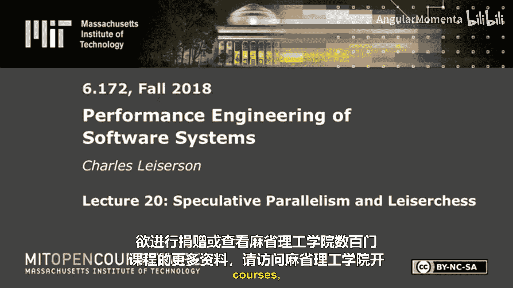
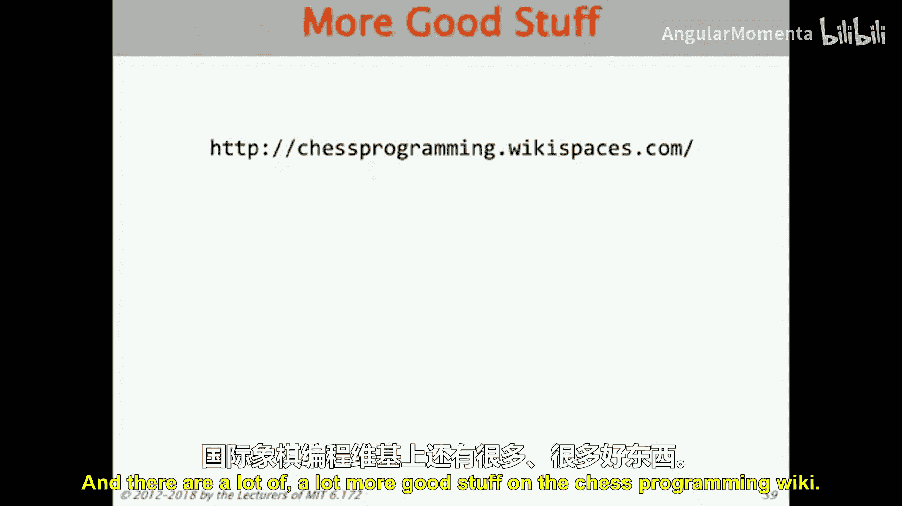

# 020：推测并行性与Leiserchess




在本节课中，我们将要学习推测并行性的概念，并探讨如何将其应用于Leiserchess这类具有内在串行性的算法中，以实现性能提升。我们将从简单的阈值求和示例入手，逐步深入到复杂的并行Alpha-Beta搜索，并讨论在实现过程中需要注意的数据结构、优化策略和潜在陷阱。

## 概述

推测并行性是一种通过猜测某些并行工作在未来会被需要，从而提前执行这些工作以提升性能的技术。然而，如果猜测错误，就会造成计算资源的浪费。本节课的核心在于理解如何明智地使用推测并行性，特别是在像Alpha-Beta搜索这样存在大量剪枝、本质上串行的算法中。

## 推测并行性基础

上一节我们介绍了推测并行性的基本概念。本节中我们来看看一个具体的简单示例：并行化的阈值求和循环。

### 串行阈值求和

首先，我们有一个串行代码，用于计算数组元素之和，并在总和超过某个限制时提前返回。

```c
int threshold_sum_serial(unsigned int *A, int n, unsigned int limit) {
    unsigned int sum = 0;
    for (int i = 0; i < n; i++) {
        sum += A[i];
        if (sum > limit) {
            return 1; // 超过阈值
        }
    }
    return 0; // 未超过阈值
}
```

一个简单的优化是使用条带挖掘（Strip Mining），减少条件检查的频率。

```c
int threshold_sum_serial_opt(unsigned int *A, int n, unsigned int limit) {
    unsigned int sum = 0;
    for (int i = 0; i < n; i += 4) {
        for (int j = 0; j < 4 && i + j < n; j++) {
            sum += A[i + j];
        }
        if (sum > limit) {
            return 1;
        }
    }
    return 0;
}
```

### 并行阈值求和与提前终止

现在，我们希望并行化这个循环，同时保留提前终止的能力。这引入了“短路循环”并行化的挑战。

解决方案是引入一个全局的“中止标志”（`abort_flag`）。每个并行任务在计算前和计算中定期检查这个标志。如果某个任务发现总和已超限，它会设置中止标志。其他任务看到标志被设置后，就会提前结束自己的计算。

以下是使用类似Cilk并行任务模型的伪代码思路：

```c
// 全局变量，需谨慎处理竞态条件
volatile int abort_flag = 0;

void parallel_sum_range(unsigned int *A, int start, int end, unsigned int limit, unsigned int *partial_sum) {
    if (abort_flag) return; // 检查中止标志
    if (end - start <= GRAIN_SIZE) { // 达到粒度阈值，串行计算
        unsigned int sum = 0;
        for (int i = start; i < end; i++) {
            sum += A[i];
            if (sum > limit) {
                // 在设置标志前检查，避免不必要的缓存行争用
                if (!abort_flag) abort_flag = 1;
                *partial_sum = sum;
                return;
            }
        }
        *partial_sum = sum;
        return;
    }
    int mid = (start + end) / 2;
    unsigned int sum1, sum2;
    // 递归并行计算左右两半
    spawn parallel_sum_range(A, start, mid, limit, &sum1);
    parallel_sum_range(A, mid, end, limit, &sum2);
    sync; // 等待子任务完成

    *partial_sum = sum1 + sum2;
    // 检查合并后的总和是否超限
    if (*partial_sum > limit && !abort_flag) {
        abort_flag = 1;
    }
}
```

**关键点**：
1.  **良性竞态**：多个任务可能同时尝试将 `abort_flag` 从0设置为1。由于它们都写入相同的值，这是一个良性竞态。但先检查再设置可以避免持续的缓存行无效化，提升性能。
2.  **内存栅栏**：在此例中，由于标志的值只会从假（0）变为真（1），且算法的正确性不依赖于值变化的确切时机，因此不需要昂贵的内存栅栏来强制同步。
3.  **非确定性**：这类代码的执行路径是非确定性的，取决于任务调度顺序。这增加了调试难度，因此需要能够关闭推测机制以进行确定性测试。

### 何时使用推测并行性

推测并行性的基本规则是：**除非并行机会很少，且被推测的工作有很大概率被需要，否则不要生成推测性任务。**

滥用推测并行性（例如，为寻找最小值而盲目生成大量任务）可能导致工作量远超串行算法，甚至无法获得加速。存在一个理论界限（课程中提及但未在幻灯片详细展示），用于指导何时推测是有效的。

## 并行Alpha-Beta搜索

上一节我们了解了推测并行性的通用模式。本节中我们将其应用于Leiserchess的核心——并行Alpha-Beta搜索（或其主要变体搜索PVS）。

### 挑战与Young Siblings Wait算法

Alpha-Beta搜索通过剪枝（Beta截断）来减少需要评估的节点数。在最佳走法顺序下，Knuth和Moore的分析表明，搜索的节点数约为 `B^(ceil(D/2)) + B^(floor(D/2)) - 1`，其中B是分支因子，D是深度。这相比朴素的`B^D`搜索，工作量大约开了平方根。

然而，剪枝引入了严格的依赖关系：只有当一个子节点搜索完成后，才能确定其兄弟节点是否会被剪枝。这导致了内在的串行性。

Burkhard Monien等人提出的“Young Siblings Wait”（YSW）算法提供了解决方案。他们观察到，在最佳顺序的博弈树中，任何节点的子节点要么全部被探索（在主要变路上），要么只有第一个子节点被探索后就发生截断（在非主要变路上）。

**YSW算法思路**：
1.  顺序搜索第一个子节点。
2.  如果第一个子节点**没有**导致Beta截断，则**推测**当前节点是一个“全宽度”节点（即主要变路的一部分）。此时，可以安全地并行搜索剩余的兄弟节点，因为根据推测，它们都需要被评估。
3.  如果推测错误（即后续发现第一个子节点其实很好，本应导致截断），则必须**中止**那些已经启动的、不必要的兄弟节点的搜索。

### 中止机制

为了实现中止，需要在每个搜索节点中维护一个标志（例如 `aborted`）。当某个节点发生Beta截断时，它沿着树向上传播“中止”信号。所有正在进行的推测性任务定期（例如，每评估若干次后）检查其祖先节点是否被标记为中止。如果是，则立即停止计算并返回。

这避免了无用工作的继续蔓延，是控制推测开销的关键。

### 共享数据结构的并行化

在并行化搜索循环时，需要处理几个全局共享的数据结构，它们可能引入数据竞争：

1.  **置换表**：缓存已搜索过的局面及其评估结果。这是最重要的优化之一。
    *   **选项**：加锁保证原子更新、为每个工作线程维护本地副本、容忍良性竞态。
    *   **建议**：在MIT参赛程序的经验中，由于竞态实际影响最终走法选择的概率极低，而加锁开销显著，他们选择了容忍竞态。但**必须提供关闭并行置换表访问的开关**，以便进行确定性调试和功能测试。

2.  **杀手启发表**：记录在特定深度下导致截断的“杀手”走法，用于优化走法顺序。
    *   **选项**：全局共享并同步更新，或线程本地副本。
    *   **建议**：需要评估同步开销与信息共享带来的收益。可能折衷的方案更有效。

3.  **历史启发表**：基于历史统计对走法进行排序。
    *   面临与杀手表类似的选择。可以考虑使用线程本地表，定期合并到全局表，或者使用读写锁保护。

**调试提示**：务必为这些并行组件（推测、置换表访问等）实现开关。在测试评估函数、走法生成等基础模块时，关闭所有非确定性并行功能，确保结果可重复，便于定位问题。

## Leiserchess性能优化机会

上一节我们深入探讨了并行搜索的核心机制。本节中我们来看看在Leiserchess项目中，除了并行化之外，还有哪些重要的性能优化方向。

以下是项目中值得关注的优化点列表：

*   **激光覆盖评估**：这是当前代码中最耗时的部分之一。`LaserCover` 函数通过模拟所有单步移动后的激光路径来评估局面的攻击性。优化思路包括：
    *   **缓存**：如果一步移动不改变激光路径上的棋子，则无需重新计算完整的激光覆盖评估，可以直接使用缓存值。
    *   **增量更新**：利用位棋盘或更智能的数据结构，只更新受移动影响的激光路径部分。
    *   **更便宜的启发式**：考虑能否找到一个计算量更小、虽不精确但足够指导搜索的替代评估函数，从而允许进行更深度的搜索。



*   **走法排序**：`search` 函数中，生成走法列表后的排序操作开销不小。在最佳顺序的树中，很多走法可能因为截断而根本不会被搜索到。
    *   **惰性排序**：可以尝试先只找出看起来最好的几个走法进行搜索。如果它们触发了截断，则无需排序和搜索剩余走法。
    *   **优化排序键计算**：走法排序依赖置换表、杀手表、历史表等多种启发信息。确保这些值的计算高效。

*   **棋盘表示**：当前简单的棋盘数组表示可能不是最高效的。
    *   **位棋盘**：使用64位整数（bitboard）表示每种棋子的位置。可以利用位操作（如移位、AND、POPCOUNT）高效地生成走法、计算激光路径等。这是国际象棋程序的标准优化。
    *   **棋子列表**：维护一个所有棋子的列表及其坐标。随着棋子被吃，列表变短，操作开销可能降低。
    *   **重构建议**：在修改表示前，**将所有棋盘访问操作重构到独立的函数或宏中**。这样可以在保留旧表示进行验证的同时，逐步替换为新表示，并确保编译器能内联这些调用以避免开销。

*   **迭代加深**：代码已经实现了迭代加深。理解其好处很重要：
    *   **走法排序**：浅层搜索的结果为深层搜索提供了优质的走法顺序信息（通过置换表），极大地提高了剪枝效率。
    *   **时间控制**：自然提供了在任意深度中断搜索的能力。

*   **静止搜索**：确保在评估局面时，不在“动荡”状态（例如正在交换棋子）中进行。代码应实现静止搜索，在常规搜索结束后，继续模拟所有吃子走法，直到达到“静止”局面再评估。

*   **空着剪枝**：基于“即使放弃行棋权，我方局面依然足够好”的假设。如果放弃行棋权（空着）后浅搜仍能引发Beta截断，则无需搜索其他走法。需注意避免陷入“无等着”局面。

*   **残局库**：对于棋子极少的局面，可以预先计算所有结果并存入数据库。但需要注意：
    *   不仅要存储胜/负/和，还要存储**距离将死的步数**，以避免循环。
    *   评估残局库的实际收益，因为很多对局可能在中局就结束了。

*   **开局库**：预先计算开局阶段的最佳走法。可以显著节省开局时间，并可能引导对手进入我方熟悉的局面。技巧包括为执白和执黑分别维护开局库，以及在库中引入随机性以避免被对手预测。

*   **置换表调优**：置换表是一个组相联缓存。可以调整其大小和相联度，在命中率和查找开销之间取得平衡。

*   **后期走法削减**：对于排序靠后的走法，减少其搜索深度，因为它们是“好走法”的概率较低。代码中已有相关参数，可以谨慎调整。

## 总结


本节课中我们一起学习了推测并行性的原理与实践。我们从简单的阈值求和例子出发，理解了如何通过中止标志来并行化可提前终止的循环。接着，我们深入探讨了如何将推测并行性应用于Alpha-Beta搜索，介绍了Young Siblings Wait算法及其关键的中止机制。我们还详细分析了在并行化过程中，置换表、杀手表等共享数据结构面临的竞争问题及处理策略。最后，我们梳理了Leiserchess项目中一系列重要的性能优化机会，包括激光评估优化、走法排序、棋盘表示改革等，为后续的项目开发提供了清晰的改进方向。记住，在追求性能的同时，保持代码的可测试性和可调试性至关重要。