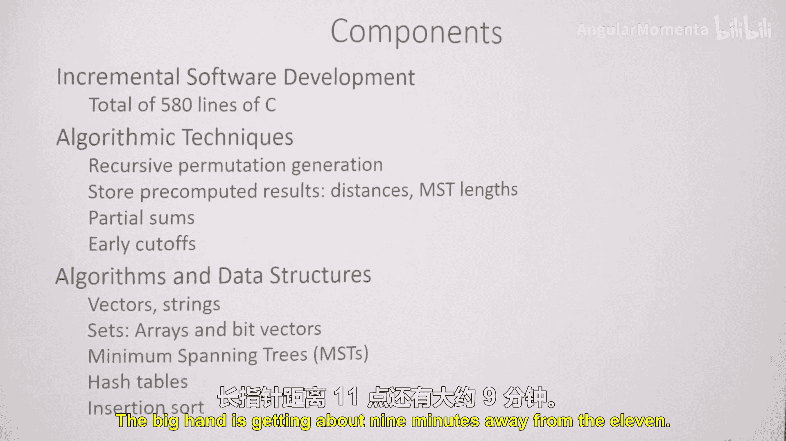

# 021：调优TSP算法 🚀


在本节课中，我们将跟随John Bentley的讲解，学习如何通过一系列性能工程技术，对一个经典的旅行商问题求解算法进行逐步优化。我们将从最基础的暴力枚举开始，最终实现一个能够高效求解较大规模问题的程序。

## 概述

旅行商问题是一个著名的NP完全问题，其目标是找到访问一系列城市并返回起点的最短可能路径。我们将从一个简单的递归枚举算法出发，通过应用缓存、剪枝、预计算和更智能的搜索策略等性能工程技巧，逐步提升程序的运行效率。

## 递归生成：枚举所有子集

在深入TSP之前，我们先理解一个基础概念：如何递归地枚举一个集合的所有子集。这对于后续的排列生成和搜索至关重要。

假设我们有一个大小为 `n` 的集合。一个直观的迭代解法是从0数到 `2^n - 1`，每个数字的二进制位表示一个子集。但递归方法提供了更清晰的思路和更好的可扩展性。

递归的核心思想是：要生成所有大小为 `n` 的子集，可以先将最左边的位固定为0，递归生成剩余 `n-1` 位的所有子集；然后再将该位固定为1，再次递归生成。这样就能覆盖所有 `2^n` 种可能性。

以下是递归生成子集的伪代码框架：
```c
void generate(int n) {
    if (n == 0) {
        visit(current_subset);
        return;
    }
    // 固定当前位为0
    set_bit(n-1, 0);
    generate(n-1);
    // 固定当前位为1
    set_bit(n-1, 1);
    generate(n-1);
}
```
理解这个递归模式是后续所有优化算法的基础。

## 旅行商问题简介

TSP不仅是一个理论问题，它在现实世界中有广泛的应用，例如：
*   **历史**：亚伯拉罕·林肯时代，法官需要巡回审理案件，希望找到最短的巡回路线。
*   **制造业**：电路板钻孔机需要以最短路径移动。
*   **汽车装配**：安排不同配置的汽车生产顺序，以最小化产线切换成本。

TSP是算法研究的“大肠杆菌”——一个被深入研究的原型问题。本节课的目标不是介绍最前沿的TSP算法，而是展示如何通过系统的性能工程，让一个基础算法变得实用。

## 算法演进：从暴力到智能

我们将从最简单的算法开始，逐步应用优化技巧。

### 算法1：朴素递归枚举

第一个算法直接生成所有 `n!` 种城市排列（即旅行路径），计算每条路径的总长度，并记录最短的那条。

**核心代码结构**：
```c
void search(int m) {
    if (m == 1) {
        // 计算当前排列的路径总长度
        compute_total_distance();
        // 如果更短，则更新最优解
        if (total_distance < min_distance) {
            update_best_tour();
        }
        return;
    }
    for (int i = 0; i < m; i++) {
        // 交换元素，生成新的排列
        swap(i, m-1);
        search(m-1); // 递归
        swap(i, m-1); // 回溯，恢复状态
    }
}
```
这个算法非常直观，但速度极慢。对于 `n=10` 的城市，`10! = 3,628,800` 种排列，在现代计算机上约需1秒。但当 `n` 增加到16时，预计需要数月时间。显然，我们需要优化。

### 初步优化：编译器与硬件

在修改算法之前，我们可以先利用外部因素获得加速：
1.  **编译器优化**：使用 `-O3` 优化标志进行编译。这可以带来惊人的速度提升（在我们的例子中高达25倍），因为编译器会自动进行循环展开、内联等优化。
2.  **更快的硬件**：与20年前的机器相比，现代计算机由于更快的时钟频率、更宽的数据通路和更深的流水线，可以提供约150倍的性能提升。

这些是“免费”的加速，但面对阶乘级增长，它们只能让我们多解决一两个城市的问题。

### 算法2 & 3：预计算与固定起点

以下是两个简单的代码级优化：
*   **算法2：查表代替计算**：原本每次都需要计算城市间的几何距离（涉及平方、开方等运算）。我们可以预先计算所有城市对之间的距离并存入一个二维数组，将距离计算变为一次数组查找，这带来了约3倍的加速。
*   **算法3：固定起始城市**：由于旅行路线是一个环，起点选择不影响总长度。我们可以固定一个城市作为起点，将搜索空间从 `n!` 减少到 `(n-1)!`，获得了约 `n` 倍的加速。

### 算法4：累积部分和

在算法1中，每次计算完整路径的总长度都需要 `O(n)` 的时间。我们可以改进为在递归过程中**累积当前已走路径的部分和**。当递归深入时，我们只需加上新边的距离，而不是从头计算。这避免了大量重复计算。

这个优化将每次路径评估的成本从 `O(n)` 降到了 `O(1)`，带来了显著的加速（约 `e ≈ 2.718` 倍）。

### 关键转折：剪枝搜索空间

之前的优化都是常数倍或线性倍的改进。要应对阶乘爆炸，必须**减少需要搜索的排列数量**，即“剪枝”。

**算法5：简单剪枝（Bound）**
核心思想：在递归构建部分路径时，如果当前累积的距离已经**超过了目前找到的最优完整路径的长度**，那么无论后面怎么走，这条部分路径都不可能成为最优解。因此，可以立即停止（剪枝）对该分支的进一步搜索。

这个简单的“如果已经搞砸了，就不要再继续”的策略效果惊人，将运行时间减少了数十到上百倍。

### 算法6：使用更紧的下界剪枝

简单剪枝的下界是“当前部分路径长度”，这个界比较松。我们可以计算一个**更紧的下界**来提前剪掉更多分支。
一个有效且计算成本可接受的下界是：**当前部分路径长度 + 剩余未访问城市的最小生成树长度**。
*   **原理**：访问剩余所有城市并返回起点的最短路径，其长度一定不小于连接这些城市的最小生成树的长度。
*   **实现**：在递归过程中，我们维护一个位掩码表示已访问的城市。对于剩余城市的集合，我们计算其最小生成树（MST）的长度（使用Prim等算法，约需 `O(k^2)` 时间，`k` 是剩余城市数）。
*   **代价与收益**：计算MST有开销，但更紧的下界能剪掉大量分支。实验证明，收益远大于代价，带来了数量级的加速。

### 算法7：缓存计算结果（Memoization）

在算法6中，我们反复为相同的剩余城市集合计算MST。这是一个典型的重复计算场景。
**解决方案**：使用**哈希表**缓存已计算过的 `(剩余城市集合) -> MST长度` 的映射。
*   **实现**：在计算MST前，先查询哈希表。如果找到，直接使用缓存值；如果没找到，则计算MST并将结果存入哈希表。
*   **效果**：这避免了大量重复的MST计算，再次带来了显著的加速（约15-25倍）。

### 算法8：更智能的搜索顺序（启发式）

搜索顺序影响剪枝效果。如果我们能更快地找到一个“相对较好”的路径，那么它的长度就可以作为一个更紧的界，从而更早地剪掉其他劣质分支。
**策略**：在递归选择下一个要访问的城市时，不按原始顺序尝试，而是**按照与当前城市距离由近及远的顺序**尝试。
*   **原理**：贪心地访问最近的城市，更可能快速构建出一条较短的完整路径。
*   **实现**：为每个城市预计算一个邻居城市列表（按距离排序）。在搜索时，按此列表顺序尝试。
*   **效果**：这引导搜索更快地找到优质解，从而更有效地剪枝，进一步提升了性能。

## 成果总结

通过应用上述一系列性能工程技术：
1.  **编译器优化**与**更快硬件**（外部因素）。
2.  **预计算**距离矩阵。
3.  **累积部分和**避免重复计算。
4.  **剪枝**：利用当前最优解和MST下界。
5.  **缓存**（Memoization）MST结果。
6.  **启发式搜索**顺序。



我们最终用大约160行C代码，将一个只能解决 `n≈12` 问题的朴素算法，提升到能够在数分钟到数小时内解决 `n≈50` 规模TSP问题的实用程序。这展示了将算法理论与性能工程实践相结合的巨大威力。

## 核心性能工程原则

本节课中我们一起学习了以下关键原则：
*   **测量，不要猜测**：性能优化前先分析瓶颈，优化后测量效果。直觉常常是错的。
*   **避免不必要的工作**：最大的加速来自于不做某事（剪枝、缓存）。
*   **用空间换时间**：查表、缓存计算结果都是经典策略。
*   **利用问题的特殊性**：固定起点、使用MST下界、启发式排序都依赖于TSP本身的性质。
*   **分阶段优化**：从高级算法和数据结构优化开始（剪枝、缓存），再进行代码级调优。
*   **递归生成与搜索**是解决组合问题的强大通用工具。


性能工程不仅是一门技术，更是一种思维模式。它让你能够深入系统内部，理解成本所在，并创造性地解决问题，从而让软件在现实世界中真正高效运行。