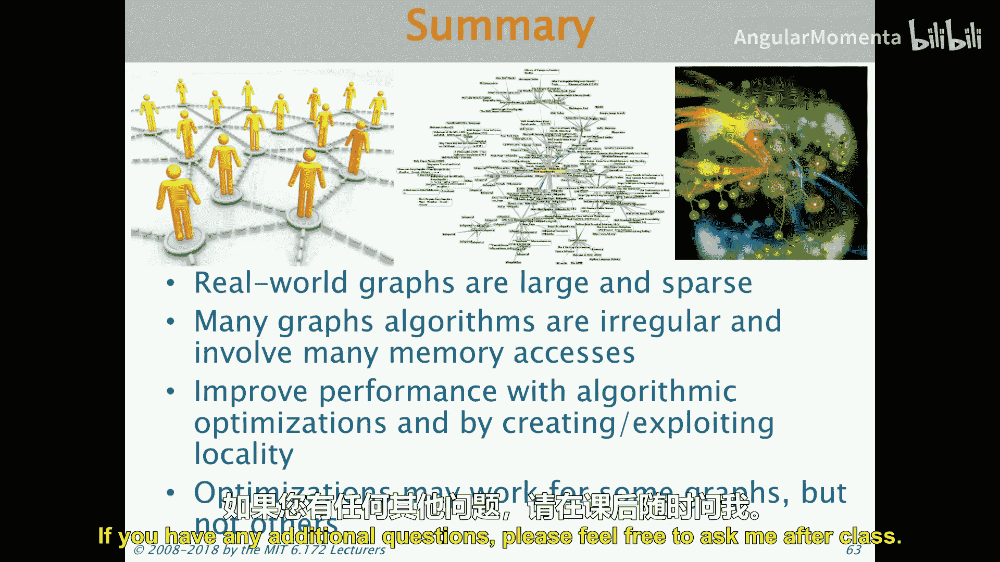
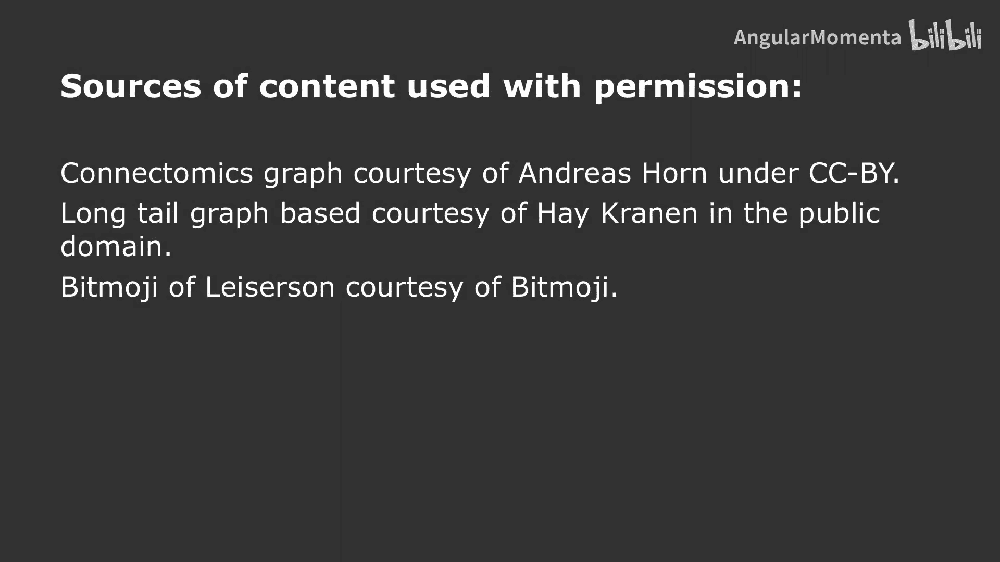

# 022：图优化 🚀


在本节课中，我们将学习图（Graph）的基本概念、在内存中的不同表示方法，以及如何高效地实现广度优先搜索（BFS）算法。我们还将探讨如何通过图压缩和重排序等技术来提升图算法的局部性。

---

## 什么是图？ 📊

图由顶点（Vertices）和边（Edges）组成。顶点代表我们感兴趣的对象，而边则代表对象之间的关系。

例如，在社交网络中，每个人可以表示为一个顶点，如果两个人是朋友，则在他们之间建立一条边。边不一定需要是双向的。例如，在推特网络中，Alice可以关注Bob，但Bob不一定需要回关Alice。图也不一定是连通的，可能存在独立的子图。

图还可以用于建模蛋白质网络，其中顶点是蛋白质，边表示蛋白质之间的相互作用。边可以是有向的，也可以是无向的。此外，边还可以被赋予权重，以表示关系的强度或距离。

顶点和边都可以带有元数据和类型。例如，谷歌知识图谱中的节点包含出生日期、逝世日期等信息，并用颜色表示其知识类型。

---

## 图的应用场景 🌐

图在许多领域都有广泛应用。

以下是图的一些常见应用：

*   **社交网络查询**：例如，在Facebook上查找与你上过同一所高中的朋友，或查找你与他人的共同好友。社交网络服务也会使用图算法来推荐你可能认识的人或感兴趣的产品。
*   **聚类**：目标是找到图中内部连接紧密、外部连接稀疏的顶点组。应用包括社交网络中的社区发现、互联网上的欺诈网站检测、文档聚类以及机器学习中的无监督学习。
*   **连接组学**：研究大脑的网络结构，其中顶点是神经元，边表示神经元之间的相互作用。
*   **计算机视觉**：例如图像分割，将像素表示为顶点，在相邻像素之间建立边，权重代表它们的相似度，然后运行最小割算法来分割图像中的不同物体。

还有许多其他应用，这里仅列举一部分。

---

## 图的表示方法 💾

在接下来的讨论中，我们假设顶点被标记为从0到n-1的整数。

以下是几种常见的图表示方法：

*   **邻接矩阵**：一个n×n的矩阵。如果存在从顶点i到顶点j的边，则矩阵中第i行第j列的值为1，否则为0。
    *   **空间复杂度**：`O(n²)`
*   **边列表**：简单地存储图中所有边的列表，每条边用一个包含两个顶点坐标的元组表示。
    *   **空间复杂度**：`O(m)`，其中m是边的数量。
*   **邻接列表**：为每个顶点维护一个指针，指向一个存储其邻居的链表（或数组）。
    *   **空间复杂度**：`O(n + m)`
    *   使用链表可能导致缓存性能不佳，因为访问邻居需要多次随机内存访问。使用数组可以改善缓存局部性，但更新图（如添加边）的成本更高。
*   **压缩稀疏行格式**：这是存储稀疏矩阵的常用格式，也适用于存储稀疏图。它包含两个数组：
    1.  `offsets`数组：长度为n，`offsets[i]`表示顶点i的边在`edges`数组中的起始位置。
    2.  `edges`数组：按顺序存储所有顶点的邻居。
    *   **空间复杂度**：`O(n + m)`
    *   可以通过`offsets[i+1] - offsets[i]`高效获取顶点i的度。
    *   要存储边权重，可以创建一个额外的长度为m的数组，或者为了更好的缓存局部性，将权重与目标顶点交错存储在一个长度为2m的数组中。

CSR格式非常适合需要顺序扫描顶点邻居的静态图算法，因为它提供了良好的内存局部性。但对于需要频繁更新边的动态图，CSR效率较低。

---

## 真实世界图的特性 📈

了解真实世界图的特性对优化算法很重要。

以下是真实世界图的一些关键特性：

*   **规模庞大但可管理**：例如，几年前的一个推特快照拥有4100万个顶点和15亿条边，占用约6.3GB内存，可以存储在个人电脑的主内存中。目前最大的公开图（Common Crawl网页图）拥有35亿个顶点和1280亿条边，需要超过0.5TB内存，这在如今拥有TB级内存的服务器上也是可以处理的。
*   **稀疏性**：边的数量m通常远小于n²。
*   **幂律度分布**：大多数顶点的度数较低，少数顶点（如社交网络中的名人）拥有极高的度数。数学上，度数为d的顶点数量与`d^(-p)`成正比，其中p通常在2到3之间。这种分布可能导致并行算法中出现负载不均衡问题。

---

## 广度优先搜索算法 🔍

BFS算法从给定的源顶点s出发，按照距离源顶点的顺序访问所有顶点。

BFS可能的输出包括：顶点被访问的顺序、每个顶点到源顶点的距离，以及一棵BFS树（其中每个顶点的父节点是其在前一层中的邻居）。

BFS有许多应用，包括作为中介中心性、偏心率估计、最大流算法、网页爬虫、环检测和垃圾收集等算法的子例程。

### 串行BFS实现

以下是使用CSR格式的串行BFS算法伪代码：

```c
parent = array of size n, initialized to -1
Q = array of size n
Q[0] = source
parent[source] = source
front = 0, back = 1

while front != back:
    current = Q[front]
    front++
    start = offsets[current]
    end = offsets[current + 1]
    for i from start to end-1:
        neighbor = edges[i]
        if parent[neighbor] == -1:
            parent[neighbor] = current
            Q[back] = neighbor
            back++
```

该算法的工作量为`O(n + m)`。

在性能分析中，访问`parent[neighbor]`是开销最大的操作，因为它是对`parent`数组的随机访问，可能导致大量缓存未命中。一种优化方法是使用一个位向量（bit vector）来记录顶点是否已被访问，只有在顶点未被访问时才去访问`parent`数组。这可以将随机访问的次数从m次减少到n次，从而提升大图上的性能。

### 并行BFS实现

并行BFS以前沿（frontier）为单位进行操作。初始前沿只包含源顶点。在每一轮迭代中，并行地探索当前前沿中所有顶点的邻居，将未访问的邻居加入下一个前沿。

算法需要处理潜在的竞争条件，因为多个前沿顶点可能试图访问同一个邻居。这可以通过比较交换（compare-and-swap）操作来解决。

以下是并行BFS的关键步骤概述：

1.  初始化`parent`数组为-1，将源顶点放入初始前沿。
2.  **While** 前沿非空：
    *   并行计算前沿中每个顶点的度数。
    *   对度数数组进行前缀和（prefix sum），为每个顶点在下一个前沿数组中分配连续的写入位置。
    *   并行遍历前沿中的每个顶点v及其所有邻居u：
        *   使用`compare-and-swap(&parent[u], -1, v)`尝试将v设为u的父节点。
        *   如果成功，则将u写入分配好的下一个前沿位置。
    *   使用前缀和过滤掉下一个前沿数组中的无效项（如-1），形成新的前沿。
3.  重复步骤2。

该算法的跨度（span）为`O(d * log m)`，其中d是图的直径，工作是`O(n + m)`，与串行算法相同。

并行BFS在实践中可以获得不错的加速比，例如在40核机器上使用80个超线程可获得约32倍的加速。

### 确定性并行BFS

上述并行BFS由于使用比较交换，生成的BFS树是非确定性的。为了获得确定性，可以采用两阶段方法：

1.  **第一阶段**：使用原子性的“写最小值”（write-min）操作。每个前沿顶点尝试将其ID写入邻居的`parent`槽位，但只有最小的ID会成功写入。
2.  **第二阶段**：每个顶点检查其邻居的`parent`值是否等于自己的ID。如果是，则该顶点负责将该邻居加入下一个前沿。

这种方法生成的BFS树总是相同的，虽然比非确定性版本慢5-20%，但带来了易于调试和推理的好处。

---

## 方向优化 BFS 🔄

方向优化基于BFS前沿大小随时间变化的观察。在迭代初期和末期，前沿较小；在中期，前沿可能变得非常大。

传统BFS是**自顶向下**的：从当前前沿顶点出发，探索其出边邻居。另一种方法是**自底向上**的：检查所有未访问顶点，查看其入边邻居是否在当前前沿中。如果找到，则将该前沿顶点作为父节点。

*   **自顶向下**：当前沿较小时效率高。更新`parent`数组需要原子操作。
*   **自底向上**：当前沿较大、且许多顶点已被访问时效率高。可以跳过许多边遍历，且更新`parent`数组无需原子操作。

方向优化BFS根据前沿大小动态选择模式。例如，当前沿大小超过`n/20`时切换到自底向上模式，否则使用自顶向下模式。对于有向图，自底向上模式需要预处理得到反向图（入边信息）。

方向优化可以显著提升在幂律图等真实世界图上的性能，有时能达到传统自顶向下方法的3倍速度。此思想可推广到其他图算法，如中介中心性、连通分量等。

---

## 图压缩技术 🗜️

图压缩的目标是减少图表示的内存占用，从而缓解内存带宽瓶颈。

在CSR格式中，我们可以对`edges`数组进行压缩：
1.  首先对每个顶点的邻居列表进行排序。
2.  存储差值：对于第一个邻居，存储`target - source`；对于后续邻居，存储与前一邻居的差值。
3.  使用变长编码（如字节码）来存储这些通常较小的差值，而不是使用完整的32位或64位整数。

为了提升解码性能并避免分支预测错误，可以采用分组编码：将需要相同字节数编码的整数分组，使用一个头字节记录组大小和每个整数所需的字节数，然后连续存储整数的数据部分。

对于高度数顶点，为了避免解码成为并行瓶颈，可以将其邻居列表分块（例如每块包含T个邻居），每块独立编码和解码，从而实现块间的并行解码。

实验表明，压缩方案可以节省大量内存。在串行执行时，速度可能与未压缩版本相近；在并行执行时，由于减轻了内存子系统压力，压缩版本甚至可能更快，并且解码操作能获得良好的并行加速比。

---

## 总结 📝

本节课我们一起学习了图优化相关的核心知识。

我们回顾了图的基本概念和多种内存表示方法，重点分析了压缩稀疏行格式的优缺点。我们深入探讨了广度优先搜索算法，分别实现了其串行和并行版本，并分析了性能瓶颈与优化策略，如使用位向量减少缓存未命中。我们还介绍了通过方向优化（自顶向下/自底向上切换）来提升BFS性能，以及通过图压缩技术来减少内存占用并提升并行可扩展性。





关键要点在于，许多图算法是不规则的，受限于随机内存访问。通过巧妙的算法优化（如方向优化）和利用局部性，可以显著提升性能。同时，需要意识到针对特定图结构（如幂律图）的优化可能对其他类型图（如道路网络图）无效，因此在优化时应使用多种图进行测试。