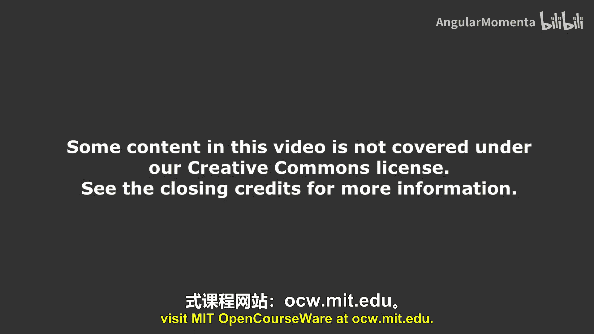
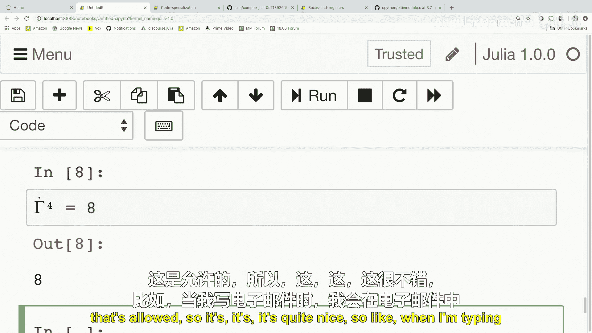

# 023：动态语言中的高性能



在本节课中，我们将探讨如何在Python、Julia等高层次动态语言中实现高性能计算。我们将分析这些语言性能差异的根本原因，并重点介绍Julia语言如何通过独特的设计，在保持动态性和高生产力的同时，达到接近C语言的执行速度。

## 概述

传统上，在Python等动态语言中进行高性能计算时，开发者通常采用“双语言方案”：用Python进行高层探索和原型设计，当需要性能关键代码时，则切换到C或Fortran等低级语言。这种方法虽然有效，但带来了编码复杂度的巨大跳跃和代码通用性的损失。

Julia语言的出现旨在解决这一矛盾。它试图成为一种既具有Python般的高层交互性和动态类型特性，又能让用户编写的循环等低级代码达到C语言速度的通用语言。本节课将通过具体的代码示例和性能对比，深入剖析Julia实现这一目标的机制。

## Python的性能瓶颈

为了理解Julia为何能快，我们首先需要理解Python为何慢。决定此类语言性能的关键因素之一是数据类型的语义，这极大地限制了任何编译器可能进行的优化。

### Python列表的数据结构

Python列表可以包含任意类型的元素，这意味着它在内存中必须被实现为一个指针数组。每个指针指向一个“装箱”对象，该对象不仅包含值本身，还包含一个类型标签。

**内存结构示意：**
```
[ 指针1 -> (类型标签, 值1), 指针2 -> (类型标签, 值2), 指针3 -> (类型标签, 值3) ]
```

这种设计的后果是，即使是最优化的C实现，在遍历列表求和时，每个循环迭代也必须：
1.  追踪指针。
2.  读取类型标签。
3.  根据类型动态决定使用哪个加法函数。
4.  为中间结果分配新的“装箱”对象。

这导致每个迭代都需要执行大量指令，而C语言中一个简单的浮点数数组求和循环，每个迭代可能只需几条机器指令。

### NumPy的解决方案

NumPy库通过引入**同质类型数组**来解决这个问题。在这种数组中，所有元素类型相同，因此只需为整个数组存储一个类型标签，值在内存中连续存储。

**内存结构示意：**
```
(类型标签: float64, 长度: N, 值1, 值2, 值3, ...)
```

这样，一旦知道了类型和长度，就可以分派到类似C代码的优化内核上执行，性能得以大幅提升。然而，关键问题在于**Python语言本身不提供表达这种语义的能力**。你无法在Python中创建一个强制所有元素类型相同的列表，并告知编译器可以省略类型标签和指针。因此，像NumPy这样的高性能库其核心必须用C实现。

## Julia的高性能之道

Julia的设计目标是在保持完全通用性的同时，编译出高效的代码。以下是一个完全通用的Vandermonde矩阵生成函数示例：

**Julia代码示例：**
```julia
function vander(x)
    m = length(x)
    V = Matrix{eltype(x)}(undef, m, m)
    for j in 1:m
        V[1, j] = one(eltype(x))
        for i in 2:m
            V[i, j] = V[i-1, j] * x[j]
        end
    end
    return V
end
```

这段代码看起来像C，但没有类型声明。`x`可以是任何容器，只要支持索引操作；其元素可以是任何数值类型，只要支持乘法运算。尽管如此，它的性能却能与高度优化的NumPy C代码相媲美，甚至在某些情况下更快。

### 核心机制一：即时编译与类型特化

Julia性能的关键在于其即时（JIT）编译和类型特化机制。当一个函数被以特定的参数类型调用时，Julia会为该类型组合编译一个专用的、高度优化的版本。

**示例：**
```julia
f(x) = x + 1
```
当首次调用 `f(3)`（`Int64`类型）时，Julia会编译一个`f(::Int64)`的专用版本。当首次调用 `f(3.1)`（`Float64`类型）时，会编译另一个`f(::Float64)`的专用版本。后续使用相同类型的调用会直接使用已编译的版本。

这个过程是递归的。对于 `g(x) = f(x) * 2`，当用整数调用`g`时，编译器会内联`f`的整数版本，知道其返回类型也是整数，进而选择整数的乘法函数，并在编译时完成常量折叠等优化。

### 核心机制二：类型推断

类型推断是编译器在给定输入类型的情况下，推断出函数内部所有中间值及返回值类型的过程。在Julia中，成功的类型推断是生成高效代码的前提。

**类型稳定的重要性：**
函数的返回类型应仅依赖于输入参数的类型，而非其值。例如，平方根函数`sqrt(x)`，即使输入`x`是整数`4`（结果是整数`2`），也应返回浮点数`2.0`。如果`sqrt(4)`返回`2`（整数），而`sqrt(5)`返回`2.236...`（浮点数），那么这个函数就不是类型稳定的，会严重阻碍编译优化。

Julia的设计（以及许多库的开发规范）鼓励编写类型稳定的代码，以利于类型推断成功。

### 核心机制三：多重分派

Julia的核心抽象是**多重分派**。与面向对象语言的**单分派**（根据第一个参数的类型决定方法）不同，多重分派根据所有参数的类型来选择最具体的方法。

**示例：**
```julia
+(a::Complex, b::Real) = Complex(a.re + b, a.im) # 复数 + 实数
+(a::Real, b::Complex) = Complex(a + b.re, b.im) # 实数 + 复数
```
这对于数学运算非常自然，也使得定义和处理混合类型操作变得简单而高效。

### 核心机制四：参数化类型

为了实现高性能且通用的用户自定义类型，Julia提供了参数化类型（类似于C++模板）。

**定义一个高性能的`Point`类型：**
```julia
struct Point{T <: Real}
    x::T
    y::T
end

# 为 Point{T} 定义加法
Base.:+(p::Point{T}, q::Point{S}) where {T<:Real, S<:Real} = Point(p.x + q.x, p.y + q.y)

# 定义零元
Base.zero(::Type{Point{T}}) where T = Point(zero(T), zero(T))
```
这里，`Point`本身是一个抽象类型族。`Point{Float64}`和`Point{Int32}`是不同的具体类型。数组`Vector{Point{Float64}}`在内存中是连续的`x1, y1, x2, y2, ...`，编译器知晓所有类型信息，可以生成与C结构体数组同样高效的代码。

这种方式既保证了性能（类型具体、内存连续），又保持了通用性（可适用于任何实数类型`T`）。

## 编译流程简介

Julia的编译流程大致如下：
1.  **解析**：将源代码解析为抽象语法树（AST）。
2.  **宏展开**：在编译早期，宏可以对AST进行任意重写，这是元编程和代码生成的重要工具。
3.  **类型推断与特化**：当函数以具体类型被调用时，进行类型推断，决定分派的方法，并可能内联函数。
4.  **生成LLVM IR**：将优化后的Julia代码转换为LLVM中间表示。
5.  **机器码生成与缓存**：LLVM将IR编译为本地机器码并缓存。下次以相同类型调用该函数时，直接使用缓存的机器码。

## 总结

本节课我们一起学习了动态语言中实现高性能的关键。我们了解到Python等语言的性能瓶颈主要源于其动态类型系统必须支持的“装箱”和异构容器语义。而Julia通过一系列协同工作的设计克服了这些障碍：
*   **即时编译与类型特化**：为不同的参数类型编译专用代码。
*   **类型推断**：鼓励类型稳定的编程风格，使编译器能在编译期知晓类型。
*   **多重分派**：根据所有参数类型选择最优方法，自然处理多态。
*   **参数化类型**：允许用户定义高性能、通用的数据类型。




这些特性使得Julia能够将高级、通用的代码编译成与C语言相媲美的机器码，从而让开发者无需在“生产力”和“性能”之间做出艰难抉择，真正实现了“双语言方案”的统一。