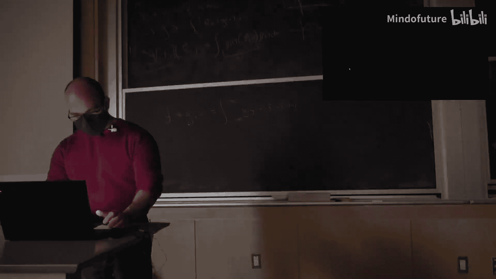

# 015：抗锯齿 🎨

在本节课中，我们将要学习计算机图形学中一个至关重要且无处不在的主题：抗锯齿。我们将探讨为什么在渲染图像时会出现锯齿状的边缘和奇怪的视觉伪影，并学习如何利用采样和重建的理论来减轻这些影响。虽然完整的理论需要深入的傅里叶分析知识，但我们将通过直观的图示和核心概念来理解其基本原理。

## 概述：采样与重建的问题

到目前为止，在我们的渲染过程中，我们通常通过向每个像素中心发射一条光线来确定其颜色。然而，现实世界是连续的，而我们的显示设备（像素网格）是离散的。当一个尖锐的边缘或高频率的纹理落在像素之间时，这种简单的“点采样”方法就会失败，导致图像出现锯齿状的边缘（称为“走样”或“锯齿”），或者产生其他奇怪的视觉伪影，如摩尔纹。

本节课的核心在于理解：**抗锯齿本质上是一个采样和重建的问题**。我们需要决定如何从连续的场景中获取有限数量的样本（采样），以及如何根据这些样本重建出最终的图像（重建）。这两个步骤都可能引入伪影。

## 锯齿现象无处不在

在深入理论之前，让我们看看锯齿现象在图形学和其他领域中的多种表现形式：

*   **渲染中的锯齿边缘**：在低分辨率下渲染的球体边缘会出现明显的阶梯状。
*   **纹理映射中的走样**：当纹理细节过于丰富，而屏幕像素无法充分采样时，会产生随机噪点般的伪影。
*   **光栅化直线的“楼梯”效应**：绘制非水平或垂直的直线时，会呈现锯齿状。
*   **数码摄影中的摩尔纹**：拍摄具有精细规则图案（如砖墙）的物体时，图像中会出现低频的波纹图案。
*   **“车轮效应”**：在视频中，高速旋转的车轮看起来可能转得很慢甚至向后转。这是因为相机的采样频率（帧率）与车轮的旋转频率不匹配，导致了频率混叠。

所有这些现象的共同点在于：**我们试图用一个离散的系统（像素网格、相机传感器）去表示一个连续的世界，当系统无法捕捉到足够的高频信息时，就会产生视觉上的错误**。

## 核心概念：采样、重建与傅里叶变换

为了系统地解决这个问题，我们需要一套数学语言来描述信号的“频率内容”。这就是**傅里叶变换**。

### 傅里叶变换简介

傅里叶变换的核心思想是：任何函数（比如我们的图像亮度分布）都可以分解成一系列不同频率的正弦波和余弦波的叠加。这与泰勒级数用多项式来逼近函数的思想类似，只不过基函数换成了正弦和余弦。

**公式表示**：对于一个空间域函数 `f(x)`，其傅里叶变换 `F(ξ)`（其中 `ξ` 代表频率）大致可以理解为 `f(x)` 与频率为 `ξ` 的复指数函数 `e^(i2πξx)` 的“内积”，它衡量了该频率成分在 `f(x)` 中的含量。
`F(ξ) = ∫ f(x) * e^(-i2πξx) dx`

**直观理解**：
*   **空间域**：我们看到的图像，`x` 和 `y` 是空间坐标。
*   **频率域**：图像经过傅里叶变换后的表示，它告诉我们图像中包含了哪些频率的成分。平滑变化的区域对应低频（集中在频率域中心），尖锐的边缘和精细的纹理对应高频（分布在频率域外围）。

### 采样在频率域的影响

采样在数学上可以看作是用一个脉冲序列（在采样点处有值，其他地方为0）乘以原始连续函数。傅里叶变换的一个关键性质是：**空间域中的相乘，对应于频率域中的卷积**。

**核心结论**：当我们以一定的间隔对连续信号进行采样时，其频率域表示 `F(ξ)` 会被**周期性地重复和叠加**。采样间隔越宽（采样率越低），这些重复的副本在频率域中就靠得越近。

### 理想重建与奈奎斯特-香农采样定理

如果原始信号是**带限的**，即其频率成分有一个上限（比如最高频率为 `B`），那么只要我们以高于 `2B` 的频率进行采样（即**奈奎斯特率**），在频率域中，这些重复的副本就不会发生重叠。

在这种情况下，我们可以通过一个完美的**重建滤波器**来恢复原始信号：在频率域中，我们只需用一个矩形函数（在 `-B` 到 `B` 之间为1，之外为0）乘以采样后的频谱，滤掉所有多余的副本，然后进行逆傅里叶变换，就能得到原始信号。

在空间域中，这个理想的矩形滤波器对应的是 **sinc 函数**：`sinc(x) = sin(πx) / (πx)`。
**因此，理论上完美的重建是通过用 sinc 函数对采样点进行卷积来实现的。**

## 现实挑战与实用抗锯齿技术

然而，现实世界的图像（尤其是带有锐利边缘的图像）并非带限信号，它们包含无限的高频成分。此外，sinc 函数是无限延伸且包含负值的，这在计算和显示上都不现实（像素颜色不能为负）。

因此，在实践中，我们采用各种近似和启发式方法来达到可接受的效果。以下是常见的抗锯齿技术：

### 1. 超采样 (Supersampling)

这是最直观的方法。我们不再只向每个像素中心发射一条光线，而是在像素内规则地（如网格）或随机地（抖动采样）发射多条光线，然后将这些光线的颜色结果进行平均，作为该像素的最终颜色。

*   **均匀网格超采样**：在像素内进行 `NxN` 的规则采样。这相当于使用了一个**盒式滤波器**进行重建。虽然简单，但可能无法完全消除某些高频伪影。
*   **抖动采样 (Jittering)**：随机扰动采样点的位置。这并不能提高信号的频率上限，但可以将规则的结构性伪影（如摩尔纹）转化为不那么显眼的随机噪声，人眼对后者更不敏感。

### 2. 改进的重建滤波器

我们不使用理想的 sinc 函数，而是使用具有有限支撑（只在有限范围内非零）且值全为正的滤波器来对超采样的样本进行加权平均。

*   **高斯滤波器**：权重从中心向四周衰减。
*   **Mitchell-Netravali 滤波器**：一种基于三次样条的滤波器，在质量和计算成本之间取得了很好的平衡，是实践中常用的选择。

选择不同的滤波器，会在图像锐度和平滑度之间进行不同的权衡。

### 3. 纹理抗锯齿与 Mipmapping

纹理映射是抗锯齿的一个特例和难点。当纹理被缩小显示（Minification）时，一个像素可能覆盖纹理上的一大片区域，如果只用纹理上的一个点来代表，就会导致严重的走样。

**Mipmapping** 是解决此问题的经典技术：
*   **原理**：预先计算并存储原始纹理的一系列下采样版本（形成 Mipmap 链）。在渲染时，根据像素在纹理平面上所覆盖区域的大小，自动选择合适的 Mipmap 层级进行查找。
*   **优点**：极大地提高了纹理缩小时的渲染质量和速度。
*   **局限性**：对于各向异性拉伸的纹理（如极度倾斜的表面），标准的 Mipmapping 可能仍会产生模糊。更高级的技术如**各向异性过滤**会考虑像素覆盖区域的形状，使用椭圆形的滤波器进行查找。

### 4. 特殊应用：字体渲染 (ClearType)

字体由许多极细的线条和曲线构成，对锯齿非常敏感。ClearType 等技术利用了大多数液晶显示屏的物理特性：每个像素由红、绿、蓝三个子像素并列组成。

*   **原理**：不是以整个像素为单位进行抗锯齿，而是以**子像素**为单位独立控制亮度。这相当于将水平方向的分辨率提高了三倍，从而能够渲染出更平滑、更清晰的字体边缘。
*   **注意**：这种技术高度依赖于显示设备的子像素排列方式。

## 总结

本节课我们一起学习了计算机图形学中抗锯齿的核心思想。我们了解到：

1.  **锯齿的根源**在于用离散的采样系统去表示连续的信号，当采样率不足以捕捉信号中的高频成分时，就会产生走样。
2.  **傅里叶变换**为我们提供了在频率域分析此问题的强大工具。理想情况下，对带限信号以奈奎斯特率采样，并用 sinc 函数重建，可以完美复原信号。
3.  **现实妥协**：由于图像非带限且 sinc 函数不实用，我们发展了一系列实用技术，包括**超采样**、使用**正值的重建滤波器**、针对纹理的 **Mipmapping** 以及针对字体的**子像素渲染**等。

抗锯齿是渲染中平衡质量与性能的关键环节。理解其背后的原理，将帮助你在未来使用或开发图形系统时，做出更明智的选择。