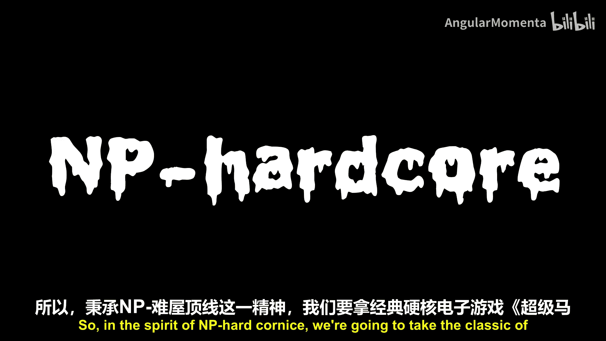
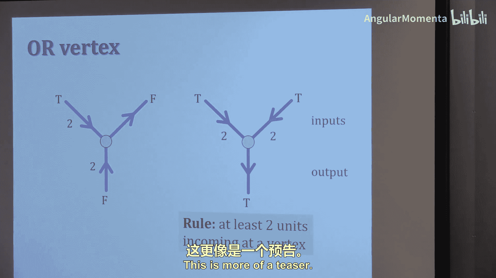
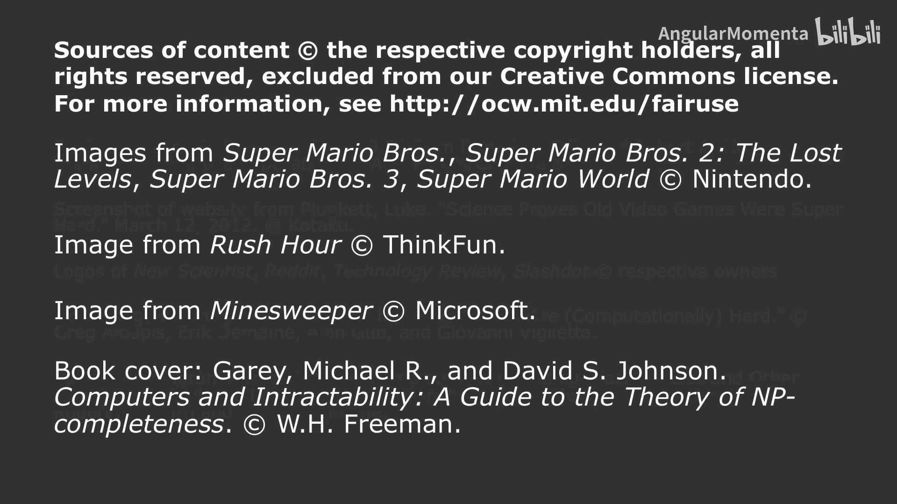

# 001：课程概述与计算复杂性导论

在本节课中，我们将学习算法下界课程的核心目标，并对计算复杂性理论进行一次快速导览。我们将了解如何证明问题是“困难”的，并探索P、NP、PSPACE等关键复杂性类。

## 课程介绍

本课程的目标是提供一份实用指南，并让大家积累大量经验，学习如何证明问题是困难的。证明问题困难涉及许多技巧。积累更多证明困难的经验后，将相对直接地对你感兴趣的任何问题证明其困难性。

本课程并非传统的复杂性理论课程。我们不会深入探讨复杂性类之间关系的深奥数学。我们将直接使用许多已有的结果，而不去证明它们。本课程期望你具备算法背景知识，因为我们采取一种算法视角，或者可以称之为“反算法”视角。

学习证明问题困难的主要原因，是为了表明在你感兴趣的模型下无法设计出高效算法。这鼓励你改变问题，例如寻找近似算法或固定参数算法。在本课程中，你将掌握许多技巧，看到许多可以归约到你问题的关键问题，并了解文献中常见的证明风格。

即使你不关心困难性证明，本课程也充满乐趣。原因之一是你会看到许多乍看之下不相关的问题之间酷炫的联系。本课程中的大多数问题彼此等价，证明这一点正是我们的目标。我们还将研究许多有趣的问题，例如超级马里奥兄弟和俄罗斯方块。证明问题困难就像解谜一样，充满乐趣。

课程要求包括填写调查问卷、参加讲座、记笔记、完成大约五次作业，以及一个最终项目。项目可以涉及新的理论证明、调查现有材料、编写代码可视化证明，或创作与困难性证明相关的艺术作品。

## 计算复杂性导论

上一节我们介绍了课程目标，本节中我们来看看计算复杂性理论的基础概念。

我们从**多项式时间**可解的问题类开始。多项式时间意味着运行时间为 `O(n^k)`，其中 `n` 是问题实例的规模，`k` 是某个常数。这通常被视为“高效”算法。

一个我们认为“低效”的例子是**指数时间**。指数时间通常定义为 `2^(p(n))`，其中 `p(n)` 是一个多项式。

我们还可以定义**递归可枚举问题**或**递归问题**，即所有可以在有限时间内解决的问题。

为了直观理解，我们可以画一条表示“计算难度”的轴。最左边是P类，中间是NP类，右边是X类（指数时间），而可判定问题的边界在更右边。

以下是各类别的例子：
*   **P类**：最短路径等。
*   **X类**：N x N 棋盘上的国际象棋（白方能否必胜）；已知未来所有方块的俄罗斯方块（能否存活）。
*   **不可判定问题**：停机问题。

大多数决策问题实际上没有算法。然而，我们倾向于提出的问题通常都有算法，本课程更关注的是P与NP等类的关系。

## NP类与非确定性

上一节我们定义了P和指数时间类，本节中我们来看看介于两者之间的NP类。

决策问题的答案是“是”或“否”。NP有多种定义方式，这里介绍两种。

第一种定义使用**幸运算法**或**非确定性**模型。在这种模型中，算法可以进行一系列“猜测”，并且总是能猜对。算法最终输出“是”或“否”。我们保证：如果存在一个答案为“是”的路径，那么你将被引导至一个“是”的答案。如果算法输出“否”，则意味着无论做什么选择，最终都会得到“否”。

第二种定义是：NP问题是那些其**解相对简短**并且可以在多项式时间内**被验证**的问题。

这两种定义本质上是等价的。例如，俄罗斯方块（已知未来方块序列）属于NP。要证明你能存活，只需给出每个方块的放置位置（一个简短的证书），然后可以在多项式时间内验证这个放置序列是否有效。

显然，任何P类问题也属于NP类。同时，任何NP问题都可以通过尝试所有可能的猜测路径在指数时间内解决，因此NP包含于指数时间类中。

一个重大的开放问题是P是否等于NP。直观上，这意味着你无法“制造运气”。大多数人相信P不等于NP，即存在一些属于NP但不属于P的问题。

## 困难性与完全性

上一节我们介绍了NP类，本节中我们来看看如何定义问题的“困难”程度。

如果我们有一个复杂性类X（例如NP），那么一个问题被称为是**X-困难的**，如果它至少和X类中的每一个问题一样难。这意味着从X类中的任何问题到该问题都存在一个归约。

一个问题被称为是**X-完全的**，如果它既是X-困难的，又属于X类。

在复杂性图谱中，NP完全问题位于NP类中最难的那部分。例如，国际象棋（广义）是指数时间完全的。这意味着我们知道它可以在指数时间内解决（上界），并且它至少和所有指数时间问题一样难（下界）。因此，它不可能在多项式时间内解决。

另一个重要的类是**PSPACE**，即可在多项式空间内解决的问题。通常，如果一个问题能在多项式空间内解决，那么它也能在指数时间内解决，因为机器只有指数多个可能的状态。因此，PSPACE位于P（或NP）和指数时间之间。同样，也有PSPACE困难和PSPACE完全的概念。

例如，推箱子游戏（Rush Hour）是PSPACE完全的。这意味着它比NP完全问题（如俄罗斯方块）更难（假设NP不等于PSPACE）。因此，推箱子游戏没有多项式时间算法。

还有更大的类，如指数空间，但本课程主要关注NP和PSPACE。

一个有用的事实是：PSPACE等于**NPSPACE**（非确定性多项式空间）。这由萨维奇定理证明。这对于分析推箱子这类游戏很有用，因为虽然解的长度可能是指数级的，但验证一个猜测的移动序列是否构成解只需要多项式空间。

## 归约：困难性证明的核心

上一节我们定义了困难性和完全性，本节中我们来看看证明这些性质的核心工具——归约。

归约是连接两个问题的桥梁。如果我们有问题A和问题B，从A到B的一个**归约**是一个算法（通常指多项式时间算法），它将A问题的一个实例转换为B问题的一个实例，并且这种转换使得两个实例的答案（是/否）相同。

为什么归约重要？因为如果我们有一个解决B问题的算法，那么通过归约，我们也能解决A问题。我们说，**B至少和A一样难**。

几乎所有困难性证明都基于归约。你从一个已知在某个类中（如NP）是困难的问题出发，将其归约到你想要研究的新问题。如果你能做到这一点，那么你就证明了新问题至少和那个已知困难问题一样难，因此新问题也是该类的困难问题。

需要注意的是归约的方向。你总是从**已知的困难问题**归约到**你的问题**。一个常见的说法是：“我们的证明基于从[某个已知困难问题]到[你的问题]的归约。”

在算法课中，你也见过归约，例如将无权最短路径归约为有权最短路径。在那种情况下，你展示的是A问题是B问题的一个特例。在困难性证明中，归约通常远没有那么明显。

以下是基于归约的定理：
*   如果A是X-困难的，并且存在从A到B的归约，那么B也是X-困难的。
*   反之，如果B属于某个复杂性类X（且X包含多项式时间），那么A也属于X类。

## 实例分析：超级马里奥兄弟是NP困难的

上一节我们介绍了归约的概念，本节中我们来看一个具体的例子：证明超级马里奥兄弟是NP困难的。

我们需要从一个已知的NP完全问题出发进行归约。最常用的起点是**3-SAT**问题（三元可满足性问题）。

3-SAT实例如下：给定一个由多个子句构成的布尔公式，每个子句是三个文字（变量或其否定）的析取。问题是：是否存在对变量的真值赋值，使得整个公式为真。

证明的思路是使用**构件**。我们将3-SAT实例的各个部分转换成马里奥关卡中的小模块。

以下是核心构件：
1.  **变量构件**：马里奥需要决定向左走还是向右走。这代表将变量赋值为真或假。一旦选择，由于跳跃高度限制，无法返回。
2.  **子句构件**：包含三个入口。马里奥需要从至少一个入口进入并触发一个星星（例如，通过撞击问号砖块获得无敌星）。之后，他才能安全通过一个充满火焰棒的障碍区域。
3.  **交叉构件**：由于变量与子句的连接图可能不是平面图，我们需要让路径交叉而不相互干扰。这需要设计一个交叉构件，确保马里奥只能沿特定方向通过，而不会意外地从一条路径跳到另一条路径。

整个关卡的组装方式如下：马里奥依次通过每个变量构件，做出真/假选择。根据选择，他会沿着对应的路径访问那些包含该变量（以相应形式出现）的子句构件，并触发其中的星星。在访问完所有变量后，他必须依次通过所有子句构件的火焰棒区域。这只有当每个子句构件都至少被触发过一次（即每个子句都为真）时才可能实现。

因此，当且仅当3-SAT公式可满足时，马里奥才能通关。这就完成了从3-SAT到超级马里奥兄弟的归约，证明了后者是NP困难的。

## 实例分析：推箱子是PSPACE完全的

上一节我们通过3-SAT归约证明了一个动作游戏的困难性，本节中我们来看一个更复杂的谜题——推箱子，并介绍一种适用于更长、更具策略性游戏的归约框架。

对于推箱子这类游戏，一个有用的源问题是**约束逻辑**。

在约束逻辑中，我们有一个图，边分为红边（权重1）和蓝边（权重2）。图的一个状态是给所有边指定一个方向。约束是：在每个顶点，指向该顶点的边的权重之和必须至少为2。允许的操作是反转一条边的方向，只要反转后仍满足所有顶点的约束。

顶点有两种类型：
*   **与门**：连接两条红边（输入）和一条蓝边（输出）。只有当两条红边都指向顶点（输入为真）时，蓝边才可能被反转指向外（输出为真）。
*   **或门**：连接三条蓝边。其中任意一条边指向顶点（输入为真），都允许另一条指定的边被反转指向外（输出为真）。

约束逻辑中的决策问题是：给定一个初始合法状态，能否反转某条特定的边？这个问题被证明是PSPACE完全的。

现在，要将约束逻辑归约到推箱子，我们需要用推箱子中的方块构造出与门和或门构件。

以下是推箱子中的构件思路：
*   **与门构件**：一个方块C能否被推入一格，取决于方块A和方块B是否都被推出一格。这模拟了“与”的逻辑。
*   **或门构件**：一个方块C能否被推入一格，取决于方块A **或** 方块B被推出一格。这模拟了“或”的逻辑。这里需要一个“受保护”的设计，以确保不会意外地同时触发两个输入。

通过精心设计方块布局，确保灰色固定块无法移动，我们可以将这些构件像拼图一样拼接起来，模拟任何约束逻辑图。因此，推箱子中的可达性问题（能否移动特定方块）至少和约束逻辑问题一样难，从而证明推箱子是PSPACE完全的。

## 总结

本节课我们一起学习了算法下界课程的核心目标与计算复杂性理论的基础。

我们首先了解了本课程旨在教授证明计算问题困难性的实用技巧。接着，我们快速回顾了关键的计算复杂性类：P（多项式时间可解）、NP（非确定性多项式时间可验证）、PSPACE（多项式空间可解）以及指数时间类。我们明确了“困难性”和“完全性”的定义。

然后，我们深入探讨了**归约**这一核心工具，它是连接已知困难问题与新问题的桥梁，是几乎所有困难性证明的基础。最后，我们通过两个实例分析了归约的应用：将3-SAT归约到**超级马里奥兄弟**证明了其NP困难性；将约束逻辑归约到**推箱子**证明了其PSPACE完全性。这些例子展示了如何通过设计巧妙的“构件”来构建归约。

在接下来的课程中，我们将深入探索更多类型的归约技术和源问题，例如3-Partition问题，并应用于更广泛的有趣难题和游戏中。