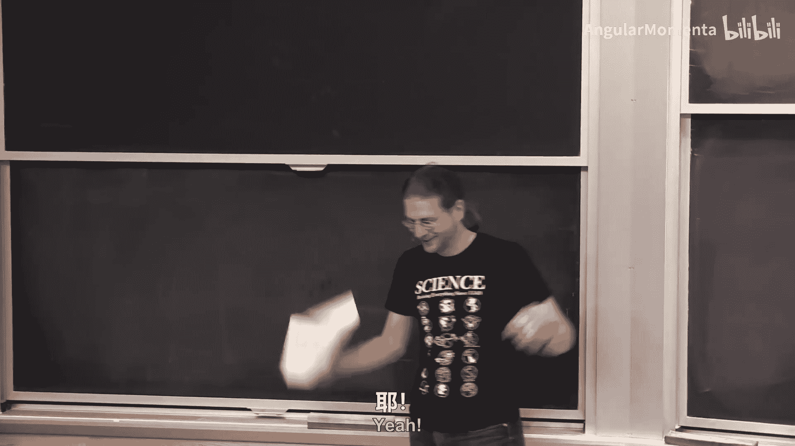
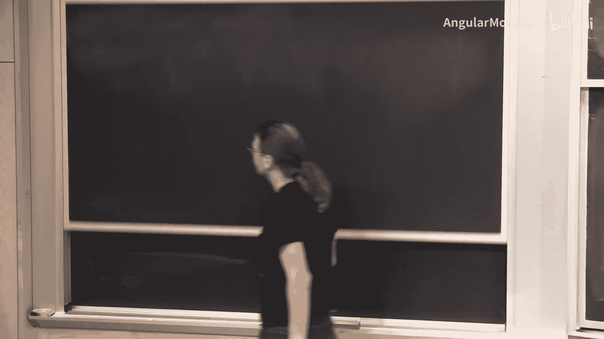
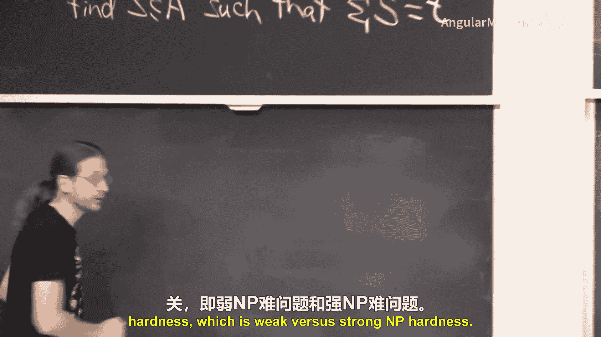
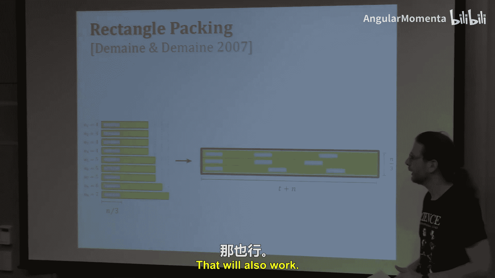
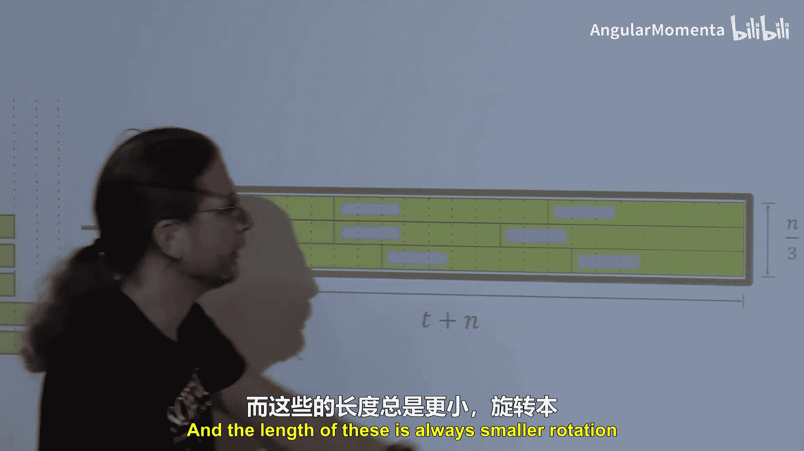
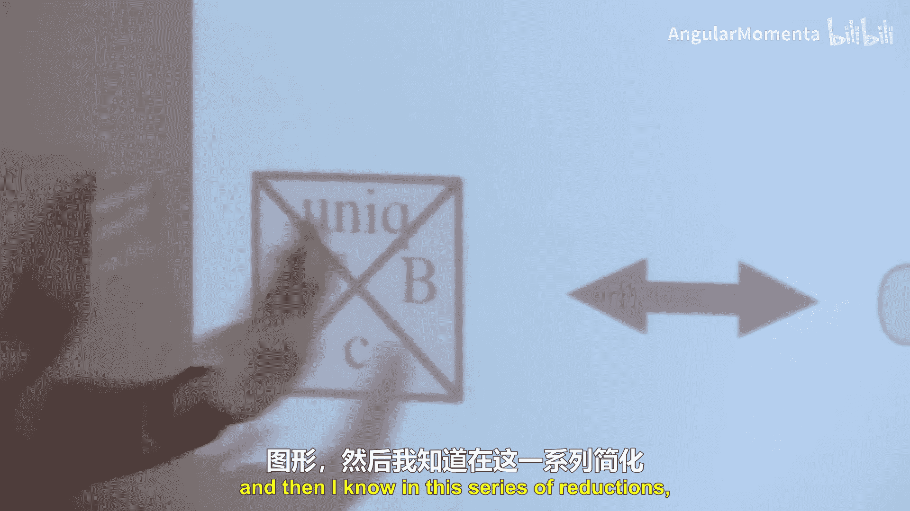
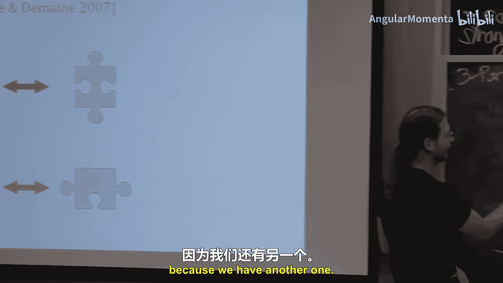
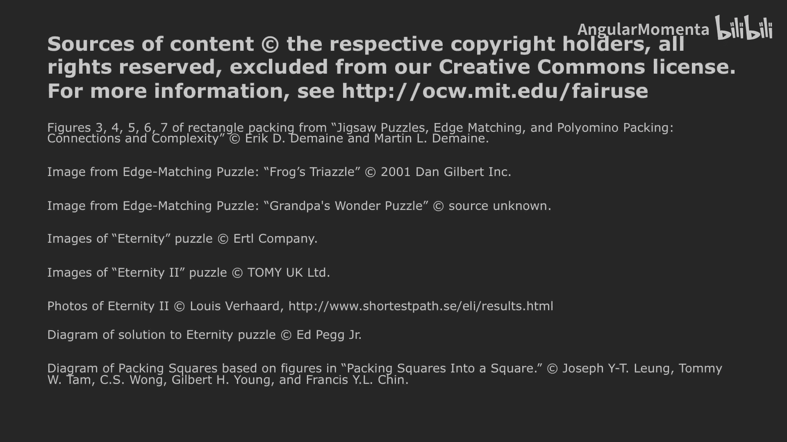

# 002：三分割问题 I

在本节课中，我们将学习一系列与数字相关的NP难问题，特别是三分割问题及其变体。我们将探讨弱NP难与强NP难之间的重要区别，并了解如何利用三分割问题来证明各种几何包装和拼图问题的计算复杂性。

## 三分割问题与相关概念

上一节我们介绍了课程背景，本节中我们来看看几个核心的数字分割问题。

### 两分割问题

首先，我们定义两分割问题。给定一个由整数组成的集合 **A**，其中包含 **n** 个整数 **a₁, a₂, ..., aₙ**。我们的目标是将这些整数分割成两个子集 **A₁** 和 **A₂**，使得两个子集中整数的和相等。即：

**sum(A₁) = sum(A₂) = (sum(A)) / 2**

这个问题是NP难的，并且是Karp在1972年提出的经典NP完全问题之一。

### 子集和问题

作为两分割问题的推广，子集和问题定义如下：给定一个整数集合 **A** 和一个目标值 **T**，目标是找到一个子集 **S ⊆ A**，使得 **sum(S) = T**。显然，两分割是子集和问题在 **T = sum(A)/2** 时的特例。

### 三分割问题

现在，我们进入本节课的核心——三分割问题。给定一个包含 **n** 个整数的集合 **A**（假设 **n** 能被3整除），目标是将其分割成 **n/3** 个三元组集合 **A₁, A₂, ..., Aₙ/₃**，使得每个三元组中整数的和都相等，记为目标和 **T**，其中 **T = sum(A) / (n/3)**。

三分割问题的一个关键特性是，在归约中，我们通常可以假设每个整数 **aᵢ** 严格介于 **T/4** 和 **T/2** 之间。这个假设保证了任何和为 **T** 的集合必须恰好包含三个元素，因为：
*   两个元素之和小于 **T**（因为每个都 < **T/2**）。
*   四个元素之和大于 **T**（因为每个都 > **T/4**）。

此外，我们可以通过给每个 **aᵢ** 加上一个极大的数 **M**（例如 **M = n¹⁰⁰ * max(A)**）来“标准化”实例。这样，所有数字都变得非常接近，其主导项相同，原始数字成为微小的“噪声”。这不会改变解的存在性，因为每个三元组都包含三个 **M**，总和为 **3M**。

### 数值三维匹配问题

这是一个与三分割密切相关的问题。给定三个整数多重集合 **A, B, C**，目标是找到 **n** 个三元组 **(a, b, c)**，其中 **a ∈ A, b ∈ B, c ∈ C**，每个元素恰好使用一次，并且每个三元组的和 **a + b + c** 都等于同一个目标值 **T**（**T = (sum(A)+sum(B)+sum(C)) / n**）。

我们可以将数值三维匹配归约到三分割。基本思想是将 **A, B, C** 中的数字合并成一个集合 **A'**，但通过添加不同的巨大偏移量来强制每个三元组必须包含来自 **A, B, C** 的各一个元素。例如：
*   对于每个 **a ∈ A**，构造 **a' = a + M**
*   对于每个 **b ∈ B**，构造 **b' = b + 3M**
*   对于每个 **c ∈ C**，构造 **c' = c + 9M**
新的目标和 **T' = T + 13M**。由于 **M** 极大，任何和为 **T'** 的三元组必须包含一个 **M**、一个 **3M** 和一个 **9M** 的项，从而强制了“各选一个”的属性。

### 三维匹配问题

这是一个纯粹的组合问题。给定三个不相交且大小均为 **n** 的顶点集 **A, B, C**，以及一组超边（每个超边连接 **A, B, C** 中各一个顶点）。目标是找到 **n** 条不相交的超边，覆盖所有顶点。数值三维匹配是三维匹配的特例，其中超边仅存在于满足 **a + b + c = T** 的三元组 **(a, b, c)** 上。

## 弱NP难与强NP难

在处理包含数字输入的问题时，NP难度有两个重要的层次。

*   **弱NP难**：当允许输入数字以二进制编码，且其值可以达到指数级（例如 **2^(n^c)**）时，问题是NP难的。然而，可能存在**伪多项式时间算法**，即运行时间是输入数字**值**的多项式，而不是其编码长度（二进制位数）的多项式。
*   **强NP难**：即使限制输入数字的**值**本身以多项式为界（例如，不超过 **n^c**），问题仍然是NP难的。这意味着即使以一元制编码数字（编码长度等于数字值），问题依然是难的。因此，强NP难问题不存在伪多项式时间算法（除非 **P=NP**）。

关键区别在于：
*   **两分割**和**子集和**是**弱NP难**的，但它们存在伪多项式时间动态规划算法。
*   **三分割**、**数值三维匹配**、**三维匹配**都是**强NP难**的。

当我们证明涉及几何包装或拼图的问题时，通常需要将数字以一元形式表示（例如，用一定数量的小方块来代表一个数字的大小）。这就要求归约的起点必须是强NP难问题（如三分割），以确保即使在一元编码下，构造的实例规模也是多项式的。若从弱NP难问题（如两分割）归约，当输入数字指数大时，一元表示会导致实例规模指数爆炸，这不是一个有效的多项式时间归约。

## 从三分割出发的归约实例

上一节我们区分了NP难度的不同类型，本节中我们来看看如何利用三分割的强NP难性来证明其他问题的难度。

### 多处理器调度问题

给定 **n** 个作业，每个作业有处理时间（整数），以及 **P** 个相同的处理器。目标是判断是否存在一种调度方案，使得所有作业在时间 **T** 内完成。决策版本：是否所有作业能在时间 ≤ **T** 内完成？

*   从**两分割**归约：设 **P=2**，作业处理时间对应两分割的整数集，**T = sum(A)/2**。这证明了问题是弱NP难的。
*   从**三分割**归约：设 **P = n/3**，作业处理时间对应三分割的整数集，**T = sum(A) / (n/3)**。这证明了问题是强NP难的。

### 矩形包装问题

给定 **n** 个小矩形（宽度和高度为整数）和一个目标大矩形 **B**。判断是否可以将小矩形（允许90度旋转）不重叠地放入大矩形中。我们考虑**精确包装**变体，即不允许有空隙。

**归约思路（从三分割）**：
1.  对于三分割实例中的每个整数 **aᵢ**，创建一个小矩形，其宽度为 **aᵢ + n/3**，高度为 **1**。
2.  将目标矩形 **B** 设置为宽度为 **T + n**（因为每个三元组宽度贡献 **n**），高度为 **n/3**。

**原理**：由于我们给每个宽度加了 **n/3**，任何矩形的宽度都大于 **n/3**，而高度 **1** 小于 **n/3**。因此，如果尝试将矩形旋转90度，其高度将大于 **n/3**，无法放入目标矩形的高度内。这强制所有矩形必须保持原始方向。那么，精确包装就要求每一行必须恰好由三个矩形组成，且它们的原始宽度（**aᵢ**）之和为 **T**，这正是三分割的解。

### 边缘匹配拼图问题

给定 **n** 个正方形瓦片，每个瓦片四条边各有一种颜色。给定一个目标矩形（通常是正方形）。判断是否可以将所有瓦片不重叠地放入目标矩形中，使得相邻瓦片接触边的颜色相同。

**归约思路（从矩形包装）**：
1.  将矩形包装实例中的每个小矩形，用单行瓦片来表示。假设矩形宽为 **W**，高为 **1**，则用 **W** 个瓦片排成一行。
2.  用特殊的“框架”瓦片包围整个区域，框架外侧使用全局唯一的颜色，确保它们必须位于边界。
3.  在表示同一矩形的瓦片之间，使用该矩形独有的内部颜色进行匹配，强制它们必须连接在一起形成该矩形。
4.  在矩形的上下边缘使用统一的颜色（如`%`），左右边缘使用另一种统一的颜色（如`$`），以模拟矩形的边界。

这样，解决边缘匹配拼图就等价于解决矩形包装问题。由于矩形包装是强NP难的，且此归约中我们将数字 **aᵢ** 表示为一元形式的瓦片数量，因此边缘匹配拼图也是强NP难的。

### 有符号边缘匹配与拼图问题

在有符号边缘匹配中，每条边有一个“头”或“尾”的符号（如蜥蜴的头和尾），只有头尾相对的边才能匹配。我们可以将无符号边缘匹配归约到有符号边缘匹配：

*   将每个无符号瓦片替换为一个2x2的有符号瓦片组合，通过精心分配头尾符号，使得这2x2的组合在功能上等同于原来的无符号瓦片。
*   拼图问题可以看作是有符号边缘匹配的实体化，其中“头”对应凸起（榫头），“尾”对应凹槽（卯眼）。类似的归约可以证明拼图问题也是NP难的。

### 多联骨牌包装问题

多联骨牌是由多个单位正方形沿边连接形成的图形。多联骨牌包装问题要求将给定的一组多联骨牌放入目标形状中。

**归约思路（从拼图问题）**：
1.  将每个拼图块放大，并用一个 **log n × log n** 的正方形区域来表示。
2.  在该区域的边界上，根据原始拼图块边的类型（凸、凹或平边），用二进制编码刻出凹凸不平的“齿状”边界。
3.  两个多联骨牌能够严丝合缝地拼接，当且仅当它们对应的原始拼图块边是匹配的（凸对凹）。

这样，多联骨牌包装问题也被证明是NP难的。有趣的是，我们还可以将多联骨牌包装归约回边缘匹配问题，形成一个闭合的归约循环，表明这些拼图问题在计算复杂性上本质是等价的。

### 正方形包装问题

给定一组正方形和一个目标正方形，判断是否可以将所有小正方形不重叠地放入大正方形中（允许旋转）。我们通过精确包装来避免旋转的复杂性。

**归约思路（从三分割）**：
1.  对于每个整数 **aᵢ**，创建边长为 **B + aᵢ** 的正方形，其中 **B** 是一个远大于所有 **aᵢ** 的巨大整数。
2.  目标正方形的尺寸需要精心设计。一种方法是先构造一个 **3B + T** 高、**(n/3)*(B+T)** 宽的矩形区域，该区域可以被 **n/3** 组（每组三个）正方形恰好填满，当且仅当存在三分割。
3.  然后，使用一个“框架”基础设施将这个矩形区域嵌入到一个更大的正方形中。框架由几种固定尺寸的正方形（如 **X × X** 和 **(X+1) × (X+1)**）以特定方式排列构成，中间恰好留下所需矩形形状的空隙。通过缩放和填充额外的单位正方形，可以确保最终包装是精确的。

这个构造证明了即使所有正方形的边长都是多项式大小的，正方形包装问题也是强NP难的。

## 总结

本节课中我们一起学习了：
1.  **三分割问题**及其变体（两分割、子集和、数值三维匹配）的定义。
2.  **弱NP难**与**强NP难**的核心区别，以及为何在涉及一元表示的归约中必须使用强NP难问题（如三分割）作为起点。
3.  如何利用**三分割问题**证明一系列**包装问题**（矩形包装、正方形包装）和**拼图问题**（边缘匹配、有符号匹配、拼图、多联骨牌包装）是NP难的，甚至是强NP难的。

这些归约展示了三分割问题作为“工具”的威力，它将数字上的约束巧妙地转化为几何形状或组合匹配上的约束，从而奠定了许多实际问题计算复杂性的基础。下一节课我们将继续探索三分割在其他类型问题中的应用。