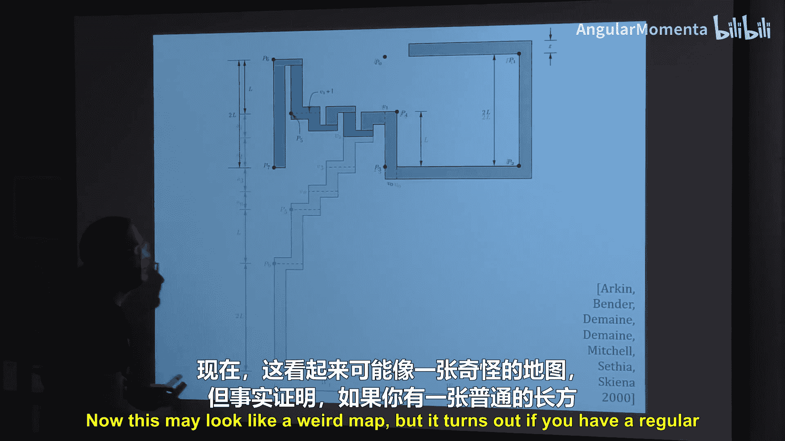
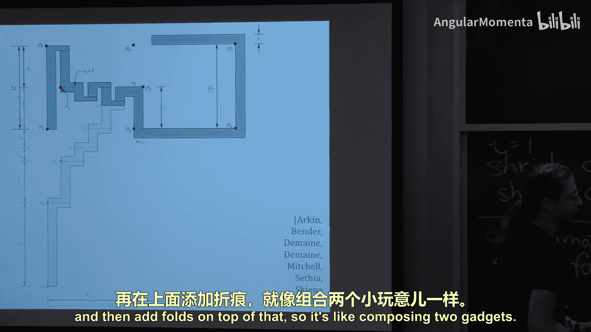
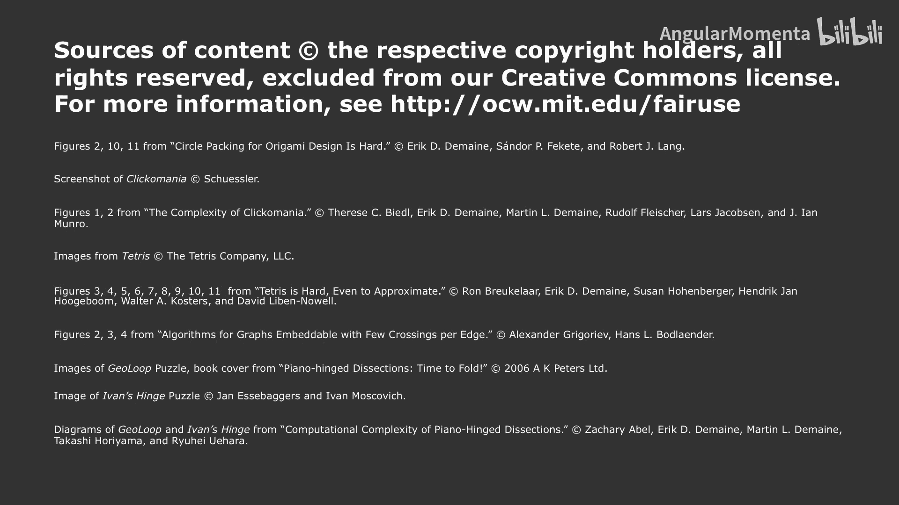

# 003：三分割 II

在本节课中，我们将继续探讨从三分割问题出发的归约，并学习一系列基于此的NP完全性证明。我们将涵盖几何折叠、益智游戏、图论等多个领域的问题，了解如何将数值表示问题转化为各种形式的约束。

上一节我们介绍了从三分割问题出发的几个归约。本节中，我们将看到更多基于三分割的归约，包括几何折叠、益智游戏和图论问题。

## 🧩 多面体边展开

**问题**：给定一个多面体，我们能否沿着其边切割，将其展开成一个单一的、无重叠的平面图形？这类似于从纸上剪出一个形状来制作立方体。

**核心概念**：对于拓扑上是球面的表面，我们需要沿着边的生成树进行切割。然而，对于某些多面体，无论选择哪棵生成树，展开后都会产生重叠。

**NP完全性证明思路**：该问题是强NP完全的。证明的核心思想是将“将正方形打包进正方形”的问题归约到此问题。
*   **基础设施**：构造一个包含“烟囱”结构的多面体，大部分区域可以塞入烟囱，但一些大的正方形面必须留在底部的一个方形区域内。
*   **连接机制**：使用称为“原子”的通用连接结构，这些原子可以自由地连接各个正方形面，无论是在原始多面体表面还是在展开后的平面布局中，从而模拟正方形打包的布局。
*   **归约**：如果能将正方形打包进一个正方形，就可以相应地安排多面体上的正方形面，并使用原子连接它们，从而得到一个可展开的多面体。反之亦然。

因此，判断一个多面体是否存在无重叠的边展开是强NP完全的。

## 🐍 蛇形立方体/库布拉谜题

**问题**：给定一个由小立方体通过弹性绳穿成的链，链由一系列“直段长度”和其间的90度转弯指定。目标是将这条链折叠成一个实心的大立方体。

**NP完全性证明思路**：该问题也是NP完全的。证明从三分割问题归约而来。
*   **数字表示**：每个数字 `A_i` 表示为一个长条结构（长度为 `A_i` 的许多小立方体），两端由长度为1的短条连接，形成一个不可分割的单元。
*   **目标形状**：构造一个目标形状，它有一个“中心枢纽”和多个向外延伸的“辐条”口袋。每个 `A_i` 单元必须完整地放入一个口袋中。
*   **通用连接器**：使用一种称为“锯齿形”的链段（全部由90度转弯构成，没有直段）作为通用连接器。可以证明，经过适当缩放（4x4x4细化）后，锯齿形链可以折叠成任何哈密顿路径形状（即访问每个小立方体一次且不交叉的路径）。
*   **构造**：链的构造是：`A_1` 单元，接着是一段锯齿形连接器，然后是 `A_2` 单元，再是一段锯齿形，如此交替。锯齿形连接器非常灵活，可以在三维空间中自由路由，连接各个 `A_i` 单元并填充剩余空间，从而允许 `A_i` 单元被自由分配到各个口袋中，模拟三分割。

因此，蛇形立方体谜题是NP完全的。

## ⭕ 圆盘装入正方形

**问题**：给定一组圆盘（指定半径）和一个正方形，能否将这些圆盘的圆心放置在正方形内，使得所有圆盘互不重叠？这个问题在计算折纸的“树形法”中很重要。

**NP完全性证明思路**：该问题是NP完全的。证明从三分割问题归约，首先考虑将圆盘装入等边三角形更容易。
*   **固定网格**：首先放置一组圆盘，强制它们排列成紧密的三角形网格，留下一些三角形的空隙。
*   **三分割单元**：对于每个三元组 `(A_i, A_j, A_k)`，构造一个由四个圆盘组成的单元：三个圆盘代表三个数字，一个中心圆盘。通过精细调整圆盘半径（与 `A_i` 值相关），可以证明中心圆盘有有效位置当且仅当 `A_i + A_j + A_k <= T`（经过缩放后 `T=1`）。
*   **处理正方形**：为了处理正方形目标，使用递归构造。在正方形的四个角放置大圆盘，中心放置一个大圆盘，再添加四个圆盘强制形成类似等边三角形的空隙区域，然后在这些空隙中递归地构建上述三分割单元。通过添加最大圆盘填满所有无用空隙，确保圆盘只能进入预设的“口袋”。
*   **归约**：每个口袋对应一个三分割的“桶”，每个三分割单元必须完整地放入一个口袋中，这模拟了三分割问题。

因此，判断圆盘能否装入正方形是NP完全的。

## 🎮 点击消除游戏

**问题**：在一个网格中，点击一个至少由两个同色方块组成的连通块，该块会被消除，上方方块会垂直落下，如果清空一列，则两侧的列会向中间移动。目标是消除所有方块。

**NP完全性证明思路**：对于两列、五种颜色的情况，该问题是NP完全的。证明从三分割问题归约。
*   **构造**：初始配置有两列。左列包含代表数字 `A_i` 的紫色条（高度为 `B * A_i`，`B` 是一个大系数），以及红、蓝、黑、白方块构成的固定结构。右列包含一系列红色方块，间隔为 `B * T`。
*   **游戏过程**：为了消除右列的红色方块，玩家需要点击左列的紫色条，使其下降，让左列的红色方块与右列的红色方块对齐。由于间隔是 `B * T`，要成功对齐，被点击的紫色条的总高度和必须是 `B * T`，这对应了三个 `A_i` 之和为 `T`。
*   **归约**：玩家必须将紫色条（代表 `A_i`）分组消除，使得每组总高度恰好为 `B * T`，才能逐步对齐并消除所有红色方块。之后，剩下的部分可以轻松消除。这模拟了三分割问题。

因此，点击消除游戏（两列五色）是NP完全的。

## 🧱 俄罗斯方块生存问题

**问题**：给定一个初始棋盘状态和一个已知的方块下落序列，玩家能否通过旋转和移动方块，在棋盘被填满至顶部前生存下来（或最大化消除行数）？

**NP完全性证明思路**：生存问题（以及分数最大化问题的近似性）是NP难的。证明从三分割问题归约。
*   **构造**：初始棋盘设置了一系列“桶”。方块序列编码了数字 `A_i`：每个 `A_i` 由模式 `[正方形，左拐L，正方形]` 重复 `A_i` 次来表示，最后以 `[正方形，直条]` 结束。
*   **游戏过程**：玩家必须将每个 `A_i` 对应的方块序列完整地放入一个“桶”中。由于方块的形状和顺序，试图将一个 `A_i` 拆分到多个桶中，或者放入未“初始化”的桶中，都会导致无法填满桶顶部的关键行，从而游戏失败。
*   **归约**：只有将 `A_i` 分成三组，每组之和恰好填满一个桶的特定高度，才能在最后使用一个T方块消除关键行，从而生存并处理后续大量方块获得高分。这模拟了三分割问题。

因此，俄罗斯方块的生存与分数最大化近似问题是NP难的。

## 📐 1-平面图

**问题**：给定一个图，能否在平面上绘制它，使得每条边最多只与另一条边交叉一次？这称为1-平面绘制。

**NP完全性证明思路**：判断一个图是否为1-平面图是NP完全的。证明从三分割问题归约。
*   **不可交叉边**：使用 `K_6`（6个顶点的完全图）作为“不可交叉边”的替代符号。在任何1-平面绘制中，`K_6` 内部的边已经产生了许多交叉，使得任何穿过其“内部”的路径都会导致某条边被交叉两次。
*   **双轮结构**：使用“双轮”图作为主要结构。数字 `A_i` 被表示为从外部顶点到内轮中心的多条长度为2的路径（度数代表 `A_i` 的值）。
*   **归约**：通过添加“不可交叉边”将外轮划分为多个区域，每个区域对应一个三分割的“桶”。每个 `A_i` 的路径组必须完全位于某个区域内，因为“不可交叉边”阻止了路径跨越区域而不违反1-平面性。这迫使 `A_i` 被分到不同的桶中，模拟三分割。

因此，1-平面图判定是NP完全的。

## 📏 可折叠木工尺

**问题**：给定一系列不同长度的刚性杆，通过铰链首尾相连，以及一个一维的盒子（指定长度）。能否将这把尺子折叠（某些铰链折成0度，某些保持180度）以完全放入盒中？

**NP完全性证明思路**：该问题是（弱）NP难的，存在伪多项式时间算法。证明从划分问题（两分割）归约。
*   **数字表示**：每个数字 `A_i` 对应一段长度为 `A_i` 的杆。
*   **折叠选择**：对于每个铰链，可以选择折叠（改变方向）或不折叠（保持方向）。这相当于选择让对应的 `A_i` 段贡献到总位移的左边或右边。
*   **构造**：在尺子开头添加一段极长的杆 `L` 和一段长为 `L/2` 的杆，结尾对称地添加 `L/2` 和 `L`。目标盒子长度为 `L`。
*   **归约**：只有当所有 `A_i` 段被分成和相等的两组（即划分问题有解）时，尺子的起点和终点才能在水平方向上对齐，从而使得加上头尾的长杆后，总长度恰好为 `L`，能够放入盒中。否则，尺子会过长。

因此，可折叠木工尺问题（一维打包）是NP难的。

## 🗺️ 地图折叠

**问题**：给定一个多边形“地图”和其上的一组折痕线，能否通过一系列“简单折叠”（每次沿一条折痕线折叠）将所有折痕线折叠起来？

**NP完全性证明思路**：该问题是NP难的。证明同样从划分问题归约。
*   **数字表示**：折痕线之间的水平距离代表数字 `A_i`。
*   **折叠选择**：是否折叠某条水平折痕线，决定了对应的 `A_i` 段是保持在原位还是被偏移。
*   **构造**：地图包含两条垂直折痕线。在折叠它们之前，需要先折叠一些水平折痕线来调整结构，使得垂直折叠后两部分能对齐而不碰撞。
*   **归约**：通过添加极长的垂直段和半长段，可以构造出这样的场景：只有当水平折痕线的折叠模式使得垂直方向对齐时（即对应的 `A_i` 被分成和相等的两组，解决划分问题），才能成功执行两次垂直折叠，进而完成所有折叠。否则，垂直折叠会导致碰撞。

因此，地图折叠问题是NP难的。一个开放问题是它是否是强NP难的。

---

本节课中我们一起学习了多个从三分割或划分问题出发的NP完全性归约，涵盖了多面体展开、蛇形立方体、圆盘打包、点击消除、俄罗斯方块、1-平面图绘制、木工尺折叠和地图折叠等问题。这些例子展示了如何将数值组合问题巧妙地嵌入到几何、游戏和图论的各种约束中，从而证明这些问题的计算难度。