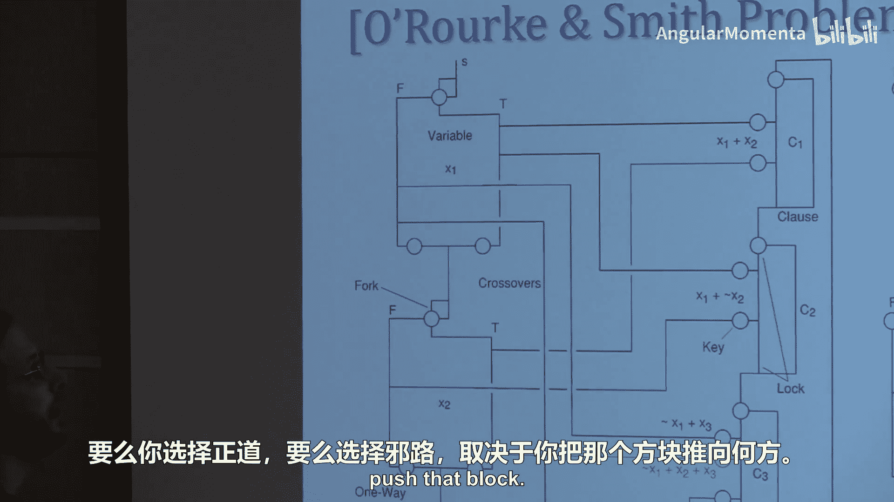
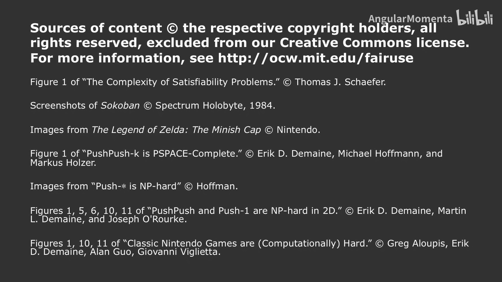

# 004：学术能力评估测试（SAT I） 🧠

在本节课中，我们将深入学习可满足性问题（SAT）及其众多变体。SAT是证明NP完全性时最常用的问题。我们将介绍SAT的各种形式，哪些是多项式时间可解的，哪些是NP难的，并学习如何利用SAT进行归约证明。

## SAT问题概述

原始的SAT问题定义如下：给定一个布尔公式，该公式由运算符 **与（∧）**、**或（∨）** 和 **非（¬）** 构成，作用于变量 `x1, x2, ..., xn` 上。问题是：是否存在一种对变量的赋值方式，使得整个公式的值为真（True）？

这是第一个被证明是NP完全的问题（Cook-Levin定理）。

## 电路可满足性问题（Circuit SAT）

另一种思考SAT的方式是电路可满足性问题。我们可以将公式视为一个有向无环电路（DAG），其中输入是变量（导线），中间节点是逻辑门（与门、或门、非门），输出是最终结果。

**电路SAT** 也是NP完全的。将任意计算表示为电路更为直观，而“是否存在一组输入使输出为真”的问题，本质上与NP验证是否存在一个“证书”使验证计算接受是等价的。

## 合取范式可满足性问题（CNF SAT）

合取范式（CNF）是SAT的一种特殊但极其重要的形式。在CNF中，公式是多个子句的合取（与），而每个子句是多个文字的析取（或）。

一个 **文字** 是一个变量或其否定，例如 `xi` 或 `¬xi`。
一个 **子句** 是多个文字的析取，例如 `(x1 ∨ ¬x2 ∨ x3)`。
整个 **CNF公式** 是多个子句的合取，例如 `(x1 ∨ ¬x2) ∧ (¬x1 ∨ x3)`。

CNF SAT本身也是NP完全的。我们可以将任意布尔公式在多项式时间内转换为CNF形式。

### 3-SAT问题

3-SAT是CNF SAT的一个更特殊的子问题，其中每个子句恰好包含三个文字（或至多三个）。这是证明NP难度时最常用的基准问题。

**公式示例**：`(x1 ∨ x2 ∨ ¬x3) ∧ (¬x1 ∨ x4 ∨ x5)`

### 3-SAT的受限变体（仍为NP难）

上一节我们介绍了基础的3-SAT，本节中我们来看看一些对3-SAT施加额外限制后，问题依然保持NP难度的变体。了解这些变体有助于我们在归约时选择最合适的起点。

以下是几个重要的NP难3-SAT变体：
*   **3-SAT-5**：每个变量（无论是其本身还是否定形式）在所有子句中出现的总次数不超过5次。
*   **单调3-SAT（Monotone 3-SAT）**：每个子句中的所有文字要么全是正变量（如 `x1 ∨ x2 ∨ x3`），要么全是负变量（如 `¬x1 ∨ ¬x2 ∨ ¬x3`）。注意，如果所有子句类型相同（全正或全负），则问题平凡可解（全赋真或全赋假即可）。但当公式混合了全正和全负子句时，问题是NP难的。
*   **恰一3-SAT（1-in-3 SAT / Exact 1-in-3 SAT）**：每个子句规定其三个变量中 **恰好有一个** 为真。通常我们考虑其“单调”版本，即子句中只出现正变量，形式为 `(x, y, z)`，要求 `(T, F, F)`、`(F, T, F)`、`(F, F, T)` 之一成立。
*   **非全相等3-SAT（Not-All-Equal 3-SAT）**：每个子句规定其三个变量 **不能全部取值相同**。即不允许 `(T, T, T)` 和 `(F, F, F)`，但允许 `(T, T, F)`、`(T, F, T)`、`(F, T, T)`、`(T, F, F)` 等。这等价于要求每个子句中恰有一或两个变量为真。它是对称的，没有真假值的偏向性。

## 多项式时间可解的SAT变体

并非所有SAT变体都是难的。了解哪些是容易的，可以避免在归约中误入“简单”的陷阱。

以下是几个多项式时间可解的SAT变体：
*   **2-SAT**：每个子句最多包含两个文字。可以通过构建蕴含图（Implication Graph）并检查强连通分量来解决。
*   **Horn SAT**：每个子句至多包含一个正文字（例如 `¬x ∨ ¬y ∨ z`，即 `(x ∧ y) → z`）。可通过单位传播算法高效求解。
*   **Dual-Horn SAT**：每个子句至多包含一个负文字。可通过将所有变量取反，转化为Horn SAT来求解。
*   **DNF SAT**：公式是析取范式（DNF），即多个项的析取，每个项是多个文字的合取。只需检查是否存在一个不含矛盾的项即可。

## Schaeffer二分法定理

面对如此多的SAT变体，是否存在一个统一的分类法则？Schaeffer二分法定理给出了答案。该定理针对一类广义的SAT问题：公式是多个“广义子句”的合取，每个子句是对其变量的一个任意布尔关系约束（例如，“恰一为真”或“非全相等”）。

定理指出，这类广义SAT问题要么是多项式时间可解的，要么是NP完全的，不存在中间情况。具体来说，多项式时间可解当且仅当所有子句关系满足以下至少一个条件：
1.  **全真/全假可满足**：将所有变量赋为真（或全赋为假）能自动满足所有子句。
2.  **Horn或Dual-Horn**：所有子句关系都可以表示为Horn子句或Dual-Horn子句。
3.  **2-CNF**：所有子句关系都可以表示为最多两个文字的析取（即2-SAT）。
4.  **线性方程组**：所有子句关系都可以表示为模2下的线性方程（即异或方程组），可用高斯消元法求解。

如果以上条件无一成立，那么该SAT问题就是NP难的。

## 应用归约示例：双色完美匹配问题

现在，让我们看一个利用上述SAT变体进行归约证明的具体例子。我们将把 **非全相等3-SAT（Not-All-Equal 3-SAT）** 归约到 **双色完美匹配（2-Colorable Perfect Matching）** 问题。

**问题定义**：给定一个3-正则图（每个顶点度为3），问能否将顶点染成红蓝两色，使得每个顶点都恰好有一个邻居与其同色？这等价于红色边和蓝色边各自构成图的一个完美匹配。

**归约思路**：
1.  **变量表示与复制**：我们需要一个“导线”来传递变量的颜色（真值）。构造一个复制器（Repeater）小工具，强制其两端的顶点颜色相同。
2.  **子句约束**：对于Not-All-Equal子句 `(x, y, z)`，构造一个小工具（例如一个K4子图，并指定其中三个顶点对应x, y, z），使得只有当x, y, z的颜色不全相同时，该小工具内部才能实现所需的双色完美匹配约束（每个顶点恰好有一个同色邻居）。
3.  **组合**：为每个变量创建复制器链，为每个子句创建上述子句小工具，并将变量对应的顶点连接到其出现的每个子句小工具上。如果原Not-All-Equal 3-SAT实例可满足，则能给出一个合法的染色方案（双色完美匹配）；反之亦然。

这个归约展示了如何将一个逻辑约束（非全相等）编码为一个图上的局部染色约束。

## 推箱子问题家族

SAT的归约技巧广泛应用于证明各类问题的难度，例如视频游戏中的推箱子问题家族。

**模型参数**：
*   **推力强度（Push-k）**：机器人一次最多能推动连续k个箱子。
*   **滑动（PushPush）**：箱子被推动后会一直滑行，直到撞到障碍物或其他箱子。
*   **固定块（F）**：存在不可移动的墙壁或固定块。
*   **非交叉路径（X）**：机器人路径不能重复经过同一格子。

**复杂度概览**：
*   几乎所有变体都是NP难的。
*   一些变体（如Sokoban，即Push-1-F）甚至是PSPACE完全的。
*   要求路径非交叉（X）的变体通常被限制在NP内，因为解路径长度是多项式级的。

**归约示例（Push-*）**：
Michael Hoffmann 在2000年给出了一个巧妙归约，将3-SAT归约到“推力无限且处于矩形围墙内”的推箱子问题（Push-*）。构造利用狭窄的通道和必须被推动的箱子来编码变量选择（推动箱子堵住“真”或“假”路径）和子句检查（只有当至少一个文字为“真”时，子句对应的通道才能被打开）。这证明了即使在没有固定块、推力无限的最简单推箱子模型中，规划问题也是NP难的。

**归约示例（Push-1 和 PushPush）**：
对于推力为1的模型，可以在3D空间中构造归约（避免交叉）。基本思想是：变量选择对应推动一个箱子堵住其中一条路径；子句检查对应一个“锁”机制，只有当至少一个满足该子句的变量路径被激活（即箱子没被推来堵路）时，机器人后期才能通过该子句对应的区域。为了在2D平面实现，需要设计复杂的“交叉小工具（Crossover Gadget）”来模拟导线交叉而不相互干扰，其设计与《超级马里奥兄弟》的硬度证明中使用的交叉小工具思路类似。

## 总结

本节课中我们一起学习了可满足性问题的核心内容。我们从最基础的SAT问题出发，深入探讨了其多种重要变体，包括NP难的3-SAT、恰一3-SAT、非全相等3-SAT，以及多项式时间可解的2-SAT、Horn SAT等。我们了解了Schaeffer二分法定理，它为一大类广义SAT问题提供了清晰的复杂度分类。最后，我们通过双色完美匹配和推箱子问题的归约实例，看到了如何灵活运用不同的SAT变体作为起点，来证明各种看似不相关的问题同样是NP难的。掌握这些SAT变体及其性质，是设计NP硬度归约的基石。在接下来的课程中，我们将看到更多利用SAT进行归约的精彩例子。