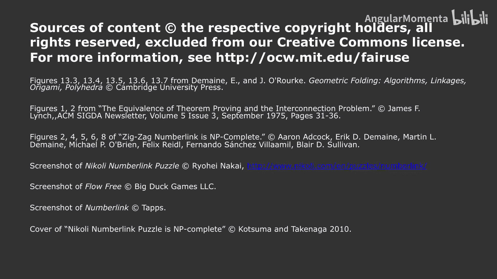

# 005：SAT简化与NP完全性证明

在本节课中，我们将学习如何从3SAT问题出发，证明一系列游戏、谜题和图论问题是NP难的。我们将看到如何将复杂的逻辑约束编码到各种看似简单的游戏机制中。

## 从3SAT到超级马里奥兄弟 🎮

上一节我们介绍了NP完全性证明的一般思路。本节中，我们来看看如何将3SAT问题归约到经典平台游戏《超级马里奥兄弟》。

证明的核心是构造三种“小工具”：
*   **变量小工具**：迫使玩家选择向左或向右，对应变量的**真**或**假**赋值。
*   **子句小工具**：包含一个无敌星，玩家只有在该子句中至少有一个文字为真（即至少有一颗星星被放置）时，才能安全通过火焰棒。
*   **交叉小工具**：确保不同路径的连线不会意外干扰。

整体构造是：玩家依次访问变量并做出选择，然后遍历所有子句。当且仅当对应的3SAT公式可满足时，玩家才能到达终点。

---

## 其他任天堂游戏的NP难度证明 🕹️

理解了超级马里奥兄弟的证明框架后，我们可以将其思路应用到其他游戏中。

以下是几个例子及其核心机制：

*   **超级马里奥世界**：使用“问号砖块”和“龟壳”机制。提前访问三个位置之一可以触发砖块，将硬币变为可站立平台，从而通过子句区域。
*   **塞尔达传说**：利用“钩锁”机制。变量选择通过钩锁跨越峡谷的方向来实现；子句满足则允许推动一个方块，从而创造钩锁目标。
*   **银河战士**：使用“射击”和“球形态滚动”机制。在设置变量时访问子句区域可以提前清除怪物，之后才能以球形态安全通过。
*   **大金刚国度**：使用“滚动攻击”和“发射桶”机制。变量选择是坠落方向；访问子句区域可以拾取桶并扔出以消灭蜜蜂，之后才能安全通过。
*   **宝可梦**：抽象为“训练家”机制。红色（弱）训练家被击败后会停住，成为障碍；蓝色（强）训练家无法击败。通过选择与训练家“对战”或“对话”来设置变量，并利用训练家的视野和移动来构造子句和交叉。

这些证明的关键在于，利用游戏自身的物理规则和限制，精确地模拟3SAT的逻辑约束，并防止玩家利用游戏漏洞（如穿墙）来“作弊”。

---

## 一次性获胜问题与填字游戏 🧩

接下来，我们转向一些不同类型的难题。

**哲学家足球**
这是一种在围棋棋盘上用棋子进行的双人游戏。我们考虑其简化版本：判断当前玩家能否在**一步之内**获胜。这个问题被证明是NP完全的。

归约思路是构造一个巨大的网格。变量赋值对应于在网格中向右跳跃或向下再向右跳跃的路径选择。子句区域包含三列，只有当至少一列对应的变量赋值为真（即该列路径未被提前破坏）时，玩家才能向上跳跃通过该子句。所有子句都通过后，玩家即可跳跃到底边获胜。

**密码算术**
这是一种经典的谜题，例如 SEND + MORE = MONEY，每个字母代表一个唯一数字。对于任意进制B的广义密码算术问题，它是强NP完全的。

证明通过构造复杂的算术等式系统来实现：
1.  首先建立基础，强制 `0=0` 和 `1=1`。
2.  构造变量小工具，使得 `V_i` 和 `V_i_bar` 的值模4后互为 `1` 和 `0`，代表真和假。
3.  构造子句小工具，使得三个变量之和模4必须为1、2或3（即至少一个为真）。
4.  利用模128的余数来区分所有字母，并通过精心选择高位数（利用类似Fusion Tree的思想）确保所有数字互不相同，且总和在多项式范围内。

---

## 折纸的平面折叠问题 📄

给定一个折痕图（平面上的直线段图），并指定每条折痕是“峰折”还是“谷折”，判断是否存在一种方式将纸张折叠成平坦状态（所有面共面且不穿透）。

这个问题是NP完全的，归约自“非全相等3SAT”。

证明使用以下小工具：
*   **导线**：一个简单的平行折痕组（褶折），其两种折叠方式代表真/假信号。
*   **分线/反相器**：一个局部折痕图，强制一个输入信号产生一个同相和一个反相的输出信号。
*   **交叉**：两组互不干扰的褶折，允许信号交叉。
*   **子句小工具（三角扭转）**：当三个输入信号不全相等时，可以局部平坦折叠；当三个信号全相等时，中心区域会产生无法解决的层叠循环约束。

通过将这些小工具以特定角度和方式连接，可以构造出等价于给定“非全相等3SAT”公式的折痕图。

---

## 顶点不相交路径与数字连线谜题 🔗

**顶点不相交路径问题**
给定一个图和若干顶点对 `(s1, t1), (s2, t2), ...`，判断是否存在连接每个顶点对的路径，且这些路径在顶点上互不相交。该问题在一般图上是NP完全的。

一个简单的归约来自3SAT：每个变量对应一条长路径，有两个选择（阻塞某些子句路径）；每个子句对应一条路径，只有当至少一个相关文字路径未被阻塞时才能通过。

**平面网格中的数字连线谜题**
这是上述问题的特例：在一个矩形网格中，有些格子是数字（成对出现），有些是空白。需要找到连接所有数字对的、在格点上不相交的路径，并且要求**路径覆盖所有格子**。这个问题也是NP完全的。

证明需要精心设计网格上的小工具：
*   **变量小工具**：用嵌套的“括号”结构实现二选一，并确保所有格子被覆盖。
*   **交叉小工具**：更复杂的“括号”排列，允许一条路径穿过另一条路径的“通道”，同时保持覆盖性。
*   **子句连接**：调整终端位置以解决**奇偶性**问题（在网格中，未被路径覆盖的区域面积必须为偶数）。

这个谜题历史悠久，可追溯到1897年Sam Lloyd的设计，现代以“Number Link”或“Flow Free”等游戏形式流行。

---

## 总结 📝

本节课我们一起学习了多种从3SAT问题出发的NP完全性证明。我们看到了如何将逻辑约束编码到：
1.  **电子游戏**的物理规则和角色能力中。
2.  **棋盘游戏**的一步获胜条件中。
3.  **算术谜题**的数字等式中。
4.  **折纸**的折叠约束中。
5.  **路径连接谜题**的网格几何中。

这些证明展示了NP完全性理论的强大与普适性，也体现了设计归约时需要兼顾创造性、严谨性以及对问题细节（如奇偶性）的深入把握。核心思想始终是：利用目标问题的本地约束，来模拟3SAT中变量赋值与子句满足之间的全局逻辑关系。