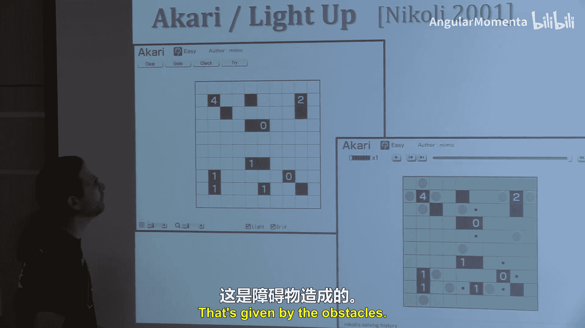
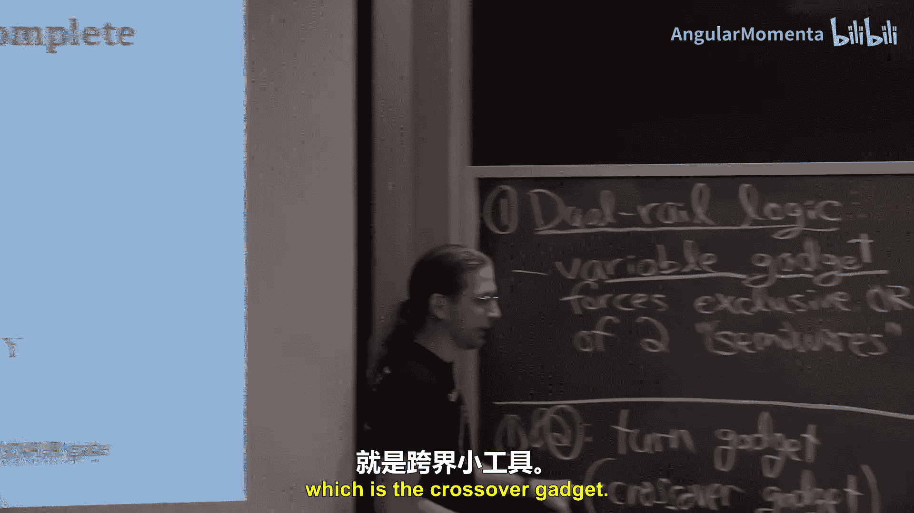

# 006：电路可满足性问题

在本节课中，我们将学习电路可满足性问题的证明方法，并通过几个具体的益智游戏（如《点亮》、《扫雷》和《糖果粉碎传奇》）的NP完全性证明，来深入理解如何构建从电路SAT到这些问题的归约。我们将重点关注构建逻辑门、导线和交叉结构所需的组件，并探讨平面电路SAT的复杂性。

## 概述

我们首先回顾两种主要的3SAT证明风格：双轨逻辑和二进制逻辑。接着，我们将通过几个具体的NP完全性证明，展示如何利用电路SAT的框架来构建归约。这些证明将涉及构建导线、逻辑门、分线器、交叉结构等基本组件。

## 两种3SAT证明风格

在深入具体问题之前，区分两种构建3SAT归约的基本方法是有益的。这两种方法正交于电路视角与逻辑视角。

**双轨逻辑**：在这种风格中，变量具有两个输出。一个输出在变量设为真时激活，另一个在变量设为假时激活。两者不应同时激活。这为真和假的情况提供了独立的“轨道”或线路。我们之前看到的任天堂游戏证明就属于这种风格。

**二进制逻辑**：在这种风格中，导线在所有情况下都处于激活状态，但它可以处于两种不同的状态之一：真或假。它在单根导线中同时表示了两种可能性。我们在讨论折纸可平折性时看到的证明就是这种风格的一个例子。

这两种风格的主要区别在于信息如何表示和传递。在双轨逻辑中，信息被“拆分”到两根半导线中；而在二进制逻辑中，所有信息都编码在一根导线中。

## 《点亮》游戏的NP完全性证明

《点亮》是一款网格益智游戏。目标是放置灯泡，使得整个棋盘被照亮，同时没有两个灯泡能互相看见（即在同一行或列中，中间没有障碍物），并且满足障碍物上的数字约束（表示其四邻中应有几个灯泡）。

### 构建基本组件

以下是构建从电路SAT到《点亮》归约所需的关键组件：

**导线组件**：基本导线由交替的空白格序列构成，通过数字“1”强制交替选择，从而表示真或假信号。

**转向组件**：一个90度转弯结构，允许导线改变方向。

**分线器/非门组件**：一个结构既能复制信号（分线器），又能产生信号的否定（非门）。通过巧妙地布置数字约束，可以强制输出包括一个原信号和一个反相信号。

**逻辑门组件**：我们构建了一个能同时计算OR和XNOR的门。结合已有的非门，我们可以构造NOR门。由于NAND和NOR门都是功能完备的，这足以模拟任何布尔电路。

**交叉组件**：利用XNOR门，我们可以构造一个交叉结构，允许两条导线交叉而不互相干扰。这在平面布局中至关重要。

### 整体构造与NP完全性

通过组合导线、转向器、分线器、非门、OR/XNOR门以及交叉结构，我们可以将任何布尔电路嵌入到《点亮》的棋盘布局中。我们在电路输出端放置一个特殊的约束（例如一个“0”），强制最终输出必须为真，从而使谜题有解当且仅当原布尔电路可满足。
由于可以在多项式时间内验证一个灯泡放置方案是否满足所有规则，因此《点亮》属于NP类。结合NP难度的归约，我们证明《点亮》是NP完全的。

## 《扫雷》的两种复杂性证明

《扫雷》存在两个自然的问题：一致性问题（给定部分雷区，是否存在满足所有数字提示的布雷方案？）和推理问题（给定部分雷区，能否唯一确定所有地雷的位置？）。

### 《扫雷》一致性（NP完全）

**导线组件**：利用数字“1”强制交替选择，表示真/假信号。

**分线器/非门/转向器**：一个结构同时实现信号分线、取反和转向功能。

**移位组件**：用于调整导线长度，解决模3对齐问题。

**与门组件**：一个更复杂的结构，计算两个输入信号的逻辑与。

**交叉与完备性**：利用NAND门可以构造交叉结构。由于我们已有与门和非门，可以构造NAND门。因此，拥有NAND门就自动解决了平面性问题，无需单独的交叉组件。我们可以构建任何布尔电路，并在输出端强制为真。

一致性问题是NP完全的：给定一个布雷方案，很容易验证它是否满足所有数字提示；同时，我们可以将电路SAT归约到该问题。

### 《扫雷》推理（Co-NP完全）

推理问题要求玩家能否从给定信息中推导出所有地雷的位置（即解是否唯一）。这对应于电路不可满足性问题：无论变量如何赋值，电路输出总为假。

**平衡构造**：在此归约中，所有组件被设计为无论信号真值如何，使用的地雷总数相同。这是必要的，因为《扫雷》实例会给出地雷总数，这个信息不应泄露额外线索。

**组件构建**：需要构建导线、转向器、移位器、非门、或门、分线器等，并确保它们都是“平衡”的。

**从Co-NP完全问题归约**：我们将一个电路不可满足性问题实例，转化为一个《扫雷》盘面。在该盘面中，能否推断出某个特定方格有雷，等价于原电路是否不可满足（即所有赋值下输出均为假）。因此，《扫雷》推理问题是Co-NP完全的。

## 《糖果粉碎传奇》的NP完全性证明

《糖果粉碎传奇》是一款匹配消除游戏。移动是交换相邻糖果，如果形成三个或以上同行/同列，它们会消除，上方糖果下落，并可能引发连锁反应。

### 第一个证明（基于移动次数限制）

此证明假设连锁反应按从下到上的顺序处理。

**变量组件**：通过一次交换，可以选择让中间列或右侧列下落三格。这代表了变量的真值赋值。

**连接组件**：根据变量在子句中是正出现还是负出现，选择不同的上方结构。当变量赋值满足该子句时，会触发一个紫色糖果下落。

**超级导线组件**：一种鲁棒的导线，无论下方变量组件导致哪一列下落，都能正确传递触发信号。

**子句组件**：来自不同变量的导线（或半导线）汇聚于此。如果至少有一个输入满足子句，就会触发一个连锁反应，导致上方一列下落，从而激活“奖励”组件获得分数。

**归约思路**：我们创建大量子句副本，使得通过设置变量来满足多个子句获得的分数，远高于直接操作单个导线所能获得的分数。由于玩家移动次数有限（仅够设置每个变量一次），最优策略就是寻找一个满足所有子句的变量赋值，即求解原3SAT问题。

### 第二个证明（基于最大化分数，无移动限制）

另一个证明将“精确一3SAT”归约到游戏的一个决策问题：能否通过一系列移动获得某个特定的糖果？构造了一个庞大的布局，包含序列器确保变量按顺序设置，以及子句组件要求恰好一个变量满足子句时才能触发后续反应。这个构造非常复杂，但作者甚至实现了可玩的版本。

## 功能完备性

在电路构造中，拥有一个功能完备的门集合至关重要。一些关键点：
*   **NAND和NOR**：它们是仅有的二元运算符中自身就功能完备的。
*   **其他组合**：例如，与门加上非门是功能完备的。蕴含加上常量假也是功能完备的。
*   **平面性**：对于平面电路SAT，如果所有门都是NAND或NOR，则可以避免显式的交叉组件，因为可以利用这些门本身来构造平面交叉结构。这是一个有力的结论，简化了许多平面问题的归约。

## 总结

本节课中，我们一起学习了电路可满足性问题在证明NP完全性中的应用。我们通过《点亮》、《扫雷》和《糖果粉碎传奇》的具体例子，深入探讨了如何构建导线、逻辑门、分线器、交叉结构等基本组件，从而将电路SAT归约到各种益智游戏。我们还区分了双轨逻辑和二进制逻辑两种证明风格，并了解了功能完备性在电路构造中的重要性。最后，我们看到了平面电路SAT的威力：只要拥有如NAND或NOR这样的功能完备门集合，就可以避免构建复杂的交叉结构，从而简化许多在平面环境中问题的归约证明。这些技巧为下一节课学习平面3SAT及其变体的复杂性奠定了基础。