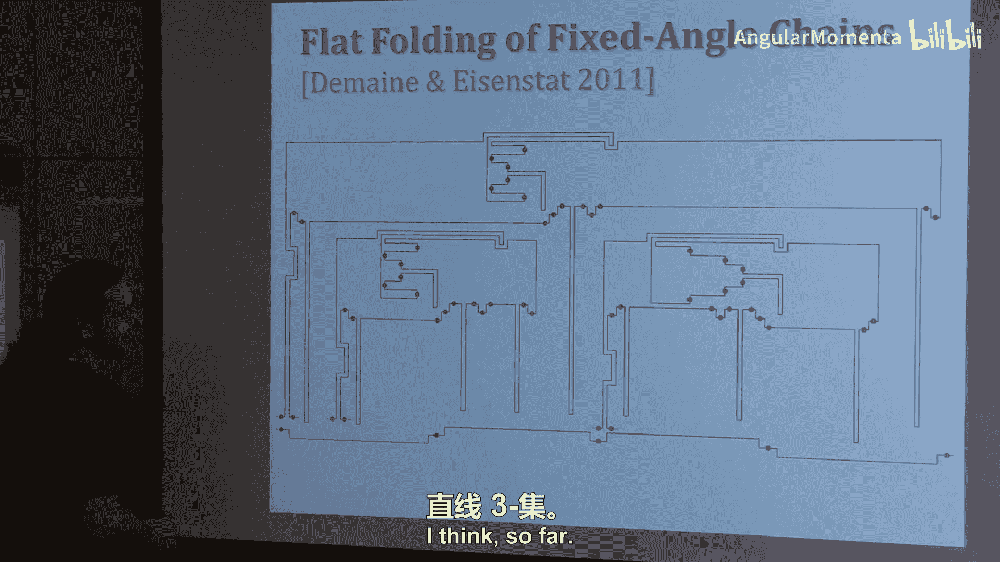
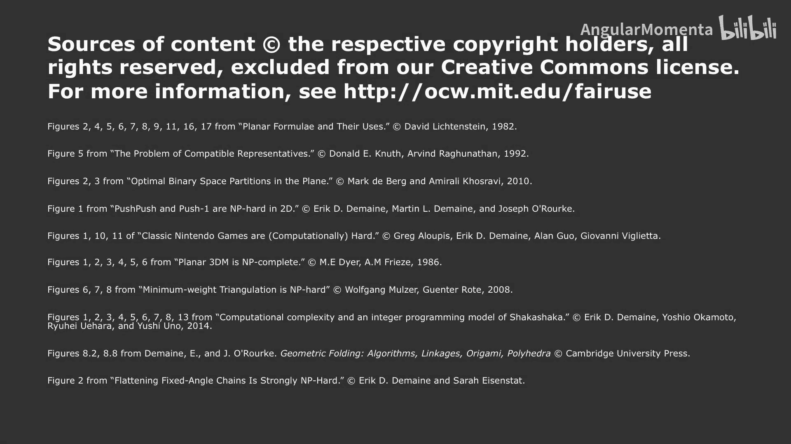

# 007：平面布尔可满足性问题

在本节课中，我们将学习平面3-SAT问题及其变体。我们将探讨如何将一般的3-SAT问题转化为平面版本，并了解这一转化在证明其他问题NP难时的重要性。课程内容将涵盖平面3-SAT的定义、其NP难性的证明，以及如何利用其平面性质简化对其他问题的归约。

## 平面3-SAT的定义与NP难性证明

平面3-SAT是3-SAT问题的一个特殊变体。在平面3-SAT中，我们不仅要求找到一组变量赋值以满足所有子句，还要求变量与子句之间的二分图是平面的。具体来说，我们为每个变量和每个子句创建一个顶点，并在变量顶点和包含该变量的子句顶点之间连边。如果该变量在子句中以否定形式出现，我们可以用颜色（如红色）标记该边。这个二分图必须是平面的，即可以在平面上绘制而没有任何边交叉。

上一节我们介绍了平面3-SAT的基本定义，本节中我们来看看如何证明它是NP难的。证明的核心思想是从一般的3-SAT问题归约到平面3-SAT。给定一个任意的3-SAT实例，其对应的变量-子句二分图可能不是平面的，会存在边交叉。我们需要构建一个“交叉 gadget”来模拟这些交叉，同时保持问题的可满足性等价。

以下是构建交叉 gadget的关键步骤：
1.  对于原始图中每条交叉的边，我们用一个局部结构替换它。
2.  这个局部结构引入了一些辅助变量（如图中的α, β, γ, δ）。
3.  通过精心设计子句，确保辅助变量能正确传递原始变量的真值信息，并消除交叉。
4.  最终，我们得到一个平面二分图，其可满足性当且仅当原始3-SAT实例可满足。

这个证明由Lichtenstein在1982年提出，它展示了如何在平面图中模拟交叉，从而确立了平面3-SAT的NP难性。

## 增强的平面性质：变量环

在证明了基本平面3-SAT的NP难性后，我们可以进一步要求更强的平面性质。一个非常有用的增强是要求所有变量可以连接成一个环，并且这个环与变量-子句二分图共同构成的图仍然是平面的。

上一节我们看到了如何消除边交叉，本节中我们来看看如何构造这样的变量环。其思路是利用之前交叉gadget的变体。我们不仅用gadget处理边交叉，还在变量路径需要“转弯”或连接以形成环的地方插入gadget。通过像打印机扫描线一样来回遍历所有变量顶点，我们可以构造一条不交叉的路径，最终首尾相连形成环。因此，存在变量环的平面3-SAT问题也是NP难的。

这个性质非常有用，因为在许多归约中（例如涉及机器人移动或顺序访问变量的游戏），我们需要一条可以遍历所有变量而不引起交叉的路径。拥有这样一个现成的变量环简化了这些归约。

## 平面单调正交3-SAT

我们可以对平面3-SAT施加更多限制，得到一个结构更规整但仍然NP难的问题变体：平面单调正交3-SAT。

上一节我们讨论了变量环，本节中我们来看看这个更具结构性的变体。在这个变体中：
*   所有变量被表示为X轴上的一条线段。
*   所有子句被表示为另一条水平线段。
*   变量和子句之间通过垂直线段连接。
*   最关键的限制是**单调性**：所有位于X轴上方的子句必须完全由正文字组成（即所有变量都以非否定形式出现），所有位于X轴下方的子句必须完全由负文字组成（即所有变量都以否定形式出现）。

以下是证明平面单调正交3-SAT为NP难的简化思路：
1.  从一个平面正交3-SAT实例开始（它已经是平面的，且变量和子句按上述方式排列）。
2.  对于任何出现在“错误”侧的文字（例如，一个否定文字出现在X轴上方），我们使用一个简单的复制和取反gadget。
3.  这个gadget会复制变量，并强制原始变量与其副本取反后的值相反，从而将否定文字“移动”到正确的侧。
4.  通过处理所有这样的文字，我们最终得到一个所有上方子句全为正、下方子句全为负的实例。

这个变体之所以强大，是因为它的结构非常清晰（所有连接都是水平或垂直的），并且单调性分离，这使得它在归约到某些几何或网格问题时特别方便。

## 平面非全等3-SAT的多项式可解性

并非所有平面3-SAT的变体都是NP难的。一个重要的例外是平面非全等3-SAT。

上一节我们看到了NP难的变体，本节中我们来看一个多项式时间可解的变体。在非全等3-SAT中，每个子句要求其三个文字不全取相同的真值（即不允许全真或全假）。当对应的变量-子句二分图是平面时，这个问题可以在多项式时间内解决。

证明的关键是将其归约到**平面图的最大割问题**，而平面图的最大割是多项式时间可解的。归约方法如下：
*   **变量gadget**：用一个偶数长度的循环来表示一个变量及其否定。为了最大化割的边数，这个循环必须交替着色，这对应了变量真与其否定假必须取值相反。
*   **子句gadget**：每个非全等子句用一个三角形表示。当三角形三个顶点颜色不全相同时（即非全等条件满足），割中能包含特定数量的边。
*   通过设置适当的目标割规模，可以确保满足所有子句的非全等条件当且仅当存在一个达到该目标的割。

由于平面图最大割存在多项式时间算法，因此平面非全等3-SAT也是多项式时间可解的。这提醒我们，在利用平面性质时，需要仔细区分哪些约束组合会导致NP难，哪些不会。

## 从平面3-SAT出发的归约示例

平面3-SAT及其变体作为起点，可以用于证明许多其他平面问题的NP难性。以下是两个经典示例：

上一节我们区分了难易变体，本节中我们来看看如何利用难的变体去证明其他问题。

**1. 平面顶点覆盖**
顶点覆盖问题要求选择最少的顶点，使得图中每条边至少有一个端点被选中。其平面版本是NP难的，可以通过从平面3-SAT归约来证明。
*   **变量gadget**：用一个偶数环表示。在有限的预算下，最优覆盖必须是交替选择顶点，这对应了变量的真/假赋值。
*   **子句gadget**：用一个三角形表示。覆盖一个三角形至少需要两个顶点。如果与三角形相连的三个变量gadget都未提供覆盖（即对应变量赋值为假），则仅凭两个顶点无法覆盖三角形的所有边，从而导致矛盾。这强制了每个子句至少有一个文字为真。

**2. 平面有向哈密顿环**
哈密顿环问题要求找到一条访问每个顶点恰好一次的环。其平面有向图版本是NP难的。
*   **变量gadget**：用一条之字形路径表示，路径的方向选择对应变量的真值。路径上的顶点必须全部被访问，这强制了交替模式，从而产生多组一致的文字副本。
*   **子句gadget**：通过添加额外的边，使得哈密顿环只有当至少一个相关变量选择特定方向（即文字为真）时，才能访问子句顶点而不违反哈密顿性。
*   利用平面3-SAT中存在的变量环，可以将所有gadget连接成一个大的平面有向图，其存在哈密顿环当且仅当原3-SAT公式可满足。

这些例子表明，平面3-SAT提供了一个结构良好的基础问题，使得归约构造相对直观，无需再处理复杂的交叉结构。

## 总结

本节课中我们一起学习了平面布尔可满足性问题的多个方面。我们首先定义了平面3-SAT并证明了其NP难性，关键在于构造能模拟边交叉的gadget。接着，我们探讨了更强的平面性质，如存在变量环，这在实际归约中非常有用。然后，我们介绍了结构更规整的平面单调正交3-SAT，并说明了其NP难性。重要的是，我们也指出了例外情况：平面非全等3-SAT是多项式时间可解的。最后，我们通过平面顶点覆盖和平面有向哈密顿环的例子，展示了如何从平面3-SAT出发归约以证明其他平面问题的NP难性。掌握这些平面可满足性问题的变体及其性质，是设计NP难性证明特别是针对平面或几何问题时的有力工具。