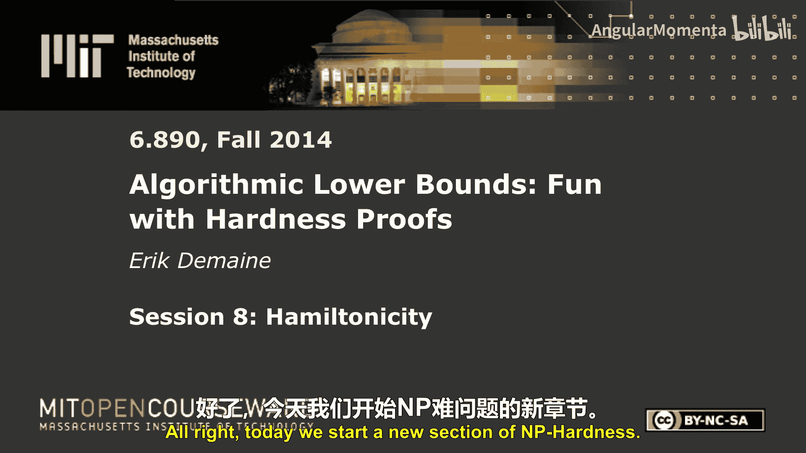
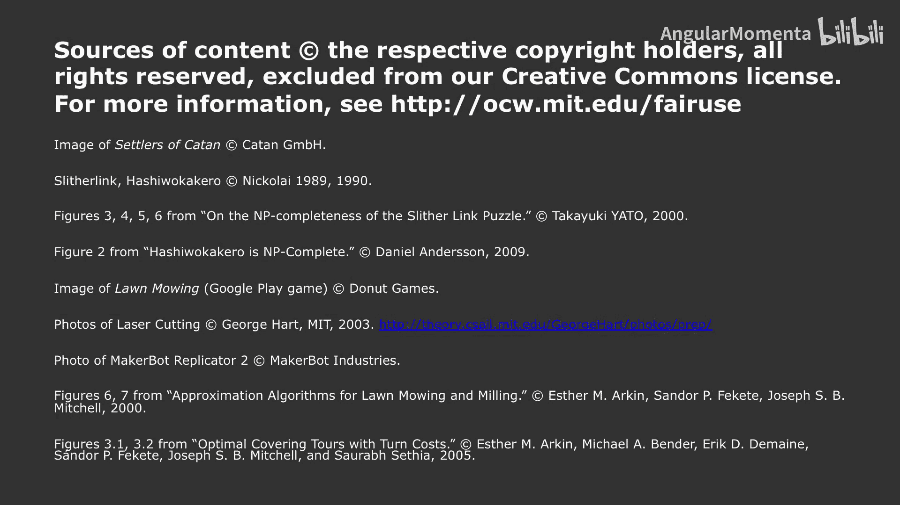

# 008：哈密尔顿性

在本节课中，我们将学习哈密尔顿性问题，包括哈密尔顿回路和哈密尔顿路径。我们将探讨这些问题的NP完全性，并展示如何通过一系列归约，将问题限制在越来越特殊的图类中（如平面图、二分图、网格图）来证明其难度。课程还将介绍这些理论结果在几何问题（如欧几里得旅行商问题）和游戏（如《卡坦岛》）中的应用。

## 哈密尔顿性问题概述

哈密尔顿回路是指访问图中每个顶点恰好一次的回路。哈密尔顿路径则是访问每个顶点恰好一次的路径。这两个问题在一般图中都是NP完全的。

哈密尔顿问题起源于威廉·哈密尔顿在1857年提出的一个游戏。该游戏在一个十二面体的对偶图（二十面体）上进行，目标是找到一个哈密尔顿回路。

## 从3SAT归约到平面有向最大度3图

上一节我们介绍了哈密尔顿问题的基本概念。本节中，我们来看看如何从经典的3SAT问题归约到哈密尔顿回路问题，并最终得到一个在**平面、有向、最大度3**的图中依然困难的结果。

核心思想是使用三种构件来模拟3SAT公式：
1.  **变量构件**：使用一个“异或”结构来确保一个布尔变量及其否定值的一致性。
    *   公式：对于变量 `x` 及其副本 `x'`，构件强制 `(x 为真) XOR (x' 为真)`。
2.  **子句构件**：确保在哈密尔顿回路中，至少有一个对应于子句中文字的连接被“激活”。
3.  **交叉构件**：由于我们需要平面图，当表示变量和子句的连线交叉时，需要此构件来保持平面性且不改变问题本质。

通过组合这些构件，我们可以将任何3SAT公式实例转化为一个平面、有向、最大度3的图，使得该图存在哈密尔顿回路当且仅当原3SAT公式可满足。

## 归约到平面二分最大度3图

上一节我们得到了平面有向最大度3图的哈密尔顿回路是NP难的。本节中，我们通过一个非常简单的归约，将其转化为**无向、平面、二分、最大度3**图的哈密尔顿回路问题。

归约的关键在于利用二分性来模拟有向性。在原图的有向边 `u -> v` 中，我们将其替换为一个由三个顶点构成的小路径。通过精心设置顶点颜色（二分图着色），我们可以强制哈密尔顿回路以特定方向遍历这条路径，从而模拟原有的有向边。

具体操作是：对于每个有向边，我们添加一个新顶点，将其拆分为两条边，并确保在二分着色下，哈密尔顿回路只能从 `u` 端进入，从 `v` 端离开，从而编码了方向信息。

## 归约到网格图

前面我们已将问题限制在平面二分最大度3图。本节中，我们进一步将其归约到**网格图**的哈密尔顿回路问题，这在计算几何中非常有用。

网格图由二维方格点阵的一个子集构成，两点间有边当且仅当它们是单位距离的邻居。

归约步骤如下：
1.  **网格嵌入**：将给定的平面二分最大度3图，以一种保持二分着色（奇偶性）的方式画在网格上。这可以通过标准正交网格绘图算法实现，并通过局部“扭动”调整顶点的颜色。
2.  **构件设计**：
    *   **边构件**：用一条2×n的“触手”走廊模拟原图的一条边。哈密尔顿回路有两种方式遍历它：之字形穿过（模拟使用该边）或直接走到尽头折返（模拟不使用该边，并顺带访问路径上的所有顶点）。
    *   **顶点构件**：用一个3×3的网格点块模拟原图的一个顶点。它有四个角点用于连接边构件。关键性质是：从任何一个角点进入，都可以访问完所有连接边构件的接入点后，从另一个指定的角点离开。
3.  **奇偶性匹配**：通过将边构件的连接区分为“全长连接”和“单点连接”，并与顶点构件的特定颜色（黑/白）配对，确保整个构造的奇偶性一致，从而保证归约的正确性。

最终，我们得到一个网格图，其存在哈密尔顿回路当且仅当原平面二分最大度3图存在哈密尔顿回路。特别地，如果网格图中没有“洞”（即所有面都是单位正方形或外部面），则称为**实心网格图**，该情况下的哈密尔顿回路问题存在多项式时间算法。我们的归约产生的是有洞的网格图，因此是NP难的。

## 应用：欧几里得旅行商问题与游戏

网格图哈密尔顿问题的硬度结果有直接而漂亮的应用。

**欧几里得旅行商问题**：给定平面上n个点，求访问所有点恰好一次的最短回路。其判定形式（是否存在长度 ≤ L 的回路）是NP难的。
*   **证明**：从网格图哈密尔顿回路问题归约。给定一个网格图，将它的所有顶点视为欧几里得TSP的输入点集。设定目标长度L等于顶点数n。在网格图中，相邻点距离为1，不相邻点距离至少为√2 > 1。因此，存在长度恰好为n的TSP回路，当且仅当该回路只遍历距离为1的边，即当且仅当原网格图存在哈密尔顿回路。

**平台游戏与《卡坦岛》**：
*   **平台游戏**：许多游戏（如《超级马里奥兄弟》）涉及在网格状场景中收集所有物品。通过将网格图顶点设为需要收集的硬币，并设置步数限制等于硬币数，可以证明判断能否在规定步数内收集全硬币是NP难的。
*   **《卡坦岛》中的“最长道路”**：在游戏《卡坦岛》中，玩家通过建造道路竞争“最长道路”奖励。我们可以将网格图建模为游戏版图，对手的建筑作为障碍物。那么，判断在当前局面下，能否通过建造道路获得一条超过对手长度的道路（即哈密尔顿路径），是NP难的问题。这甚至是一个“0步将死”问题——判断当前是否已经获胜也是NP难的。

## 扩展到其他网格与问题

网格图的硬度证明可以扩展到其他类型的网格和变种问题。

**最大度3网格图**：标准网格图顶点度最大为4。我们之前的归约产生了度数为4的顶点。通过修改边构件（转角处）和顶点构件（将3×3块替换为两个由路径连接的“哑铃”状结构），可以进一步证明**最大度3的网格图**上的哈密尔顿回路问题也是NP难的。

**三角形网格与六边形网格**：
*   **三角形网格**：类似的方法可以证明平面、最大度4或5的三角形网格图上的哈密尔顿回路是NP难的。
*   **六边形网格**：六边形网格天然最大度为3。证明其上的哈密尔顿回路是NP难的构造更为复杂，但同样可行。这直接证明了《卡坦岛》“最长道路”问题的计算难度。

**其他谜题与问题**：
*   **数回**：通过用数字约束模拟网格图的顶点和边，可以证明数回谜题是NP难的。
*   **造桥**：通过设置顶点度数要求来模拟哈密尔顿回路，可以证明该谜题是NP难的。
*   **割草/铣削问题**：在机器人路径规划中，“割草”问题（覆盖一个区域，允许走出区域）和“铣削”问题（必须严格在区域内移动）都可以归约到网格图哈密尔顿路径问题，从而证明是NP难的。
*   **最小转弯铣削**：在3D打印等应用中，有时最小化路径的转弯次数比最小化总长度更重要。通过将网格图顶点扩展为必须环绕的小方块，可以证明最小转弯数问题也是NP难的。

## 总结

本节课中我们一起学习了哈密尔顿性问题的丰富理论。我们从基本的哈密尔顿回路和路径出发，通过一系列精巧的归约，证明了即使在非常受限的图类中，如平面、二分、最大度3的图，乃至网格图及其变种（三角形、六边形网格）中，该问题仍然是NP完全的。这些硬度结果为理解众多计算几何问题（如欧几里得TSP、路径规划）和流行游戏/谜题（如《卡坦岛》、数回、造桥）的内在计算复杂性提供了坚实的基础。哈密尔顿问题作为一个强大的工具，常被用作证明其他问题难度的起点。