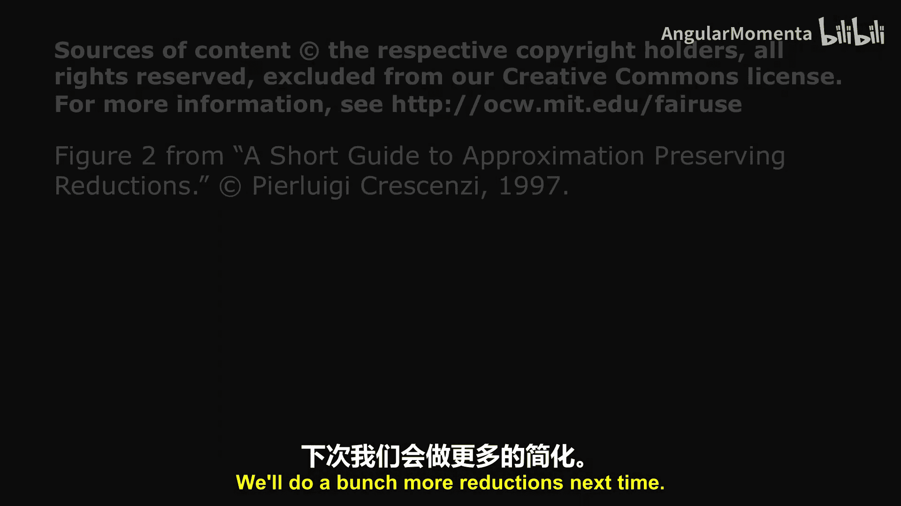

# 010：10. 不可逼近性概述

在本节课中，我们将学习近似算法的基础概念，包括优化问题的定义、近似比、以及用于证明近似难度（不可逼近性）的核心工具——近似保持归约。我们将重点理解如何区分“可任意接近最优解”的问题（PTAS）和“只能达到某个常数倍近似”的问题（APX），并介绍几种关键的归约类型。

## 优化问题与近似算法

上一节我们介绍了算法下界的一般概念。本节中，我们来看看当精确求解NP难问题不可行时，如何退而求其次，寻找近似解。

首先，我们需要将决策问题的框架扩展到优化问题。一个优化问题包含：
*   **实例集合**：所有可能的输入。
*   **可行解集合**：对于给定实例，所有允许的输出。
*   **成本函数**：为每个可行解分配一个非负的成本值。
*   **目标**：最小化或最大化成本。

一个**NP优化问题** 需要满足：实例和可行解都能在多项式时间内被识别，且成本函数是多项式时间可计算的。对于这类问题，可以定义其对应的决策版本（例如，对于最小化问题：“是否存在成本 ≤ k 的解？”），该决策问题属于NP。

由于精确求解NP优化问题通常是困难的，我们转向寻找**近似算法**。对于一个最小化问题，如果一个算法对任何实例 `x` 产生的解的成本满足 `cost(ALG(x)) / cost(OPT(x)) ≤ C`，则称该算法为 **C-近似算法**。这里 `C ≥ 1`。对于最大化问题，通常的定义是 `cost(OPT(x)) / cost(ALG(x)) ≤ C`（此时 `C ≥ 1`），或者等价地 `cost(ALG(x)) ≥ (1/C) * cost(OPT(x))`。

## 近似复杂度类

基于可达到的近似比，我们可以对NP优化问题进行分类：

*   **PTAS**：多项式时间近似方案。对于任意固定的 `ε > 0`，都存在一个 `(1+ε)`-近似算法（运行时间关于输入规模是多项式，但关于 `1/ε` 可以是任意函数）。
*   **APX**：存在某个常数 `C > 1`，使得问题有 `C`-近似算法。
*   **Log-APX**：存在 `O(log n)`-近似算法。
*   **Poly-APX**：存在 `n^ε`-近似算法（对于某个常数 `ε < 1`）。

显然，`PTAS ⊆ APX`。若 `P ≠ NP`，则该包含关系是严格的，即存在属于APX但不属于PTAS的问题。

## 近似保持归约与不可逼近性

为了证明一个问题是APX难（即不存在PTAS，除非P=NP），我们需要使用**近似保持归约**。这类归约比NP归约更强，它不仅要将一个问题的实例转化为另一个问题的实例，还要能将后者的解高效地转化回前者的解，并保证近似比不会恶化太多。

以下是几种重要的归约类型：

*   **PTAS归约**：如果问题B有PTAS，则通过该归约，问题A也有PTAS。这用于证明问题的PTAS不可存在性。
*   **AP归约**：近似比的变化是线性的。如果B有 `f(n)`-近似算法，则A有 `O(f(n))`-近似算法。
*   **L归约**：这是一种更易于使用的归约，它蕴含AP归约。一个从问题A到问题B的L归约包含两个多项式时间可计算的函数 `F` 和 `G`，并满足两个条件：
    1.  **最优值有界**：`OPT_B(F(x)) ≤ α * OPT_A(x)`，其中 `α` 是常数。
    2.  **误差有界**：对于 `F(x)` 的任何可行解 `y'`，其对应的A的解 `y = G(x, y')` 满足 `|cost_A(y) - OPT_A(x)| ≤ β * |cost_B(y') - OPT_B(F(x))|`，其中 `β` 是常数。

L归约非常强大，它甚至允许在最小化和最大化问题之间进行归约。

## 经典的APX完全问题

通过L归约，我们可以建立一系列APX完全问题（即APX中最难的问题）。以下是部分重要问题及其已知的最好近似结果：

*   **Max 3SAT**：给定一个3-CNF公式，最大化可满足的子句数。它有常数近似比，但没有PTAS。
*   **Max 3SAT(3)**：每个变量恰好出现3次的Max 3SAT。同样是APX完全的。证明中使用了**扩展图**来强制变量的多个副本取值相同，而不显著增加误差。
*   **独立集（度数有界）**：在最大度数为常数的图中寻找最大独立集。有常数近似算法，且是APX完全的。可以从Max 3SAT(3)规约得到。
*   **顶点覆盖（度数有界）**：在最大度数为常数的图中寻找最小顶点覆盖。有2-近似算法，且是APX完全的。可以通过与独立集的“互补”关系，从独立集问题L归约得到。
*   **支配集**：在图中寻找最小的支配集。在度数有界图中是APX完全的，可以从顶点覆盖问题规约。

## 总结

本节课中我们一起学习了近似算法理论的基础。我们定义了优化问题、近似比和各类近似复杂度类（PTAS， APX）。为了证明一个优化问题不存在PTAS（即具有不可逼近性），我们引入了近似保持归约的概念，特别是强大且实用的L归约。最后，我们看到了如何利用L归约，从诸如Max 3SAT这样的基础问题出发，证明一系列经典图优化问题是APX完全的，从而确定了它们近似能力的下界。这为我们理解哪些问题可以“几乎最优”地近似，哪些问题只能“大致”近似提供了理论基础。