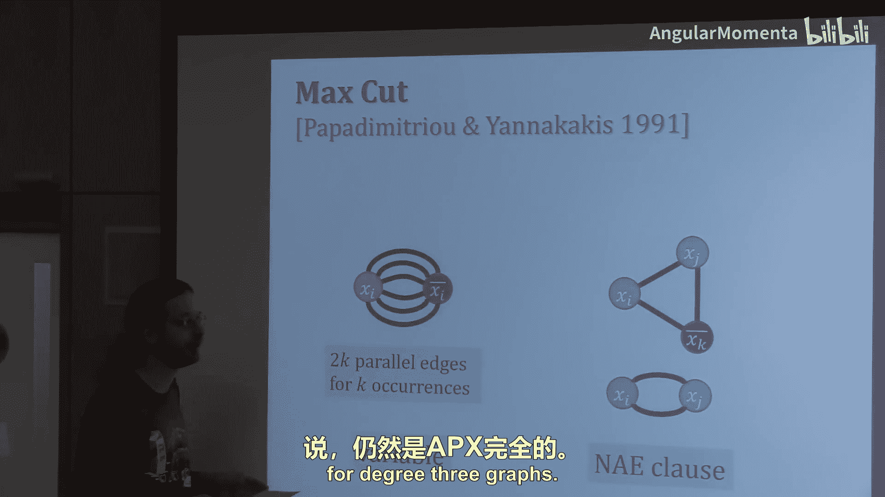
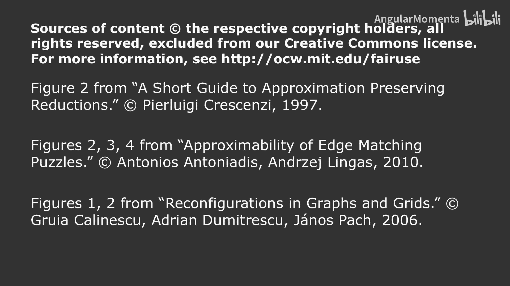

# 011：不可近似性示例

在本节课中，我们将继续探讨近似算法的下界，特别是通过L归约来证明问题的APX完全性。我们将回顾L归约的定义，并通过一系列具体的归约示例，展示如何将已知的APX完全问题（如Max 3SAT）归约到其他优化问题（如Max Cut、边匹配拼图等），从而证明这些问题的不可近似性。课程最后将简要介绍复杂度层次中高于APX的类别。

## L归约回顾

上一节我们介绍了多种归约，特别是PTAS归约、AP归约和L归约。本节我们将主要使用L归约。

L归约旨在将问题A归约到问题B。给定问题A的一个实例X，我们通过函数F将其转换为问题B的一个实例X'。然后，假设我们以某种方式获得了X'的一个解Y'（属于B的解空间）。在归约中，我们需要能够通过函数G将任何这样的解Y'映射回问题A的实例X的一个解Y。

这需要满足两个条件：
1.  对于F，X'的最优解值最多是X的最优解值的某个常数倍。即，我们不会过度放大最优解的值。
    *公式：OPT_B(X') ≤ α * OPT_A(X)*
2.  Y的成本与X的最优解之间的绝对差值，应在Y'的成本与X'的最优解之间的绝对差值的某个常数倍之内。这意味着，如果我们得到一个非常接近X'最优的解Y'，那么我们产生的解Y也将非常接近X的最优解。我们希望在**加法意义**上保持这种关系。
    *公式：|cost_A(Y) - OPT_A(X)| ≤ β * |cost_B(Y') - OPT_B(X')|*

这种加法意义上的保持将意味着在乘法意义上也是良好的。我们上次证明了对于最小化问题，如果你在B这边有一个常数因子近似，你将在A这边保留一个常数因子近似，并且只会损失一个合理的因子。同样，如果你能在B这边得到一个PTAS（任意好的近似），你在A这边也能得到一个PTAS。

需要注意的是，对于最大化问题，L归约并不完全意味着AP归约，因为存在非线性项。但对于最小化问题，L归约确实意味着AP归约。

## 从独立集到Max 2SAT

我们之前证明了Max E3SAT-5（每个子句恰好3个不同文字，每个变量恰好出现5次）是APX完全的。基于Max 3SAT是APX完全的假设，我们将其归约到了Max 3SAT-3（每个变量最多出现3次），然后又归约到了有界度图中的独立集、顶点覆盖和支配集等问题。

现在，让我们进行更多的APX归约。下一个问题是Max 2SAT。在优化世界中，2SAT和3SAT的区别并不那么重要，事实证明Max 2SAT也将是APX完全的。

我们将从**度数为3的图中的独立集**问题出发，进行一个L归约到Max 2SAT。

归约方法如下：
*   对于每个顶点V，我们创建一个子句：`V`。这表示我们希望尽可能地将V放入独立集中。
*   对于每条连接V和W的边，我们创建一个子句：`¬V ∨ ¬W`。这表示我们不希望V和W同时出现在独立集中。

这样，我们就模拟了独立集。给定变量赋值（每个变量对应一个顶点是否在独立集中），我们可以声称存在一个最优解满足所有的边约束子句。因为违反一条边约束（即V和W同时为真）只会让你从顶点子句`V`或`W`中获得一点好处，但却可能因为违反多条边约束而损失更多。因此，总可以转换为一个满足所有边约束且不损失最优性的解。此时，解就对应了一个合法的独立集。

于是，Max 2SAT实例的最优解值等于独立集实例的最优解值加上总边数。由于我们假设图是有界度的，边数是顶点数的线性倍，因此独立集的最优解值也是顶点数的线性倍（Ω(n)）。这样，添加的边数不会使OPT过度放大，满足L归约的第一个条件。第二个条件中，常数β为1。因此，Max 2SAT是APX难的。

有趣的是，Max E2SAT-3（每个变量恰好出现3次）也是APX完全的。

## 从Max 2SAT到Not-All-Equal 3SAT

接下来，我们归约到Not-All-Equal 3SAT (NAE-3SAT)。我们将从刚证明为APX完全的Max 2SAT出发，进行一个**严格归约**（比L归约更强）。

归约非常简单。假设我们从Max 2SAT开始，所有子句形如`X ∨ Y`（文字可能被否定）。我们将其转换为NAE-3SAT子句：`NAE(X, Y, A)`，其中A是一个在每个子句中都出现的新变量。

Not-All-Equal具有很好的对称性。通过可能的全局位翻转，我们可以假设A = 0。一旦A=0，`NAE(X, Y, 0)`就意味着X和Y不能同时为0，这等价于`X ∨ Y`。因此，最优解值得以保留。任何解都可以先通过翻转使得A=0，然后直接提取X和Y的赋值，解的大小和最优解都完全保持不变。这是一个严格归约，因此NAE-3SAT也是APX完全的。

## 从NAE-3SAT到Max Cut

下一个问题是Max Cut（最大割）。给定一个图，希望将其划分为两部分，以最大化两部分之间的边数。这等价于Max Positive 1-in-2SAT，或者Max 2-XOR-SAT。

我们将从Max NAE-3SAT进行归约。这个归约的核心是，可以用一个三角形上的割来表示一个NAE-3SAT子句。在三角形中，如果三个顶点颜色全部相同，则没有割边；如果颜色不全相同，则恰好有两条割边。对于二元子句，可以用一个二边形（一条边）类似表示。

我们还需要处理变量的否定。我们为每个变量及其否定形式构建一个变量 gadget：用许多平行边连接`X`和`¬X`。如果变量出现k次，我们就用2k条平行边。在最优解中，我们可以论证`X`和`¬X`必然在割的不同侧，因为如果它们在同侧，你会损失这2k条边的收益，而翻转其中一个最多只会影响k个子句（每个最多损失2点），净收益非负。因此，可以假设变量 gadget 被正确设置，从而整个问题归约到了NAE-3SAT。

这个归约得到的图也是有界度的（基于变量出现次数，可以限制为3）。因此，Max Cut在度数为3的图上也是APX完全的。

这一系列归约展示了我们熟悉的许多NP完全问题，在前面加上“Max”优化后，都变成了APX完全问题（对于有界度图，它们都有常数因子近似，但没有PTAS）。

## CSP问题的近似性分类定理

在可满足性（SAT）领域，有Schaefer二分定理，它描述了哪些类型的子句集合使得SAT问题是多项式时间可解的。

对于优化版本（约束满足问题，CSP），存在一个类似的、但更复杂的分类定理，它详尽地描述了对于不同类型的子句函数族，其对应的最大化/最小化约束满足或最大化/最小化真变量数问题的近似复杂度。定理将问题分为四类：Max CSP、Min CSP、Max Ones、Min Ones。对于每一类，都给出了多项式时间可解、APX完全、Poly-APX完全（近似因子为n^(1-ε)）或不可行（找到可行解即NP难）的完整条件。这个定理非常强大，如果你遇到任何类似CSP的问题，可以查阅此定理进行分类。

## 从Max 3DM到边匹配拼图

现在，让我们通过归约，接触到我们在早期课程中见过的“边匹配拼图”问题。我们有方形瓦片，边上有颜色，目标是最大化满足的边匹配约束数量（相邻边颜色相同）。

首先，我们需要另一个APX完全问题作为起点：**三正则三边可着色图中的最大独立集**。我们可以将其等价于一个三维匹配（3DM）的变体：**Max 3DM-2**，即选择尽可能多的三元组，使得它们在A、B、C三个坐标上都不重复，且每个元素恰好出现在两个三元组中。

归约思路是：用三种边颜色代表A、B、C集合，图的每个顶点（关联三种颜色的边各一条）对应一个三元组。选择顶点（三元组）构成独立集，等价于选择的三元组集合没有共享元素。

接下来，我们从Max 3DM-2归约到**边匹配拼图**。构造的核心思想是：每个三元组用一组特定的瓦片表示，这些瓦片在拼图的底行强制形成特定的颜色序列。如果你选择该三元组，可以在顶行放置一组“完美匹配”的瓦片，获得满分。如果未选择该三元组，则必须使用一些“填充”瓦片，这些瓦片会产生一个固定的不匹配惩罚。通过精心设计瓦片集合，使得总得分等于一个基础分减去未选择的三元组数量。因此，最大化拼图得分等价于最大化选中的三元组数量，这是一个L归约。

## 高于APX的复杂度层次

我们主要关注了没有PTAS但有常数因子近似的APX完全问题。需要指出，存在一些常数因子可近似、没有PTAS、但又不是APX完全的问题，称为APX中间问题。例如装箱问题、最小最大度生成树、最小边着色等。

对于对数因子近似，最经典的问题是**集合覆盖**和**支配集**，它们可以互相L归约，并且已知具有Θ(log n)的近似上界和下界，是“log-APX”完全问题的代表。许多问题的不可近似性可以归约为集合覆盖的难度。

在更高的层次上：
*   **Poly-APX完全**：近似因子为n^(1-ε)。代表问题是**最大团**和**最大独立集**。
*   **Exp-APX完全**：近似因子需要达到指数级。代表问题是**非度量旅行商问题**（TSP），其中边权可以是指数级大。
*   **NPO PB完全**：问题中数字是多项式有界的，但优化本身极其困难，例如在布尔公式中最大化真变量权重（权重多项式有界）。
*   **NPO完全**：最困难的类别，包含所有NP优化问题中近似性最难的一类，例如最小独立支配集、最长诱导路径等。

这些分类给出了不同难度级别的标准问题，用于证明新问题的近似难度下界。

## 总结

本节课我们一起学习了如何使用L归约来证明优化问题的APX完全性。我们从Max 2SAT出发，通过一系列归约证明了Not-All-Equal 3SAT、Max Cut等问题的APX难度，并了解了如何将Max 3DM归约到边匹配拼图问题。最后，我们概览了高于APX的复杂度层次，包括对数近似、多项式近似、指数近似以及更难的NPO完全类别的代表性问题。这些归约技术和复杂度分类为我们理解优化问题的内在计算难度提供了强大的工具。下一节课，我们将探讨另一种证明不可近似性的方法：间隙保持归约。