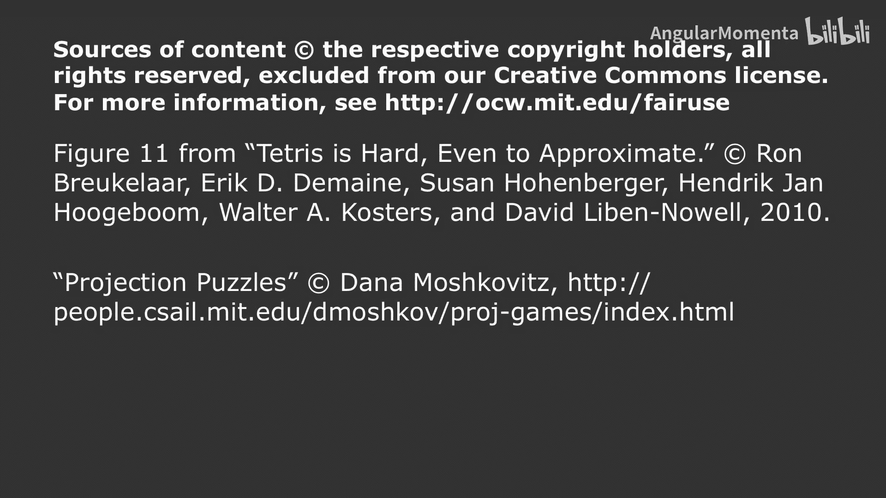

# 012：差距与PCP

在本节课中，我们将学习一种证明优化问题不可近似性的不同方法，称为“差距问题”。我们将探讨差距保持归约，并在此过程中证明最大3SAT问题的最优下界以及其他有趣的结果。

## 差距问题概述

上一节我们介绍了近似算法和不可近似性的概念。本节中，我们来看看一种将优化问题转化为决策问题的新方法：差距问题。

差距问题是一种将优化问题转化为决策问题的方式。我们已知一种方法：对于一个NPO优化问题，可以将其转化为一个明显的决策问题（例如，对于最小化问题，判断最优值是否至多为K），这通常是NP完全的。但从可近似性的角度来看，我们希望得到更有用的结果。

其核心思想是定义一个不同的问题：我们不是简单地判断最优值是否至多为K，而是要**区分**以下两种情况：
*   最优值至多为K。
*   最优值至少为C × K（对于某个值C）。

这里的类比对象是C-近似算法。C不一定必须是常数，它可以是n的函数（例如log n， n^ε）。对于最小化问题，这里存在一个介于K和C×K之间的“差距”。关键在于，我们被“承诺”输入实例必定属于这两种类别之一。我们需要判断它属于哪一类。我们称前一种为“是”实例，后一种为“否”实例。

如果某个问题的C-差距版本是NP难的，那么对该问题进行C-近似也是NP难的。这让我们可以通过思考决策问题的NP难性来证明不可近似性结果，这在概念上更简洁。

## PCP定理简介

接下来，我们介绍一个与差距问题直接相关的重要概念：PCP定理。

PCP代表“概率可检查证明”。这涉及到另一个复杂性类别，通常写作PCP[O(log n), O(1)]，我们简称为PCP。在PCP中，问题的“是”实例拥有多项式长度的证书（就像NP一样），但存在一个验证算法，它仅使用O(log n)的随机位和**常数**运行时间，就能以高概率检查证书的正确性。

具体来说：
*   对于“是”实例和正确的证书，算法总是接受（无错误）。
*   对于“否”实例，无论提供什么证书，算法以至少某个**常数**概率拒绝。

PCP定理指出：**NP = PCP**。这意味着所有NP问题都存在这样的高效概率验证算法。我们不会证明这个定理，但会看到它如何直接导致差距问题的NP难性。

## 从PCP到差距硬度

PCP定理与差距问题紧密相连。首先，考虑最大3SAT的差距版本：区分“所有子句可满足”（最优值=1）和“最多有常数比例A的子句可满足”（最优值≤ A）的实例。我们声称这个问题在PCP类中。

验证算法可以这样设计：证书是一个变量赋值。算法随机选择一个子句（使用O(log n)随机位），检查该子句在证书下是否满足（常数时间）。如果实例完全可满足，算法总是接受；如果最多只有比例A的子句可满足，则算法拒绝的概率至少为(1-A)。因此，该差距问题属于PCP。

更重要的是其逆命题：如果（普通的）3SAT在PCP中（根据NP=PCP，这是真的），那么其差距版本就是NP难的。论证如下：
1.  利用3SAT的PCP算法，该算法在常数时间内运行。
2.  该算法可以表示为一系列（由随机位选择的）常数大小的逻辑公式。
3.  由于只有O(log n)随机位，可能的随机选择是多项式多个。
4.  我们构造一个新公式：它是所有可能随机选择对应的公式的**合取**。
5.  如果原3SAT公式可满足，则新公式100%可满足（是实例）。
6.  如果原公式不可满足，根据PCP定义，至少有一个常数比例的随机选择会导致验证失败，这意味着新公式中至少有一个常数比例的子句是不可满足的（否实例）。

这样，我们就将普通的3SAT归约到了其差距版本，从而证明了差距版本的NP难性。这本质上是一个“差距产生”归约，它从无差距的问题产生了常数差距。

## 差距保持归约与最大E3SAT的紧下界

一旦我们有了差距硬度结果，就可以通过“差距保持归约”将其传播到其他问题，从而获得更强的不可近似性下界。

考虑从“最大E3线性方程”问题（每个方程形如 `x_i XOR x_j XOR x_k = 0/1`，恰有三个变量）到“最大E3SAT”问题（每个子句恰有三个文字）的归约。已知前者具有 (1/2+ε, 1-ε) 的差距NP难性（即区分“至少(1-ε)比例方程可满足”和“至多(1/2+ε)比例方程可满足”是NP难的）。

以下是归约方法：将每个线性方程替换为4个特定的3SAT子句。分析表明：
*   如果方程可满足，则对应的4个子句全部可满足。
*   如果方程不可满足，则对应的4个子句中恰好有3个可满足。

现在，我们进行差距分析：
*   **是实例**：假设有M个方程，至少 (1-ε)M 个可满足，至多 εM 个不可满足。在3SAT实例中，满足的子句数至少为 `4*(1-ε)M + 3*εM = (4 - ε)M`。
*   **否实例**：至多 (1/2+ε)M 个方程可满足，至少 (1/2-ε)M 个不可满足。满足的子句数至多为 `4*(1/2+ε)M + 3*(1/2-ε)M = (7/2 + ε)M`。

3SAT实例总子句数为 `4M`。因此，我们得到了一个从 `(7/8 + ε', 1 - ε')` 差距的归约（其中 `ε'` 为某个小常数）。这意味着区分“满足至少(1-ε')比例子句”和“满足至多(7/8+ε')比例子句”是NP难的。因此，最大E3SAT不存在优于 `7/8` 的近似算法（除非P=NP）。这与随机赋值算法的性能匹配，从而得到了一个紧下界。

## 标签覆盖与更强的不可近似性

最后，我们介绍一个作为许多不可近似性结果起点的强大问题：**标签覆盖**（Label Cover）。它有两个版本：最大可重复覆盖（Max Rep）和最小可重复覆盖（Min Rep）。

问题定义如下：给定一个二分图，左右顶点集各自被划分为K个组。目标是选择顶点的子集。
*   在**Max Rep**中，约束是每组中必须恰好选一个顶点，目标是最大化被“覆盖”的超边数（超边连接两个组，如果所选顶点在该组间有边相连，则被覆盖）。
*   在**Min Rep**中，约束是必须覆盖所有超边，目标是最小化所选顶点的总数。

对于这些问题，存在极强的差距硬度结果：
*   Max Rep 具有 (ε, 1) 差距的NP难性（即区分“覆盖所有超边”和“最多覆盖ε比例超边”是NP难的）。
*   更强的结果指出，对于某些常数c，如果存在解决 (1/(log n)^c, 1) 差距的 `n^{O(k)}` 时间算法，则NP ⊆ DTIME(`n^{O(k)}`)。这意味着，如果假设NP没有拟多项式时间算法，那么Max Rep甚至不存在 `1/2^{log^{1-ε} n}` 因子的近似算法。

许多优化问题（如有向Steiner森林、节点加权Steiner树）的近似下界，都是通过从标签覆盖问题进行差距保持归约来证明的。

## 唯一游戏猜想

作为尾声，我们提及一个著名的猜想：**唯一游戏猜想**。这是标签覆盖的一个特例，其中每组间的边构成一个**匹配**（即左组的一个选择唯一决定了右组中能与之匹配的选择）。

唯一游戏猜想断言：对于任意常数ε > 0，(ε, 1-ε) 差距的唯一游戏问题是NP难的。这个猜想尚未被证明或证伪，但它在近似算法领域极具影响力。如果该猜想成立，那么对于一大类约束满足问题（CSP），其最佳近似比恰好等于某个特定半定规划松弛的“整数间隙”。这为理解近似算法的极限提供了一个统一而优美的框架。

## 总结

本节课中，我们一起学习了：
1.  **差距问题**：一种通过承诺输入存在性能差距来刻画优化问题难度的决策问题形式。
2.  **PCP定理**：证明了NP = PCP，为产生差距硬度提供了关键工具。
3.  **差距保持归约**：如何将一个问题上的差距硬度转移到另一个问题，从而证明其不可近似性。我们以此证明了最大E3SAT的 `7/8` 近似下界是紧的。
4.  **标签覆盖**：一个具有极强差距硬度的问题，是许多不可近似性结果的源头。
5.  **唯一游戏猜想**：一个重要的开放性猜想，如果成立，将完美刻画一大类CSP问题的近似难度。

通过差距和PCP的视角，我们获得了证明优化问题不可近似性的强大范式，并理解了近似算法理论中一些最深刻结果的来源。