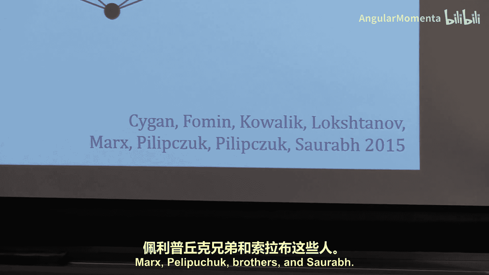
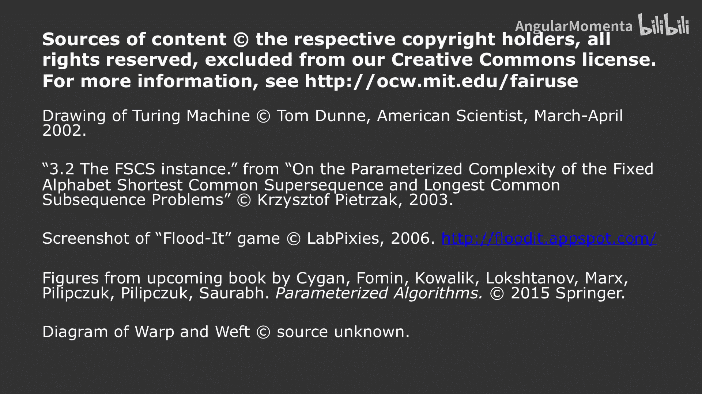

# 013：W层次结构

在本节课中，我们将学习参数化复杂性的基本概念，特别是W层次结构。我们将了解如何通过引入额外参数来分析问题的计算难度，并学习区分“固定参数易处理”问题和那些可能更难处理的问题。课程将涵盖核心定义、关键问题示例以及它们之间的归约关系。

## 概述

参数化复杂性是计算复杂性理论的一个较新领域，它通过引入一个额外的参数 `K` 来补充传统的问题规模 `n`，旨在将指数级复杂度从 `n` 转移到 `K` 上。如果对于小的 `K` 值，我们能得到 `f(K) * poly(n)` 的运行时间，那么即使 `n` 很大，问题也可能是实际可解的。本节课将介绍参数化复杂性的基本框架，包括固定参数易处理性、参数化归约，以及用于对参数化问题难度进行分类的W层次结构。

## 参数化问题与复杂度类

一个**参数化问题**由一个决策问题加上一个**参数函数** `K` 构成，该函数将问题实例映射到一个非负整数。通常，`n` 表示输入规模，`K` 是额外的参数。

我们的目标是获得对 `n` 的良好依赖（例如多项式时间），同时允许对 `K` 有较差的依赖（例如指数时间）。这引出了两个重要的复杂度类：

*   **XP**：可在 `n^{f(K)}` 时间内解决的问题集合，其中 `f` 是任意函数。这意味着对于每个固定的 `K`，问题是多项式时间可解的，但多项式的次数随 `K` 增长。
*   **FPT（固定参数易处理）**：可在 `f(K) * n^{O(1)}` 时间内解决的问题集合。这里，对 `n` 的依赖被限制为多项式，且多项式的次数是常数（不依赖于 `K`）。这是更理想、更强大的性质。

一个关键定理是，FPT 也等价于可在 `f(K) + n^{O(1)}` 时间内解决的问题集合。

上一节我们介绍了参数化问题的基本概念和复杂度类，本节中我们来看看一个具体的FPT算法例子。

### 顶点覆盖问题的FPT算法

考虑**顶点覆盖**问题的自然参数化：给定图 `G` 和参数 `k`，判断是否存在大小不超过 `k` 的顶点覆盖。

一个简单的XP算法是尝试所有大小为 `k` 的顶点子集，共有 `C(n, k)` 种可能，检查每个子集是否是顶点覆盖需要 `O(n)` 时间。这证明了该问题属于XP。

要证明它属于FPT，我们可以使用一个分支算法：
1.  选择任意一条边 `(u, v)`。在任何一个大小不超过 `k` 的顶点覆盖中，`u` 或 `v` 至少有一个必须被选中。
2.  递归地分支两种情况：将 `u` 加入覆盖，并从图中删除 `u` 及其关联的所有边；或者将 `v` 加入覆盖，并做类似删除。
3.  重复此过程。如果递归深度超过 `k` 仍未覆盖所有边，则回溯。
4.  如果在深度 `k` 内找到了一个顶点覆盖，则回答“是”。

这个算法探索了一棵深度为 `k` 的二叉树，因此运行时间为 `O(2^k * n)`，属于FPT。

## 参数化归约与W层次结构

为了证明某些问题可能不属于FPT，我们需要一个归约框架。**参数化归约**类似于NP归约，但有一个额外条件需要保持参数“可控”。

具体来说，要从参数化问题 `A`（参数 `K`）归约到问题 `B`（参数 `K‘`），我们需要一个在多项式时间内计算的函数，将实例 `x` 映射到实例 `x’`，使得：
*   `x` 是 `A` 的“是”实例当且仅当 `x‘` 是 `B` 的“是”实例。
*   新参数 `K’(x‘)` 以原参数 `K(x)` 的某个可计算函数 `g` 为上界，即 `K’ <= g(K)`。

如果 `B` 属于FPT，并且存在这样的归约，那么 `A` 也属于FPT。反之，如果我们相信 `A` 不属于FPT，那么 `B` 也不属于FPT。

### W1完全问题：一个核心难题

在参数化复杂性中，我们相信存在一个不属于FPT的“核心”难题，用它来证明其他问题的难度。一个这样的问题是 **K步非确定性图灵机问题**：
*   **输入**：一个非确定性图灵机（具有 `O(n)` 个状态和指令），以及参数 `k`。
*   **问题**：是否存在一条长度不超过 `k` 的计算路径，使机器输出“是”？

直观上，由于机器每一步可能进行 `O(n)` 种非确定性选择，暴力搜索需要大约 `n^k` 时间，这属于XP但不像是FPT。这个问题被定义为 **W1完全** 的。W1类包含了所有能通过参数化归约约化到此问题的问题。

独立集问题也是W1完全的。这意味着，如果存在从K步非确定性图灵机问题到独立集的参数化归约（反之亦然），那么独立集也与该核心难题同样困难。

## 更多W1完全问题及其归约

从独立集或团问题出发，可以证明许多其他问题是W1完全的。以下是几个例子及其归约思路：

### 正则图中的团问题

**问题**：在最大度为 `Δ` 的正则图中寻找大小为 `k` 的团。
**归约（来自团问题）**：对于给定图 `G` 的每个顶点 `v`，创建 `Δ` 个副本。如果 `v` 在原图中的度为 `d < Δ`，则添加 `Δ - d` 个新顶点，并将它们与 `v` 的所有 `Δ` 个副本相连，形成一个二分团。这确保了所有顶点度都变为 `Δ`，并且没有引入新的三角形，因此团的大小保持不变。

### 部分顶点覆盖问题

**问题**：给定图 `G` 和参数 `k`, `L`，是否存在 `k` 个顶点，覆盖至少 `L` 条边？（注意：参数是 `k`）
**归约（来自正则图中的独立集）**：假设图是 `Δ`-正则的。存在大小为 `k` 的独立集，当且仅当存在 `k` 个顶点恰好覆盖 `Δ * k` 条边。因为独立集中的顶点互不相邻，每个顶点覆盖其 `Δ` 条关联边，且边无重复。

### 多色团问题

**问题**：给定一个 `k`-着色的图，问是否存在一个团，恰好包含每种颜色一个顶点。
**归约（来自团问题）**：对原图 `G` 的每个顶点 `v`，创建 `k` 个副本 `v_1, ..., v_k`，并赋予第 `i` 个副本颜色 `i`。对于原图中的每条边 `(u, v)`，在新图中连接所有 `u_i` 和 `v_j`（其中 `i != j`）。这样，新图中的团对应于原图中的团，并且必须包含所有颜色。

多色团问题是一个非常有用的起点，可以简化许多问题的W1-硬度证明。

## 支配集与W2层次

有些问题比W1完全问题更难，属于 **W2完全** 类。一个典型的例子是**支配集**问题：
*   **问题**：给定图 `G` 和参数 `k`，是否存在大小不超过 `k` 的支配集（即每个顶点要么在集合中，要么与该集合中的某个顶点相邻）？

我们可以从多色团问题归约到支配集问题，证明支配集是W1-难的。实际上，支配集被证明是 **W2完全** 的。集合覆盖问题也是W2完全的，因为支配集可以很容易地归约到集合覆盖。

## W层次结构的定义

W层次结构基于一个称为**加权电路可满足性**的问题来定义。
*   **问题**：给定一个布尔电路（有单个输出）和参数 `k`，是否存在一个汉明权重为 `k`（即恰好 `k` 个输入为1）的输入赋值，使电路输出1？
*   所有能参数化归约到此问题的问题构成类 **WP**。

通过限制电路的结构，我们得到W层次结构。定义电路的**深度**为最长路径。定义电路的**纬**为任意输入到输出路径上“大”门（输入数大于常数的门，例如输入数>2的门）的最大数量。

那么，对于常数 `t`，类 **W[t]** 定义为所有能参数化归约到**常数深度、纬为 `t` 的加权电路可满足性问题**的问题集合。

根据这个定义：
*   **独立集**可以写成一个深度为2、纬为1的电路（第一层是多个“大”的OR门，表示每条边的两个端点不能同时被选；第二层是一个“大”的AND门，要求所有边约束满足）。因此独立集属于 **W[1]**，并且是W[1]完全的。
*   **支配集**在一般图上需要深度为2、纬为2的电路（第一层是多个“大”的OR门，表示一个顶点可以被其邻居或自身支配；第二层是一个“大”的AND门，要求所有顶点都被支配）。因此支配集属于 **W[2]**，并且是W[2]完全的。

大多数自然出现的问题都属于W[1]或W[2]。CNF-SAT（加权版本）是W[2]完全的，而3-SAT（加权版本）是W[1]完全的。

## 与近似算法的联系：高效PTAS

参数化复杂性与近似算法有一个有趣的联系。回顾一下，一个**多项式时间近似方案** 的运行时间可能是 `n^{f(1/ε)}`。如果运行时间是 `f(1/ε) * n^{O(1)}`，则称为**高效PTAS**。

可以证明，如果一个优化问题的自然参数化版本是FPT的，那么它就存在一个高效PTAS。反之，如果一个问题（在标准假设下）不是FPT的，那么它就不可能有高效PTAS。这为证明某些问题不存在高效PTAS提供了强有力的工具。

## 总结

本节课中我们一起学习了参数化复杂性的基础知识。我们首先了解了参数化问题、FPT和XP类的定义。然后，我们探讨了参数化归约的概念，并引入了W层次结构作为对参数化问题难度进行分类的工具。我们看到了几个核心的W[1]完全问题（如独立集、团）和W[2]完全问题（如支配集），并通过归约示例了解了如何证明问题的参数化难度。最后，我们简要讨论了参数化复杂度与高效PTAS之间的联系。理解这些概念有助于我们判断一个难解问题在参数较小时是否可能被有效解决，或者其近似算法的效率下限。