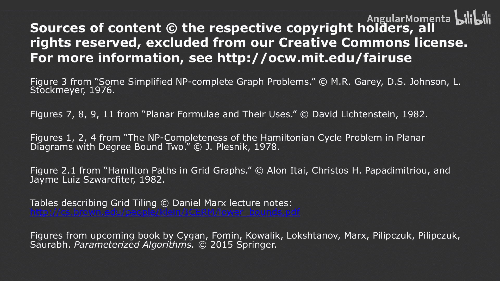

# 014：指数时间假说与平面固定参数可解性

在本节课中，我们将学习指数时间假说及其对算法复杂度，特别是参数化复杂度领域的影响。我们将看到，这个假说如何帮助我们推导出各种问题精确的时间下界，并区分平面图问题与非平面图问题的难度差异。

## 指数时间假说概述

指数时间假说是一个关于3-SAT问题计算复杂度的猜想。其核心主张是：对于3-SAT问题，不存在运行时间为 $2^{o(n)}$ 的算法，其中 $n$ 是变量数。当然，我们可以对任意 $k$ 的 $k$-SAT 提出类似的假设，但通常认为对于任何固定的 $k$，都不存在 $2^{o(n)}$ 时间的算法。2-SAT是简单的多项式时间可解问题，因此不在讨论之列。

我们支持这个假说的证据仅仅是：迄今为止，我们尚未找到这样的算法。目前已知的最佳算法运行时间约为 $1.31^n$，这是三年前的研究成果。许多研究者致力于寻找更好的SAT算法，但猜想认为，你无法得到像 $2^{\sqrt{n}}$ 这样的亚指数时间算法。对于3-SAT，$2^{cn}$ 或等价地 $c^n$（$c$ 为常数）似乎是正确的复杂度级别。

这里需要简要说明的是变量 $n$ 的定义。通常，$n$ 指变量数，$m$ 指子句数。由于每个子句包含三个变量，在考虑指数时间假说时，我们可以认为 $m$ 和 $n$ 是线性相关的，这得益于“稀疏化引理”。该引理指出，一个具有超线性子句数的公式，可以转化为多个（例如 $2^{\epsilon n}$ 个）每个都具有线性子句数的公式。因此，在考虑指数时间假说时，我们可以认为子句数和变量数是线性相关的。

当然，我们无法证明这个假说。如果能够证明，它将意味着 $P \neq NP$。从SAT的角度看，这是 $P \neq NP$ 的一种更强形式。因为我们有许多从SAT出发的归约，如果我们假设关于SAT的这个下界，就可以证明其他问题的相应下界。

除了指数时间假说，还有一个更强的版本，称为强指数时间假说。它主张：对于CNF SAT，不存在 $(2 - \epsilon)^n$ 时间的算法（对于任意 $\epsilon > 0$）。其思想是，对于每个 $k$-SAT，存在一个理想的基础常数 $c_k$，但当 $k$ 趋于无穷时，这个常数趋于 $2$。也就是说，对于子句长度非常大的SAT问题，你无法击败 $2^n$。本节课我们不讨论需要这个强假设的内容。

## 回顾经典归约与规模膨胀

上一节我们介绍了指数时间假说，本节中我们来看看它如何通过经典归约影响其他问题。关键在于分析归约过程中的“规模膨胀”。

一个NP归约（Karp风格）中，我们从实例 $x$（规模为 $n$）出发，通过归约函数 $f$ 构造实例 $x'$（规模为 $n'$）。$n'$ 应是 $n$ 的多项式，这个多项式就是规模膨胀函数。

如果膨胀是线性的，即 $n' = O(n)$，那么指数时间假说的结论得以保留。具体来说，如果问题 $A$ 没有 $2^{o(n)}$ 时间的算法，那么问题 $B$ 也没有 $2^{o(n)}$ 时间的算法。因为你可以将 $A$ 的实例线性地转化为 $B$ 的实例，然后运行 $B$ 的算法。如果 $B$ 存在 $2^{o(n)}$ 的算法，那么 $A$ 就存在 $2^{o(n)}$ 的算法，这与假设矛盾。

更一般地，如果膨胀函数是 $b(n)$，即 $n' \leq b(n)$，并且问题 $A$ 没有 $2^{o(n)}$ 时间的算法，那么问题 $B$ 将没有 $2^{o(b^{-1}(n))}$ 时间的算法。例如，如果膨胀是平方级的（$b(n) = n^2$），那么 $B$ 将没有 $2^{o(\sqrt{n})}$ 时间的算法。

以下是我们在之前课程中看到的一些具有线性规模膨胀的归约例子：

*   **三染色**：从3-SAT归约。如果3-SAT实例有 $n$ 个变量和 $m$ 个子句，构造出的图将有 $O(n + m)$ 个顶点和边。因此，假设指数时间假说，对于顶点数和边数为 $O(n)$ 的图，三染色问题没有 $2^{o(n)}$ 时间的算法。
*   **顶点覆盖**：从3-SAT归约。每个子句和变量出现都对应常数个顶点和边，总构造规模为 $O(n + m)$。因此，假设指数时间假说，对于顶点数和边数为 $O(n)$ 的图，顶点覆盖问题没有 $2^{o(n)}$ 时间的算法。
*   **支配集**：从顶点覆盖归约。该归约也是线性膨胀，因此支配集同样没有 $2^{o(n)}$ 时间的算法（假设指数时间假说）。
*   **哈密顿路径**：从3-SAT归约（有向图最大度3版本）。该归约构造的图规模也是线性的。因此，哈密顿路径问题也没有 $2^{o(n)}$ 时间的算法（假设指数时间假说）。
*   **独立集**：从3-SAT归约（通过3-SAT-3）。该归约的构造规模也是线性的。因此，独立集问题也没有 $2^{o(n)}$ 时间的算法（假设指数时间假说）。注意，独立集与团问题在复杂度上紧密相关，但团问题通常对应稠密图，其边数可能是顶点数的平方，因此结论表述上需稍加注意。

所有这些结果都适用于一般（非平面）图问题。

## 平面图问题的差异

上一节我们看到，对于一般图，许多NP难问题在指数时间假说下具有 $2^{o(n)}$ 的时间下界。然而，对于平面图，情况有所不同。平面图问题往往存在 $2^{O(\sqrt{n})}$ 时间的算法，并且在指数时间假说下，这个界限是紧的。

原因在于，将3-SAT归约到平面图问题时，通常需要引入“交叉 gadget”来处理边在平面嵌入中的交叉。在最坏情况下，交叉的数量可能是 $O(n^2)$ 个。因此，归约的规模膨胀是平方级的。根据之前的分析，这意味着下界变为 $2^{o(\sqrt{n})}$。

具体来说，对于以下平面图问题，假设指数时间假说，不存在 $2^{o(\sqrt{n})}$ 时间的算法：

*   平面3-SAT
*   平面三染色
*   平面顶点覆盖
*   平面支配集
*   平面哈密顿路径
*   平面独立集

这些问题的证明都涉及从（平面）3-SAT出发的归约，并且都包含了交叉 gadget，导致了平方级的规模膨胀。

这个结果在某种意义上表明，即使平面图问题是NP难的，它们也比对应的非平面图问题“稍微容易一些”。事实上，许多平面图问题确实存在 $2^{O(\sqrt{n})}$ 时间的算法，例如通过“提升与分隔”或利用平面图具有 $O(\sqrt{n})$ 树宽的性质。

## 对参数化复杂度的影响

我们刚刚讨论了指数时间假说对经典算法复杂度的定量影响。现在，让我们转向参数化复杂度的世界，看看它在那里产生的影响，这甚至更为显著。

首先，我们可以得到一些简单的推论。对于以自然参数 $k$（如顶点覆盖大小、路径长度、支配集大小、独立集大小）参数化的问题，假设指数时间假说，不存在 $2^{o(k)} \cdot \text{poly}(n)$ 时间的算法。因为当 $k = n$ 时，这就退化为经典情况。这至少给出了参数部分 $f(k)$ 的下界。

*   对于**顶点覆盖**和**最长路径**，它们是FPT问题，存在 $c^k \cdot \text{poly}(n)$ 时间的算法。指数时间假说表明这个 $c^k$ 的形式是紧的，不存在更好的 $2^{o(k)} \cdot \text{poly}(n)$ 算法。
*   对于**支配集**和**独立集**，我们知道它们是W[1]-难或W[2]-难的，通常认为没有FPT算法。指数时间假说允许我们证明更强的结论：不存在 $f(k) \cdot n^{o(k)}$ 时间的算法（对于任何可计算函数 $f$）。这远比“不是FPT”要强。

接下来，我们证明关于团问题的这个强下界。

**定理**：假设指数时间假说，则 $k$-团问题不存在 $f(k) \cdot n^{o(k)}$ 时间的算法（对于任何可计算函数 $f$）。

**证明思路**：我们通过反证法，从三染色问题归约到 $k$-团问题。
1.  给定一个 $n$ 个顶点的图 $G$（三染色实例）。
2.  将顶点集划分为 $k$ 组，每组大约 $n/k$ 个顶点。
3.  构造新图 $G‘$：对于每一组，考虑该组顶点所有可能的三染色方案（最多 $3^{n/k}$ 种），每个方案对应 $G’$ 中的一个顶点。
4.  $G‘$ 中，不同组对应的两个顶点（染色方案）之间连边，当且仅当这两个染色方案对于连接这两组的所有边是兼容的（即不会产生单色边）。
5.  这样，在 $G‘$ 中寻找一个大小为 $k$ 的团，等价于在 $G$ 的 $k$ 个组中各选一个兼容的染色方案，这等价于 $G$ 存在三染色。
6.  通过巧妙地将 $k$ 设置为 $n$ 的某个缓慢增长的函数（使得假设存在的 $k$-团算法在代入 $G‘$ 的规模后，其运行时间会违反指数时间假说），我们导出矛盾。

这个证明的关键在于，归约的参数 $k‘$（团的大小）等于我们设定的 $k$，并且问题规模膨胀是 $k \cdot 3^{n/k}$。通过精细的计算，可以得出假设的 $k$-团算法将导致三染色问题存在 $2^{o(n)}$ 的算法，与指数时间假说矛盾。

这个结果非常重要。此后，在参数化归约中，我们不仅关心参数 $k$ 是否被某个函数 $g(k)$ 限制，还关心这个函数的具体形式。如果是线性函数（$k‘ = O(k)$），我们就能保留“不存在 $f(k) \cdot n^{o(k)}$ 算法”的强下界。如果是平方函数（$k‘ = O(k^2)$），那么下界会弱化为“不存在 $f(k) \cdot n^{o(\sqrt{k})}$ 算法”。

## 平面图问题的参数化下界

上一节我们看到了对于一般图问题的强参数化下界。对于平面图问题，我们之前提到经典复杂度下界是 $2^{o(\sqrt{n})}$。相应地，在参数化 setting 下，我们通常会得到 $f(k) \cdot n^{o(\sqrt{k})}$ 形式的下界。

这引出了一个核心工具：**网格铺砖问题**。该问题由 Daniel Marx 在2007年提出，是连接一般图参数化难度与平面/几何图参数化难度的桥梁。

**网格铺砖问题定义**：
*   **输入**：一个 $k \times k$ 网格，每个格子 $(i, j)$ 对应一个集合 $S_{ij} \subseteq [n]^2$（即一些二维坐标对的集合）。
*   **输出**：从每个格子 $S_{ij}$ 中恰好选择一个元素 $x_{ij} = (a_{ij}, b_{ij})$，使得：
    *   在同一行 $i$ 中，所有被选元素的第二坐标 $b_{ij}$ 相等。
    *   在同一列 $j$ 中，所有被选元素的第一坐标 $a_{ij}$ 相等。

这个问题被证明是W[1]-难的（参数为 $k$），并且在指数时间假说下，不存在 $f(k) \cdot n^{o(k)}$ 时间的算法。注意，虽然我们选择 $k^2$ 个元素，但参数是网格的边长 $k$。

网格铺砖问题的威力在于，它的约束是局部的（只需要相邻格子间协调），因此可以嵌入到平面图或几何结构中。当我们进行这种嵌入时，通常会将参数 $k$（网格边长）转化为问题规模的一部分，导致在最终问题中参数变为 $k^2$，从而产生 $n^{o(\sqrt{k})}$ 的下界。

以下是两个平面/几何问题的例子，它们通过从网格铺砖问题（或其变种）归约，证明了相应的参数化下界：

1.  **分散集问题**（Scattered Set）：在图中寻找 $k$ 个顶点，使得它们两两之间的距离至少为 $D$（$D$ 是输入的一部分，不作为参数）。当 $D=2$ 时即为独立集。对于平面图，该问题参数化于 $k$ 是W[1]-难的，并且假设指数时间假说，不存在 $f(k) \cdot n^{o(\sqrt{k})}$ 时间的算法。存在匹配的 $n^{O(\sqrt{k})}$ 算法，因此界限是紧的。

2.  **单位圆盘图独立集问题**：给定平面上一些点（代表单位圆盘中心），如果两点距离 $\leq 1$ 则连边，在此图中寻找大小为 $k$ 的独立集。该问题同样是W[1]-难的（参数为 $k$），并且假设指数时间假说，不存在 $f(k) \cdot n^{o(\sqrt{k})}$ 时间的算法。同样存在匹配的 $n^{O(\sqrt{k})}$ 算法。

这些归约都利用了网格铺砖问题及其变种（如带单调递增约束的版本），通过精巧的几何构造，将网格的约束编码到平面距离或圆盘相交的条件中。

## 总结

本节课中，我们一起学习了指数时间假说及其深远影响。

我们首先介绍了指数时间假说，它是对3-SAT问题计算难度的一个定量猜想。通过分析经典NP归约中的规模膨胀，我们看到了该假说如何为一系列NP难问题提供精确的指数时间下界，并清晰地区分了平面图问题（$2^{\Theta(\sqrt{n})}$）与非平面图问题（$2^{\Theta(n)}$）的复杂度差异。

接着，我们将视角转向参数化复杂度。指数时间假说在这里产生了更强的影响。我们证明了对于像 $k$-团这样的问题，不仅没有FPT算法，甚至不存在 $f(k) \cdot n^{o(k)}$ 时间的算法。我们引入了“网格铺砖”这一核心工具，它作为许多平面图和几何问题参数化难度的来源。通过从网格铺砖问题归约，我们为如“分散集”和“单位圆盘图独立集”等问题建立了 $f(k) \cdot n^{o(\sqrt{k})}$ 的紧下界，并指出了匹配的上界算法。

这些结果不仅深化了我们对计算问题内在难度的理解，也将近似算法、精确算法和参数化算法的下界研究统一到了一个共同的复杂性假设之下。