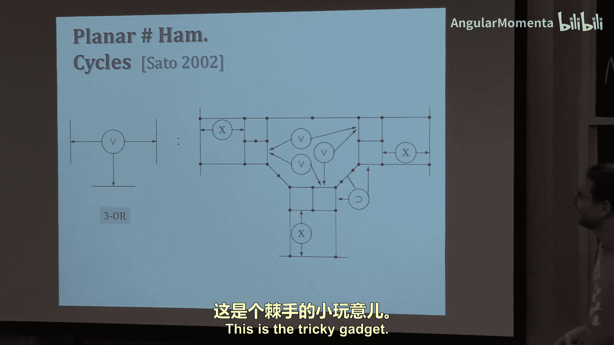

# 015：#P与ASP

在本节课中，我们将学习如何从算法角度“计数”，并证明计数类问题的计算难度。与输出为“是/否”的决策问题不同，计数问题的输出是一个整数。我们将定义比NP问题更强的概念，并引入#P复杂性类。我们还将探讨其与ASP（另一个解）问题的关系。

## 概述

我们将从定义NP搜索问题及其对应的计数问题开始。接着，我们会引入#P复杂性类，并讨论用于证明#P难度的归约类型，特别是保真归约和倍乘归约。然后，我们会回顾之前证明过的一些问题，检查它们的归约是否保真，从而判断其计数版本是否#P完全。最后，我们将深入探讨一个核心的#P完全问题——矩阵积和式，并展示如何将其简化为0-1矩阵的积和式问题，进而与二分图完美匹配计数问题联系起来。

## 从搜索问题到计数问题

上一节我们介绍了NP决策问题。本节中，我们来看看如何将其扩展为搜索问题和计数问题。

首先，一个NP搜索问题定义如下：给定一个实例，目标是找到一个“解”。这里没有目标函数，所有解都是平等的。这与优化问题不同，优化问题追求最优解。对于一个NP搜索问题，存在一个多项式时间算法，可以验证给定的候选解是否有效。

几乎我们定义过的每个NP决策问题，背后都有一个对应的搜索问题。例如，对于SAT问题，搜索问题是找到一个满足所有子句的变量赋值。

给定这样一个搜索问题A，我们可以定义其对应的计数问题#A。该问题的目标是：对于给定的实例，计算其解的数量。显然，知道解的数量至少能回答“是否存在解”这个决策问题，因此计数问题严格难于对应的决策问题。

## #P复杂性类与归约

上一节我们定义了计数问题。本节中，我们来看看如何定义其计算难度。

#P被定义为所有此类计数问题构成的复杂性类。从计算视角看，一个非确定性图灵机在计算结束时，会输出所有接受路径的数量，而不是简单地判断是否存在一条接受路径。

为了定义#P难度，我们需要使用归约。这里我们允许使用非常强大的归约：多调用Cook归约。在这种归约中，我们可以多次调用一个能解决目标问题B的“预言机”，并结合一些多项式时间的计算，来解决源问题A。

然而，对于许多问题，我们可以使用一种更简单、更熟悉的归约：保真归约。这是一种针对NP搜索问题的归约，类似于NP归约，但有一个更强的条件：归约函数f必须将实例x映射到实例x‘，使得x的解的数量**精确等于**x’的解的数量。这意味着它不仅保持了“解是否存在”的性质，还精确保持了解的数量。因此，如果A的决策版本是NP难的，那么B的决策版本也是NP难的；更重要的是，如果#A是#P难的，那么#B也是#P难的。

另一种有用的归约是倍乘归约。在这种归约中，我们只要求x‘的解的数量等于x的解的数量乘以一个固定的常数C（C可以依赖于问题规模n，但不能依赖于具体实例x）。由于我们可以先计算#B，再除以已知的常数C来得到#A，所以这对于证明#P难度同样有效。

## 回顾经典问题的#P完全性

上一节我们介绍了证明#P难度的归约方法。本节中，我们应用这些方法，检查之前学过的一些NP完全性证明是否保真。

以下是几个通过保真归约证明是#P完全的问题：
*   **平面单调正矩形3SAT**：其归约中引入的变量都是原有变量的拷贝或取反，因此解的数量被精确保持。
*   **Shikaku谜题**：归约中，代表变量的“导线”恰好有两种填充方式（真/假），子句部分在满足时也只有唯一的填充方式，因此是保真的。
*   **平面最大度3图的哈密顿环计数**：原始的归约不保真，但通过使用更复杂的“异或”、“或”和“蕴含”构件，可以构造出一个保真的归约。
*   **数织谜题**：从平面最大度3哈密顿环问题归约而来。其构件中，每个顶点的遍历方式（直行、左转、右转）都是唯一的，因此该归约是保真的。

然而，并非所有NP难的证明都是保真的。例如，**平面1-in-3 SAT**的第一个归约证明在某些情况下会产生两个解，而在其他情况下只产生一个解，因此不是保真或倍乘归约。不过，其第二个针对**平面正矩形1-in-3 SAT**的归约证明是保真的。

## 积和式：一个核心的#P完全问题

上一节我们看了一些组合问题的#P完全性。本节中，我们转向一个更代数化的问题：矩阵积和式。

矩阵A的积和式`Perm(A)`定义与行列式`Det(A)`类似，但求和中不包含置换的符号项。计算一般矩阵的积和式是#P完全的。我们可以通过一个倍乘归约（C是子句数量的函数）从#3SAT证明这一点。

该归约将3SAT实例转化为一个带权有向图，其构造包含变量构件和子句构件。关键在于一个特殊的4x4矩阵X（对应图中的构件），它具有以下性质：在任何非零权重的环覆盖中，若进入该构件的左侧顶点，则必须遍历其所有四个顶点并从右侧离开，且这样的遍历方式恰好贡献权重4。最终，整个图的所有环覆盖权重之和（即积和式）等于原SAT实例解的数量乘以一个固定的倍数（4的某次幂）。因此这是一个倍乘归约。

## 0-1积和式与完美匹配

上一节我们证明了一般矩阵积和式的#P难度。本节中，我们将其简化为只包含0和1的矩阵积和式问题。

首先，利用中国剩余定理和模运算，我们可以将计算一般矩阵积和式的问题，转化为多项式次调用“计算积和式模R”的问题。由于在模R下，负数可以转化为正数，我们只需处理非负权重的边。

接着，对于一条权重为k（k>1）的边，我们可以用一个特定的子图结构来模拟。该子图保证：如果不使用原边，有1种方式覆盖子图；如果使用原边，则有恰好k种方式覆盖子图。这样，我们就在模R的意义下，用0-1权重的图模拟了非负权重的边。

因此，计算0-1矩阵的积和式也是#P完全的。0-1积和式有一个重要的组合解释：它等价于计算对应二分图的**完美匹配**的数量。这解释了为什么虽然能在多项式时间内找到二分图的一个完美匹配，但**计数**所有完美匹配却是#P完全的难题。

## 更多计数问题与ASP

上一节我们建立了积和式与匹配计数的联系。本节中，我们看看由此衍生出的其他计数问题，并介绍ASP概念。

利用数论和构造技巧，我们可以证明更多匹配计数问题是#P完全的：
*   **最大匹配计数**：通过将原图的每个顶点“膨胀”成n个顶点的团，并巧妙分析解的数量级，可以从完美匹配计数归约得到。
*   **所有匹配计数**：通过为每个顶点添加k个叶子节点，构造一系列图G_k，并利用多项式插值技术，可以从最大匹配计数归约得到。

此外，**正2SAT**（即每个子句都是两个正文字）的计数也是#P完全的。这可以通过从二分图完美匹配计数进行保真归约来证明：将每条边关联一个布尔变量（True表示边**不在**匹配中），那么对于两条相邻的边，必须有子句保证至少有一条不在匹配中（即变量至少一个为True）。这建立了匹配与正2SAT解的一一对应。

最后，我们简要介绍ASP（另一个解）问题。对于一个搜索问题，ASP问题是指：给定一个实例**及其一个解**，判断是否存在**另一个不同的解**。许多设计谜题时（希望解唯一）需要考虑这个问题。如果一个保真归约同时能在多项式时间内将解双向转换，那么该归约也能证明ASP完全性。我们之前讨论的许多保真归约（如Shikaku、数织）同样也是ASP完全的。

## 总结

本节课中，我们一起学习了算法中的计数问题及其计算难度。我们定义了#P复杂性类，并介绍了用于证明#P难度的多调用归约、保真归约和倍乘归约。通过重新审视多个NP完全问题的证明，我们确认了平面3SAT、Shikaku、数织等问题的计数版本也是#P完全的。我们深入探讨了矩阵积和式这一核心的#P完全问题，并利用数论技巧将其简化为0-1积和式，从而与二分图完美匹配计数等价。由此，我们还得到了最大匹配计数、所有匹配计数以及正2SAT计数等问题的#P完全性。最后，我们了解了与#P紧密相关的ASP问题，它在确保谜题解唯一性方面有重要意义。