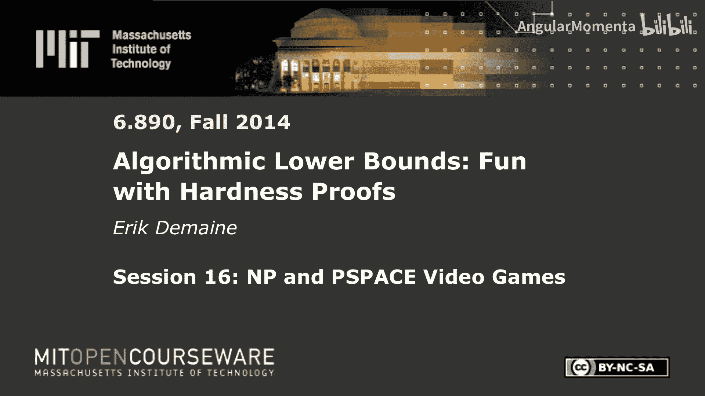

# 016：NP与PSPACE电子游戏

## 概述
在本节课中，我们将学习如何通过“元定理”来证明电子游戏的复杂性。我们将探讨两种主要类型的元定理：一种用于证明NP难度，另一种用于证明PSPACE难度。这些元定理提供了一套通用技术，可以应用于大量不同的游戏，通过分析游戏中的特定机制（如位置遍历、单次使用路径、压力板、按钮和门）来证明其计算复杂性。

## 元定理1：NP难度证明

上一节我们介绍了课程背景，本节中我们来看看第一个元定理，它用于证明游戏的NP难度。

元定理1的核心思想是：如果一个游戏设定在二维平面环境中，玩家需要访问特定的位置（位置遍历），并且游戏中存在只能使用一次的路径（单次使用路径），那么这个游戏通常是NP难的。

这个证明基于从平面、最大度为3的哈密顿路径问题进行的归约。以下是归约的基本思路：
*   将原图中的每个顶点转换为游戏中必须访问的位置。
*   将原图中的每条边转换为一条单次使用路径。

由于每条边只能使用一次，并且每个顶点最多连接三条边，玩家必须找到一条访问所有顶点的路径，这正好对应了寻找哈密顿路径的问题。

基于这个元定理，我们可以证明多款经典游戏的NP难度。

以下是应用此元定理证明NP难度的游戏示例：
*   **推石头**：通过放置钻石实现位置遍历，通过可推动的石头（一旦推动就会挡住回头路）实现单次使用路径。
*   **淘金者**：通过放置黄金实现位置遍历，通过挖掘的坑洞（一旦掉入，该方格会在一段时间后恢复，但玩家无法通过）实现单次使用路径。
*   **塞尔达传说2：林克的冒险**：通过钥匙实现位置遍历（需要收集足够钥匙开门），通过消失的桥梁实现单次使用路径。

## 元定理2：NP难度证明的变体

上一节我们介绍了基于单次使用路径的NP难度证明，本节中我们来看看一个使用不同机制的变体。

元定理2与元定理1设定类似，但使用“令牌”和“收费道路”来模拟单次使用路径。玩家一次只能携带一个令牌，而某些道路（收费道路）需要支付一个令牌才能通过。

归约思路如下：
*   在每个顶点放置一个令牌（实现位置遍历）。
*   将每条边设置为收费道路。

玩家必须访问每个顶点以获取令牌，然后用它来通过一条相邻的边。这同样强制了玩家找到一条哈密顿路径。

这个变体可以用来证明**吃豆人**是NP难的。在归约中，豆子作为令牌，而幽灵的移动模式被精心设计，使得某些路径只有在玩家拥有“令牌”（即处于某种状态）时才能安全通过。

## PSPACE难度基础与元定理3

前面我们讨论了NP难度，现在我们将目光转向更复杂的PSPACE难度。首先，我们需要了解一些PSPACE完全问题作为归约的起点。

PSPACE是可以在多项式空间内解决的问题的集合。它包含NP，并且等于非确定性多项式空间。一个关键的PSPACE完全问题是**量化布尔公式可满足性问题**（QBF或QSAT），即判断一个带有全称量词和存在量词的布尔公式是否为真。

与SAT类似，QSAT也有多种变体是PSPACE完全的，包括平面QSAT和平面1-in-3 QSAT。

有了基础问题，我们现在可以介绍用于证明PSPACE难度的元定理。

元定理3的设定如下：玩家在一个平面环境中，需要从起点A到达终点B。游戏中有“门”和“压力板”机制。每扇门有对应的“打开”和“关闭”压力板。踩上“打开”压力板会使门开启（可通过），踩上“关闭”压力板会使门关闭（不可通过）。每扇门恰好有一对这样的压力板。

这个构造是PSPACE完全的，证明是从Q3SAT（量化3SAT）问题归约而来。归约的核心是构建量词 gadget：
*   **存在量词 gadget**：为玩家提供两条路径选择，分别对应将变量设为真或假。
*   **全称量词 gadget**：强制玩家依次尝试变量的两种赋值（真和假），并且两种赋值下剩余的公式都必须为真，玩家才能继续前进。

子句 gadget 则由多扇门实现，只要对应子句中至少有一个文字为真（即其门是打开的），玩家即可通过。

基于这个强大的元定理，我们可以证明许多带有压力板机制的游戏是PSPACE完全的。

以下是应用此元定理证明PSPACE难度的游戏示例：
*   **魔法门之英雄无敌等早期RPG**：拥有直接的压力板开门机制。
*   **毁灭战士**：虽然没有直接的压力板，但可以通过触发器（如走过某处使墙壁出现或消失）来模拟门和压力板。
*   **SCUMM引擎冒险游戏**（如《猴岛小英雄》）：其脚本系统可以模拟压力板的效果，通过对话或行动改变游戏状态，开启新的路径。
*   **波斯王子**：拥有直接的压力板机制。虽然玩家可以跳跃，但通过将压力板放在必须攀爬的平台上，可以强制玩家触发。

## 元定理4：从压力板到按钮

上一节我们使用了压力板，本节中我们看看一个更常见的机制——按钮。

元定理4指出，如果将压力板替换为“按钮”，并且每个按钮可以同时控制三扇门的开关状态，那么游戏仍然是PSPACE完全的。

证明思路是将压力板 gadget 模拟为按钮 gadget。通过精巧的布置，使得按下一个按钮会产生一系列连锁反应，最终效果等同于踩下一个特定的压力板（打开或关闭某扇门）。

这个机制在游戏中更为常见。

以下是应用此元定理的游戏示例：
*   **古墓丽影**：开关可以控制门的开启。
*   **刺猬索尼克**：按按钮可以打开门。
*   **失落的维京人**：角色按按钮可以同时打开两扇门。

## 元定理5：门与交叉点

元定理5是元定理3的另一种具体实现和简化。它直接关注“门”这一核心元素。

该定理指出，只要游戏中存在可以打开/关闭的“门” gadget，以及允许路径交叉的“交叉点” gadget，那么游戏就是PSPACE完全的。

这里的门 gadget 有多个连接点：一个用于通行（当门开时），一个用于打开门，一个用于关闭门。这本质上是对压力板功能的重新包装。

这个框架被应用于多款任天堂游戏的PSPACE难度证明中。

以下是应用此元定理进行PSPACE难度证明的经典游戏：
*   **塞尔达传说：众神的三角力量**：实现了门 gadget。游戏中的开关是翻转式的（按一次状态改变），但通过结合单向传送点等机制，可以模拟出所需的打开/关闭行为。
*   **大金刚国度**：该系列三部曲分别使用不同的游戏元素实现了门 gadget。
    *   **第一部**：使用“轮胎”作为可移动障碍物来实现门的状态。
    *   **第二部**：使用“气球”在气流中的升降来实现门的状态。
    *   **第三部**：使用“跟踪桶”的左右移动来实现门的状态。
*   **超级马里奥兄弟**：实现了门 gadget 和交叉点 gadget。门的状态由一个“刺猬”敌人的位置决定，玩家可以通过顶砖块来改变它的位置，从而“打开”或“关闭”门。交叉点则利用马里奥的跳跃物理特性实现。

## 案例研究：旅鼠的PSPACE难度

最后，我们来看一个特别复杂和精彩的证明：《旅鼠》的PSPACE难度。

《旅鼠》是一款实时策略游戏，玩家需要指挥旅鼠使用各种技能（如挖掘、建造）到达终点。即使假设“建造者”和“挖掘者”技能数量无限，仅使用一个旅鼠，并且有关卡陷阱，游戏仍然是PSPACE完全的。

证明同样遵循元定理5的框架，但需要极其精确地分析旅鼠的像素级物理规则：
*   **基本移动**：定义了旅鼠如何行走、掉落和转向。
*   **挖掘者技能**：分析了水平挖掘的精确条件和停止机制（包括对“钢块”的特殊检测）。
*   **建造者技能**：分析了建造楼梯的精确步骤和停止条件。
*   **Gadget 构建**：基于上述物理规则，构建了：
    *   **交叉点 gadget**：利用地形引导旅鼠单向交叉。
    *   **分岔点 gadget**：允许玩家选择让旅鼠走上方或下方路径。
    *   **门 gadget**：利用陷阱和可破坏的方块来实现门的打开、关闭和通行逻辑。

这个证明展示了如何将严谨的元定理应用于一个物理规则异常复杂的游戏，是算法下界领域的一项杰作。

## 总结
本节课中我们一起学习了如何通过一系列元定理来证明电子游戏的NP硬度和PSPACE硬度。我们从需要位置遍历和单次路径的NP难度框架开始，进而探讨了基于压力板、按钮和门机制的PSPACE难度框架。通过将这些框架应用于《推石头》、《吃豆人》、《毁灭战士》、《塞尔达传说》、《大金刚》、《超级马里奥兄弟》和《旅鼠》等众多经典游戏，我们不仅证明了它们固有的计算复杂性，也展示了理论计算机科学与流行文化之间深刻而有趣的联系。这些证明的核心在于，即使是最娱乐性的问题，也可能隐藏着与最深奥的计算复杂性类别的等价关系。