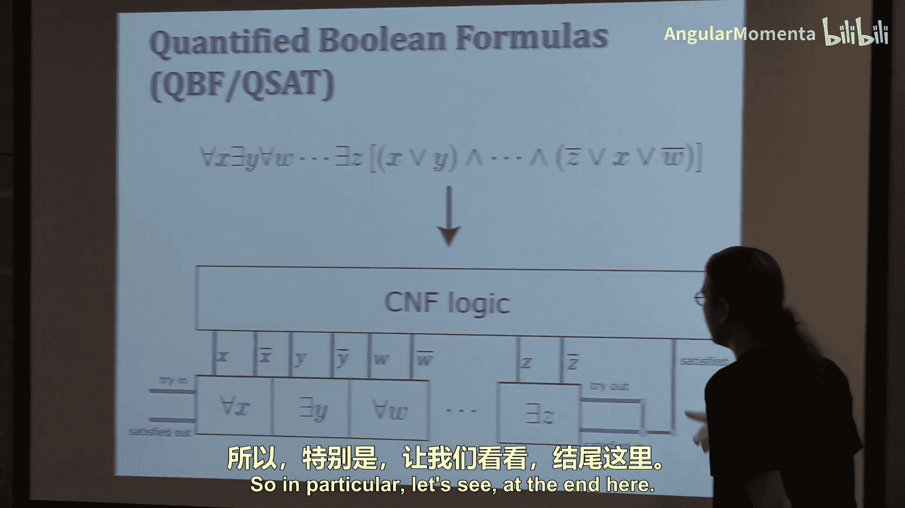
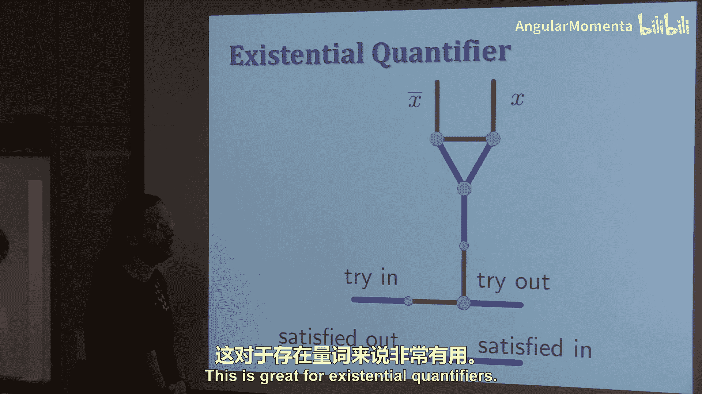

# 017：非确定性约束逻辑

在本节课中，我们将学习一个用于证明谜题基于棋子完备性的通用理论——约束逻辑。我们将重点介绍其一个特定方面：非确定性约束逻辑。这是一种非常有用的框架，尤其适用于证明滑块类谜题的基于棋子的难度结果。

## 概述

非确定性约束逻辑通常简称为 NCL。它提供了一个强大的基础结构，用于证明各种谜题问题是 PSPACE 完备的。我们将从定义约束逻辑的基本概念开始，然后探讨如何利用它来构建复杂的归约证明。

## 约束逻辑基础

我们从一个无向图的概念开始，这可以看作是一个计算模型。图中包含红色边和蓝色边，红色边的权重为 1，蓝色边的权重为 2。

一个约束图的配置，就是对该图的一个定向，使其成为一个有向的红蓝图。这个定向必须满足一个约束：在每个顶点处，**总流入权重至少为 2**。这意味着，要么至少有一条蓝色边流入，要么至少有两条红色边流入。

用公式表示，对于一个顶点 *v*，其约束为：
`总流入权重(v) ≥ 2`
其中，红色边权重为 1，蓝色边权重为 2。

我们感兴趣的是通过每次反转一条边来对约束图进行重新配置。每次移动后，图必须始终保持为一个有效的约束图，即满足流入约束。

这就是游戏的规则。在每个时间步，你可以进行任何有效的移动。这种可以自由选择移动的特性，就是“非确定性”的体现，它模拟了大多数谜题的特点。

## NCL 决策问题

基于上述模型，我们可以定义两个决策问题。

第一个也是最常见的问题是：给定一个约束图和一个指定的目标边，是否存在一系列移动，使得最后一次移动恰好反转了这条目标边？

第二个问题是：给定一个约束图的两种有效配置（即两种满足约束的定向），是否存在一系列单边反转操作，可以从一种配置到达另一种配置？

我们将证明，即使在图的最大度数为 3，并且只包含两种特定类型的顶点的情况下，这两个问题都是 PSPACE 完备的。

## 基本顶点类型：与门和或门

在 NCL 中，我们主要使用两种顶点类型来构建逻辑电路。

**与门顶点** 由两条红色边（作为输入）和一条蓝色边（作为输出）构成。其特性是：只有当**两个输入边都处于激活状态**（即都指向该顶点）时，输出边才有可能被激活（即从该顶点指出）。

**或门顶点** 由两条蓝色边（作为输入）和一条蓝色边（作为输出）构成。其特性是：只要**至少有一个输入边处于激活状态**，输出边就有可能被激活。

这里对“激活”的定义是不对称的：对于输入边，激活意味着它指向该顶点；对于输出边，激活意味着它从该顶点指出。这种定义使得在连接两个顶点时，一条边对于一端是输出，对于另一端是输入，其激活状态是一致的。

一个重要的点是，在这个框架下，我们**无法构建非门**。因为流入约束是一个下界（至少为2），它总是“希望”有更多的输入激活，这与非门需要“输入激活则输出不激活”的逻辑相悖。

## 辅助结构与归约

为了构建复杂的逻辑电路，我们还需要一些辅助结构。

**选择顶点** 是一个由三条红色边构成的顶点，其约束是：必须有两条边指向该顶点（即最多一条边指出）。这可以模拟为一个三角形结构。

**红蓝转换器** 用于在需要时将红色信号转换为蓝色信号，反之亦然。这通过一个小的固定结构实现，确保转换过程中权重约束始终满足。

**终端器** 用于处理度数为 1 的顶点，使其融入三正则图中。根据需求，可以是无约束的（边可自由指向），也可以是受约束的（强制边指向特定方向）。

利用这些基本结构，我们可以模拟布尔电路。例如，通过“双轨逻辑”来表示变量及其非，我们可以构建合取范式公式。一个边能否被反转，当且仅当该公式是可满足的。这证明了**约束图可满足性问题**（给定无向红蓝图，寻找一个有效定向）是 NP 完备的。

## 证明 PSPACE 完备性

为了证明 NCL 的重新配置问题是 PSPACE 完备的，我们从量化的布尔公式问题进行归约。

我们构建一系列量词器件（存在量词和全称量词）和一个用于表示 CNF 公式的电路。这些器件通过“锁存器”连接，锁存器是一种可以存储一位信息（如变量赋值）的单元，其状态可以非确定性地设置并锁定。

*   **存在量词器件** 相对简单：当被激活时，它可以非确定性地选择将变量设置为真或假，并将其锁定，然后激活后续计算。
*   **全称量词器件** 更为复杂：它需要验证变量无论取真值还是假值，公式的剩余部分都能被满足。这涉及到设置变量、检查满足性、回滚计算、更改变量值、再次检查满足性等一系列操作，最终报告结果。

通过将这些器件与表示布尔公式的电路链接起来，我们构造出一个约束图。图中一条特定边的反转是可能的，当且仅当原始量化布尔公式为真。这就证明了“反转指定边”的问题是 PSPACE 困难的，从而是 PSPACE 完备的。

## 平面图与更简单的门

上述构造可能产生非平面图。为了证明即使对于平面图，问题也是 PSPACE 完备的，我们需要平面交叉器件。我们可以构建蓝-蓝交叉、红-蓝交叉和红-红交叉的模拟器件。

此外，为了简化后续归约中构建器件的难度，我们引入了**保护型或门**的概念。保护型或门看起来像普通或门，但要求**最多只有一个输入被激活**。如果两个输入同时激活，整个系统可能会进入无效或不可分析的状态。重要的是，我们可以用保护型或门来构建出功能完整的普通或门。因此，我们只需要能够实现与门和保护型或门，就足以证明平面图上的 NCL 是 PSPACE 完备的。

## 应用实例：滑块谜题

NCL 的强大之处在于，许多谜题可以相对容易地模拟这些基本器件。一个经典的例子是**滑块谜题**。

在滑块谜题中，我们有一个棋盘和若干滑块，目标通常是将一个特定滑块移动到指定位置。通过设计巧妙的滑块布局，我们可以模拟与门和保护型或门。

*   **与门模拟**：一个滑块要向下移动一格，必须要求左侧和上方的两个特定滑块先移开，以腾出必要的空间。
*   **保护型或门模拟**：一个滑块要向下移动，只需要左侧或上方的某一个特定滑块移开即可。如果两个滑块都错误地移开，可能会导致布局“崩溃”，使得谜题无法解决，这正好符合保护型或门的特性。

通过将这样的器件嵌入到网格中，并用“导线”（即滑块通道）连接起来，我们就可以将任意一个平面 NCL 问题转化为一个滑块谜题实例。这就证明了滑块谜题是 PSPACE 完备的。

## 更多应用

NCL 的框架被广泛应用于证明各种游戏的 PSPACE 完备性，包括：

*   **推箱子** 及其变体。
*   **滚动方块** 谜题。
*   **木板渡河** 谜题。
*   **动态地图标注** 的连续重新配置问题。
*   **激光搜索** 问题。

这些证明的核心思想都是相似的：在目标游戏中，设计出模拟 NCL 中与门和保护型或门的“小装置”，然后将这些装置组合起来，模拟一个已知的 PSPACE 困难问题（通常是平面 NCL）。

## 总结

本节课我们一起学习了非确定性约束逻辑这一重要理论。我们定义了约束图、有效配置和移动规则。我们看到了如何用简单的与门和或门顶点来模拟布尔逻辑，并证明了与之相关的配置可达性和边反转问题是 PSPACE 完备的，即使对于平面图也是如此。最后，我们探讨了 NCL 在证明各种实际谜题和游戏 PSPACE 完备性方面的强大应用，其核心在于将复杂的游戏机制归约为简单的约束逻辑器件，从而快速得到难度证明。