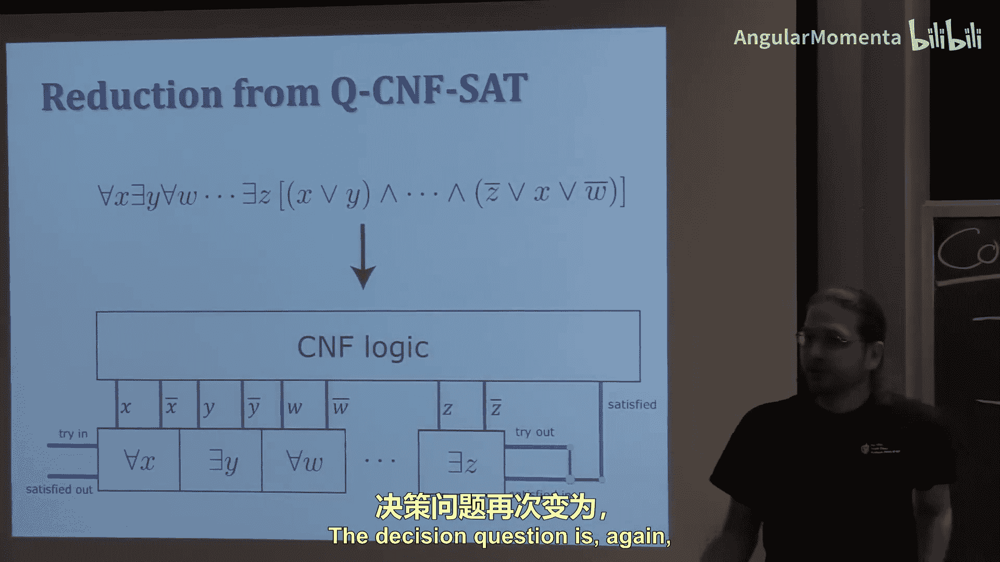
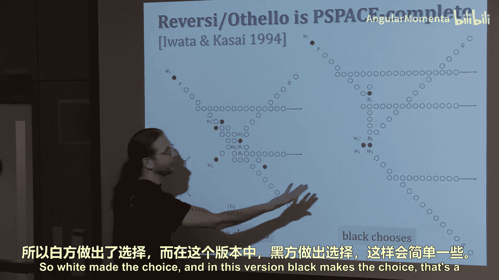
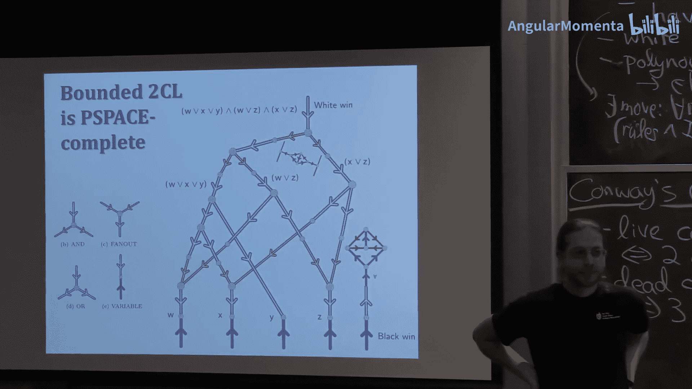
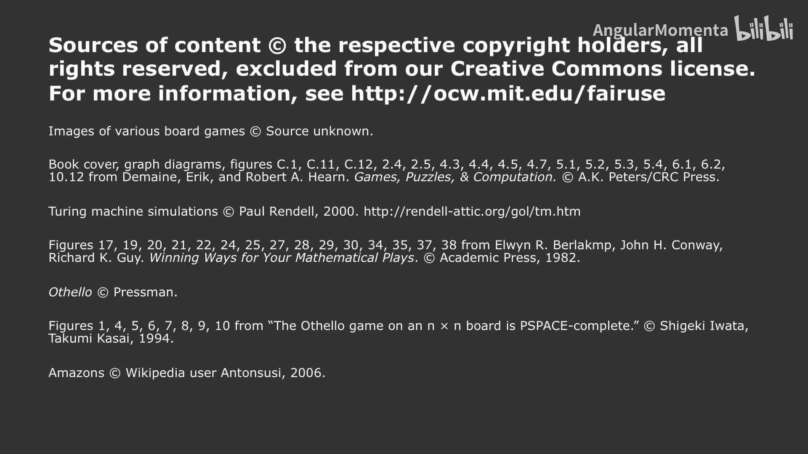

# 018：0人和2人游戏

在本节课中，我们将学习零人游戏和两人游戏的计算复杂性。我们将从经典的零人游戏“生命游戏”开始，探讨其如何达到P空间完全性甚至不可判定性。接着，我们将转向两人游戏，特别是多项式步数有界的游戏，并了解它们如何达到P空间完全性。我们将通过约束逻辑的视角来统一理解这些复杂性结果。

---

## 零人游戏：生命游戏与复杂性

上一节我们介绍了游戏的一般分类。本节中，我们来看看零人游戏，其中最经典的例子是康威的“生命游戏”。

生命游戏定义在一个无限网格上，每个细胞有两种状态：存活（黑色）或死亡（白色）。游戏根据以下规则同步更新所有细胞：
*   一个存活的细胞将继续存活，当且仅当其八个邻居中有**两到三个**存活细胞。
*   一个死亡的细胞将变为存活（诞生），当且仅当其八个邻居中**恰好有三个**存活细胞。

这些简单的规则可以产生极其复杂的行为，例如静态图案（静物）、周期振荡（如脉冲星）以及移动的图案（如滑翔机和飞船）。

### 计算问题与复杂性

对于生命游戏，我们可以提出不同的计算问题，其复杂性取决于游戏空间的设定：

*   **多项式空间有界（有限棋盘或环面）**：如果游戏在有限空间内进行，且最大步数由空间大小多项式限定，那么预测其行为是**P空间完全**的。这可以通过构造模拟图灵机（或其等价物，如双栈下推自动机）的生命图案来实现。
*   **无限空间（有限初始图案）**：如果游戏在无限棋盘上进行，但初始只有有限区域有存活的细胞，那么某些问题（如“所有细胞最终会全部死亡吗？”）是**不可判定**的。这可以通过构造一个能模拟通用图灵机并自动扩展其“磁带”的生命图案来证明。

### 证明技巧：滑翔机逻辑

生命游戏复杂性证明的核心是利用滑翔机构建数字逻辑电路。以下是关键组件：

*   **信号（比特）**：一列滑翔机代表比特流。有滑翔机代表1，无滑翔机代表0。
*   **导线**：滑翔机的对角线路径。
*   **“吞噬者”**：一种静物结构，能吸收撞上的滑翔机，用作导线终端或逻辑门的一部分。
*   **滑翔机枪**：一种周期结构，能持续发射滑翔机，用作常量信号源。
*   **逻辑门**：通过精心安排滑翔机枪和滑翔机流的碰撞，可以构建与门、或门等。例如，通过让一个信号流与一个常量流碰撞并湮灭，可以实现信号取反。
*   **交叉**：通过“稀释”信号流（例如，每10个位置才有一个滑翔机），并精心安排两条流的相位，可以实现无碰撞交叉。
*   **存储器（计数器）**：使用特定的静物图案（如2x2方块）代表非负整数，并通过发送特定模式的滑翔机波来对其进行递增、递减和零值检测。

通过组合这些组件，可以在生命游戏中构建出能够进行任意计算的电路，甚至是能够模拟图灵机的米insky机（双计数器机），从而证明其P空间完全性或不可判定性。

---

## 零人游戏：确定性约束逻辑

现在，我们从生命游戏转向一个更抽象的模型——确定性约束逻辑，它为零人游戏的复杂性提供了统一的框架。

确定性约束逻辑是我们在上节课介绍的非确定性约束逻辑的“零玩家”版本。在DCL中，边的翻转不是由玩家选择，而是由确定性的规则驱动。

### 模型定义

在DCL中，除了每条边有方向（红边要求入权重大于等于1，蓝边要求入权重大于等于2）外，系统还有“活跃”状态。
*   **活跃边**：在上一时间步刚刚翻转过的边。
*   **活跃顶点**：如果刚翻转的入边（即活跃入边）满足了该顶点的权重约束，则该顶点被激活。
*   **更新规则**：在每一轮中，同时翻转两类边：
    1.  指向活跃顶点的**非活跃**边。
    2.  指向非活跃顶点的**活跃**边。
    新翻转的边成为下一轮的活跃边。

### 一个示例：信号分离器

考虑一个简单的结构：一条边指向一个蓝顶点，该顶点另有两条出边。如果初始只有输入边是活跃的，且没有其他输入，信号会在这个顶点处“反弹”。但是，如果同时有另一个输入激活，使得该顶点的约束被满足，那么信号就会成功分离并沿着两条出边传播出去。这类似于非确定性约束逻辑中的分离器。

### P空间完全性证明

我们可以证明，判定“在DCL中，某条特定的边是否会被翻转”是**P空间完全**的。证明思路仍然是量化布尔公式的归约，但需要处理确定性问题带来的时序挑战。

*   **存在量词 gadget**：使用一个循环结构，依次尝试变量的“假”和“真”赋值，而不是让玩家选择。
*   **全称量词 gadget**：结构类似，但需要验证所有分支。
*   **逻辑门 gadget**：为了确保确定性下的稳定操作，需要更复杂的门电路，引入“确认”信号来同步输入输出。
*   **平面化与度数简化**：通过边的细分（例如，将每条边替换为长度为4的路径）可以消除度为2的顶点，并将所有边转换为“蓝-蓝”或“红-蓝”类型。同时，也有特定的交叉结构可以在保持时序的情况下实现平面化。

因此，对于平面图，确定性约束逻辑是P空间完全的，这为证明许多零人游戏的硬度提供了有力工具。

---

## 两人游戏：概述与复杂性类别

现在，我们转向两人游戏。在完美信息、确定性的游戏中，两人以上的游戏在复杂性上通常可以简化为两人游戏，因为所有对手可以视为一个联合的“对手”玩家。

对于**多项式步数有界**的两人游戏，其决策问题（先手是否有必胜策略？）自然属于**P空间**。这是因为必胜策略可以表述为一个交替量词（“存在先手的一步，使得对于对手的所有应对，存在先手的下一步...”）的命题，而游戏规则和终局条件可以写成多项式大小的布尔公式。

我们的目标是证明这类游戏的**P空间硬度**。可以从一些逻辑游戏开始。

### 基于SAT的两人游戏

考虑将布尔可满足性问题转化为两人游戏。玩家轮流为变量赋值，最终根据公式的真值决定胜负。根据赋值规则（玩家可以赋值任何未赋变量，或只能赋值属于自己颜色的变量）和胜利条件（最后公式为真则先手胜 / 首先使公式为真者胜 / 首先使公式为真者负），可以衍生出多种游戏变体。例如：
*   ** impartial game positive 11 CNF-SAT**：任何玩家可为任何变量赋值（但公式只含正文字，且每个子句恰好有11个文字），先手目标是使公式最终为真。此问题是P空间完全的。
*   ** partisan game CNF-SAT**：变量分为白方和黑方，玩家只能给己方变量赋值，公式为一般CNF，先手目标是使公式最终为真。此问题也是P空间完全的。

许多此类组合都被证明是P空间完全的，为归约提供了丰富的来源。

### 其他经典的P空间完全两人游戏

*   **地理游戏**：给定一个有向图和一个起点，玩家轮流将令牌沿有向边移动，**不允许重复访问节点**（顶点地理）或**不允许重复使用边**（边地理）。最后无法移动者输。有向图上的顶点地理和边地理都是P空间完全的。
*   **黑白棋**：在多项式步数内（棋盘会被下满），判定给定局面下黑方是否有必胜策略是P空间完全的。证明通常从地理游戏归约，利用“威胁”机制：一方制造必须立即应对的威胁，从而迫使对方按预定路径行动。

---

## 两人游戏：有界约束逻辑

最后，我们介绍两人游戏约束逻辑框架，称为**有界两人约束逻辑**。

### 模型定义

在有界两人约束逻辑中：
*   每条边被标记为**白色**或**黑色**，同时也标记为**红色**或**蓝色**（定义权重约束）。
*   **白方玩家**只能翻转白色边。
*   **黑方玩家**只能翻转黑色边。
*   每条边在整个游戏中**最多只能被翻转一次**（“有界”）。
*   顶点约束与之前相同（红边入权重大于等于1，蓝边入权重大于等于2）。

### P空间完全性证明

我们可以证明，判定“在白方先手的情况下，白方是否有必胜策略？”是**P空间完全**的。我们从一个已知的P空间完全问题——** impartial game positive CNF-SAT**——进行归约。

*   **变量 gadget**：使用一个特殊的顶点，有一条白入边和一条黑入边。谁先翻转了己方的边，就相当于设置了变量（白方翻转为真，黑方翻转为假），并会阻止对方翻转另一条边。
*   **逻辑传播**：公式的结构用标准的与门、或门约束逻辑顶点来构建，但输入信号来自变量gadget。
*   **胜利条件**：白方的目标是翻转一条特定的目标边。这对应于在游戏结束时，所有变量赋值使得CNF公式为真。
*   **交叉与保护**：存在交叉gadget。此外，可以使用“自由边”（可随时翻转的边）来构建受保护的或门，确保逻辑正确运作。

通过这种归约，我们建立了有界两人约束逻辑的P空间完全性。这可以作为跳板，进一步证明许多具体的有界两人棋盘游戏（如亚马逊棋、康纳棋等）也是P空间完全的。

---

## 总结

本节课中我们一起学习了：
1.  **零人游戏**的复杂性，以**生命游戏**为例，展示了其如何从P空间完全到不可判定的惊人能力。我们还介绍了**确定性约束逻辑**这一抽象模型，它为零人游戏的P空间完全性提供了统一证明框架。
2.  **两人游戏**的复杂性，特别是多项式步数有界的情况。我们看到了从逻辑游戏（如SAT变体）到经典游戏（如地理游戏、黑白棋）的P空间完全性结果。最后，我们介绍了**有界两人约束逻辑**模型，它能够归约许多具体的两人游戏，是证明其硬度的有力工具。

通过这些内容，我们看到了即使在没有玩家选择（零人）或仅有简单交替移动（两人有界）的游戏中，计算问题也可以达到极高的复杂性等级。这深刻揭示了计算现象在游戏和谜题中的普遍性。