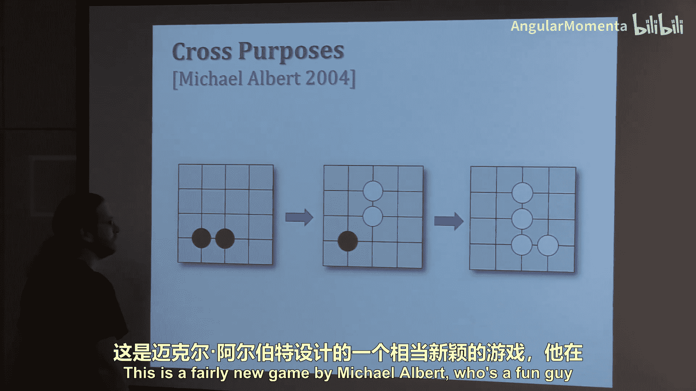
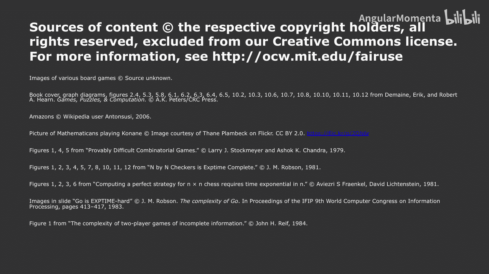

# 019：无界游戏

在本节课中，我们将学习双人无界游戏，即移动步数可能呈指数级增长的游戏。我们将探讨这类游戏的计算复杂性，并了解一些经典游戏（如国际跳棋、国际象棋和围棋）如何被证明是EXPTIME完全的。

---

## 概述

上一节我们介绍了移动步数多项式有界的双人游戏，并证明了它们是PSPACE完全的。本节中，我们将转向移动步数无界的双人游戏。这类游戏的状态空间可能呈指数级增长，其决策问题属于EXPTIME复杂性类。我们将看到，约束逻辑和多个经典棋盘游戏都属于此类。

---

## 有界双人约束逻辑回顾

首先，我们快速回顾一下有界双人约束逻辑，它是PSPACE完全的。其核心思想是模拟一个布尔公式求值游戏：白方玩家通过翻转特定的边来将变量设为真，黑方玩家则通过翻转其他边来将变量设为假。如果公式最终被满足，则白方获胜。这个框架被用来证明多个实际游戏的PSPACE完全性。

为了将约束逻辑的硬度结果应用到具体游戏中，我们通常需要一些基本构件，例如**选择变量**和**受保护或门**。这些构件允许我们在平面图中构建交叉结构，并确保信号传播的正确性。

---

## 具体游戏示例：亚马逊棋

亚马逊棋是一款在棋盘上进行的双人游戏，每位玩家控制四个“亚马逊”皇后。一个回合包含两步：移动一个己方皇后（沿任意方向走任意格，但不能穿过障碍），然后从新位置“射箭”到另一个格子（同样遵循皇后移动规则），被箭射中的格子永久变为障碍。游戏目标是分割出比对手更多的领地，当一方无法移动时即告负。

以下是证明亚马逊棋是PSPACE完全的核心构件：

*   **导线**：通过一系列皇后的移动和射击，将信号从一个位置传递到另一个位置。
*   **变量构件**：模拟玩家设置变量真值的初始阶段。白方或黑方谁先占据关键位置，就决定了该“变量”的状态。
*   **与门构件**：需要两个输入信号都被激活，才能触发输出信号。
*   **或门构件**：两个输入信号中任意一个被激活，即可触发输出信号。
*   **选择构件**：一个输入信号可以激活两个输出路径中的一条，且只能选择一条。
*   **分裂构件**：将一个输入信号复制并传递到两个输出路径。

通过将这些构件组合，我们可以从有界双人约束逻辑规约到亚马逊棋，从而证明其PSPACE完全性。

---

## 具体游戏示例：Kōnane

Kōnane是一种古老的夏威夷跳棋游戏。棋盘布满黑白棋子（类似国际跳棋开局）。玩家轮流移动，移动方式是让己方棋子跳过一条连续的对方向色棋子链（每次跳过一颗），被跳过的棋子被移除。移动必须沿直线进行，且不能在一次移动中改变方向。

以下是其PSPACE完全性的证明思路：

*   **导线**：通过一系列跳跃传递信号。
*   **变量构件**：同样，哪位玩家先占据关键位置，就设置了变量。
*   **或门/选择构件**：同一个结构可以充当或门或选择门，取决于信号来源。
*   **与门/分裂/移位构件**：一个复杂的构件可以模拟与门（需要两个输入按顺序激活）、分裂门（一个输入激活两个输出）或移位门（调整信号时序）。

游戏的关键在于设计安全的中间位置，防止对手在信号传递过程中进行破坏性捕获。通过精心安排棋子和跳跃路径，可以模拟约束逻辑，证明Kōnane是PSPACE完全的。

---

## 具体游戏示例：Cross Purposes

Cross Purposes是一款较新的游戏。棋盘上有一些竖立的黑色方块（“塔”）。两位玩家分别称为“水平”玩家和“垂直”玩家。水平玩家只能将塔向左或右推倒，垂直玩家只能将塔向上或下推倒。推倒后的塔变为“白色”并占据两格，无法再次移动。最后无法移动的玩家输掉游戏。

其PSPACE完全性证明同样基于有界双人约束逻辑：

*   **导线**：通过触发一系列塔的推倒来传递信号。垂直玩家（假设是我们希望获胜的一方）推倒一个塔后，水平玩家将被迫推倒下一个，依此类推。
*   **变量构件**：在游戏初始阶段，哪位玩家先推倒关键塔，就设置了变量。
*   **受保护或门**：确保最多只有一个输入信号能成功通过，避免浪费触发机会。
*   **选择构件**：输入信号可以选择两条输出路径之一。
*   **与门/分裂/移位构件**：一个多功能构件，通过控制塔的推倒顺序和路径，模拟与门、分裂门和移位门的功能。

证明中需要仔细设计，确保水平玩家除了被强制回应外没有其他有效移动，从而控制游戏进程。

---

## 随机游戏与PSPACE

我们简要讨论一种变体：双人有界随机游戏。在这种游戏中，一位玩家是对手，另一位玩家是随机（例如掷骰子）的。研究表明，这类游戏的决策问题同样是PSPACE完全的。直觉上，随机性似乎比对抗性对手要弱，但通过概率放大论证，可以证明它们在计算难度上大致相当。目前，还没有已知的经典骰子游戏被证明属于此类，这是一个有趣的研究方向。

---

## 迈向EXPTIME：无界游戏

现在，我们进入本节课的核心：移动步数无界的双人游戏。由于状态数量可能呈指数级增长，对这些游戏进行最优策略决策通常需要指数时间，对应的复杂性类是EXPTIME。

### 公式游戏家族

一系列被称为G1到G6的公式游戏被证明是EXPTIME完全的。它们是理解更复杂游戏硬度的基础。我们以G3为例：

*   **状态**：一组布尔变量（分属黑白双方）的赋值，以及一个指示轮到谁的变量。
*   **移动**：玩家必须翻转（即取反）一个己方颜色的变量。不允许跳过。
*   **输掉条件**：如果玩家在移动后使某个特定的DNF公式为真，则该玩家立即输掉游戏。

其他变体（G1, G2, G4, G6）在移动规则（如设置变量值而非翻转、可跳过）和获胜条件（玩家自己的公式、共同公式、CNF公式等）上有所不同，但都被证明是EXPTIME完全的。

### 为何属于EXPTIME？

对于这些游戏，一个状态可以用多项式长度的字符串表示（变量赋值和当前玩家）。因此，可能的状态总数最多是 `2^(多项式) = 指数级`。要判断初始状态是否为必胜态，最直接的方法是构建整个指数大小的状态转移图，然后通过逆向归纳（从立即输的状态开始标记）来确定每个状态的胜负。这个过程可以在指数时间内完成。

---

## 具体EXPTIME完全游戏：国际跳棋

国际跳棋（英式）被证明是EXPTIME完全的，这是一个非常精巧的证明。其核心思想是从G3公式游戏进行规约。

*   **变量构件**：用棋盘上的特定国王棋子在两个位置（代表真/假）之间移动来模拟变量翻转。
*   **强制吃子规则**：这是构造的关键。通过精心布置棋子，可以迫使对手沿着我们预设的路径进行一系列连续吃子，从而“激活”或“发送”信号。
*   **子句构件**：DNF公式的每个子句对应一个复杂的区域。白方需要将其所有相关变量（通过国王移动）以正确的赋值“发送”到该区域，并触发一系列连锁吃子。如果所有条件满足，白方将获得一系列“自由步数”。
*   **外部螺旋与获胜机制**：棋盘外围有一个巨大的螺旋结构，包含许多国王。如果白方通过满足公式获得了足够多的自由步数优势，它就可以进入螺旋，利用步数差逐步捕获所有黑方国王，从而锁定胜局。螺旋的规模确保了其步数资源远超内部构件的可能步数。

整个构造极其复杂，涉及奇偶性调整、防御路径、冗余设计等，但最终成功模拟了G3，证明了国际跳棋是EXPTIME完全的。

---

## 其他EXPTIME完全游戏

*   **国际象棋**：通过类似的原理（主要使用兵和象），也被证明是EXPTIME完全的。证明更为复杂。
*   **围棋（日本规则）**：围棋的EXPTIME完全性证明基于G3。虽然棋盘空间有限，但“劫”的规则（禁止立即回提）使得游戏可以进入极长的、非重复的循环威胁状态，从而可能产生指数长度的对局。日本规则禁止重复**上一回合**的全局局面，状态图仍为指数大小。
*   **无界双人约束逻辑**：允许玩家多次翻转边。通过从G6规约，可以证明其也是EXPTIME完全的。证明涉及“锁定”变量、攻击阶段以及精妙的时序平衡。

---

## 超越EXPTIME：更复杂的规则

如果我们为游戏添加更严格的历史记录规则，复杂性会进一步提升：

*   **超级劫规则（如中国规则）**：禁止重复**任何曾经出现过的**全局局面。这要求记住指数长的历史，可能将问题推入EXPSPACE。围棋在此规则下的确切复杂度是悬而未决的。
*   **禁止局面重复规则**：在G1-G3等公式游戏中，额外加入“如果重复任何过去的游戏配置则输”的规则。这使游戏变为EXPSPACE完全。
*   **带有X/Y变量的重复规则**：加入两个特殊变量X和Y。规则变为：如果重复了过去的配置，并且自那个过去配置以来，X和Y中最多只有一个被改变过，则输。这使游戏变为**双重指数时间（2-EXPTIME）** 完全。
*   **不完全信息游戏**：当玩家无法看到对手的全部状态时（私人信息），复杂性也可能达到双重指数时间或指数空间。

这些结果展示了游戏规则细微变化如何导致计算复杂性的巨大飞跃。

---

## 总结

本节课中，我们一起学习了双人无界游戏的计算复杂性。我们从PSPACE完全的有界游戏出发，探讨了亚马逊棋、Kōnane和Cross Purposes等例子。然后，我们进入了EXPTIME领域，理解了为何无界游戏通常需要指数时间求解，并看到了国际跳棋、国际象棋和围棋如何被证明是EXPTIME完全的。最后，我们瞥见了当引入局面重复禁止或不完全信息规则时，游戏复杂性如何进一步提升到EXPSPACE甚至双重指数时间。这些结果深刻揭示了即使是我们熟悉的棋盘游戏，其最优策略的寻找在计算上也是异常困难的。