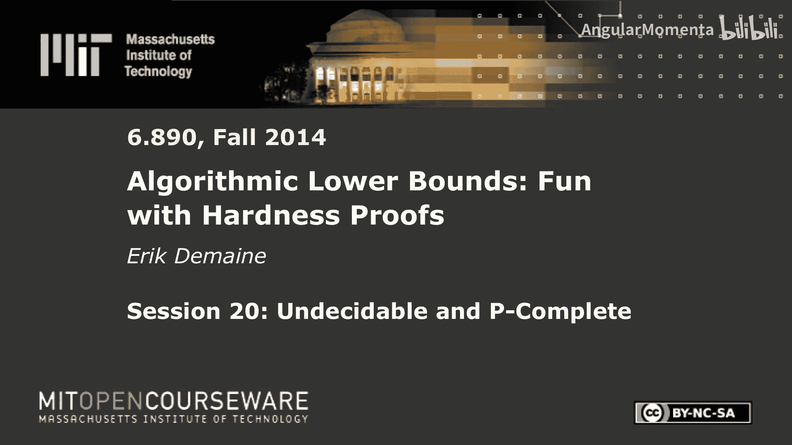
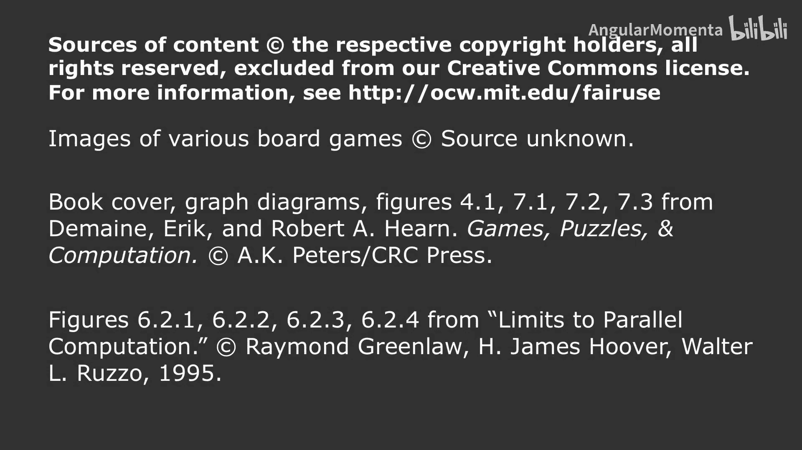

# 020：不可判定与P-完全问题



在本节课中，我们将学习算法下界理论中的两个重要概念：不可判定问题和P-完全问题。我们将首先探讨团队不完美信息游戏如何导致不可判定性，然后转向计算复杂性理论中的P-完全问题，了解哪些多项式时间可解的问题难以并行化。

---

## 团队不完美信息游戏与不可判定性

上一节我们介绍了不同玩家数量下的游戏复杂性分类。本节中，我们来看看团队不完美信息游戏。当游戏步数有**多项式**上界时，其复杂性对应于**NEXPTIME**（非确定性指数时间）。当游戏步数**无界**（可能接近无限多步）时，问题将变得**不可判定**，即不存在任何算法可以解决它。

以下是游戏复杂性分类矩阵的总结：
*   **有界步数团队不完美信息游戏**： 复杂性为NEXPTIME。一个潜在的实例是桥牌的单手牌局。
*   **无界步数团队不完美信息游戏**： 复杂性为不可判定。一个候选实例是“盲棋团队围棋”。

### 有界情况：DQBF与团队私有约束逻辑

我们从一个称为**DQBF**的问题开始，它是QBF（量化布尔公式）的一个变体。

在标准QBF中，量词交替出现，且每个量词可以依赖于之前所有变量的值。在DQBF中，我们有两组并行的存在量词，但存在变量的选择只能依赖于指定的全称变量子集。

**公式描述如下：**
`∀x1∀x2 ∃y1(x1) ∃y2(x2) φ(x1, x2, y1, y2)`

这里，`y1`的选择只能依赖于`x1`，`y2`的选择只能依赖于`x2`。`φ`是一个合取范式公式。这个问题可以看作一个三玩家游戏（一个黑方团队，两个白方玩家），且信息不完美。可以证明，DQBF是**NEXPTIME完全**的。

接下来，我们可以将DQBF归约到一个称为**有界团队私有约束逻辑**的游戏。在这个游戏中：
*   有三名玩家：一个黑方玩家，两个白方玩家。
*   游戏在一个有向图上进行，边被标记为对特定玩家可见或可翻转。
*   玩家只能翻转他们可见且合法的边。
*   游戏的目标是翻转某个特定的目标边。

通过精巧的构造，我们可以用TPCL来模拟DQBF，从而证明有界TPCL也是NEXPTIME完全的。有趣的是，在这种团队不完美信息设置下，单轮游戏和多轮游戏具有相同的计算能力（NEXPTIME完全），这与大多数其他游戏设置不同。

### 无界情况：从停机问题到团队计算游戏

现在，我们转向更令人兴奋的无界步数情况，这将导致**不可判定性**。我们从一个经典问题开始：**图灵机停机问题**。给定一个图灵机（初始磁带为空），判断它是否会最终停机。这个问题是众所周知的不可判定问题。

为了将其转化为一个使用有限资源的游戏，我们引入**团队计算游戏**。该游戏设置如下：
*   **玩家**： 一名黑方玩家，两名白方玩家（白1和白2）。
*   **游戏机制**：
    1.  黑方被强制运行一个给定的算法（或图灵机）`K`步（`K`为常数）。
    2.  如果算法输出结果（黑方胜或白方胜），游戏结束。
    3.  如果算法没有输出，则黑方可以选择设置两个比特`x1`和`x2`（取值A或B），作为给白方玩家的消息。
    4.  白方玩家`i`只能看到对应的`xi`，并以此设置一个内存单元`Mi`的值，作为其回合操作。
    5.  游戏重复进行。
*   **决策问题**： 白方团队是否有必胜策略？

这个游戏的关键在于，白方玩家必须协同“模拟”一个给定的图灵机。黑方通过选择`x1`和`x2`的序列，非确定性地查询白方维护的“指针”。白方要获胜，必须保证无论黑方如何选择查询序列（即无论图灵机的执行路径如何），它们模拟的计算历史都是有效的，并且最终能进入停机状态。

通过精心设计检查算法，我们可以将任意图灵机的停机问题归约到这个团队计算游戏，从而证明后者是**不可判定的**。其核心思想是利用了“白方必须应对黑方所有可能选择”这一全称量化特性，来强制白方进行正确的模拟。

随后，我们可以将团队计算游戏进一步归约为公式游戏，并最终归约为**无界团队私有约束逻辑**，从而证明它也是不可判定的。

---

## P-完全问题与并行计算

现在，让我们切换到另一个极端，从不可判定性回到多项式时间可解的问题，但关注其**并行计算**的难度。

### P类与NC类

我们熟知**P**类，即所有多项式时间可解的问题。在并行计算中，一个强大的模型是**NC**类。NC问题可以在多项式数量的处理器上，以**多对数时间**（即`(log n)^O(1)`）解决。这等价于由多项式大小、多对数深度的布尔电路族可计算的问题。

显然，**NC ⊆ P**。一个重要的复杂性理论假设是 **NC ≠ P**，即并非所有P中的问题都能被高效并行化。**P-完全**问题就是那些属于P，并且至少和P中所有问题一样“难”并行化的问题。如果某个P-完全问题属于NC，那么将推出P = NC，这与我们的假设矛盾。因此，P-完全问题被认为是“固有串行”的。

### 基础的P-完全问题

首先，我们有一个非常自然的P-完全问题：**（一元编码的）有界图灵机模拟**。给定一个图灵机和一个用一元编码的步数上限`T`，判断机器是否在`T`步内停机。由于`T`以一元编码，我们可以在`O(T)`时间内直接模拟，故该问题属于P。而P中任何问题都可以归约到它，所以它是P-完全的。

更实用、更适合用于归约的是各种**电路值问题**：
*   **CVP**： 给定一个布尔电路（无环）及其所有输入位的赋值，求输出位的值。
*   **单调CVP**： 电路只包含AND和OR门，没有非门。
*   **交替单调CVP**： 在单调CVP基础上，要求从任意输入到输出的任何路径上，AND和OR门严格交替出现，并且以OR门开始和结束。
*   **AM2CVP**： 在交替单调CVP基础上，要求每个门的**入度和出度恰好为2**。
*   **同步AM2CVP**： 在AM2CVP基础上，要求电路是同步的，即每一层深度的门同时接收输入。

我们可以通过一系列保持P-完全性的归约，从单调CVP得到同步AM2CVP。这些归约技巧包括：用树结构限制扇出/扇入、插入冗余门来保证交替性和度数、通过复制和延迟门来实现同步等。同步AM2CVP的简单结构使得它非常适合用于证明其他问题的P-完全性。

### 一个优雅的归约示例：词典序最大独立集

考虑以下问题：给定一个图，求其**词典序第一个极大独立集**（即按顶点编号顺序，能加就加）。一个简单的串行算法如下：
```
S = ∅
for i = 1 to n:
    if vertex i is not adjacent to any vertex in S:
        add i to S
```
判断某个特定顶点`v`是否在这个算法输出的集合`S`中，是一个P-完全问题。

我们可以从**NOR电路值问题**（将同步AM2CVP中的门替换为NOR门）归约到这个问题：
1.  为电路中的每个输入和门创建一个对应的顶点。
2.  添加一个特殊顶点“0”，将其连接到所有赋值为0的输入顶点。
3.  根据电路的拓扑序为所有顶点编号（拓扑排序可在NC内完成）。
4.  在生成的图上运行上述串行算法。
5.  可以证明，一个顶点被加入独立集`S`，当且仅当它在原电路中输出值为1。

这个归约简洁地展示了如何用图上的一个简单贪婪算法来模拟电路计算。

### 更多P-完全问题示例

以下是一些有趣的P-完全问题：
*   **生命游戏**： 给定初始配置和一元编码的时间`T`，判断特定细胞在`T`时刻是否存活。
*   **无环图上的广义地理学**： 在无环有向图上进行的双人游戏。
*   **凸包层**： 给定平面点集，反复计算并移除凸包，判断一个点是否在第`k`层。
*   **多列表排名**： 合并多个已排序列表后，求某个元素的排名。
*   **线性规划**： 即使系数仅为0和1。
*   **最大流问题**： 属于“弱”P-完全（如果允许权重很大）。
*   **开放问题**： 判断两数是否互质、模幂运算`a^b mod c`、有界度图同构等，被猜想是P-完全的。

---

## 总结

本节课中，我们一起学习了算法下界中的两个高级主题。
1.  **不可判定性**： 我们探讨了团队不完美信息游戏如何通过模拟图灵机，导致即使在有限资源下也产生不可判定的问题。从停机问题出发，我们介绍了团队计算游戏，并最终将其与约束逻辑联系起来。
2.  **P-完全性**： 我们转向了多项式时间内的计算难度。通过引入并行计算模型NC，我们定义了P-完全问题——那些在P中但被认为难以并行化的问题。我们学习了一系列基础的P-完全问题（如各种电路值问题），并通过一个优雅的归约示例（词典序最大独立集）展示了如何证明P-完全性。最后，我们列举了现实中的一些P-完全问题及其开放猜想。



这两个主题分别代表了计算可行性光谱的两个极端：不可判定（无算法可解）和P-完全（有算法但固有串行），极大地丰富了我们对问题内在难度的理解。