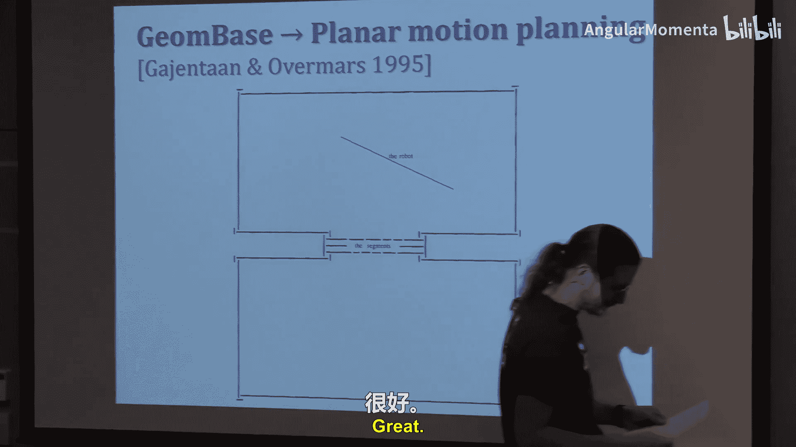
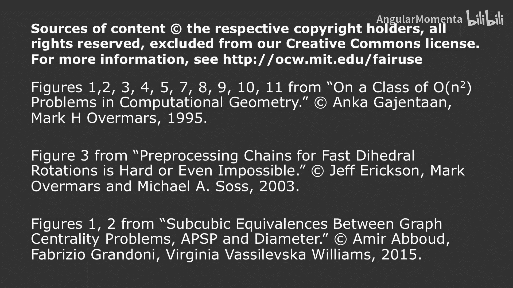

# 021：3SUM与APSP问题复杂度 🔍

在本节课中，我们将探讨多项式时间层次结构中的“低端”问题，即区分线性时间与非线性时间（特别是二次方或三次方时间）的复杂性。我们将重点关注一个核心问题——3SUM问题，并了解其如何作为证明其他问题计算下界的基础。课程将介绍3SUM问题的定义、已知算法、相关猜想，以及一系列被证明是“3SUM困难”的计算几何和图形问题。最后，我们会简要提及与全对最短路径（APSP）问题相关的立方时间下界猜想。

## 3SUM问题及其复杂性

3SUM问题定义如下：给定一个包含n个整数的集合，需要判断是否存在其中三个数之和为零。一个简单的立方时间算法是测试所有三元组。然而，也存在更高效的二次方时间算法。

以下是两种已知的二次方时间算法：

1.  **随机化算法**：首先构建一个包含所有整数的哈希表。然后，计算所有两两之和 `a + b`，并检查其相反数 `-(a + b)` 是否存在于哈希表中。由于 `a + b + c = 0` 等价于 `a + b = -c`，此算法能在期望的 `O(n²)` 时间内运行。
2.  **确定性算法**：首先对整数进行排序（`O(n log n)`）。对于每个目标值 `-c`，使用双指针技术在排序后的数组中找到两个数，使其和等于 `-c`。对n个目标值各执行一次线性扫描，总时间为 `O(n²)`。

**3SUM猜想**认为，在最坏情况下，不存在运行时间为 `O(n^(2-ε))`（对于任意 ε > 0）的算法。这个猜想催生了“3SUM困难性”的概念：如果一个问题是3SUM困难的，那么除非3SUM猜想错误，否则该问题也不存在真正的次二次方时间算法（即 `O(n^(2-ε))`）。

需要指出，当整数范围受限时（例如在 `-U` 到 `U` 之间），可以通过快速傅里叶变换（FFT）在 `O(U log U)` 时间内解决。因此，在讨论下界时，通常假设数字足够大（例如，大于 `n²`）。此外，存在一些在特定计算模型下的次二次方算法（如字RAM模型、实数RAM模型或决策树模型），但它们要么需要随机化，要么在实际中难以高效实现，因此并未推翻关于标准计算模型的3SUM猜想。

## K-SUM问题

3SUM问题可以推广为K-SUM问题：给定n个整数，判断是否存在其中K个数之和为零。

*   **计算复杂性**：当K较大时（例如K ≈ n/2），该问题实际上是NP难的（可规约到划分问题）。在指数时间假设（ETH）下，可以证明不存在 `n^(o(k))` 时间的算法。
*   **已知算法与猜想**：存在一个简单的随机化算法，时间复杂度为 `O(n^(ceil(k/2)))`。例如，对于3SUM（K=3），这就是 `O(n²)`；对于5SUM（K=5），则是 `O(n³)`。相应的 **K-SUM猜想** 认为，这个时间复杂度是最优的，即不存在 `O(n^(ceil(k/2) - ε))` 时间的算法。

## 3SUM困难性与规约

我们称一个问题为 **3SUM困难** 的，如果该问题存在 `O(n^(2-ε))` 时间的算法将意味着3SUM问题也存在 `O(n^(2-ε))` 时间的算法，从而与3SUM猜想矛盾。

证明3SUM困难性通常通过 **3SUM规约** 实现。规约必须满足以下条件：
*   可以将3SUM问题实例在次二次方时间内转化为目标问题实例。
*   目标问题实例的规模 `n'` 必须是原问题规模 `n` 的线性倍数（即 `n' = O(n)`）。
*   只能进行常数次数的目标问题“调用”。

这样，如果目标问题存在真正的次二次方算法，将其与高效的规约过程结合，就能得到3SUM问题的次二次方算法，从而违背猜想。

接下来，我们将从几个基础的核心3SUM困难问题出发。

## 核心的3SUM困难问题

以下三个基本问题是等价的（相互间存在次二次方规约），常作为证明其他问题3SUM困难性的起点：

1.  **标准3SUM**：如前所述。
2.  **3SUM‘（ABC版本）**：给定三个整数集合A、B、C，判断是否存在 `a ∈ A, b ∈ B, c ∈ C` 使得 `a + b = c`。这本质上是3SUM的一个变体。
3.  **几何基问题（Geometric Base）**：给定二维平面上位于三条水平线（y=0, y=1, y=2）上的点集，判断是否存在一条**非水平**直线穿过三个点（每条线上各一个）。可以通过将3SUM‘中的数字映射为点的x坐标来规约。

上一节我们介绍了几个等价的基准问题。本节中，我们将利用它们来证明一系列计算几何问题的3SUM困难性。

## 计算几何中的3SUM困难问题

许多计算几何问题可以被证明是3SUM困难的，这意味着它们很可能需要二次方时间来解决。以下是一些例子及其规约思路：

*   **共线性检测**：给定平面上的n个点，判断是否存在三点共线。可以通过将3SUM中的每个数x映射到点 `(x, x³)` 来规约。代数上可以证明，三个点共线恰好对应原始三个数之和为零。
*   **直线分离线段**：给定n条线段，判断是否存在一条直线能将它们分成两个非空集合，且不接触任何线段。可以通过从几何基问题规约，将点替换为围绕该点的微小间隙，使得分离线存在当且仅当原三点共线。
*   **条带覆盖矩形**：给定一个轴对齐矩形和若干平行条带（由两条平行线界定的区域），判断这些条带的并集是否完全覆盖矩形。这可以通过对“直线分离线段”问题的实例进行对偶变换得到。
*   **三角形覆盖三角形/并集面积/并集空洞**：给定一个大三角形和许多小三角形，判断小三角形是否完全覆盖大三角形（覆盖问题）、计算小三角形并集的面积（面积问题）、判断并集是否包含空洞（空洞问题）。这些问题都可以从“条带覆盖矩形”问题规约，通过用三角形拼接来模拟条带和矩形。
*   **点覆盖（线性规划近似）**：给定二维平面上n个半平面和一个整数k，判断是否存在一个点至少被k个半平面包含。这可以通过从“条带覆盖矩形”问题规约，巧妙地将条带和矩形的约束转化为半平面的计数条件。
*   **弱可见性**：给定两条线段（或一个点与一个三角形），判断它们是否弱可见（即存在各自上的一点，其连线不被其他障碍物阻挡）。对于线段弱可见性或点能否看到三角形等问题，可以规约自三角形覆盖问题。
*   **运动规划**：
    *   **平面运动规划**：给定一个可平移旋转的线段机器人、障碍物以及起点终点，判断是否存在可行路径。可以构造类似几何基问题的障碍物布局，使得机器人通过当且仅当存在特定的分离线（即原三点共线）。
    *   **三维平移运动规划**：机器人是一个垂直线段，障碍物是水平三角形，只允许平移。同样可以构造一个“笼子”，使得机器人逃脱当且仅当笼子底部存在未被三角形覆盖的空隙。

这些规约展示了3SUM猜想在计算几何领域的深远影响，将众多看似不同的问题的复杂性联系在了一起。

## 图论中的类似下界猜想

除了二次方时间下界，在立方时间领域也有类似的核心猜想，主要围绕 **全对最短路径（APSP）** 问题。

**APSP猜想** 认为，在带权图中计算所有顶点对之间的最短路径距离，需要 `Ω(n^(3-ε))` 时间（对于稠密图，n为顶点数）。基于此猜想，一系列问题被证明是 **APSP困难** 的，即如果它们存在真正的次立方时间算法，则APSP也存在。

一些APSP困难的问题包括：
*   **检测负权三角形**：图中是否存在总权重为负的三角形。
*   **图的半径/中位数**：计算图的半径（所有顶点偏心率的最小值）或中位数（到所有其他顶点距离之和最小的顶点）。
*   **列出所有三角形**：在无权重图中列出所有三角形。

值得注意的是，目前 **3SUM猜想** 与 **APSP猜想** 之间尚未建立正式的规约关系，但它们共同构成了理解多项式时间低端复杂性的重要框架。

## 总结

本节课中我们一起学习了计算复杂性理论中关于“低端”多项式时间的问题。我们深入探讨了3SUM问题及其猜想，它是证明许多问题需要二次方时间的基础。我们看到了如何通过规约，将3SUM的困难性传递到一系列计算几何问题，如共线性检测、运动规划、覆盖问题等。最后，我们简要介绍了图论中基于APSP猜想的立方时间下界研究。这些猜想和规约技术，帮助我们理解了许多自然问题为何看似需要二次方或立方方时间，并描绘了算法下界研究中的一个活跃而有趣的领域。