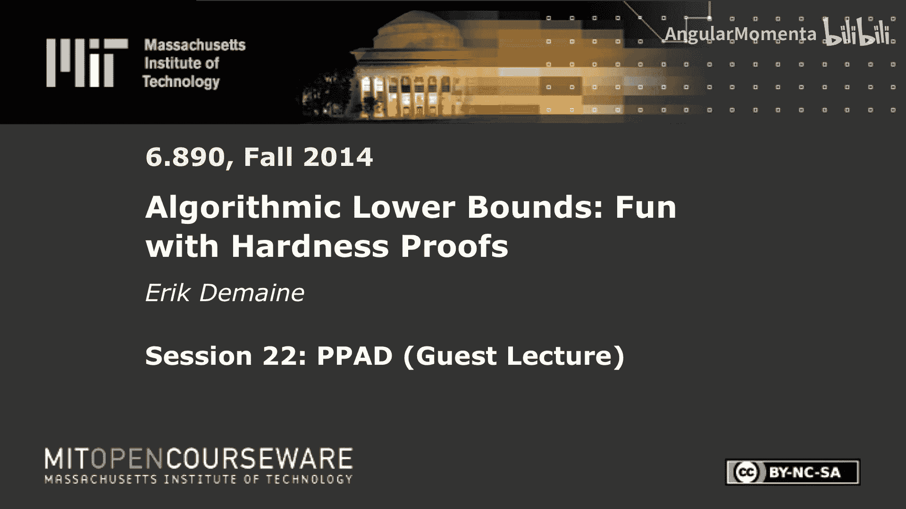

**算法下界：22：PPAD 完全性入门**



在本节课中，我们将学习一个名为 PPAD 的计算复杂性类。这个类源于对纳什均衡、布劳威尔不动点定理和斯佩纳引理等存在性定理的计算复杂性研究。我们将了解为什么传统的 NP 完全性框架不足以描述这些问题，并探索 PPAD 的定义及其第一个完全问题。

---

**动机：三个经典的存在性定理**

上一节我们介绍了课程背景，本节中我们来看看驱动 PPAD 类定义的三个核心数学定理。

**纳什定理**
纳什定理指出，任何有限博弈（即玩家数量有限、策略集有限）都存在一个混合策略纳什均衡。在一个博弈中：
*   有 N 个玩家。
*   每个玩家 i 有一个策略集 S_i。
*   每个玩家 i 有一个收益函数 u_i，它将所有玩家的策略组合映射到一个实数。

一个混合策略是玩家在其策略集上的一个概率分布。一组混合策略 (x_1, ..., x_N) 构成一个纳什均衡，当且仅当对于每一个玩家 i，给定其他玩家的策略，玩家 i 无法通过单方面改变自己的策略来获得更高的期望收益。

用公式表示，对于所有玩家 i 和所有可能的替代混合策略 x_i‘，有：
`E_{s~x}[u_i(s)] >= E_{s_{-i}~x_{-i}, s_i~x_i'}[u_i(s)]`
其中 x 表示所有玩家的混合策略组合。

**布劳威尔不动点定理**
布劳威尔定理指出，任何从一个紧致凸集到其自身的连续函数，都存在一个不动点（即 f(x) = x 的点）。例如，将一个圆盘旋转、收缩平移或连续变形到自身内部，总有一个点保持不变。

**斯佩纳引理**
斯佩纳引理是一个组合拓扑引理。考虑一个被三角化的正方形（或 n 维单形），其顶点用有限种颜色着色。如果边界上的着色满足特定条件（例如，在正方形的三条边上分别缺少某种颜色），那么无论内部顶点如何着色，内部至少存在一个“全色”三角形（其三个顶点颜色互不相同）。事实上，全色三角形的数量是奇数。

---

**计算问题与 NP 的局限性**

上一节我们了解了这些定理保证了解的存在性，本节中我们来看看它们的计算版本。

我们可以定义对应的搜索问题：
1.  **NASH**：给定一个博弈描述和一个精度参数 ε，找到一个 ε-近似纳什均衡（即没有玩家能通过单方面偏离获得超过 ε 的收益改善）。
2.  **BROUWER**：给定一个对紧致凸集到自身的连续函数的简洁描述（例如一个电路），以及一个精度参数 ε，找到一个 ε-近似不动点（即满足 ||f(x) - x|| < ε 的点 x）。
3.  **SPERNER**：给定一个对指数级大规模三角化着色实例的简洁描述（例如一个能根据坐标输出颜色的电路），其边界着色满足斯佩纳条件，找到一个全色三角形。

这些问题都是“完全”的：对于任何有效输入，解都存在。它们属于复杂度类 **TFNP**（Total Function NP），即那些解总存在且验证容易的 NP 搜索问题。

然而，传统的 **NP 完全性**概念（如 SAT 问题）并不适用于它们。因为要将 SAT 归约到 SPERNER，你必须将可能无解的 SAT 实例映射到总有解的 SPERNER 实例。如果归约后 SPERNER 的“解”（全色三角形）总是存在，那么你总能将其转换回 SAT 的“解”（可满足赋值），但这对于原本不可满足的 SAT 实例是不可能的。因此，不存在这种保持解存在性的归约。我们需要一个新的框架来刻画这类“总是有解”的难题。

---

**从证明到复杂性类：PPAD 的诞生**

上一节我们指出了传统框架的不足，本节中我们深入探讨斯佩纳引理的证明，它将引导我们定义 PPAD。

斯佩纳引理的标准证明使用了一个“路径追踪”论证：
1.  在三角化网格外引入一个额外的“虚拟”全色三角形。
2.  定义一条行走路径：从虚拟三角形开始，反复穿过“红-黄”边（且黄在左）进入相邻三角形。
3.  由于边界着色特性，路径无法走出网格，也不会循环（因为进入和离开一个三角形需通过不同的边），并且网格是有限的。
4.  因此，路径必须终止于某个内部的**全色三角形**。这个终点就是我们要找的解。

这个证明可以抽象为在一个有向图中寻找一个“不平衡”顶点（入度不等于出度）：
*   将每个三角形视为图的一个顶点。
*   如果三角形 A 能通过一条“红-黄”边（黄在左）走到三角形 B，则连一条从 A 到 B 的有向边。
*   在这个有向图中，每个顶点的入度和出度最多为 1（因为最多只有一条边进入和一条边离开）。因此，整个图由一些路径和环组成。
*   虚拟三角形是一个不平衡顶点（只有出边，没有入边）。
*   在这样的图中，如果存在一个不平衡顶点，则必定存在另一个不平衡顶点（由奇偶性保证）。而全色三角形恰好对应图中的不平衡顶点（度数为 1）。

于是，证明的核心被简化为一个组合事实：**在一个每个顶点入度和出度至多为 1 的有向图中，若存在一个不平衡顶点，则必存在另一个不平衡顶点。**

---

**定义 PPAD 与 END-OF-THE-LINE**

基于上述洞察，我们可以定义一个计算问题，它捕获了在“简洁描述”的指数级大图中寻找另一个不平衡顶点的复杂性。

**END-OF-THE-LINE 问题**
输入由两个多项式规模电路描述：
*   `P` (可能的“前驱”电路)
*   `N` (可能的“后继”电路)
这两个电路试图描述一个顶点集为 `{0,1}^n` 的有向图 G。对于顶点 u 和 v，当且仅当 `v = N(u)` 且 `u = P(v)` 时，图中存在一条从 u 到 v 的有向边。这保证了每个顶点的入度和出度至多为 1。
已知：顶点 `0^n`（全零串）在 G 中是不平衡的（通过查询 P 和 N 容易验证）。
任务：输出**另一个**不平衡的顶点。

**复杂度类 PPAD**
PPAD 被定义为所有可以多项式时间归约到 END-OF-THE-LINE 问题的 TFNP 中的问题。PPAD 代表“有向图奇偶论证”（Polynomial Parity Argument on Directed graphs）。

直观理解：END-OF-THE-LINE 问题就像是给定了两个“黑盒”函数，让你在一个可能是指数大的路径/环结构中，从起点 `0^n` 出发，找到路径的终点或另一个分支点（即另一个不平衡顶点）。斯佩纳引理的构造正是这种问题的一个具体实例。

---

**PPAD 完全性初步**

上一节我们定义了 PPAD，本节中我们来看看 PPAD 完全性的第一个关键问题。

研究证明，SPERNER 和 BROUWER 都是 PPAD 完全问题。这意味着它们不仅属于 PPAD，而且和 END-OF-THE-LINE 一样难。一个更核心的 PPAD 完全问题是**算术电路可满足性问题**的一个近似变体。

**近似算术电路可满足性 (Approximate Circuit Sat)**
输入：一个由特殊门电路组成的算术电路，允许循环。门类型包括：
*   `=` (赋值)：`y = x`
*   `+` (加法)：`z = min(x + y, 1)`
*   `-` (减法)：`z = max(x - y, 0)`
*   `*c` (乘常数)：`z = min(c * x, 1)` (c 为常数)
*   `==` (比较)：如果 `x > y`，则 `z` 必须为 0；如果 `x < y`，则 `z` 必须为 1；如果 `x = y`，则 `z` 可以是 [0,1] 中任意值。
所有变量和门的输出值被限制在区间 [0, 1] 内。
任务：为所有变量和门输出分配 [0,1] 之间的值，使得所有门的关系被**近似满足**（允许一定的计算误差）。

这个问题被证明是 PPAD 完全的。它扮演的角色类似于布尔电路可满足性问题 (SAT) 之于 NP 完全性。从这个问题出发，可以构造出到 NASH 等其他自然问题的归约。

例如，考虑一个简单电路：
```
A -----> (==) ----> (=1/2) ----> C
        比较门        赋值门
        |
        v
        B
```
其中 `(=1/2)` 门强制 C = 1/2。分析可知，唯一能（近似）满足所有约束的解是 A = B = C = 1/2。比较门在输入相等时，其输出可以是任意值（这里设为 1/2），从而满足赋值门的要求。

---

**总结与展望**

本节课中我们一起学习了：
1.  **动机**：纳什均衡、布劳威尔不动点、斯佩纳引理等存在性定理引出了对“总有解但难找”问题的计算复杂性研究。
2.  **局限性**：传统的 NP 完全性框架无法很好地刻画这类总搜索问题。
3.  **核心洞察**：斯佩纳引理的证明可抽象为在特定结构的有向图中寻找不平衡顶点。
4.  **定义 PPAD**：基于上述洞察，定义了 END-OF-THE-LINE 问题及复杂度类 PPAD，用以捕获这类基于有向图奇偶论证的复杂性。
5.  **PPAD 完全性**：斯佩纳、布劳威尔以及一个近似的算术电路可满足性问题被证明是 PPAD 完全的。


在下节课中，我们将看到如何利用这个算术电路问题，证明寻找纳什均衡是一个 PPAD 完全问题，从而在计算复杂性上确认其内在的难度。