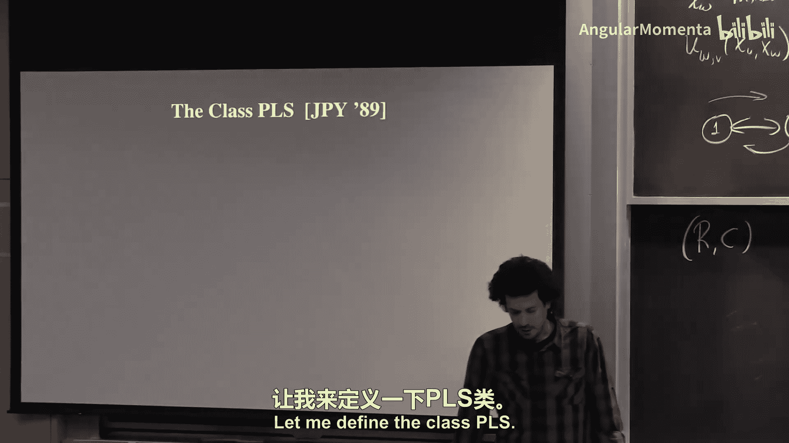
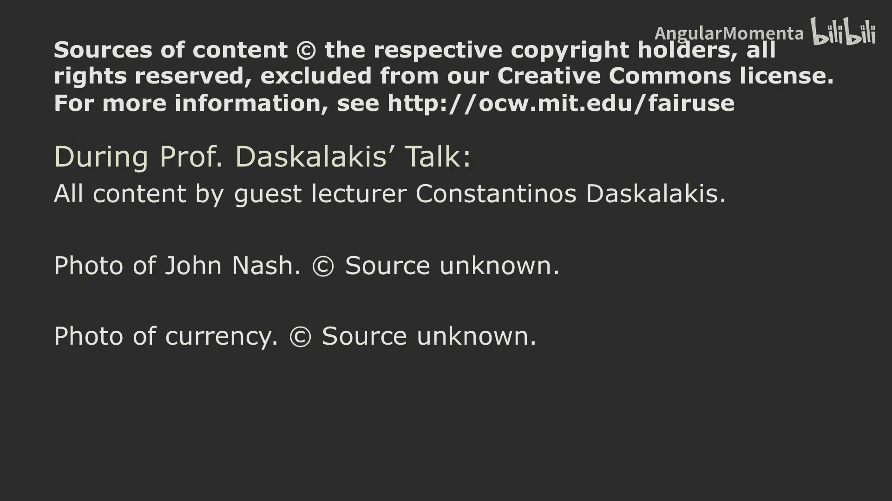

# 023：PPAD 归约

在本节课中，我们将学习PPAD类及其完全性证明，特别是如何将算术电路满足性问题归约到纳什均衡问题。我们还将简要介绍其他基于存在性论证的复杂性类，如PPA、PLS和PPP。

---

## 课程回顾

上一节我们介绍了拓扑学中的有趣定理（纳什、斯佩纳、布劳威尔），并定义了相应的问题。由于这些定理的存在，对应的搜索问题总是有解的。我们研究了TFNP中那些总是有解的问题，并试图找出使它们“总有解”的组合论证。这个论证被证明是基于有向图的奇偶论证。基于此，我们定义了PPAD类，并引入了PPAD完全问题——算术电路满足性问题。本节课，我们将从该问题出发，展示一系列PPAD硬度归约。

首先，让我们回顾一下PPAD类的核心定义。PPAD类具有组合特性。其定义方式是：在所有可能的n位字符串（一个指数级大的集合）上定义一个图。通过提供两个电路P（可能的前驱）和N（可能的后继），我们可以在字符串V1和V2之间建立一条有向边，条件是它们满足父子关系（即V2认为V1是其父节点，且V1认为V2是其子节点）。对所有字符串对进行此操作后，我们得到一个图。问题“线尾”是：给定这两个电路及其定义的图，如果全零字符串的入度与出度不同（即不平衡），则要求你找到另一个不平衡的节点（字符串）。PPAD类就是所有在多项式时间内可归约到“线尾”问题的TFNP搜索问题。

需要记住的是，由这两个电路定义的图具有特定结构：每个顶点的入度和出度最多为1。因此，图由一些路径和环组成。我们寻找的是所有“红色”点（即除全零点外的任何不平衡点）。

另一方面，我们最初的目标问题（纳什均衡、布劳威尔不动点）具有更“连续”的特性。因此，我们没有直接尝试将“线尾”问题归约到纳什或布劳威尔问题，而是引入了一个更接近连续领域的问题——**算术电路满足性问题**，并声称它是PPAD完全的。这使其成为归约的自然起点。

以下是该问题的定义：

**输入**：一个电路，包含两种节点：变量节点（V1 到 Vn）和门节点（G1 到 Gm）。每个门节点有六种可能类型之一：赋值门、加法门、减法门、设为常数门、乘以常数门、比较门。根据类型，门节点有0到2个输入，并总是有1个输出。该电路**没有输入变量**，允许循环。关键点是：每个变量节点的入度为1；每个门节点的输入数（0、1或2）取决于其类型；边只存在于变量节点和门节点之间（或门节点和变量节点之间），变量节点之间或门节点之间没有边。

**任务**：为电路中的变量分配一个在[0,1]区间内的实数值，使得所有门的约束条件得到满足。以下是门约束：
*   **赋值门**：输出变量的值等于输入变量的值。
*   **加法门**：输出变量的值等于两个输入变量值之和（但需限制在[0,1]内，即若和大于1则取1，小于0则取0）。
*   **减法门**：输出变量的值等于第一个输入减去第二个输入的值（同样限制在[0,1]内）。
*   **设为常数门**：输出变量被设为一个特定常数值c（在[0,1]内）。
*   **乘以常数门**：输出变量的值等于输入变量乘以一个常数c（结果限制在[0,1]内）。
*   **比较门**：如果第一个输入值大于第二个，则输出为1，否则为0。

我们上次声称，对于任何这样的电路，总存在一个满足所有约束的赋值（这需要通过不动点定理来论证）。我们还声称，找到这样一个赋值是PPAD完全的。此外，我们可以在门约束中允许±ε的误差，这个ε也是输入的一部分。也就是说，我们可以要求满足近似约束。

上次我们还简要展示了纳什均衡PPAD硬度的证明结构：将通用的PPAD完全问题“线尾”嵌入到三维立方体的几何中，定义斯佩纳引理的一个版本，然后将其归约到算术电路满足性问题。我们没有展示归约的细节，因为那部分很复杂。本节课，我们将展示如何从**算术电路满足性问题**归约到**纳什均衡**问题，以说明使用该问题向其他问题归约的便利性。

这就是上节课的回顾。本节课，我们将重点讨论纳什均衡的PPAD完全性证明，简要介绍来自组合数学的其他两个例子，最后讨论其他存在性论证及其定义的复杂性类（PPA、PPP、PLS）。在开始之前，回答上节课的一个问题：PPAD代表“有向图的多项式奇偶论证”，反映了该类是基于有向图的奇偶论证这一事实。

---

## 从算术电路满足性到纳什均衡的归约

我们将重点关注从算术电路满足性到纳什均衡的归约。在展示归约之前，需要先介绍一个概念：**图形博弈**和其特例**多矩阵博弈**。

图形博弈由Kearns、Littman和Singh在2001年引入，旨在刻画玩家的收益仅依赖于少数其他玩家行动的场景（例如，由于地理或通信限制）。在图形博弈中，玩家是（有向）图中的节点，一个玩家的收益仅依赖于她自己的策略以及指向她的玩家的策略。

多矩阵博弈是图形博弈的一个特例，出现得更早。在多矩阵博弈中，节点的收益函数是可加分离的。具体来说，一个玩家V的收益，作为所有人混合策略的函数，可以分离为所有指向她的边上的某个双人收益函数的和。由于玩家独立随机化，任何关于一对玩家策略的期望（其分布是乘积分布）都可以写成一个二次型。因此，多矩阵博弈可以由一个有向图定义，其中每条有向边关联一个矩阵（定义该边上的双人收益）。之所以叫“多矩阵”，是因为它涉及许多矩阵（而两人博弈只需要两个矩阵）。

现在，我们想要做的是：为了将算术电路满足性归约到纳什均衡，我们首先将其归约到寻找**多矩阵博弈的纳什均衡**。这一步完成后，我们再将其归约到两人博弈。第一步（到多人博弈）实际上是简单的部分，之前（从其他问题归约到算术电路满足性）的部分才是困难的。

那么，如何将算术电路满足性问题归约到多矩阵博弈的纳什均衡问题呢？类似于NP完全性归约中的“ gadget ”思想，我们需要找出在多矩阵博弈中能够模拟电路中各种运算的小型构件。我们将引入所谓的**博弈构件**——即执行算术运算的小型多矩阵博弈，然后将它们组合起来以模拟一个算术电路满足性实例。

我们将以**加法构件**为例来展示。该构件包含四个玩家，每个玩家只有两个纯策略：0和1。因此，一个玩家的混合策略就是她以概率p选择1，p是[0,1]区间的一个实数。构件的结构如下：有四个玩家X、Y、W、Z。X和Y是构件的**输入玩家**，W是**辅助玩家**，Z是**输出玩家**。输入玩家指向W，但W和Z的行动不影响X和Y。输出玩家Z的收益依赖于W。我们需要定义W和Z的收益函数，使得在这个小博弈的任何纳什均衡中，加法运算得以体现。

具体定义如下：
*   玩家W的收益：若W选择策略0，则其期望收益为 `Prob(X=1) + Prob(Y=1)`。若W选择策略1，则其期望收益为 `Prob(Z=1)`。
*   玩家Z的收益：若Z选择策略0，则无论W做什么，其收益恒为0.5。若Z选择策略1，则其收益为 `1 - Prob(W=1)`。

可以构造具体的收益矩阵来实现这些期望收益。

我们的主张是：在任何包含此构件的大型多矩阵博弈的纳什均衡中，输出玩家Z以概率1行动的概率，等于输入玩家X和Y以概率1行动的概率之和（当然，结果被限制在[0,1]之间）。可以通过简单的案例分析来证明这一点。关键在于，算术运算实际上发生在玩家选择的混合策略概率中。

类似地，我们可以定义**减法构件**，只需将W选择0时的收益改为 `Prob(X=1) - Prob(Y=1)`，证明思路完全相同。

我们声称，可以实现模拟算术电路满足性所需的所有类型的门。以下表格总结了所需构件（用 `p(Node)` 表示节点以概率1行动的概率）：

| 门类型 | 条件（在纳什均衡中需满足） |
| :--- | :--- |
| 赋值 | `p(Z) = p(X)` |
| 加法 | `p(Z) = min(p(X) + p(Y), 1)` |
| 减法 | `p(Z) = max(p(X) - p(Y), 0)` |
| 设为常数 c | `p(Z) = c` |
| 乘以常数 c | `p(Z) = min(c * p(X), 1)` |
| 比较 | 若 `p(X) > p(Y)`，则 `p(Z)=1`；若 `p(X) < p(Y)`，则 `p(Z)=0`；相等时任意。 |

因此，给定一个算术电路满足性实例，我们可以通过组合对应的构件来创建一个多矩阵博弈，使得该博弈的任何纳什均衡都满足所有门条件。这样，通过找到该博弈的一个纳什均衡，我们就解决了初始的算术电路满足性实例。这也间接证明了每个算术电路满足性实例都必然有解（因为纳什定理保证纳什均衡存在）。此外，可以证明解可以用有理数表示，且其描述复杂度是输入规模的多项式。

关于比较构件，我们可以展示其简单实现：输出玩家Z的收益设计为，当 `p(X) > p(Y)` 时，Z倾向于选择1；当 `p(X) < p(Y)` 时，Z倾向于选择0；相等时则无差异。这很容易通过收益矩阵实现。

---

## 从多矩阵博弈到两人博弈

接下来，我们需要从多矩阵博弈（多人）归约到两人博弈。首先要注意，我们实现的所有门构件都可以用**二分图**来表示。也就是说，我们可以用两种颜色（例如红色和蓝色）给构件中的玩家着色，使得输入和输出玩家在同一侧，辅助玩家在另一侧。我们声称所有需要的门都可以用这种二分图结构的多矩阵博弈实现。

基于此，我们可以创建“律师”游戏。我们将有一个**红方律师**和一个**蓝方律师**。红方律师的策略集是其所有红色客户策略集的**并集**（而非笛卡尔积，否则归约规模会指数膨胀）。蓝方律师同理。

在律师游戏中，如果红方律师选择红色客户U的策略i，蓝方律师选择蓝色客户V的策略j，那么他们的收益就是原多矩阵博弈中客户U和V在采取策略(i, j)时会获得的收益。如果U和V在原博弈中没有边相连，则双方收益均为0。

一个美好的设想是：如果(x, y)是律师游戏的一个纳什均衡，那么观察律师分配给各个客户的边缘概率分布，这些分布构成的集合就是原多矩阵博弈的一个纳什均衡。然而，这只是一个设想，因为律师可能只代表有利可图的客户，给某些客户的概率分配为0，导致边缘分布未定义。

为了解决这个问题，我们引入一个**高赌注游戏**，让律师们在玩原游戏的同时也玩这个游戏。假设每个律师都有n个客户（可通过填充虚拟玩家使数量相等）。我们将客户任意标记为1到n。

高赌注游戏的规则如下：当红蓝律师选择策略时，如果他们选择的策略所属的客户**标签相同**，则红方律师获得一大笔钱M，蓝方律师损失M。如果他们选择的客户标签不同，则双方收益均为0。这本质上是一个零和游戏，红方律师试图“抓住”蓝方律师（选择相同标签），蓝方律师试图“躲避”。

可以证明，在这个高赌注游戏的任何纳什均衡中，每个律师都以**均匀的概率**（1/n）选择代表每个客户的策略集（至于在每个客户的具体策略间如何分配概率则是任意的）。

现在，我们将要用于归约的最终两人博弈定义为**原律师游戏**与**高赌注游戏**的**和**（即收益相加）。我们选择M为一个极大的数，远大于原博弈中的最大收益。

可以分析这个组合游戏的纳什均衡。由于M极大，在决定如何将总概率质量分配给不同客户时，高赌注游戏占主导地位，因此律师们会以**近似均匀**的概率代表每个客户。而在决定了分配给某个客户U的总概率质量X_U后，律师如何在其具体策略间分配X_U，则主要由原律师游戏部分决定，因为不同策略间的收益差不再包含巨大的M。

通过分析均衡条件，我们可以推导出，由此产生的边缘概率分布构成了原多矩阵博弈的一个**近似纳什均衡**。近似误差可以通过选择更大的M来控制。由于我们的算术电路满足性问题允许门约束有±ε的误差，因此这个近似纳什均衡对应了原问题的一个近似解，并且该归约保持了PPAD难度。

这就是从多矩阵博弈到两人纳什均衡归约的核心思想。最初的归约论文是到了四人博弈（因为当时使用的乘法门构件需要四部分图），但后续研究（由Chen和Deng完成）发现我们实际并未使用通用的乘法门，所有必需的门都可以用二分图实现，因此可以归约到两人博弈。

---

## 其他存在性论证与复杂性类

PPAD建立在**有向图奇偶论证**之上。组合数学中还有其他自然的存在性论证，每个都对应一个不同的复杂性类。

1.  **无向图奇偶论证**：如果一个无向图有一个奇度顶点，那么它必有另一个奇度顶点（握手引理）。这定义了 **PPA** 类（多项式无向图奇偶论证）。
2.  **局部搜索**：每个有向无环图（DAG）都有一个汇点。这定义了 **PLS** 类（多项式局部搜索）。
3.  **鸽巢原理**：如果一个函数将n个元素映射到n-1个元素，则必然存在碰撞。这定义了 **PPP** 类（多项式鸽巢原理）。

### PPA类

类似于PPAD，输入是一个电路C，输入n位，输出一个包含k个n位字符串的列表。该电路在所有字符串上诱导一个无向图：在V1和V2之间连边，当且仅当V2在V1的邻居列表中，且V1在V2的邻居列表中。这样定义的图，每个顶点的度数最多为2k。问题“奇度节点”是：如果全零字符串的度数为奇数，则找到另一个度数为奇数的节点。PPA类就是所有可多项式时间归约到该问题的TFNP搜索问题。一个著名的PPA完全问题是**史密斯问题**：给定一个三正则图及其中的一个哈密顿回路，找到另一个不同的哈密顿回路（史密斯定理保证了其存在性）。

### PLS类

输入是两个电路。一个电路C将n位字符串映射到一个邻居列表（多个字符串）。另一个电路S为每个字符串计算一个“分数”（有理数）。由此诱导一个有向无环图：从V1到V2有边，当且仅当V2在V1的邻居列表中，且S(V2) > S(V1)。问题“寻找汇点”是：找到一个顶点X，其分数不低于任何邻居。PLS类就是所有可归约到该问题的TFNP搜索问题。一个例子是**局部最大割问题**：给定一个带权图，找到一个割，使得无法通过移动单个顶点来增加割的权值。对于任意权重，该问题是PLS完全的。

### PPP类

输入是一个电路C，将n位字符串映射到n位字符串。问题“寻找碰撞”是：要么找到一个X使得C(X) = 0^n，要么找到两个不同的X, Y使得C(X) = C(Y)。鸽巢原理保证了解的存在。PPP类就是所有可归约到该问题的TFNP搜索问题。

这些类之间存在包含关系：PPAD ⊆ PPA，PPAD ⊆ PPP。PPAD也是PLS的子集吗？这需要具体验证，但通常认为它们互不包含。

最后，回答一个关于为什么需要定义这些特定类而不是直接研究TFNP完全问题的重要问题：TFNP不是一个“语法类”。也就是说，给定一个图灵机，你无法判定它是否计算一个总问题（即对所有输入都有输出）。因此，我们必须关注那些由特定存在性论证保证“总有解”的问题类别，这样才能为这些类别定义复杂性类并证明完全性结果。否则，我们得到的将是“承诺类”，不利于建立完全性理论。

---

## 总结

本节课我们一起学习了：
1.  **PPAD类**的回顾，其基于有向图的奇偶论证。
2.  **算术电路满足性问题**作为PPAD完全问题的核心地位。
3.  如何通过设计**博弈构件**（如加法、减法、比较构件），将算术电路满足性问题归约到**多矩阵博弈的纳什均衡**问题。
4.  如何通过创建“律师”游戏和“高赌注”游戏，将多矩阵博弈进一步归约到**两人纳什均衡**问题，从而证明寻找纳什均衡是PPAD难的。
5.  简要介绍了其他基于组合存在性论证的复杂性类：**PPA**（无向图奇偶论证）、**PLS**（局部搜索）、**PPP**（鸽巢原理），并给出了各类中的典型问题。
6.  理解了定义这些特定类的必要性在于它们是由语法上可检查的存在性定理所保证的“总有解”问题类，便于建立完全性理论。

这些概念构成了理解算法下界中基于拓扑和组合论证的复杂性类的基础。