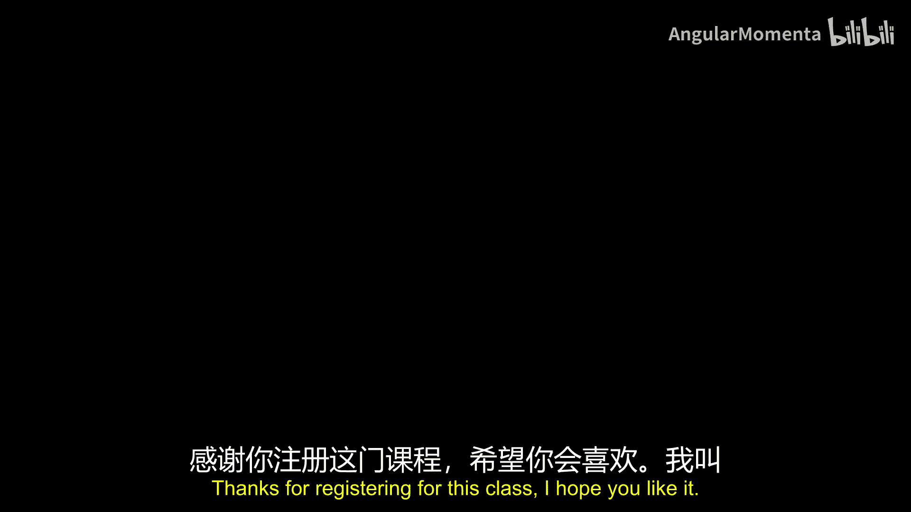
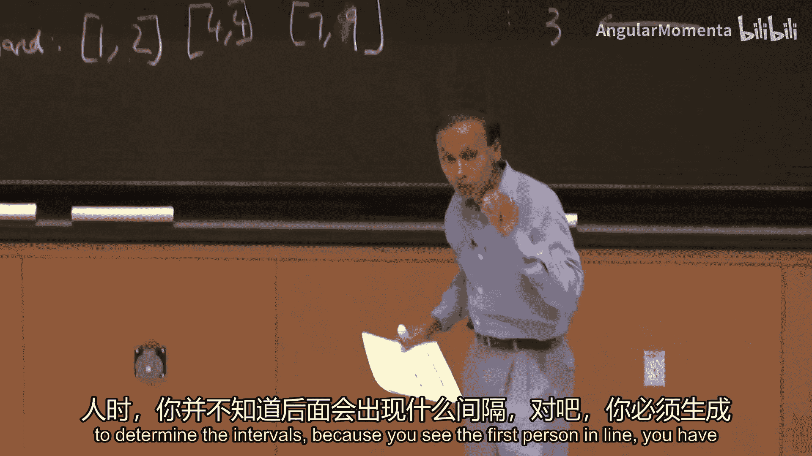
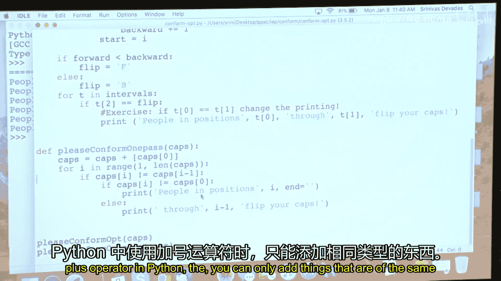
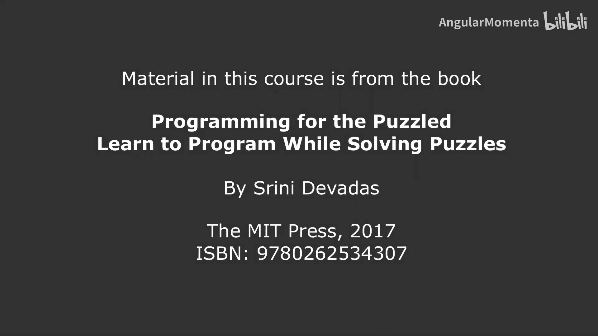

# 001：你们都会服从



## 概述
在本节课中，我们将学习如何通过编程解决一个关于队列中人群帽子朝向的谜题。我们将从问题描述开始，逐步分析，并最终用代码实现解决方案。这个谜题的核心是找到最少的指令，让队列中所有人的帽子朝向一致。

## 问题描述
你是一名棒球比赛的检票员。排队等候入场的人们都戴着帽子，有些人的帽子朝前戴，有些人的帽子朝后戴。你的任务是让所有人的帽子朝向一致（全部朝前或全部朝后），以便他们入场。每个人都知道自己在队列中的位置（索引从0开始）。你只能发出“翻转帽子”的指令，并且为了节省精力，你可以对连续区间内的人发出一个指令（例如，“位置1到位置2的人，翻转你们的帽子”）。目标是找出需要发出的最少指令数量。

## 初始思路与算法
上一节我们介绍了问题的基本设定，本节中我们来看看如何设计算法来解决它。

最直观的方法是先找出队列中所有帽子朝向相同的连续区间（我们称之为“区间”）。然后，比较朝前区间和朝后区间的数量，选择数量较少的那种朝向作为目标，并对属于该朝向的所有区间发出翻转指令。

以下是实现此思路的步骤：
1.  遍历队列，识别并记录所有连续的帽子朝向区间。
2.  统计朝前区间和朝后区间的数量。
3.  选择区间数量较少的朝向作为目标。
4.  针对目标朝向的每个区间，发出一个翻转指令。

## 优化：单次遍历算法
上一节我们介绍了一个需要两次遍历的算法，本节中我们来看看如何优化为一次遍历。

观察发现，最终选择翻转哪个朝向的帽子，实际上只取决于队列第一个人的帽子朝向。如果第一个人戴的是朝前的帽子，那么最终需要翻转的就是所有戴朝后帽子的人所在的区间，反之亦然。因此，我们可以在一次遍历中，直接根据第一个人的朝向，在遇到另一个朝向的连续区间开始时，立即发出翻转该区间的指令。



以下是优化后的算法步骤：
1.  在队列末尾添加一个“虚拟”的人，其帽子朝向与第一个人相同，以简化边界处理。
2.  从第二个人开始遍历队列（索引1）。
3.  每当发现当前人的帽子朝向与前一个人不同时，就意味着一个新的区间开始了。根据第一个人的朝向决定是否需要为前一个区间发出指令。
4.  遍历完成后，即得到了所有需要发出的指令。

## 代码实现
现在，让我们将上述算法转化为Python代码。

首先，我们实现初始的“两次遍历”算法：

```python
def please_conform_naive(caps):
    """
    初始算法：两次遍历
    caps: 一个列表，包含‘F’（朝前）和‘B’（朝后）
    """
    intervals = []
    start = 0
    caps = caps + [‘END‘]  # 添加哨兵值简化边界处理

    # 第一次遍历：找出所有区间
    for i in range(1, len(caps)):
        if caps[start] != caps[i]:
            intervals.append((start, i-1, caps[start]))
            start = i

    # 统计区间数量
    f_count = sum(1 for interval in intervals if interval[2] == ‘F‘)
    b_count = len(intervals) - f_count

    # 决定翻转哪个朝向
    flip = ‘F‘ if f_count > b_count else ‘B‘

    # 第二次遍历：发出指令
    for interval in intervals:
        if interval[2] == flip:
            if interval[0] == interval[1]:
                print(f‘Person at position {interval[0]}, flip your cap!‘)
            else:
                print(f‘People in positions {interval[0]} through {interval[1]}, flip your caps!‘)
```

接下来，我们实现优化后的“单次遍历”算法：

```python
def please_conform_one_pass(caps):
    """
    优化算法：单次遍历
    caps: 一个列表，包含‘F’（朝前）和‘B’（朝后）
    """
    # 在队列末尾添加第一个人的帽子朝向作为哨兵
    caps = caps + [caps[0]]

    for i in range(1, len(caps)):
        if caps[i] != caps[i-1]:
            if caps[i] != caps[0]:
                # 开始一个新的需要翻转的区间
                print(f‘People in positions {i}‘, end=‘‘)
            else:
                # 一个需要翻转的区间结束
                print(f‘ through {i-1}, flip your caps!‘)
```






## 总结
本节课中我们一起学习了“你们都会服从”这个编程谜题。我们从问题描述出发，首先设计了一个直观但需要两次遍历的算法来找出最少的翻转指令。接着，我们通过观察发现了关键优化点——只需关注队列第一个人的帽子朝向，从而将算法优化为仅需一次遍历。最后，我们用Python代码实现了这两种算法。这个谜题虽然简单，但很好地展示了如何通过深入分析问题来优化解决方案和代码。