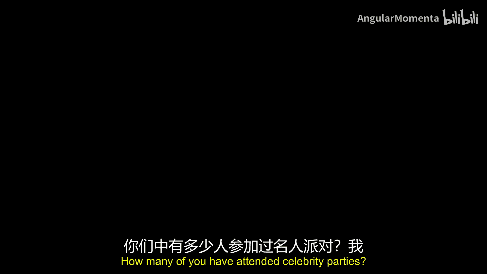
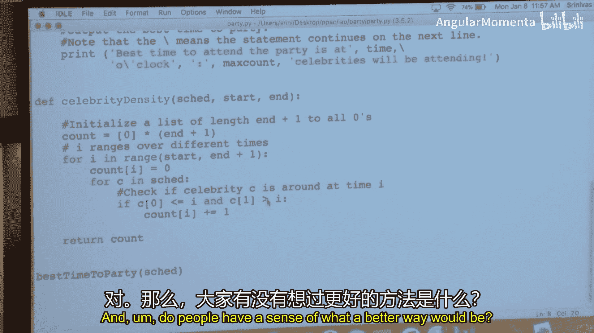
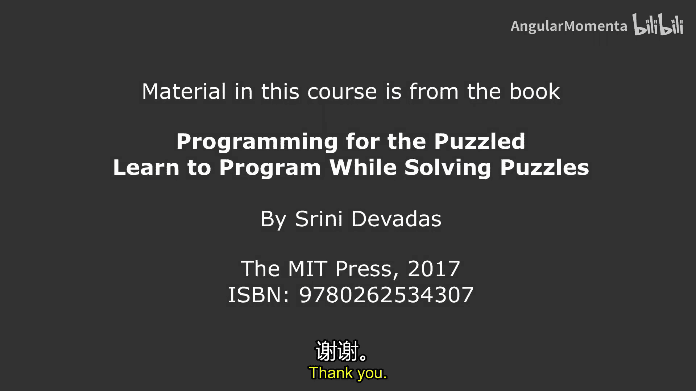

# 002：谜题2-聚会的最佳时间 🎉



在本节课中，我们将学习如何解决一个关于选择最佳聚会时间以遇到最多名人的问题。我们将从最直观的暴力解法开始，然后逐步优化，最终得到一个更高效、更优雅的算法。

## 问题概述

假设你获得了一张名人派对的入场券，但只能在派对期间选择一个特定的**一小时**时间段参加。派对会公布每位名人出席的精确时间区间。你的目标是选择一个时间段，使得在该时间段内能遇到的**名人数量最大化**。

例如，已知以下名人出席时间表（时间采用24小时制，区间左闭右开，例如 `[6, 7)` 表示6点整到7点整之间）：
*   Beyonce: `[6, 7)`
*   Taylor: `[7, 9)`
*   Brad: `[10, 11)`
*   Katie: `[10, 12)`
*   Chong: `[8, 10)`

通过手动计算，我们可以发现，在10点开始的一小时内，可以遇到Brad、Katie和Chong三位名人，这是最优解。

## 方法一：暴力枚举法

最直接的思路是，枚举所有可能作为起始时间的小时（例如从最早的名人到达时间到最晚的名人离开时间），然后分别计算在每个时间段内有多少位名人在场。

以下是该算法的核心逻辑描述：

1.  **确定时间范围**：遍历所有名人时间表，找到最早的开始时间 `earliest_start` 和最晚的结束时间 `latest_end`。
2.  **枚举并计算**：对于 `earliest_start` 到 `latest_end` 之间的每一个整数小时 `t`（代表时间段 `[t, t+1)`），执行以下操作：
    *   初始化计数器 `count = 0`。
    *   遍历每一位名人的时间区间 `[s, e)`。
    *   如果 `t` 满足 `s <= t < e`，则意味着该名人在时间段 `[t, t+1)` 内也在场，计数器 `count` 加1。
3.  **选择最大值**：记录下所有 `t` 对应的 `count` 值，选择 `count` 最大的那个 `t` 作为最佳开始时间。


**代码示例（Python）**:
```python
def best_time_to_party_brute_force(schedule):
    # 1. 确定时间范围
    start = min(s[0] for s in schedule)
    end = max(s[1] for s in schedule)
    
    max_count = 0
    best_time = start
    
    # 2. 枚举每个可能的小时
    for t in range(start, end):
        count = 0
        # 检查每位名人
        for c in schedule:
            if c[0] <= t < c[1]: # 判断时间t是否在名人出席区间内
                count += 1
        # 3. 更新最大值
        if count > max_count:
            max_count = count
            best_time = t
            
    return best_time, max_count
```



**算法分析**：
这个算法简单易懂，但效率较低。它的时间复杂度是 **O(n * m)**，其中 `n` 是需要枚举的小时数，`m` 是名人数量。如果时间粒度更细（例如精确到分钟），或者名人数量很多，计算量会急剧增加。

## 方法二：基于事件的扫描线算法

上一节我们介绍了直观但低效的暴力枚举法。本节中，我们来看看如何通过观察问题的本质来设计一个更高效的算法。

**核心洞察**：在场名人数量**只会在名人到达或离开的时刻发生变化**。在其他任何时间点，人数都是保持不变的。因此，我们无需检查每一个可能的时间点，只需关注这些“事件点”。

以下是优化算法的步骤：

1.  **创建事件列表**：将每位名人的到达时间标记为 `+1`（表示人数增加），离开时间标记为 `-1`（表示人数减少）。将所有事件点放入一个列表。
2.  **排序事件**：将所有事件点按照时间先后顺序排序。如果多个事件发生在同一时间，通常将 `+1` 事件放在 `-1` 事件之前处理，以确保逻辑正确。
3.  **扫描并计算**：初始化当前人数 `current_count = 0` 和最大人数 `max_count = 0`。按顺序处理排序后的事件列表：
    *   遇到 `+1` 事件：`current_count += 1`
    *   遇到 `-1` 事件：`current_count -= 1`
    *   每次更新 `current_count` 后，检查并更新 `max_count`。**记录下达到 `max_count` 时对应的事件时间**。
4.  **输出结果**：`max_count` 就是能遇到的最多名人数量，而记录下的时间就是最佳开始时间（注意：这个时间是一个名人到达的时间点）。

**代码示例（Python）**:
```python
def best_time_to_party_smart(schedule):
    events = []
    # 1. 创建事件列表
    for c in schedule:
        events.append((c[0], ‘start’)) # 到达事件
        events.append((c[1], ‘end’))   # 离开事件
        
    # 2. 排序事件：先按时间，再按类型（‘start’ 在 ‘end’ 前）
    events.sort(key=lambda x: (x[0], 0 if x[1] == ‘start‘ else 1))
    
    max_count = 0
    current_count = 0
    best_time = 0
    
    # 3. 扫描事件
    for time, event_type in events:
        if event_type == ‘start’:
            current_count += 1
            # 关键：最佳时间总是一个名人到达的时刻
            if current_count > max_count:
                max_count = current_count
                best_time = time
        else: # event_type == ‘end’
            current_count -= 1
            
    return best_time, max_count
```

**算法分析**：
这个算法的时间复杂度主要取决于排序步骤，为 **O(m log m)**，其中 `m` 是事件数量（名人数的两倍）。之后只需线性扫描一次事件列表。对于大规模数据，这比暴力枚举法要高效得多。

**一个重要观察**：从算法中我们可以发现，**最佳开始时间总是与某位名人的到达时间重合**。因为人数只有在到达时才会增加，我们总是在人数达到新的峰值时记录时间，而这个峰值是由到达事件触发的。

## 总结

本节课中我们一起学习了“聚会的最佳时间”这个谜题的两种解法。
1.  **暴力枚举法**：思路简单，通过检查每一个可能的时间段来寻找最大值，但效率较低，适用于问题规模较小或对效率要求不高的场景。
2.  **扫描线算法**：通过将问题转化为处理“到达”和“离开”事件，并对其进行排序和扫描，高效地找到了最优解。这种方法的核心是**关注状态发生变化的关键点**，避免了大量冗余计算。



理解第二种算法背后的思想——将区间问题转化为对端点的处理——对于解决许多其他类似的调度和区间问题非常有帮助。