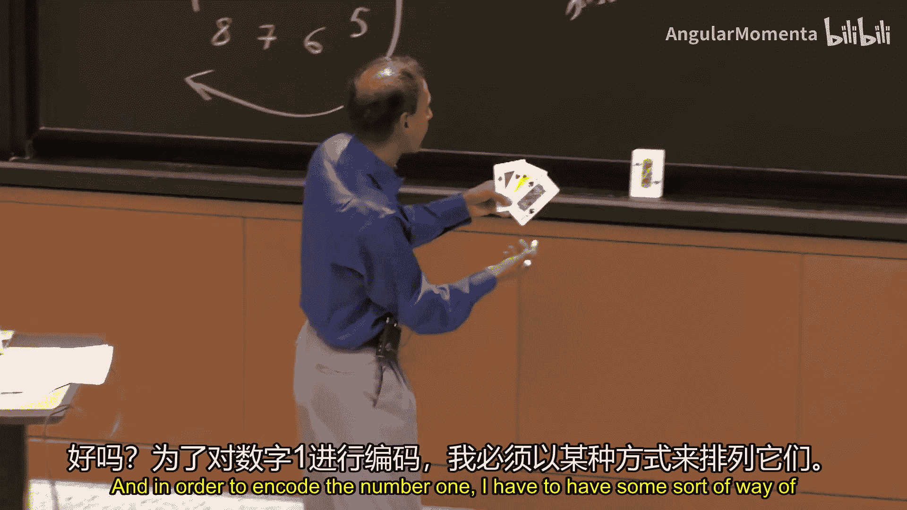
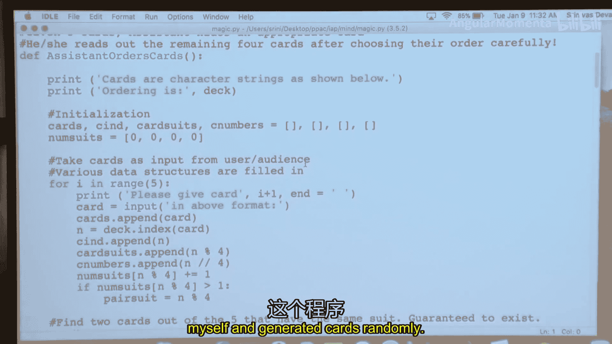
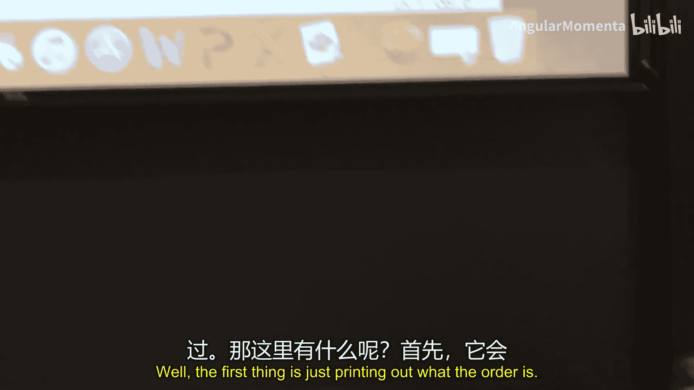
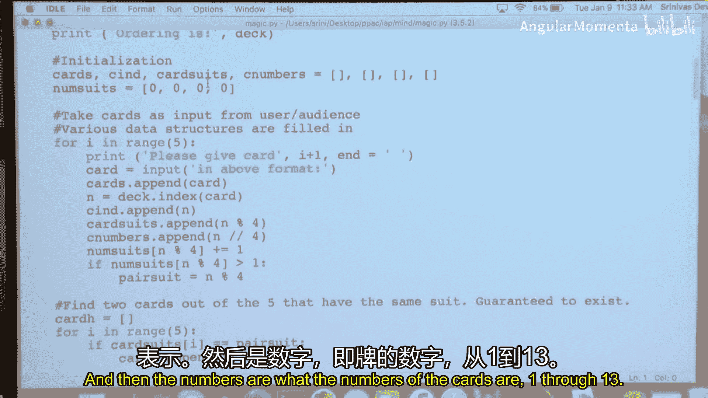
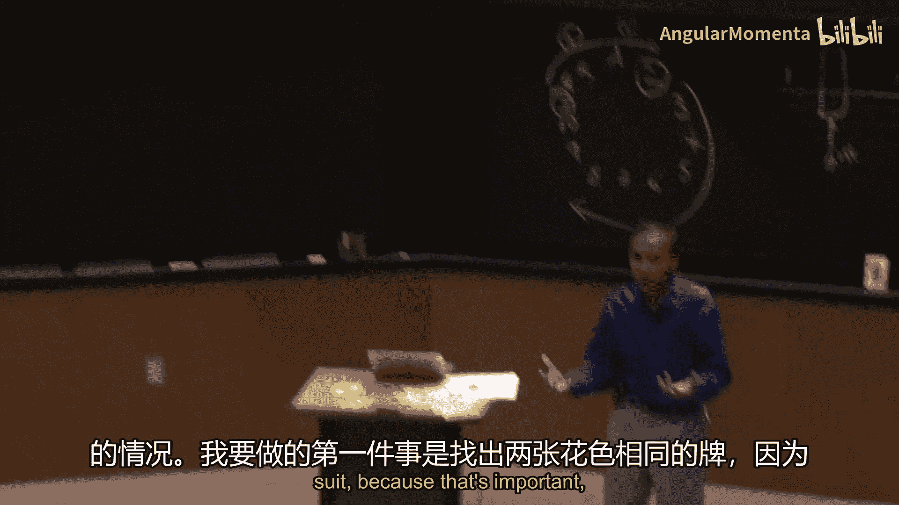
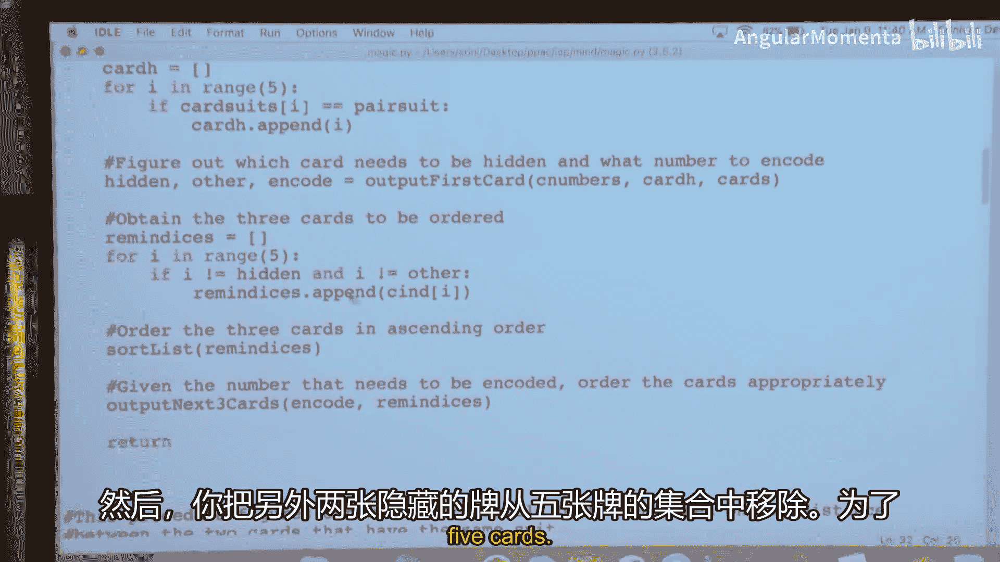
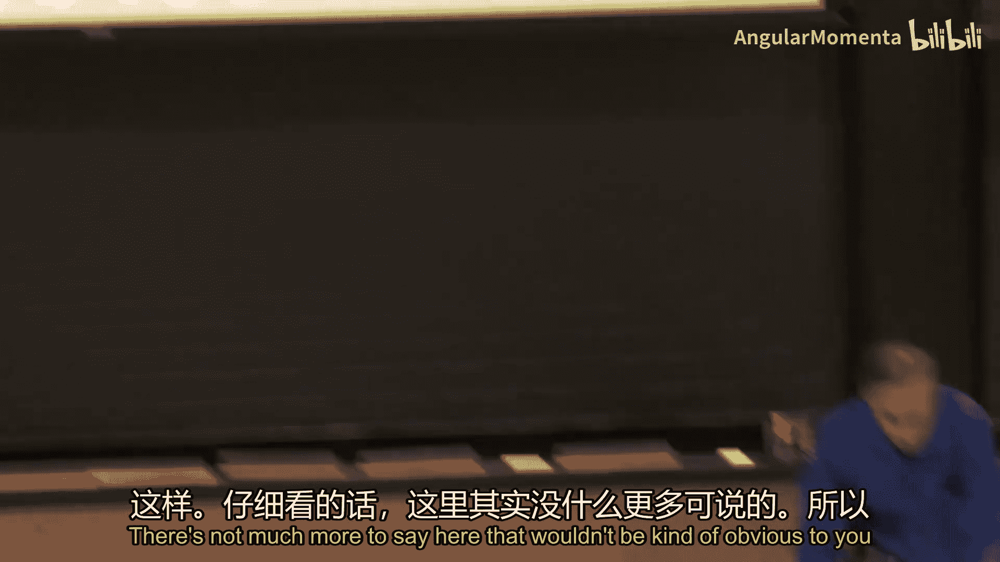
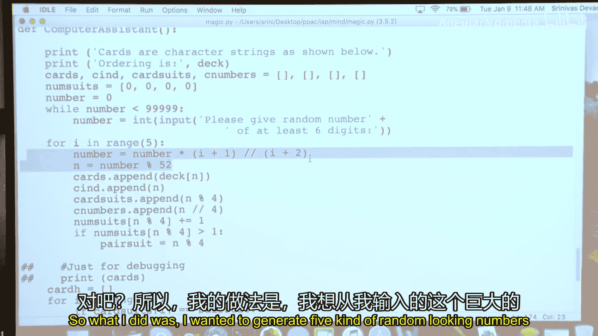
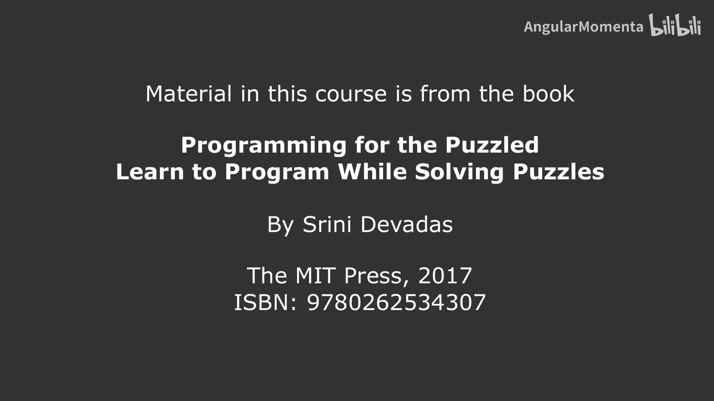

# 003：读心术（经过一点校准）🎴


在本节课中，我们将要学习一个看似神奇的纸牌读心术背后的算法。通过这个谜题，我们将理解如何利用有限的信息（四张牌的顺序）来编码并传递关于第五张隐藏牌的信息。

## 概述

这个魔术的核心是：助手向观众展示五张随机抽取的牌，然后隐藏其中一张，并向“读心者”展示其余四张。仅凭这四张牌的顺序，“读心者”就能准确猜出隐藏的牌。这并非真正的魔法，而是一个巧妙的算法。

## 算法原理

上一节我们介绍了谜题的基本设定，本节中我们来看看其背后的数学原理和算法步骤。

### 第一步：找到重复花色

从五张牌中，我们总能找到至少两张花色相同的牌。这是因为只有四种花色（黑桃、红心、梅花、方块），根据鸽巢原理，五张牌中必然有至少一对花色相同。

### 第二步：确定“关键牌对”

在找到的同花色牌对中，我们需要选择一张作为向“读心者”展示的第一张牌，另一张则作为需要猜出的隐藏牌。选择的原则是：确保隐藏牌的点数与第一张展示牌的点数，在循环顺序（将A看作1，J=11，Q=12，K=13，然后13之后循环回1）中的距离不超过6。

**公式**：对于两张同花色牌的点数 `a` 和 `b`，计算循环距离 `d = (b - a + 13) % 13`。我们需要选择 `a` 和 `b` 的角色，使得 `1 <= d <= 6`。

### 第三步：编码距离

现在，我们知道了隐藏牌的花色（由第一张牌决定）以及它与第一张牌的距离 `d`（1到6之间的一个数字）。剩下的三张牌将被用来编码这个数字 `d`。



以下是编码方法：
我们将三张牌按预定义的全局顺序（例如，先按花色排序：梅花<方块<红心<黑桃，再按点数A到K排序）排列后，会得到一个“小-中-大”的顺序。通过改变这个顺序，我们可以编码1到6的数字。

例如，我们可以定义：
*   `S M L` (小， 中， 大) = 1
*   `S L M` = 2
*   `M S L` = 3
*   `M L S` = 4
*   `L S M` = 5
*   `L M S` = 6


助手根据计算出的距离 `d`，将三张牌按对应的顺序摆放。



### 第四步：解码与猜测





“读心者”看到四张牌后，执行逆过程：
1.  看到第一张牌，确定隐藏牌的花色。
2.  观察后三张牌的摆放顺序，解码出距离 `d` (1到6)。
3.  以第一张牌的点数为起点，在循环点数顺序中向前数 `d` 步，即得到隐藏牌的点数。

## 代码实现



上一节我们介绍了算法的逻辑步骤，本节中我们来看看如何用代码实现这个魔术的编码部分。核心是计算哪张牌应该隐藏，以及如何排列剩余的三张牌。



以下是一个Python代码示例的关键部分，用于确定隐藏牌和第一张牌：

```python
def find_hidden_and_first(cards):
    # cards 是一个包含五张牌信息的列表
    # 假设每张牌有 ‘suit‘ 和 ‘rank‘ 属性，rank为1-13
    # 1. 找到同花色的两张牌
    suit_count = {}
    for card in cards:
        suit_count.setdefault(card.suit, []).append(card)

    for suit, suited_cards in suit_count.items():
        if len(suited_cards) >= 2:
            card_a, card_b = suited_cards[0], suited_cards[1]
            # 2. 计算两种顺序的循环距离
            dist_ab = (card_b.rank - card_a.rank + 13) % 13
            dist_ba = (card_a.rank - card_b.rank + 13) % 13

            # 3. 选择距离在1-6之间的配置
            if 1 <= dist_ab <= 6:
                first_card, hidden_card = card_a, card_b
                distance = dist_ab
                return first_card, hidden_card, distance
            elif 1 <= dist_ba <= 6:
                first_card, hidden_card = card_b, card_a
                distance = dist_ba
                return first_card, hidden_card, distance
    # 理论上不会执行到这里，因为五张牌必有一对同花色且可配置
    return None, None, None
```



确定距离 `d` 后，我们需要排列剩余的三张牌。以下是排列三张牌以编码数字的示例代码：

```python
def encode_distance(other_cards, distance):
    # other_cards 是剩下的三张牌
    # 1. 先按全局顺序排序，得到默认的 S M L 顺序（编码1）
    sorted_cards = sorted(other_cards, key=lambda c: (c.suit_order, c.rank))

    # 2. 根据目标距离，重新排列
    # 映射关系：1:SML, 2:SLM, 3:MSL, 4:MLS, 5:LSM, 6:LMS
    encoding_map = {
        1: [0, 1, 2],  # S, M, L
        2: [0, 2, 1],  # S, L, M
        3: [1, 0, 2],  # M, S, L
        4: [1, 2, 0],  # M, L, S
        5: [2, 0, 1],  # L, S, M
        6: [2, 1, 0],  # L, M, S
    }
    order = encoding_map[distance]
    arranged_cards = [sorted_cards[i] for i in order]
    return arranged_cards
```

## 练习与扩展

这个魔术的算法是确定的，但实现方式可以变化。一个有趣的练习是修改代码，使用不同的全局排序规则或不同的顺序编码映射。



此外，可以思考一个更具挑战性的问题：**能否只用四张牌完成类似的魔术？** 观众随机抽取四张牌，助手展示其中三张，读心者猜第四张。这需要编码 `49` 种可能性，而三张牌的排列只有 `6` 种，信息差距巨大。可能需要利用牌的位置（如放在左边还是右边）来传递额外信息，这是一个开放的思考题。

## 总结



本节课中我们一起学习了“五张牌读心术”的算法。其核心在于利用必然存在的同花色牌对，将隐藏牌的信息编码到第一张牌的花色以及后三张牌的排列顺序中。这个谜题巧妙地将组合数学原理（鸽巢原理、排列数）应用于实际问题，展示了如何用有限的信息通道传递超出其表面容量的信息。通过代码实现，我们可以反复练习并验证这个魔术的可靠性。