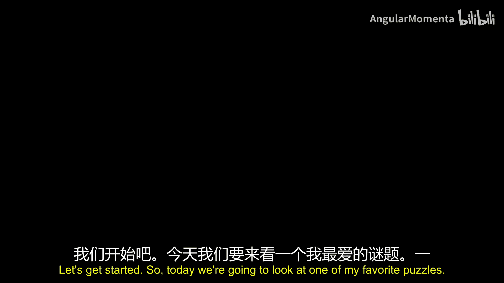
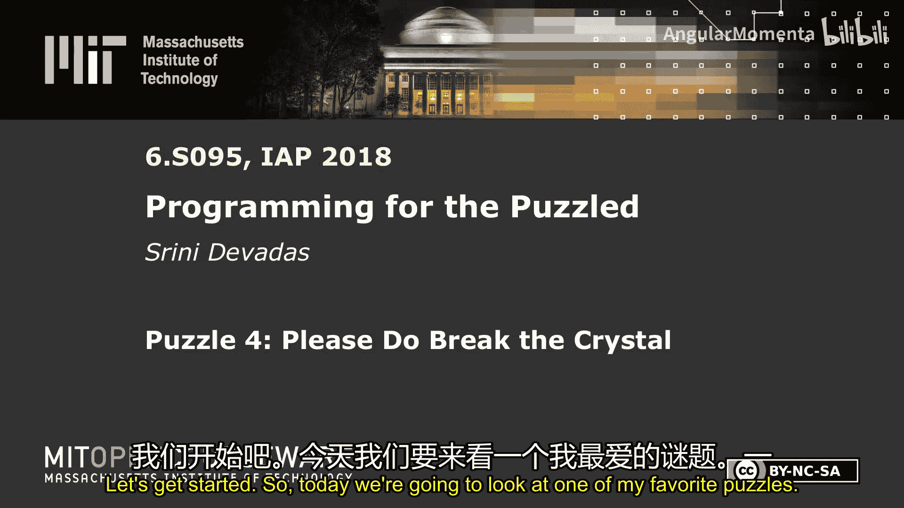
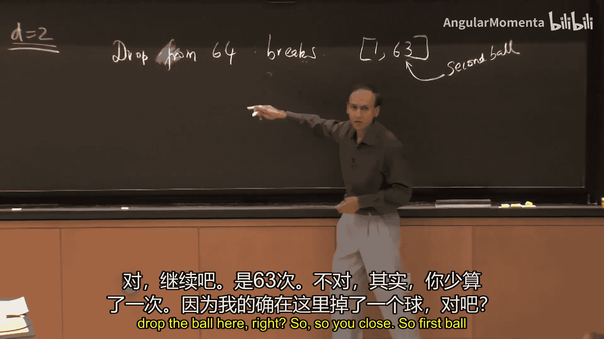
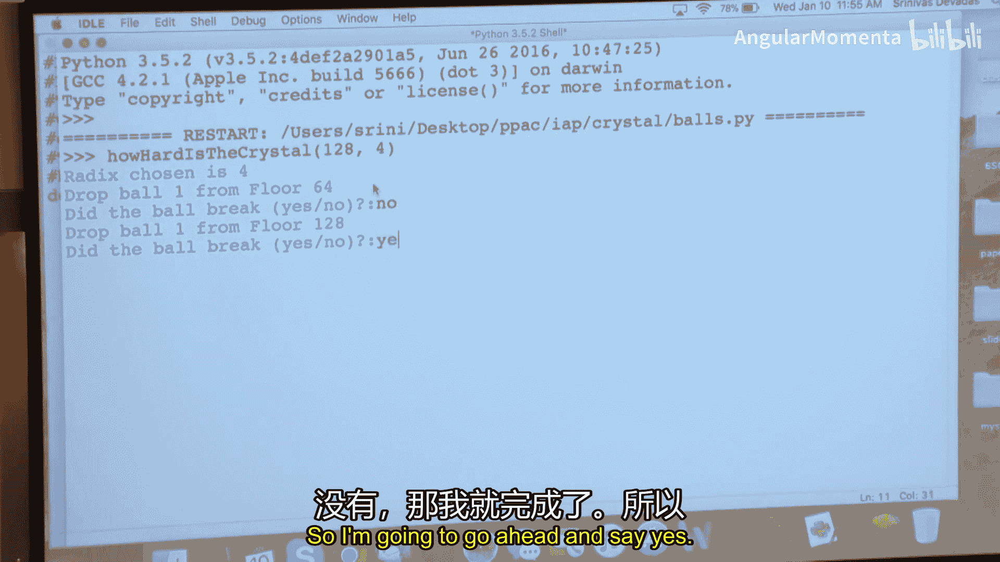
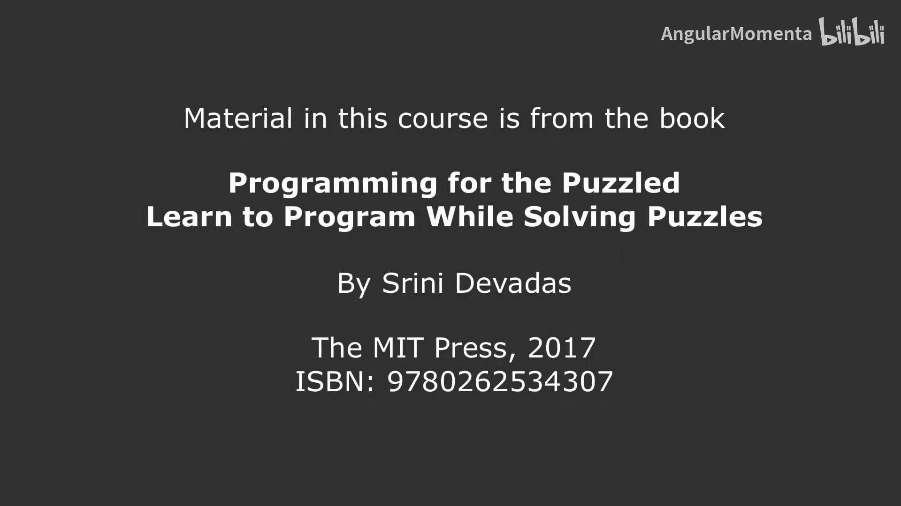

# 004：请打破水晶 🧊





在本节课中，我们将要学习一个经典的算法谜题——“水晶球谜题”。我们将分析如何用最少的尝试次数，确定一个水晶球从多高的楼层落下不会摔碎。我们将从最简单的情况开始，逐步深入，最终探讨一个适用于任意数量水晶球的通用策略。本节课的核心是**最坏情况分析**，这是算法分析中至关重要的概念。

## 概述与问题定义

我们有一个**完全相同的**水晶球，需要测试它的“硬度系数”。我们有一座128层的上海塔，楼层编号为1到128。

*   **硬度系数 F** 定义为：从**不高于 F** 的楼层落下，球不会碎；但从 **F+1** 层落下，球就会碎。
*   我们有一个**单调性**假设：如果球从某层落下没碎，那么从任何低于此层的楼层落下也不会碎。
*   我们的目标是：**使用 D 个完全相同的球，在最坏情况下，最小化确定精确硬度系数所需的“扔球”次数**。

---

## 情况一：只有一个球 (D=1)



如果我们只有一个球，并且必须得到精确的硬度系数，我们别无选择，只能从最低的楼层开始，一层一层地向上测试。

**算法**：从第1层开始扔球。如果没碎，就上到第2层再扔，以此类推，直到球摔碎。硬度系数就是球摔碎之前的那一层。

**最坏情况分析**：如果硬度系数是128（即球从128层落下也不会碎），我们需要测试所有128层。因此，最坏情况下的扔球次数是 **128** 次。

> **结论**：对于单个球，最坏情况尝试次数等于总楼层数 N。没有优化空间。

---

## 情况二：有两个球 (D=2)

现在我们有两个球，可以设计更高效的策略。上一节我们看到了单球的局限性，本节中我们来看看如何利用第二个球来减少尝试次数。

一个直观的想法是使用**二分查找**：先从中间楼层（第64层）扔第一个球。

*   **如果碎了**：我们知道硬度系数在1到63之间。但此时我们只剩下一个球，必须从第1层开始逐层测试，最多再试63次。总尝试次数 = 1 (第一次) + 63 = **64**。
*   **如果没碎**：我们知道硬度系数在65到128之间。我们仍然拥有两个球，可以在剩下的64层中继续应用策略（例如，再从第96层尝试）。可以证明，这种情况下的最坏尝试次数会少于64。

然而，64次并不是最优解。我们可以采用**非均匀间隔**的测试策略。

### 优化策略：间隔测试法

思路是：用第一个球确定一个**大致的范围**，然后用第二个球在这个小范围内逐层测试。

假设我们每间隔 **K** 层用第一个球测试一次（即测试第K， 2K， 3K...层），直到它摔碎。然后我们用第二个球在最后一个“安全层”和“摔碎层”之间逐层测试。

**最坏情况分析**：
1.  第一个球测试次数： `N/K` 次（向上取整）。
2.  第一个球在最后一次测试时摔碎，第二个球需要在长度为 `K-1` 的区间内逐层测试。
3.  总最坏尝试次数为： `N/K + (K-1)`。

我们的目标是选择一个 **K** 来最小化这个表达式。这是一个简单的优化问题。通过求导或观察可知，当 `N/K ≈ K`，即 **K ≈ √N** 时，总和最小。

对于 N=128， √N ≈ 11.3。代入公式：
*   当 K=11 时， `128/11 + 10 ≈ 11.6 + 10 = 21.6`，最坏情况约 **22** 次。
*   当 K=12 时， `128/12 + 11 ≈ 10.7 + 11 = 21.7`，最坏情况约 **22** 次。

实际上，通过更精细的调整（间隔不一定完全相等），可以做到 **21** 次。这比二分法的64次要快得多。

> **核心公式**：两球策略的最坏尝试次数可优化至约 **2√N** 量级。

---

## 情况三：通用情况 (D 个球)

当我们有更多球（D > 2）时，策略可以进一步优化。思路是**将楼层数表示为某种进制的 D 位数**。

### 进制表示法策略

1.  选择进制 **R**，使得 **R^D > N**（总楼层数）。这保证了D位数足以表示所有楼层。
2.  将目标硬度系数想象成一个D位的R进制数。
3.  测试时，我们从最高位（最左侧）开始确定这个数的每一位：
    *   用第一个球测试最高位。我们依次测试该位为1， 2， ... (R-1)时对应的楼层（即间隔为 R^(D-1) 的楼层），直到球摔碎或所有可能都试完。这确定了最高位的值。
    *   第一个球摔碎后，我们转向第二个球，用它来确定次高位的数字，此时测试间隔变为 R^(D-2)。
    *   以此类推，每摔碎一个球，我们就用下一个球来确定下一位数字，测试间隔不断缩小。
    *   当只剩下一个球时，我们只能在其确定的小范围内逐层测试（相当于确定最后一位）。

**举例**：N=128， D=4。
*   选择 R=4，因为 4^4 = 256 > 128。
*   我们将楼层表示为4位4进制数。例如，`(1, 0, 0, 0)` 对应楼层 1*64 = 64。
*   **测试流程**：
    *   **第一个球**：测试最高位。先试 `(1,0,0,0)` 即64层。如果没碎，试 `(2,0,0,0)` 即128层。假设在128层摔碎。
    *   **第二个球**：现在知道最高位是1，硬度在 `(1,0,0,1)` (65层) 和 `(1,3,3,3)` (127层)之间。测试次高位：试 `(1,1,0,0)` 即96层。如果没碎，试 `(1,2,0,0)` 即112层...以此类推。
    *   **第三、四个球**：继续确定更低位的值。

### 最坏情况分析

在最坏情况下，每个球（对应每一位数字）都需要测试 **R-1** 次（即从1测试到R-1）。因此：

**最坏尝试次数 ≈ (R - 1) * D**

对于 N=128， D=4， R=4，最坏尝试次数 ≈ (4-1)*4 = **12** 次。这比两球策略的21次要优秀得多。

> **核心概念**：D球策略的本质是进行一场 **D 位 R 进制数的“折半”搜索**，每次摔球确定一位。最坏尝试次数与 **D * R** 成正比，而 R 约等于 N^(1/D)。

---

## 算法实现

以下是该策略的核心代码实现（Python风格伪代码）：

```python
def find_hardness(n_floors, d_balls):
    # 1. 找到合适的进制 R
    r = 1
    while (r ** d_balls) <= n_floors:
        r += 1

    # 2. 初始化当前测试楼层和数字表示
    current_floor = 0
    digits = [0] * d_balls  # D位数的列表，初始全0

    # 3. 主要测试循环
    for ball in range(d_balls):  # 对于每一个球（对应每一位）
        for digit_value in range(1, r):  # 测试该位从1到R-1
            # 计算要测试的楼层：将当前数字表示转换为实际楼层
            test_floor = current_floor + digit_value * (r ** (d_balls - 1 - ball))
            if test_floor > n_floors:
                test_floor = n_floors # 处理边界

            print(f"用第{ball+1}个球从{test_floor}层扔下")
            # 交互：球是否摔碎？
            broke = input("球摔碎了吗？ (是/否): ") == "是"

            if broke:
                # 球碎了，该位数字确定，转入下一位（下一个球）
                digits[ball] = digit_value - 1  # 安全值是前一个
                current_floor += digits[ball] * (r ** (d_balls - 1 - ball))
                break  # 跳出内层循环，处理下一个球
            else:
                # 球没碎，继续增加该位数字
                digits[ball] = digit_value
                # 如果已经是该位最大测试值且没碎，则此位就是R-1
                if digit_value == r - 1:
                    current_floor += digits[ball] * (r ** (d_balls - 1 - ball))
    # 最终，current_floor 就是硬度系数 F
    return current_floor
```

---

## 总结

本节课中我们一起学习了“水晶球谜题”及其解决方案：



1.  **单球 (D=1)**：策略唯一，最坏尝试次数为楼层数 N。
2.  **双球 (D=2)**：可采用间隔测试法，最坏尝试次数优化至约 **2√N**。
3.  **多球 (D个)**：可采用**进制表示法**，将问题转化为确定一个D位R进制数。通过合理选择 R (满足 R^D > N)，最坏尝试次数约为 **(R-1) * D**，性能远优于低球数策略。



这个谜题生动地展示了**最坏情况分析**的重要性，以及如何通过**增加资源（球）** 来显著降低**时间复杂度（尝试次数）**，体现了算法设计中经典的时空权衡思想。进制策略也提供了一个将连续搜索问题离散化、层次化的精彩范例。