# 005：八皇后问题 👑

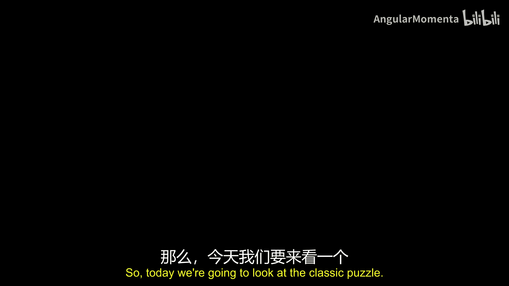

## 概述

在本节课中，我们将学习一个经典的编程谜题——八皇后问题。我们将探讨如何使用**穷举枚举**的编程范式来寻找所有可能的解决方案，并比较不同**数据结构**（如二维列表和一维列表）对算法效率和代码简洁性的影响。通过从较小的棋盘（如2x2、3x3、4x4）开始分析，我们将逐步构建解决通用N皇后问题的算法思路。

## 问题描述与规则

八皇后问题要求在一个标准的8x8国际象棋棋盘上放置8个皇后，使得**任意两个皇后都不能相互攻击**。

在国际象棋中，皇后可以沿**水平、垂直和两个对角线**方向移动任意格数。因此，放置皇后需要满足以下三个约束条件：
1.  **同一列**上不能有两个皇后。
2.  **同一行**上不能有两个皇后。
3.  **同一对角线**上不能有两个皇后。

## 解决策略：穷举搜索与回溯

解决此类组合问题的核心策略是**穷举所有可能的放置组合**，并检查每种组合是否满足约束条件。由于组合数量随棋盘尺寸呈指数级增长（例如8x8棋盘有 `8^8` 种可能），直接暴力枚举效率低下。

我们将采用一种更聪明的**逐列放置**策略，并结合**回溯法**：
*   **逐列放置**：从左到右，依次在每一列上放置一个皇后。
*   **回溯**：当在某一列上尝试了所有行都无法放置皇后（即与已放置皇后冲突）时，**撤销最近一次放置皇后的决定**，回到上一列尝试新的位置。

这种策略能系统性地探索所有可能性，同时避免大量无效的搜索。

### 从简单情况获得直觉

在编写通用代码前，我们先分析小规模问题，以理解算法流程和回溯的必要性。

*   **2x2棋盘**：无解。放置第一个皇后后，棋盘上所有其他位置都会被攻击。
*   **3x3棋盘**：无解。通过尝试所有起始位置并回溯，可以发现没有满足条件的放置方式。
*   **4x4棋盘**：有解。通过手动回溯，我们可以找到至少一种解决方案（例如 `[1, 3, 0, 2]`，表示第0列放第1行，第1列放第3行，以此类推）。这个过程清晰地演示了回溯：当在最后一列找不到安全位置时，需要返回前一列改变皇后的位置。

## 算法实现：冲突检查与数据表示

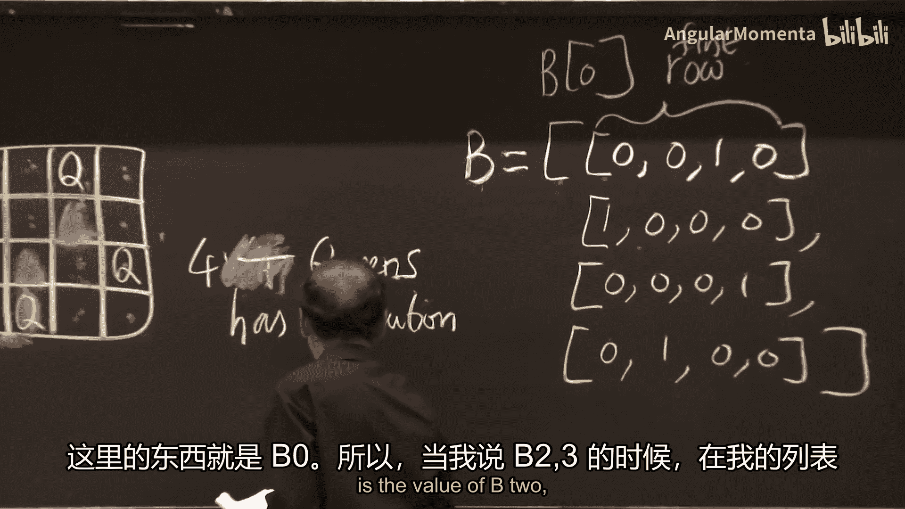

算法的核心是一个**冲突检查函数**，它判断在特定位置放置新皇后是否会与棋盘上已有的皇后冲突。我们将实现两种不同的数据表示方法。

### 方法一：使用二维列表（矩阵）

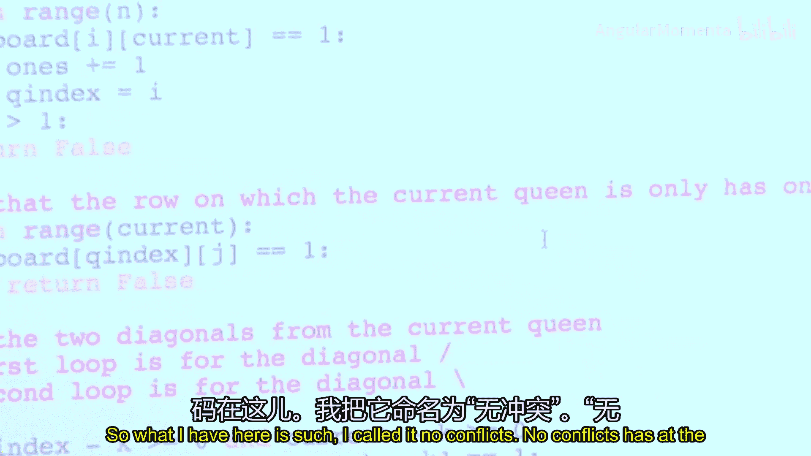

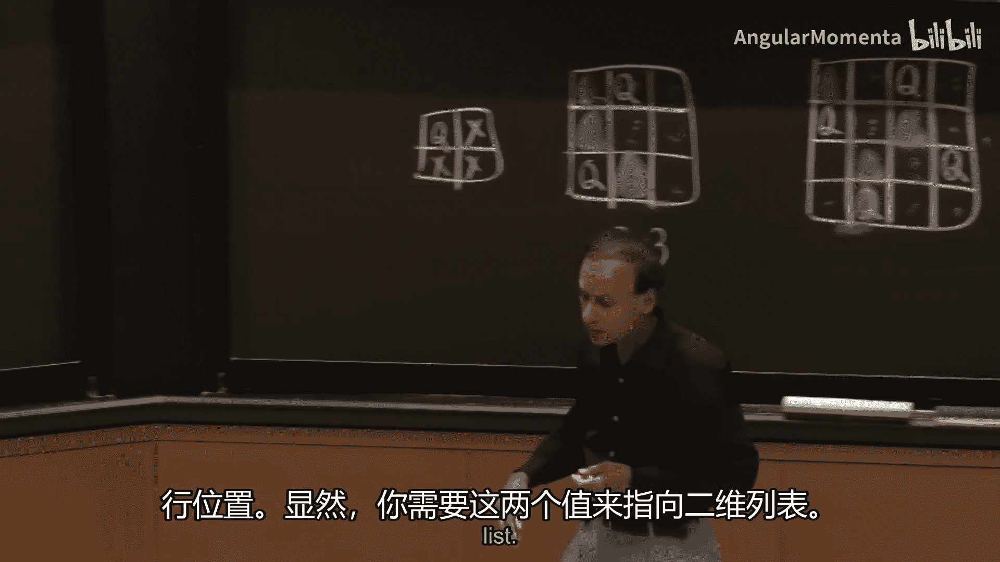

最直观的数据结构是使用二维列表（或数组）`board` 来表示棋盘，其中 `board[i][j] = 1` 表示 `(i, j)` 位置有皇后，`0` 则表示空。

以下是基于此表示的冲突检查函数的关键逻辑（以伪代码/思路表示）：

```python
def no_conflicts(board, current_col, current_row, n):
    # 检查同一列（由于我们逐列放置，此检查可省略）
    for i in range(n):
        if board[i][current_col] == 1 and i != current_row:
            return False

    # 检查同一行
    for j in range(n):
        if board[current_row][j] == 1 and j != current_col:
            return False

    # 检查主对角线（左上到右下）
    i, j = current_row, current_col
    while i >= 0 and j >= 0:
        if board[i][j] == 1 and (i, j) != (current_row, current_col):
            return False
        i -= 1
        j -= 1
    # ... 还需要检查其他三个对角线方向

    # 检查副对角线（右上到左下）
    i, j = current_row, current_col
    while i >= 0 and j < n:
        if board[i][j] == 1 and (i, j) != (current_row, current_col):
            return False
        i -= 1
        j += 1
    # ... 还需要检查其他三个对角线方向

    return True
```

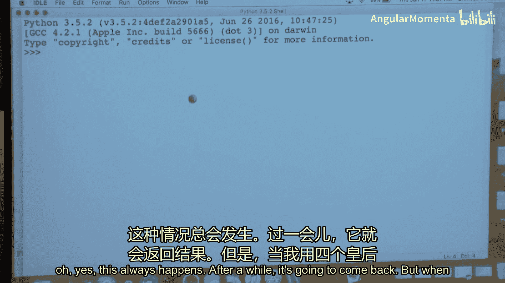

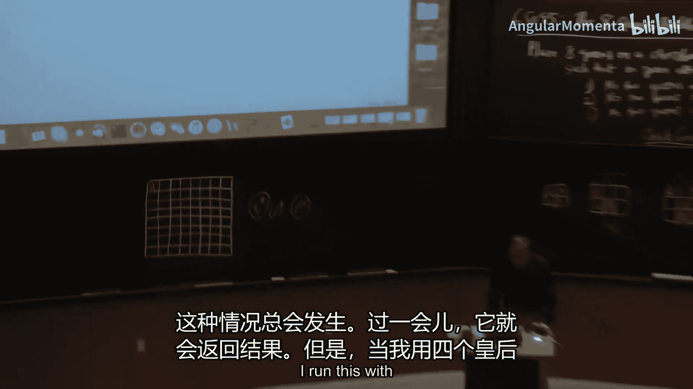

使用二维列表的搜索算法需要多层嵌套循环（对于8皇后就是8层），代码冗长且不通用（难以扩展到N皇后）。

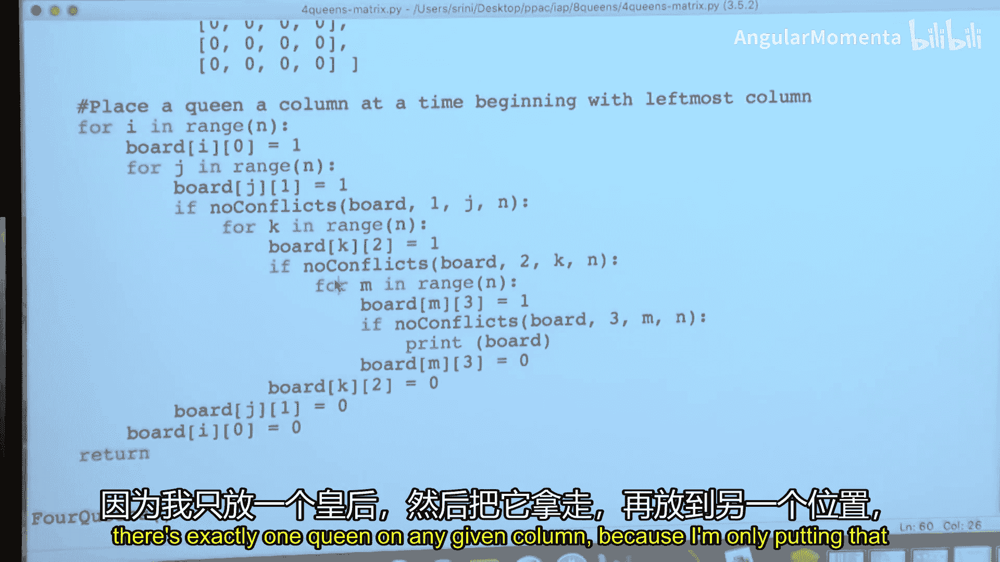

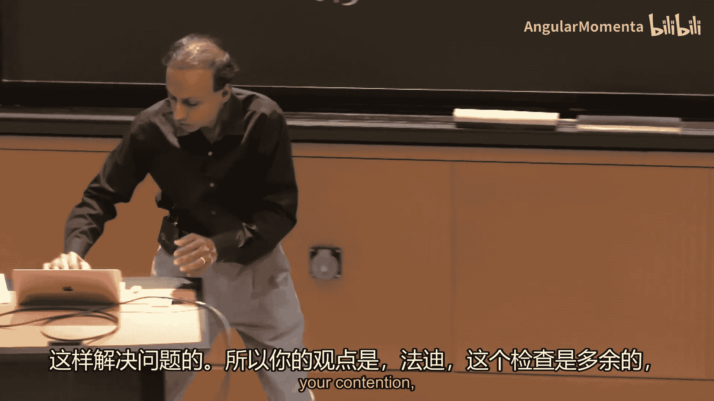

### 方法二：使用一维列表（优化表示）

我们可以利用“每列只有一个皇后”的约束，进行数据压缩。使用一个一维列表 `board`，其中 `board[col] = row` 表示第 `col` 列的皇后放在第 `row` 行。如果某列未放置，则值可以为 `-1`。

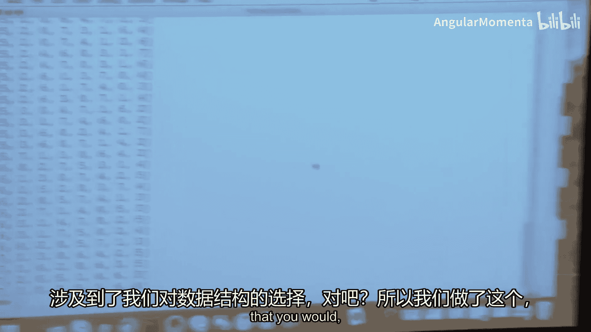

这种表示法大大简化了冲突检查：

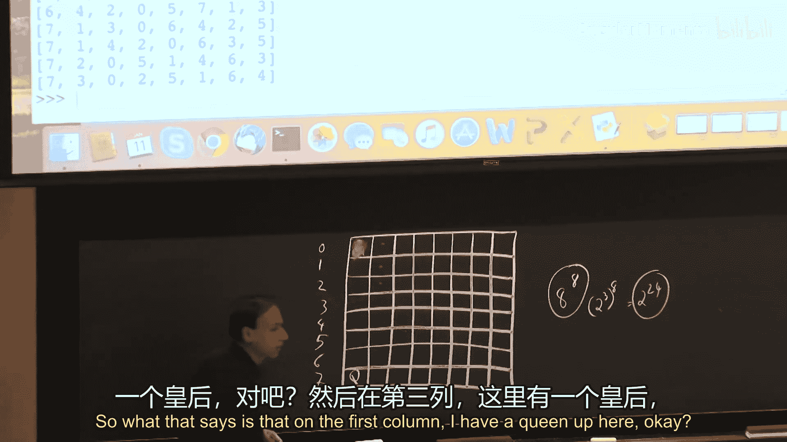

```python
def no_conflicts(board, current_col, current_row):
    # 遍历已放置皇后的列进行检查
    for col in range(current_col):
        if board[col] == current_row: # 检查同一行
            return False
        # 检查对角线：列差绝对值 == 行差绝对值
        if abs(board[col] - current_row) == abs(col - current_col):
            return False
    return True
```

这个函数非常简洁：
*   **行冲突**：检查新皇后的行号 `current_row` 是否已经存在于 `board` 列表中。
*   **对角线冲突**：检查对于任何已放置的皇后，其列索引差 `abs(col - current_col)` 是否等于行索引差 `abs(board[col] - current_row)`。这在几何上等价于判断两点是否在同一对角线上。

使用一维列表的搜索算法可以更容易地通过递归实现通用解法，代码也更清晰。

## 总结

本节课我们一起学习了八皇后问题的经典解法。我们首先理解了问题规则和约束条件，然后引入了**穷举枚举**和**回溯法**作为核心解决策略。通过分析小规模案例，我们直观感受到了回溯的必要性。

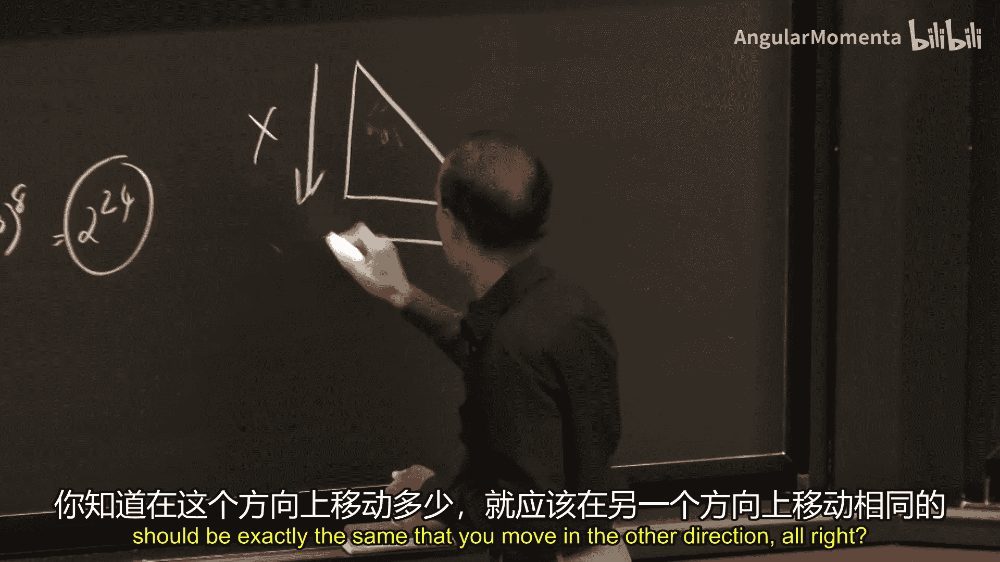

在实现层面，我们比较了两种数据结构：
1.  **二维列表**：直观但代码冗长，冲突检查复杂，难以泛化。
2.  **一维列表**：利用问题约束进行优化，**数据结构更紧凑**，冲突检查函数异常简洁（仅需几行代码），为编写通用的、递归的N皇后解法奠定了基础。

关键收获是：**选择合适的数据结构可以极大地简化算法逻辑、提高代码效率与可读性**。在八皇后问题中，一维列表的表示法完美契合了“每列一后”的约束，使得对角线冲突检查变得优雅而高效。

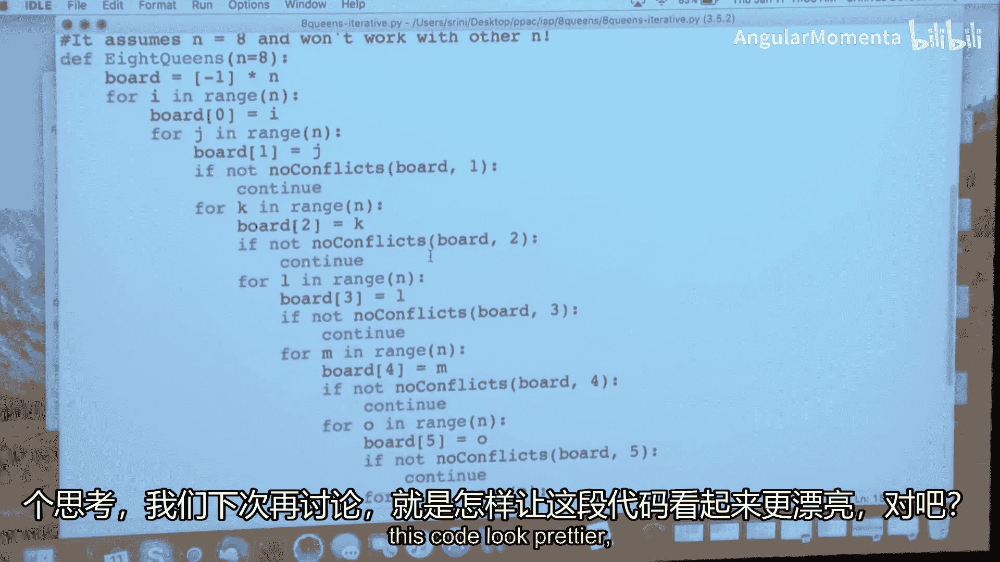

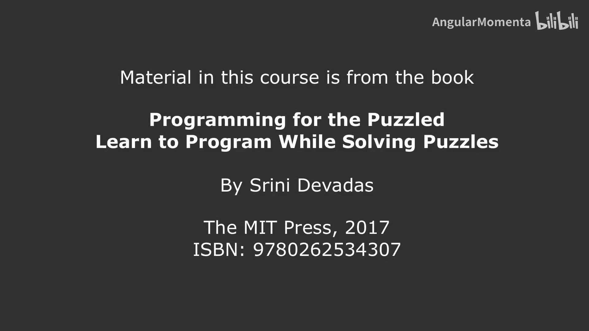

在接下来的课程中，我们将探索如何用更强大的编程范式（如递归）来美化代码，并实现一个能解决任意N皇后问题的通用程序。