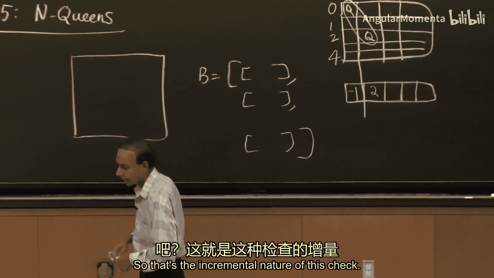
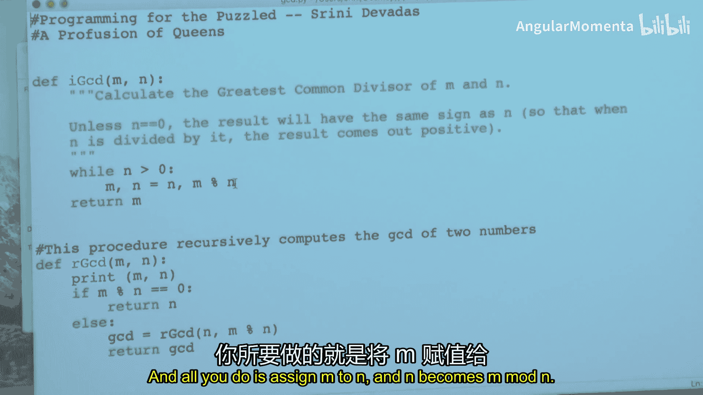
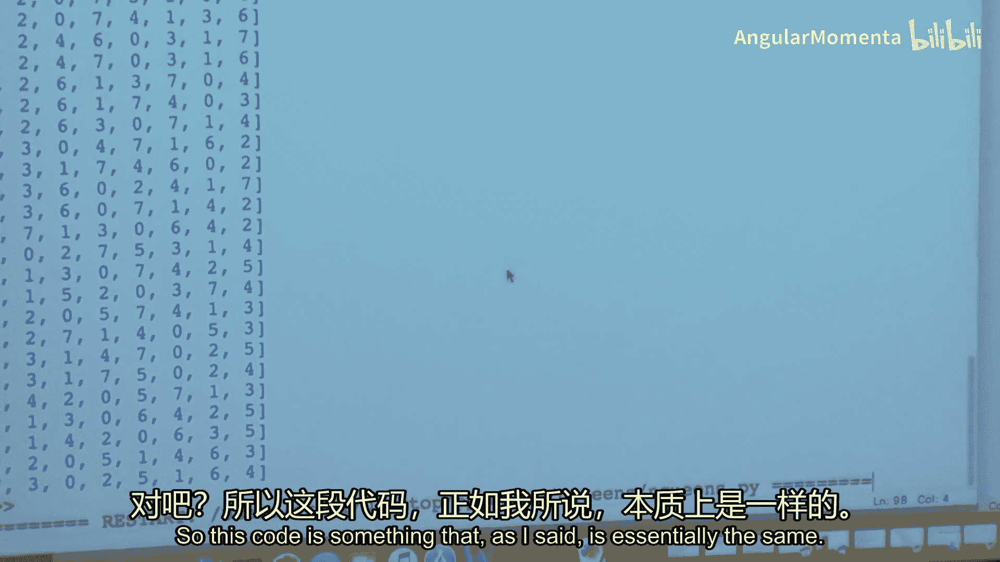
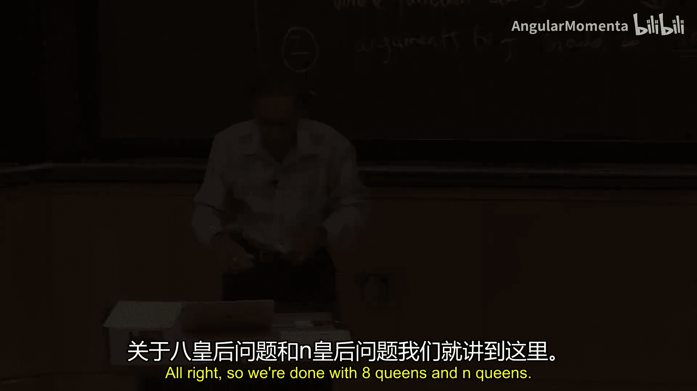
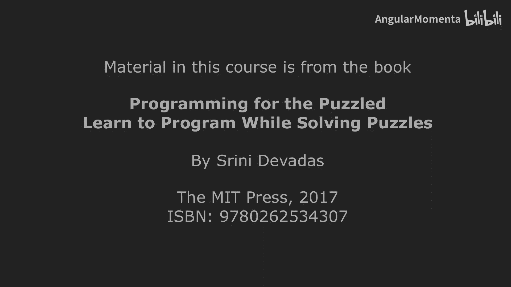

# 006：众多的皇后


在本节课中，我们将学习如何使用递归这一强大的编程范式来解决复杂的“N皇后”问题。我们将从回顾迭代解法开始，逐步过渡到更优雅、更通用的递归解法，并理解递归的核心概念。

## 概述



上一节我们介绍了使用迭代方法解决八皇后问题，但代码冗长且不通用。本节中，我们将学习如何使用递归来重写该解决方案，使其更简洁、更灵活，并能处理任意大小的棋盘（N皇后问题）。

## 回顾：迭代解法与数据结构

我们首先回顾八皇后问题的迭代解法。问题是在一个N×N的棋盘上放置N个皇后，使得任意两个皇后都不能互相攻击（即不在同一行、同一列或同一对角线上）。

我们使用了一个一维列表来紧凑地表示棋盘状态。对于一个5×5的棋盘，列表 `[2, 4, 1, 3, 0]` 表示：
*   第0列的皇后在第2行。
*   第1列的皇后在第4行。
*   以此类推。
*   `-1` 表示该列尚未放置皇后。

冲突检查是增量式的。当我们尝试在第 `current` 列放置一个皇后时，只需检查它是否与之前 `0` 到 `current-1` 列已放置的皇后冲突，无需检查已放置皇后之间的冲突。



以下是冲突检查的核心逻辑，包含行冲突和对角线冲突检查：

```python
def noConflicts(board, current):
    for i in range(current):
        # 检查行冲突：之前列皇后的行位置是否与当前列相同
        if board[i] == board[current]:
            return False
        # 检查对角线冲突：行差绝对值是否等于列差绝对值
        if current - i == abs(board[current] - board[i]):
            return False
    return True
```

迭代解法使用了N层嵌套循环来枚举所有可能的皇后位置组合，代码非常冗长且只能处理固定大小的棋盘。

## 引入递归


我们的目标是摆脱丑陋的嵌套循环，写出更通用、更简洁的代码。在深入N皇后问题之前，我们先看一个更简单的例子来理解递归：计算最大公约数（GCD）的欧几里得算法。

以下是迭代版本的GCD算法：

```python
def gcd_iter(m, n):
    while n != 0:
        m, n = n, m % n
    return m
```

我们可以将其改写为递归版本：

```python
def r_gcd(m, n):
    if m % n == 0:
        return n
    else:
        return r_gcd(n, m % n)
```

观察递归函数 `r_gcd`，我们需要注意两个关键点以确保递归正确工作：
1.  **基准情形（Base Case）**：必须存在一个条件分支，在该分支下函数直接返回结果，而不再进行递归调用。这是递归的终止条件。在 `r_gcd` 中，当 `m % n == 0` 时，函数返回 `n`。
2.  **递归步骤（Recursive Step）**：在非基准情形下，函数调用自身，但传入的参数应该以某种方式“缩小”问题规模。在 `r_gcd` 中，参数从 `(m, n)` 变为 `(n, m % n)`，使得问题向基准情形推进。

## 递归解决N皇后问题

现在，我们应用递归来解决N皇后问题。核心思想是：要解决在 `size` 列棋盘上放置皇后的问题，可以尝试在 `current` 列（从0开始）的每一行放置一个皇后，如果放置后不与之前列的皇后冲突，就递归地解决剩下的 `current+1` 到 `size-1` 列的问题。

以下是递归解决方案的代码框架：

```python
def nQueens(size):
    board = [-1] * size
    rQueens(board, 0, size)

def rQueens(board, current, size):
    # 基准情形：所有列都已成功放置皇后
    if current == size:
        print(board) # 找到一个解
        return True # 或返回False以继续搜索所有解
    else:
        for i in range(size):
            # 尝试将皇后放在当前列的 i 行
            board[current] = i
            # 如果放置后无冲突，则递归处理下一列
            if noConflicts(board, current):
                found = rQueens(board, current + 1, size)
                # 这里可以根据found的值决定是否提前返回（例如只找一个解）
        # 回溯：尝试当前列的其他行
        board[current] = -1
        return False
```

让我们分析这段递归代码：
*   **基准情形**：当 `current == size` 时，意味着已经成功为所有 `size` 列放置了皇后，且没有冲突，此时我们找到了一个有效解。
*   **递归步骤**：对于当前列 `current`，我们尝试将皇后放在每一行 `i`。如果放置后通过 `noConflicts` 检查，我们就递归调用 `rQueens` 来处理下一列 (`current + 1`)。
*   **参数“缩小”**：递归调用时，`current` 参数递增，越来越接近 `size`，这意味着待处理的列数在减少，问题规模在缩小。
*   **回溯**：在 `for` 循环结束后，我们将当前列重置为未放置状态 (`-1`)，这是回溯法的体现，允许算法尝试其他可能性。

## 递归调用的展开与性能

理解递归执行的一种方式是将其可视化为一棵调用树。对于八皇后问题，根节点是 `rQueens(board, 0, 8)`。它可能产生最多8个子调用（对应第一列皇后的8个可能行位置）。每个子调用又可能产生最多8个子调用，依此类推。



然而，由于 `noConflicts` 函数的剪枝作用，许多分支在早期就被截断了（例如，当第一列和第二列的皇后冲突时，就不会继续探索该分支下第三列及以后的所有可能性）。这极大地减少了需要探索的组合数量，使其远小于朴素的 `N^N`。

尽管如此，N皇后问题本质上是指数级复杂度的难题。对于较大的N（如N>25），即使有剪枝，计算所有解也可能需要非常长的时间。

## 总结

本节课中我们一起学习了如何运用递归解决N皇后问题。
1.  我们首先回顾了使用一维列表和增量冲突检查的迭代解法。
2.  接着，我们通过欧几里得算法的例子，引入了递归的两个核心要素：**基准情形**和**递归步骤**（参数向基准情形推进）。
3.  然后，我们将递归思想应用于N皇后问题，写出了简洁而通用的递归解法。该解法通过逐列放置皇后并递归处理剩余列来工作，并利用回溯探索所有可能解。
4.  最后，我们讨论了递归调用的树形展开和剪枝对算法性能的重要影响，虽然递归代码简洁，但N皇后问题本身的计算复杂度仍然很高。





递归是一种强大的工具，能将复杂问题分解为相似的子问题，从而简化代码结构。掌握识别基准情形和设计递归步骤是编写正确递归函数的关键。