# 007：数独求解器 🧩


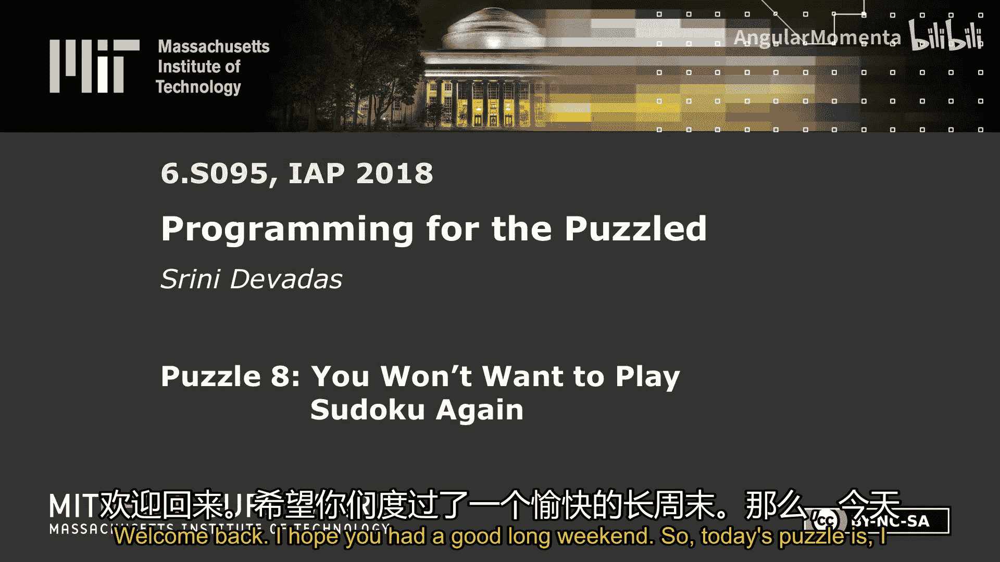

在本节课中，我们将学习如何编写一个计算机程序来解决数独谜题。我们将对比人类解决数独的“智能”方法与计算机的“暴力搜索”方法，并尝试将两者结合起来，创建一个更高效的求解器。核心思想是：在暴力搜索的基础上，通过“剪枝”来提前排除无效的搜索路径，从而大幅提升效率。

---

## 数独规则 📝

数独是一个经典的逻辑谜题。标准数独是一个9x9的网格，部分格子已预先填入数字（1到9）。游戏的目标是填满所有空格，同时满足以下三个约束条件：

1.  **每一行** 必须包含数字1到9，且每个数字在每行中只能出现一次。
2.  **每一列** 必须包含数字1到9，且每个数字在每列中只能出现一次。
3.  **每一个3x3的宫**（网格被划分为9个这样的宫）必须包含数字1到9，且每个数字在每个宫中只能出现一次。

人类玩家通常通过“推理”来解题，例如进行“水平扫描”或“垂直扫描”，以确定某个数字在特定行、列或宫中唯一可能的位置。然而，对于较难的谜题，玩家可能需要进行“猜测”，然后通过“回溯”来纠正错误的猜测。

---

## 暴力搜索方法 💻

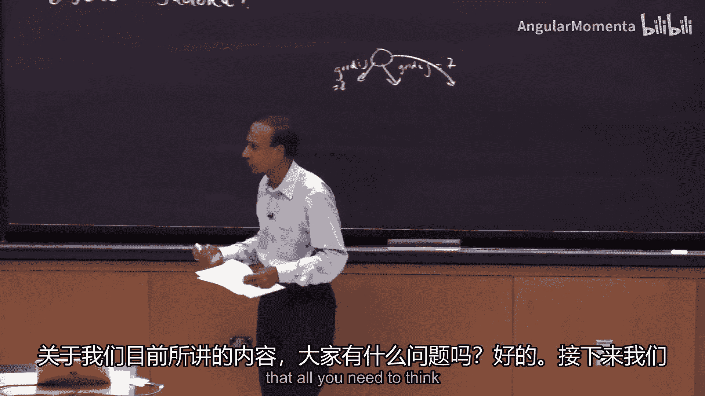

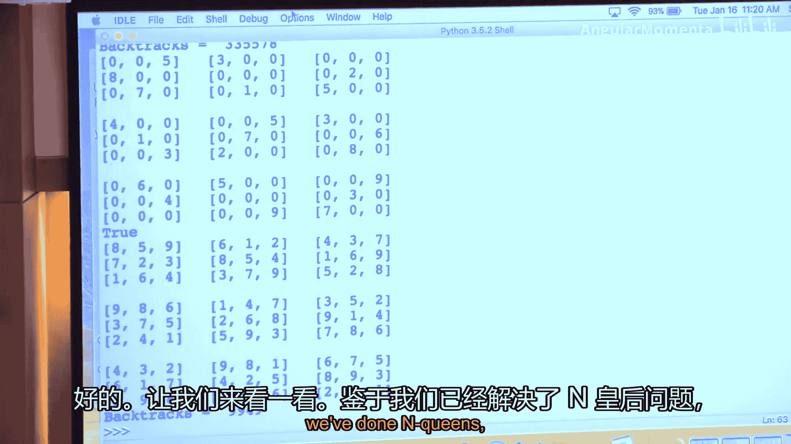

上一节我们介绍了数独的基本规则，本节中我们来看看如何用计算机程序来模拟解决过程。我们将采用一种类似于解决“八皇后问题”的递归回溯策略。

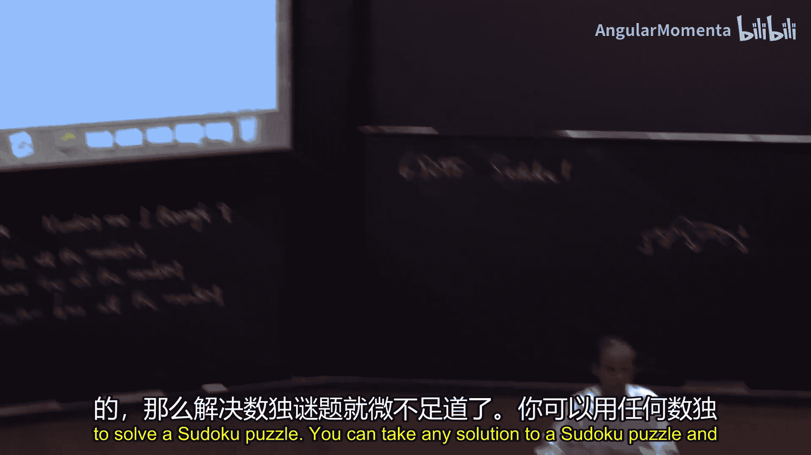

### 核心算法步骤

以下是暴力搜索求解器的核心步骤：

1.  **寻找下一个空单元格**：按顺序（例如从左到右、从上到下）扫描网格，找到第一个值为0（代表空）的格子。
    ```python
    def findNextCellToFill(grid):
        for x in range(9):
            for y in range(9):
                if grid[x][y] == 0:
                    return x, y
        return -1, -1  # 如果没有空单元格，说明已解决
    ```

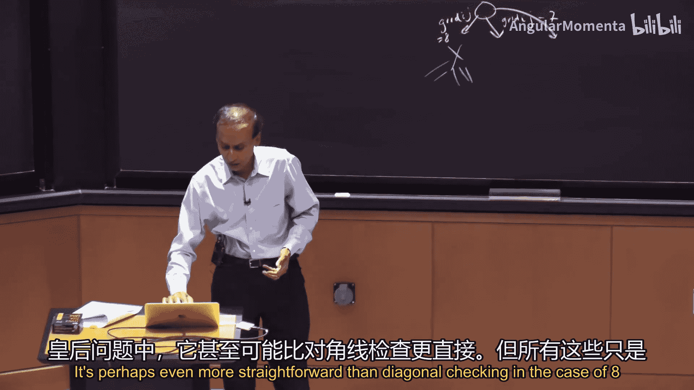

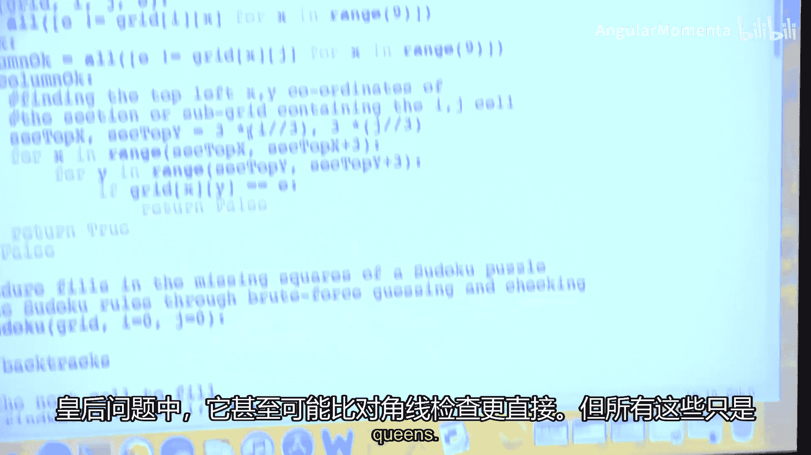

2.  **检查部分解的有效性**：在尝试向一个空单元格填入数字`e`之前，检查该操作是否会违反数独的三大规则。
    ```python
    def isValid(grid, i, j, e):
        # 检查行
        rowOk = all([e != grid[i][x] for x in range(9)])
        if rowOk:
            # 检查列
            columnOk = all([e != grid[x][j] for x in range(9)])
            if columnOk:
                # 检查3x3宫
                secTopX, secTopY = 3 * (i//3), 3 * (j//3)
                for x in range(secTopX, secTopX+3):
                    for y in range(secTopY, secTopY+3):
                        if grid[x][y] == e:
                            return False
                return True
        return False
    ```

3.  **递归求解函数**：这是算法的主体。它尝试为当前找到的空单元格填入1到9的数字，并递归地调用自身来填充剩余的空格。如果某个分支导致矛盾，则回溯并尝试下一个数字。
    ```python
    def solveSudoku(grid, i=0, j=0):
        i, j = findNextCellToFill(grid)
        if i == -1: # 没有空单元格了，已找到解
            return True

        for e in range(1, 10): # 尝试数字1到9
            if isValid(grid, i, j, e):
                grid[i][j] = e
                if solveSudoku(grid, i, j):
                    return True
                # 如果递归调用失败，撤销选择（回溯）
                grid[i][j] = 0
        return False # 触发回溯
    ```

4.  **性能度量：回溯次数**：为了客观地衡量算法效率（不受计算机速度影响），我们引入一个全局变量来计数“回溯”发生的次数。每次算法撤销一个错误猜测时，计数器加一。
    ```python
    backtracks = 0 # 全局变量

    def solveSudoku(grid, i=0, j=0):
        global backtracks
        i, j = findNextCellToFill(grid)
        if i == -1:
            return True

        for e in range(1, 10):
            if isValid(grid, i, j, e):
                grid[i][j] = e
                if solveSudoku(grid, i, j):
                    return True
                # 回溯
                backtracks += 1
                grid[i][j] = 0
        return False
    ```

这种朴素的暴力搜索方法可以解决任何有效的数独谜题，但对于较难的谜题，其回溯次数可能非常巨大（例如数万甚至数十万次），导致求解时间很长。

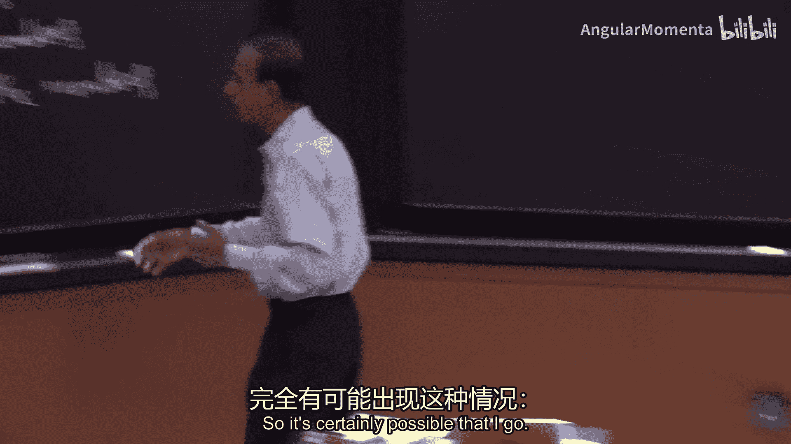

---

## 集成智能推理 🧠

上一节我们实现了一个基础但低效的暴力求解器。本节中我们来看看如何将人类的“推理”或“蕴含”策略集成到搜索过程中，从而减少不必要的猜测和回溯。

### 核心思想

在每次做出一个猜测（即向一个空单元格填入一个数字）之后，我们并不立即进行下一次递归猜测，而是先利用数独规则进行**确定性推理**，找出所有因此而被唯一确定的数字，并将它们填入网格。这个过程可以连续进行多轮，直到没有新的数字能被推理出来为止。

**关键点**：这些推理出的数字是基于当前（可能错误的）猜测的。如果最初的猜测是错误的，那么所有基于它的推理结果也都是错误的。因此，当我们回溯时，必须**彻底清理**这些推理出的数字，将它们重置为空。

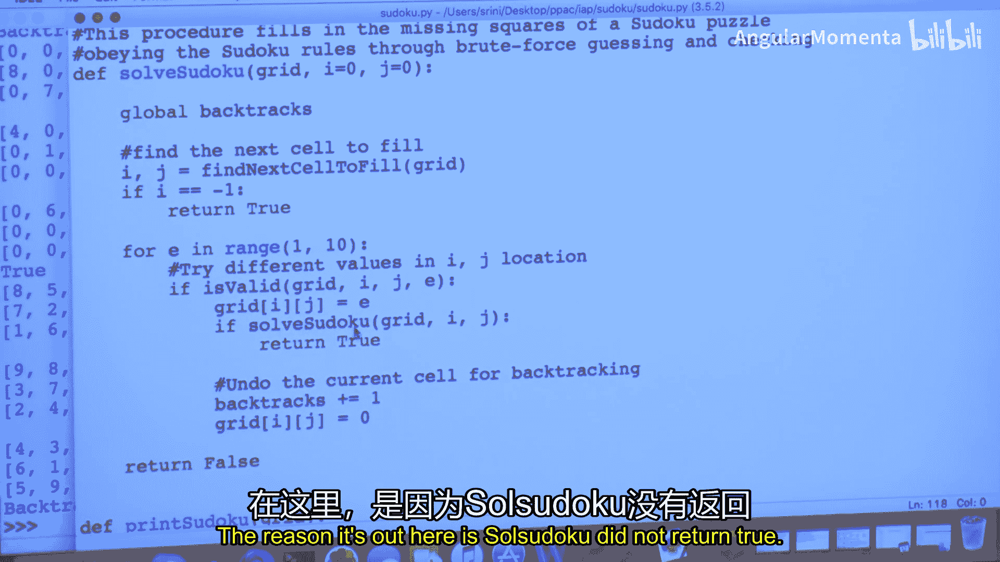

### 算法修改

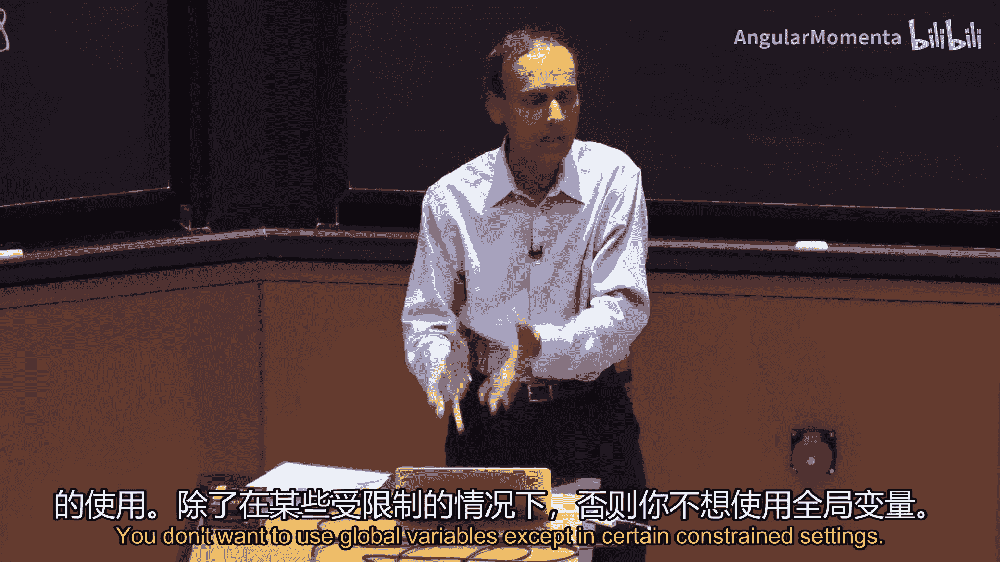

我们需要修改核心的`solveSudoku`函数，并用两个新函数`makeImplications`和`undoImplications`替换简单的赋值和清零操作。

1.  **`makeImplications(grid, i, j, e)`**：
    *   首先，将猜测值`e`填入单元格`(i, j)`。
    *   然后，基于新的网格状态，运行推理逻辑（例如，检查每个宫、行、列，寻找那些只剩下一种可能数字的空格）。
    *   将所有推理出的数字及其位置记录在一个列表（称为`implications`列表）中，并将它们填入网格。
    *   返回这个`implications`列表，以便后续清理。

2.  **`undoImplications(grid, implications)`**：
    *   接收`implications`列表。
    *   将列表中记录的所有单元格的值重置为0（空），以撤销所有基于错误猜测的推理。

3.  **修改后的求解函数**：
    ```python
    def solveSudokuOpt(grid, i=0, j=0):
        global backtracks
        i, j = findNextCellToFill(grid)
        if i == -1:
            return True

        for e in range(1, 10):
            if isValid(grid, i, j, e):
                # 进行猜测并推理，而不是直接赋值
                implications = makeImplications(grid, i, j, e)
                if solveSudokuOpt(grid, i, j):
                    return True
                # 回溯：撤销所有推理和猜测
                backtracks += 1
                undoImplications(grid, implications)
        return False
    ```

### 一个简单的推理策略示例

以下是`makeImplications`函数可能采用的一种简单推理策略（针对每个3x3宫）：

1.  对于每一个宫，找出该宫内所有空单元格。
2.  对于每个空单元格，根据其所在行和列已存在的数字，计算其可能填入的数字集合。
3.  如果某个空单元格的可能数字集合缩小到只剩一个数字，那么这个数字就是被“蕴含”出来的，可以确定地填入。

通过将这种推理循环执行，直到网格不再发生变化，我们可以填入很多数字，从而大大减少需要递归搜索的深度和分支数量。

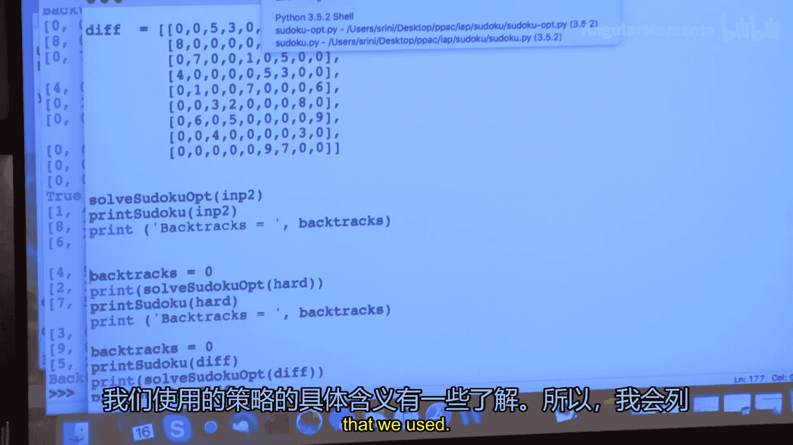

### 效果

集成这种简单的推理策略后，求解器的性能得到了显著提升。例如，对于某些谜题，回溯次数从数万次下降到了数千次甚至数百次。通过实现更强大的推理循环（持续推理直到无法推出新数字为止），性能还可以得到进一步改善。

---

## 总结 📚

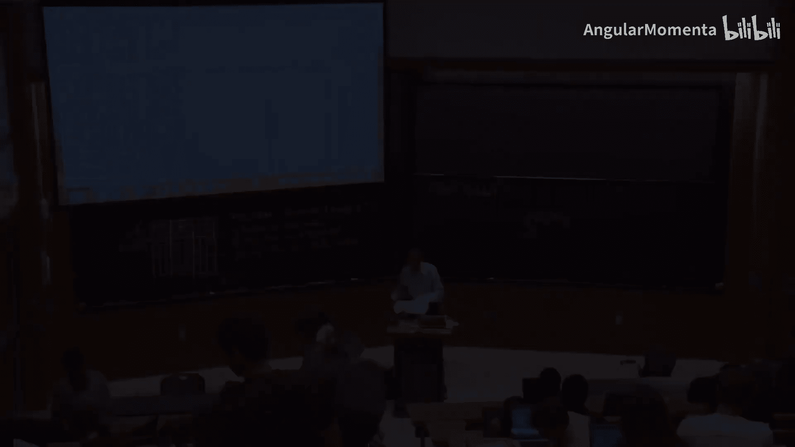

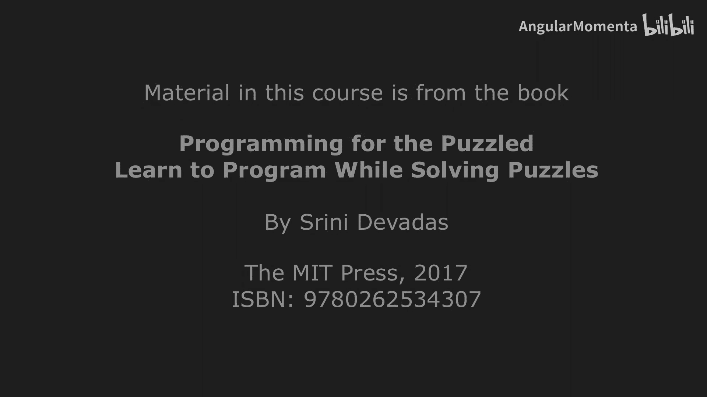

本节课中我们一起学习了如何构建一个数独求解器。我们从最基础的递归回溯（暴力搜索）方法开始，理解了其工作原理和性能瓶颈（通过回溯次数衡量）。接着，我们探索了如何通过集成人类解题时使用的“智能推理”来优化搜索过程。关键在于，在每次猜测后运行一个确定性的推理过程来填充更多单元格，并在回溯时仔细清理这些推理结果。这种“猜测-推理-回溯”的框架，结合有效的剪枝策略，是解决许多约束满足问题的强大通用方法。