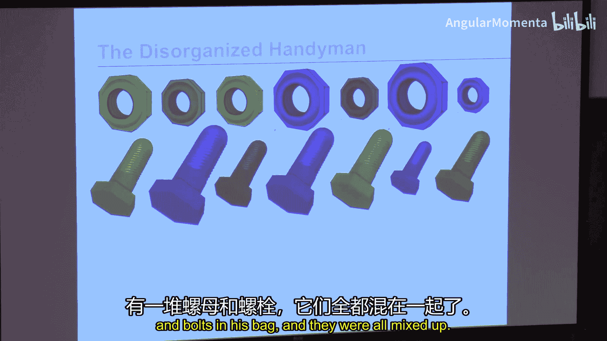
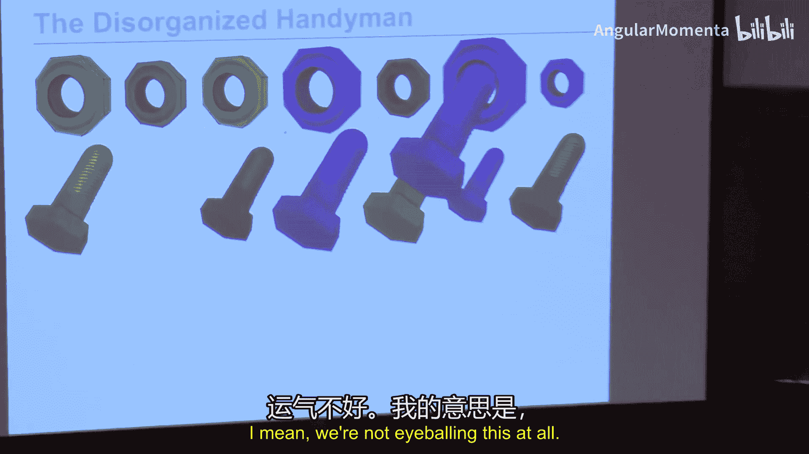
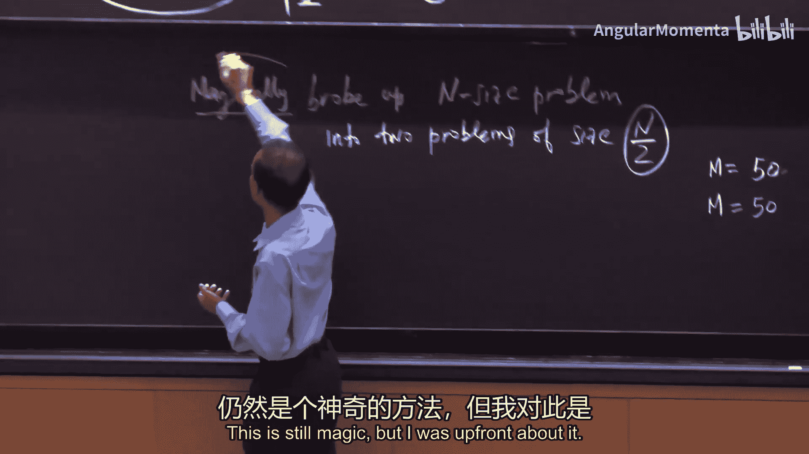
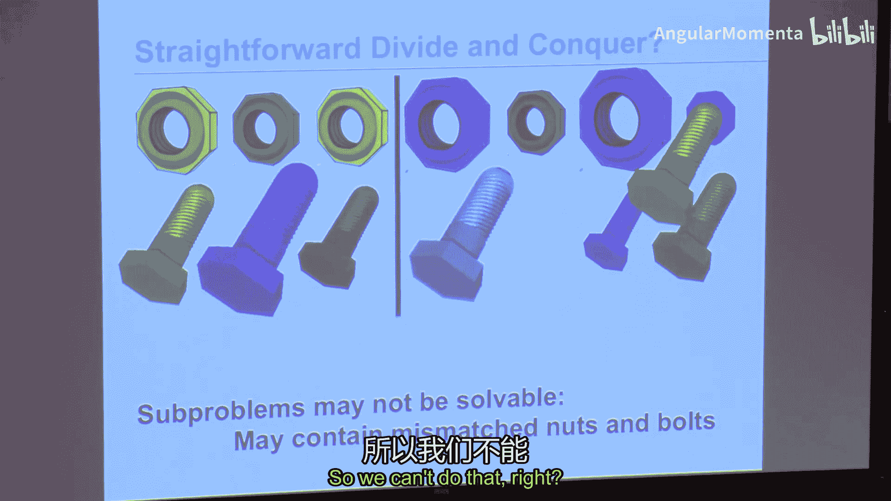
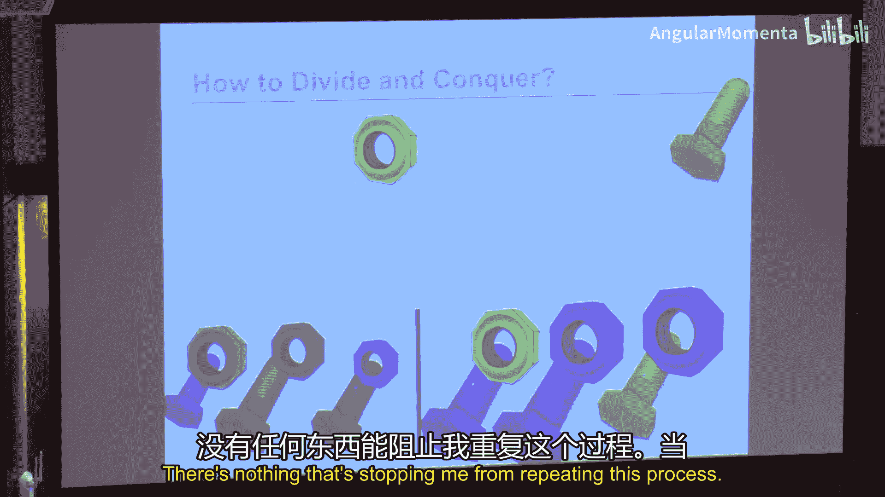
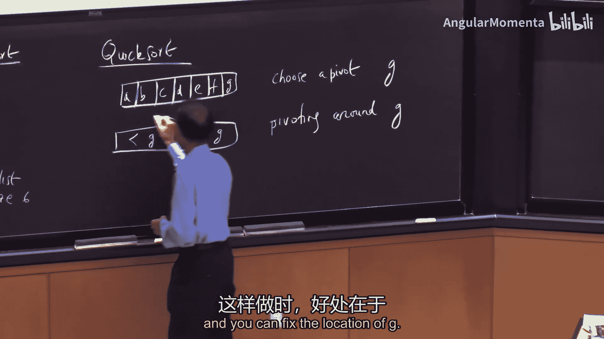
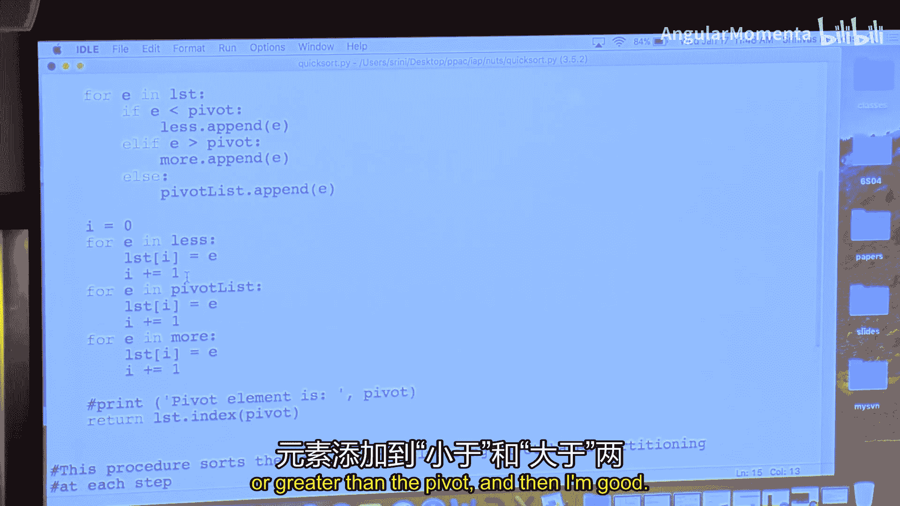
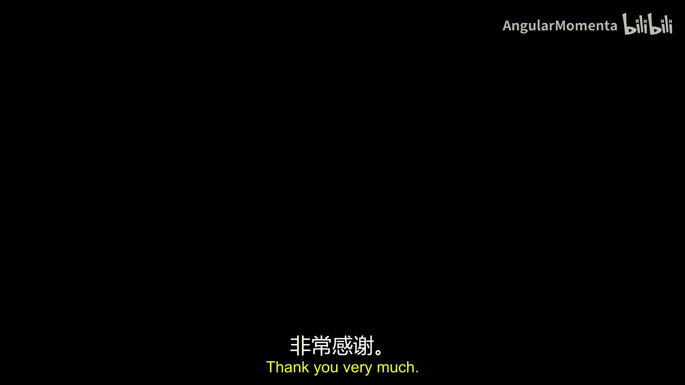

# 008：杂乱无章的修理工 🧰





在本节课中，我们将学习一个关于整理混乱的螺母和螺栓的谜题。这个谜题不仅有趣，还与一种非常流行的排序算法——快速排序——有着深刻的联系。我们将从最直观的解法开始，分析其效率，然后探索一种更巧妙的“分而治之”策略，最终将其与快速排序算法联系起来。



## 谜题设定

假设一位粗心的修理工有100个不同尺寸的螺母和100个与之配对的螺栓，但它们全部混在一个袋子里。目标是找到最高效的方法，将每个螺母与对应的螺栓配对。

唯一的检查方法是**实际尝试**将一个螺母拧到一个螺栓上。通过这个操作，你可以得到三种结果：
1.  螺母**完美匹配**螺栓。
2.  螺母**大于**螺栓（螺母会松动）。
3.  螺母**小于**螺栓（螺母拧不进去）。

## 直观解法及其复杂度



最直接的方法是：随机拿起一个螺母，然后尝试袋子里所有的螺栓，直到找到匹配的那个。找到一对后，将其放在一边，问题规模就从 `N` 对减少到 `N-1` 对，然后重复这个过程。



以下是这个过程的步骤分析：
*   寻找第一对匹配时，在最坏情况下需要进行 **N** 次比较（例如，最后一个尝试的螺栓才匹配）。
*   接下来寻找第二对匹配，最坏需要 **N-1** 次比较。
*   以此类推，直到最后一对。


因此，所需的总比较次数是：**N + (N-1) + (N-2) + ... + 1**。

这个求和公式是：
```
总比较次数 ≈ N * (N+1) / 2
```
当 `N` 很大时，其**增长速率**与 `N²` 成正比。对于100对螺母螺栓，大约需要5000次比较；对于1000对，则需要约50万次比较。这种 `N²` 级别的复杂度在问题规模增大时会变得非常低效。



## 分而治之策略

上一节我们介绍了直观但低效的解法，本节中我们来看看如何用“分而治之”的策略来改进。真正的分而治之通常将问题分解成**多个**规模更小的子问题，而不是每次只减少一个。

关键在于**枢轴划分**。思路如下：
1.  从袋中**随机选择一个螺栓**作为“枢轴”。
2.  用这个枢轴螺栓与**每一个螺母**进行比较。
    *   将比它大的螺母放入“右堆”。
    *   将比它小的螺母放入“左堆”。
    *   找到恰好匹配的螺母，将其放在一边。这个螺母就是“枢轴螺母”。
3.  现在，使用找到的**枢轴螺母**与**剩下的每一个螺栓**进行比较。
    *   将比它小的螺栓放入“左堆”。
    *   将比它大的螺栓放入“右堆”。
4.  现在，你得到了两个独立的子问题：“左堆”里的螺母和螺栓彼此配对，“右堆”里的亦然。枢轴螺母和螺栓已经配对完成。
5.  对左右两个堆**递归地**重复此过程。

这种方法的神奇之处在于，经过一轮枢轴操作后，我们得到了两个可以独立解决的子问题。如果每次划分都能大致将问题分成两半，那么解决问题的步骤数将呈**对数级**增长，整体复杂度可以接近 `N log N`，远比 `N²` 高效。



## 从谜题到快速排序 🚀

我们刚刚在谜题中使用的枢轴划分策略，正是**快速排序**算法的核心。现在，让我们暂时忘掉螺母和螺栓，看看如何用这个思想来排序一组数字。

快速排序是一种“分而治之”的排序算法，其步骤与我们的谜题解法高度对应：
1.  **选择枢轴**：从数组中选择一个元素作为枢轴（例如最后一个元素）。
2.  **划分**：重新排列数组，使得所有**小于**枢轴的元素都在其左侧，所有**大于**枢轴的元素都在其右侧。枢轴元素的位置在此步骤后就被**确定**了。
3.  **递归**：对枢轴左侧和右侧的子数组递归地执行快速排序。

这与合并排序不同。合并排序的“分”很简单（直接对半分），但“治”（合并步骤）需要额外空间和操作。而快速排序的“治”（划分步骤）是关键且需要技巧的，但在此之后，“合”几乎不需要额外工作。



## 快速排序的优势：原地排序

快速排序之所以被广泛使用，一个主要原因是它可以是**原地排序**算法。这意味着除了存储原始数据外，它只需要**常数级别**的额外存储空间（例如，用来暂存枢轴值）。

以下是一个原地划分的简要思路（对应谜题中同时移动螺母和螺栓的过程）：
*   设置两个指针，一个从数组左侧向右移动，寻找**大于**枢轴的元素；另一个从数组右侧向左移动，寻找**小于**枢轴的元素。
*   当左指针找到大于枢轴的元素且右指针找到小于枢轴的元素时，交换这两个元素的位置。
*   重复这个过程，直到两个指针相遇。相遇的位置就是枢轴元素的正确位置，将枢轴放入该位置。
*   至此，划分完成，且所有操作都在原数组上进行，无需创建新数组。

这种原地特性使得快速排序在处理海量数据时非常节省内存，这也是它比需要 `O(N)` 额外空间的合并排序更受青睐的原因之一。在平均情况下（特别是当输入数据经过随机化时），快速排序的时间复杂度也能达到高效的 `O(N log N)`。

## 总结

本节课中我们一起学习了“杂乱无章的修理工”这个有趣的谜题。
*   我们从最直观的 `O(N²)` 解法开始，理解了其效率瓶颈。
*   然后，我们引入了**枢轴划分**这一关键思想，将问题分解为可独立解决的子问题，实现了更高效的分而治之策略。
*   最后，我们将此策略与**快速排序**算法联系起来，理解了快速排序通过枢轴划分确定元素位置、并递归排序子数组的核心过程，同时也认识了其**原地排序**和**平均高效**的特点。




这个谜题完美地展示了，一个巧妙的算法思想如何既能解决一个具体的实际问题，又能构成计算机科学中一个强大工具的基础。