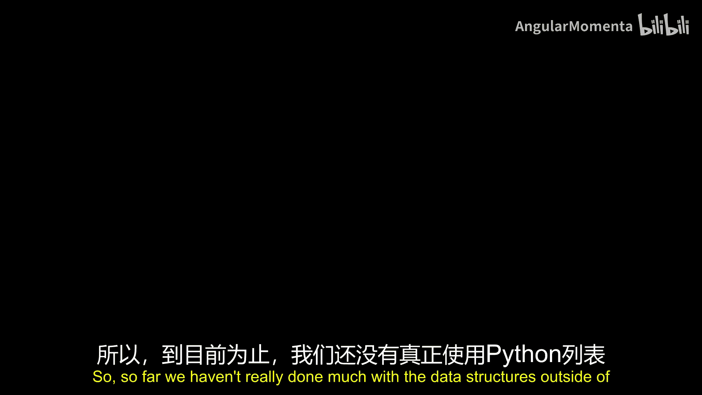
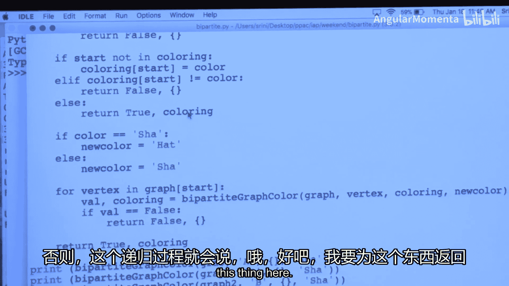

# 009：谜题10-难忘的周末 🎉



在本节课中，我们将学习如何解决一个关于周末派对安排的谜题。这个谜题的核心是判断一个社交关系图是否可以被“二分”，即能否将所有朋友分成两组，使得互相不喜欢的人不在同一组。我们将学习图论中的**二分图**概念，并使用**递归深度优先搜索**算法和Python的**字典**数据结构来解决它。

---

## 图与数据结构 📊

到目前为止，我们主要使用了Python列表这种数据结构。我们看过二维列表，但它们本质上还是列表。今天要解决的谜题涉及**图结构**。这是本课程中第一次涉及图的遍历。我们将以递归方式进行遍历，并使用**字典**来表示图。

字典是一种比列表更通用的数据结构。它允许你使用非零整数（如字符串或元组）作为索引来访问元素，而不仅仅是0到n的整数索引。在表示和遍历图时，字典非常方便。

---

## 谜题描述 🧩

这个谜题是关于周末晚餐安排的。你有一群朋友。我们可以用一个图来表示这个社交网络。

图中的每个**节点**代表一个朋友。我们用字母A到H来命名他们。

如果图中只有节点，那会非常无趣。我们需要添加**边**。这些边代表什么？你喜欢你所有的朋友，但你的朋友们不一定互相喜欢。因此，图中节点之间的边代表一种**不喜欢**的关系。

例如，B和C之间的边意味着B不喜欢C。我们假设这种关系是对称的，即C也不喜欢B。因此，这是一个**无向图**。边B-C的存在意味着在遍历时，你可以从B到C，也可以从C到B。

你的任务是让所有朋友都开心。方法是在周末举办两场派对，比如周五派对和周六派对。你需要满足两个约束条件：

1.  **约束一**：每个朋友必须参加**恰好一场**派对。不能有人被落下，也不能有人参加两场。
2.  **约束二**：任何一对互相不喜欢的朋友**不能**被邀请在同一天。

我们需要一个算法来给出一个可行的日程安排。显然，安排可能不唯一。如果所有朋友都喜欢彼此，你可以随机将他们分成两组。这可以看作是一个**划分**问题：将一个节点集合分成两组，使得每个节点恰好属于一组，并且满足与节点间边相关的额外属性。

---

## 二分图与二着色 🎨

这个谜题的目的是判断是否能够完成这样的安排。对于某些图，可能无法同时满足这两个约束。例如，考虑一个包含三个节点的环（三角形），如果其中两人互相不喜欢，你将无法将他们分配到仅有的两天中而不违反规则。

能够以这种方式划分的图有一个特殊的名称，叫做**二分图**。

之所以称为二分图，是因为你总是可以将其画成这样一种形式：所有节点被分成左右两组，并且**所有的边都只存在于左右两组节点之间**，而同一组内的节点之间没有边。这是一个拓扑性质。

二分图还有一个等价的性质，称为**二着色**。这意味着你可以用两种颜色（例如红色和蓝色，对应周五和周六）为每个节点着色，使得**任何一条边连接的两个节点颜色都不相同**。这正好等价于我们的谜题问题。

因此，我们现在的目标是：**判断一个给定的图是否是二分图（即可二着色）**。一旦知道一个图是二分图，我们就知道存在解决谜题的方案。

---

## 环与可着色性 🔄

让我们通过环来理解这个性质。一个**三节点环**（三角形）不是二分图。那么，任何环都会导致问题吗？并非如此。

考虑一个**四节点环**（A-B-C-D-A）。我们可以将A和C着为红色，B和D着为蓝色。这样，所有边连接的都是不同颜色的节点。因此，偶数环是允许的。

然而，对于一个**五节点环**，当你尝试用两种颜色交替着色时，最终会矛盾地要求同一个节点被着上两种颜色。因此，**奇数环**会导致图无法被二着色。

有趣的是，**环的奇偶性**决定了图是否是二分图。但这并不意味着一个只包含偶数环的图就一定是二分图，因为图中可能还存在其他导致问题的结构（例如，多个环交织在一起）。我们的算法需要确保图中**没有奇数环**，这正好等价于能用两种颜色为其着色。

---

## 算法与图表示法 🤖

显然，我们需要一种方法来停止遍历。当遇到环时，你可能会回到已访问的节点。如果是偶数环，可能没问题，但你不能在计算机程序中无休止地绕圈。我们将使用**递归搜索**，它包含有趣的终止条件。

与之前分治法或迭代枚举中明确的终止条件（如列表长度为1）不同，图遍历中的环检测，尤其是递归遍历，可能相当棘手。

首先，我们需要能够表示这个图结构。你可以用矩阵（或二维列表，称为邻接矩阵）来表示图，其中行和列都是节点，根据节点间是否有边来填充1或0。但在大多数情况下，这种表示法处理起来很麻烦。对于遍历图，使用字典结构要方便得多。

---

## 深度优先搜索算法 🧭

让我们通过一个稍有不同的例子来讨论算法如何工作。我们将使用**深度优先搜索**策略。

深度优先搜索的策略是：从一个节点开始，选择它的一个邻居，然后尽可能深地探索从这个邻居出发能到达的所有路径，直到遇到终止条件。然后回溯，再探索其他未访问的邻居。

这与**广度优先搜索**不同，广度优先搜索是同时探索当前节点的所有邻居，像 frontier 一样一层层向外扩展。


在我们的算法中，当遍历一条边到达一个新节点时，我们需要**翻转颜色**（例如，从红色变为蓝色，或从蓝色变为红色）。如果访问到一个已经着色的节点，我们需要检查其颜色是否与根据当前路径推导出的预期颜色一致。如果不一致，则发现了奇数环，图不是二分图。

此外，图可能是由多个互不连接的子图（森林）组成的。我们的算法需要能够处理这种情况，可能需要从多个未着色的节点分别启动遍历。

---

## 代码实现与字典操作 💻

我们将使用字典来表示图。字典是一组**键值对**，用花括号 `{}` 表示。键可以是字符串、元组等。在我们的图中，键是节点名（如 `‘B’`），值是该节点的邻居列表（如 `[‘C’]`）。

例如，一个图的字典表示可能如下：
```python
graph = {
    ‘A‘: [],
    ‘B‘: [‘C‘],
    ‘C‘: [‘B‘, ‘D‘],
    ‘D‘: [‘C‘, ‘E‘, ‘F‘],
    # ... 其他节点
}
```

访问字典类似于访问列表：`graph[‘A‘]` 会返回节点A的邻居列表。如果键不存在，则会报错。你也可以修改字典，例如 `graph[‘A‘].append(‘D‘)` 会为A添加一个邻居D。

在我们的二分图检查代码中，我们不会修改图本身，只会遍历它。我们还需要另一个字典来记录每个节点的着色结果。

---

## 算法步骤详解 📝

以下是判断图是否可二分（可二着色）的递归算法核心步骤：

1.  **输入**：图 `graph`（字典），起始节点 `start`，当前颜色 `color`，以及记录着色结果的字典 `coloring`（初始为空）。
2.  **基础检查**：如果起始节点不在图中，返回 `False`。
3.  **节点着色检查**：
    *   如果当前节点 `start` 尚未在 `coloring` 中着色，则用当前 `color` 为其着色（即 `coloring[start] = color`）。
    *   如果当前节点 `start` 已经着色：
        *   如果其现有颜色与当前 `color` **不同**，则发现矛盾（奇数环），返回 `False`。
        *   如果其现有颜色与当前 `color` **相同**，说明此节点已正确着色且访问过，无需继续从此节点深入，直接返回 `True`（作为递归子调用成功的一部分）。
4.  **颜色翻转**：为当前节点的邻居准备颜色 `new_color`，它是 `color` 的相反色。
5.  **递归遍历邻居**：对于当前节点 `start` 的每一个邻居 `vertex`：
    *   递归调用着色函数，传入图 `graph`、邻居节点 `vertex`、新颜色 `new_color` 和更新后的 `coloring` 字典。
    *   如果任何递归调用返回 `False`，则立即向上返回 `False`。
6.  **返回成功**：如果所有邻居的递归调用都成功，则返回 `True`。

为了处理多个连通分量，我们需要在外层循环中，对图中每一个尚未着色的节点，都以其为起点调用一次上述函数。



---

## 总结 🏁

本节课中，我们一起学习了一个有趣的周末派对安排谜题。通过将其抽象为图论问题，我们引入了**二分图**和**二着色**的概念。我们了解到，一个图是二分图当且仅当它不包含**奇数环**。

为了用程序解决这个问题，我们使用了Python的**字典**数据结构来表示图，并实现了基于**递归深度优先搜索**的着色算法。该算法遍历图，尝试用两种颜色为节点着色，并在发现着色矛盾时判断图不是二分图。


这个谜题和算法不仅适用于派对安排，也是图论中一个基础且重要的问题，在任务调度、资源分配等领域都有应用。希望你能通过这个例子，对图遍历和递归算法有更深入的理解。