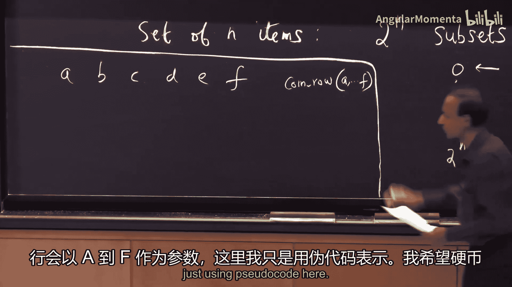
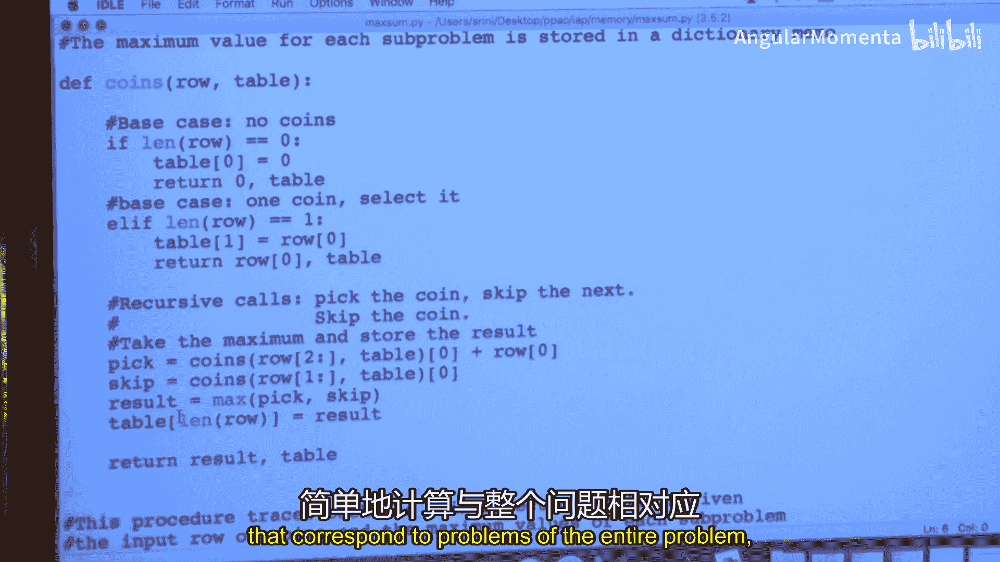
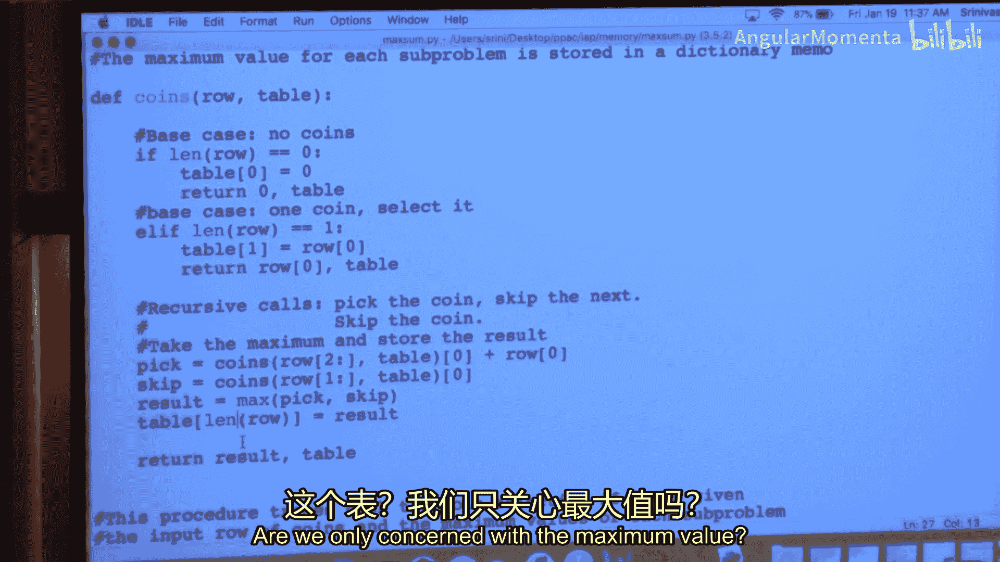
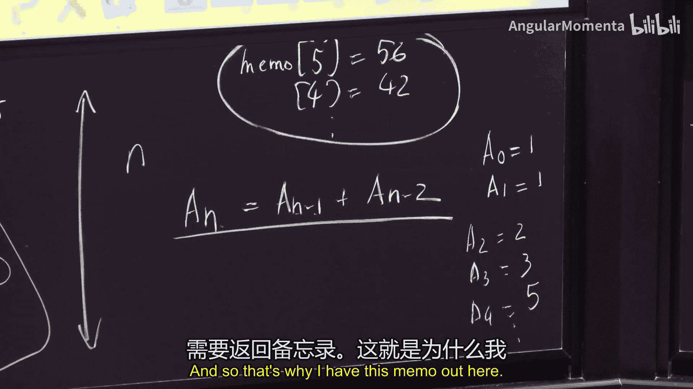
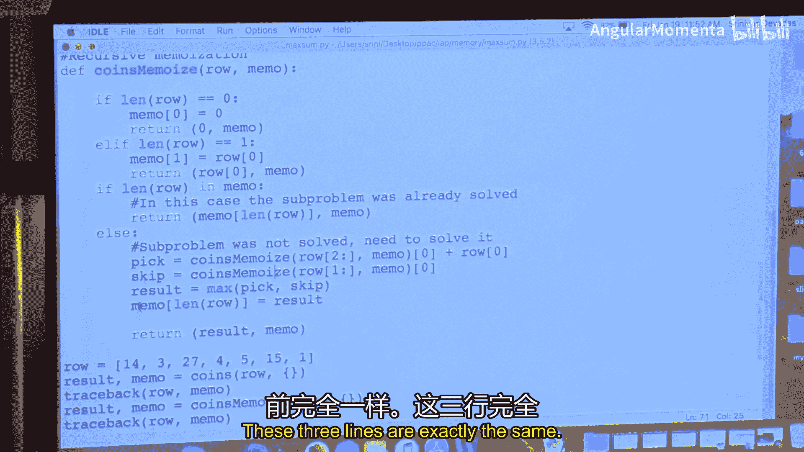
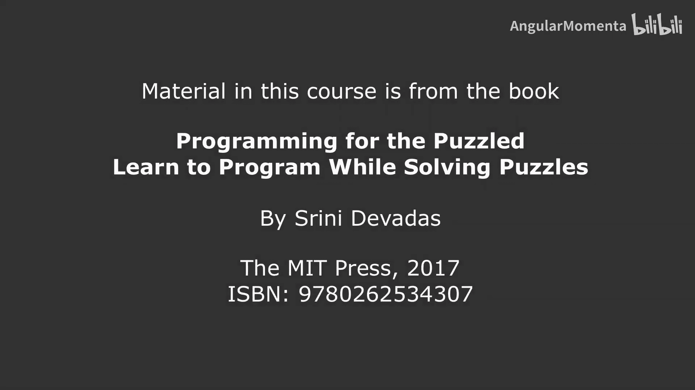

# 010：硬币排游戏


在本节课中，我们将学习一个有趣的硬币排游戏，并探讨如何通过算法来解决它。我们将从最直观的暴力解法开始，逐步引入递归策略，并最终学习一种强大的算法优化技术——动态规划。通过这个过程，你将理解如何将看似复杂的指数级时间复杂度问题，优化为高效的线性时间解决方案。

## 游戏规则

你面前有一排硬币，每个硬币都有一个正的价值。你的目标是选取硬币，使得所选硬币的总价值最大化。但有一个关键约束：**如果你选取了一枚硬币，就不能选取紧挨着它的下一枚硬币**。

这意味着你可以选择“选取-跳过-选取”的模式，也可以跳过不止一枚硬币。我们的任务是找到在遵守此约束下的最大总价值。

## 暴力枚举法

首先，我们考虑一种最直接的方法：枚举所有可能的硬币选取组合。

### 思路分析
对于一个包含 `n` 枚硬币的集合，总共有 `2^n` 个子集（包括空集和全集）。我们可以生成所有这些子集，然后检查每个子集是否满足“无连续选取”的约束，最后从所有合法子集中找出总价值最大的一个。

### 关键步骤
以下是实现此方法的关键步骤：
1.  **生成所有子集**：可以通过遍历从 `0` 到 `2^n - 1` 的所有整数，并将其二进制表示映射为选取方案（1表示选，0表示不选）。
2.  **检查约束**：对于一个用二进制字符串表示的选取方案，检查其中是否出现连续的 `1`。如果出现，则该方案无效。
3.  **计算最大值**：对所有有效方案计算总价值，并记录最大值。



### 算法局限性
虽然这种方法在硬币数量 `n` 较小时可行，但当 `n` 增大时，`2^n` 的增长速度极快（例如，`n=50` 时，子集数量超过千万亿），导致算法完全不可行。我们需要更高效的策略。

## 递归解法

上一节我们介绍了暴力枚举法，本节中我们来看看如何用递归思想更优雅地建模这个问题。

### 递归思路
我们定义函数 `coin_row(coins)`，其目标是返回从硬币列表 `coins` 中能获得的最大价值。
考虑第一枚硬币 `coins[0]`，我们有两种选择：
*   **选择它**：那么我们不能选择 `coins[1]`，因此剩余的子问题是 `coin_row(coins[2:])`。总价值为 `coins[0] + coin_row(coins[2:])`。
*   **不选择它**：那么我们可以直接考虑剩余的子问题 `coin_row(coins[1:])`。总价值就是 `coin_row(coins[1:])`。

原问题的解就是这两种选择中价值较大的那个。递归的基线条件是：当列表为空时，价值为0；当列表只有一个元素时，价值就是该元素的价值。






### 递归伪代码
```python
def coin_row(coins):
    if len(coins) == 0:
        return 0
    if len(coins) == 1:
        return coins[0]
    pick = coins[0] + coin_row(coins[2:])  # 选择第一枚硬币
    skip = coin_row(coins[1:])             # 不选第一枚硬币
    return max(pick, skip)                 # 返回较大值
```

### 递归的缺陷
这个递归解法虽然正确，但效率极低。因为它会反复计算相同的子问题。例如，计算 `coin_row(coins[2:])` 和 `coin_row(coins[1:])` 时，它们内部又会调用更小的重叠子问题。其时间复杂度与斐波那契数列递归计算类似，是指数级的 `O(φ^n)`（其中 φ 是黄金比例）。

## 动态规划与记忆化

上一节我们看到了递归解法因重复计算而低效。本节中，我们将引入**记忆化**技术来消除这种冗余，这正是动态规划的核心思想之一。

### 记忆化原理
记忆化的核心思想是“用空间换时间”。我们创建一个缓存结构（如字典或列表），在每次计算一个子问题的结果后，将其存储起来。当再次需要这个子问题的结果时，我们首先检查缓存，如果已经计算过，则直接返回缓存的结果，避免重复计算。

### 记忆化递归实现
我们只需对之前的递归代码做少量修改：
1.  添加一个 `memo` 字典作为缓存。
2.  在函数开始时，检查当前参数（如剩余硬币列表的长度或起始索引）是否已在 `memo` 中。如果在，直接返回缓存值。
3.  在函数返回前，将计算结果存入 `memo`。

### 记忆化代码示例
```python
def coin_row_memo(coins, start, memo):
    # 检查缓存
    if start in memo:
        return memo[start]
    if start >= len(coins):
        return 0
    if start == len(coins) - 1:
        return coins[start]
    pick = coins[start] + coin_row_memo(coins, start + 2, memo)
    skip = coin_row_memo(coins, start + 1, memo)
    result = max(pick, skip)
    # 存入缓存
    memo[start] = result
    return result
```
通过记忆化，每个子问题（由 `start` 索引定义）只会被计算一次。由于子问题的数量是 `O(n)` 个，每个子问题的计算是常数时间，因此总时间复杂度优化到了 **`O(n)`**，实现了从指数级到线性的巨大飞跃。

### 回溯构造最优解
仅仅知道最大价值通常不够，我们还想知道具体选取了哪些硬币。这可以通过**回溯**来实现。
我们利用存储了所有子问题最优解的 `memo` 表（或 `table` 列表）：
1.  从第一个硬币开始判断。
2.  比较 `memo[i]`（包含硬币 `i` 的最优解）和 `memo[i+1]`（不包含硬币 `i` 的最优解）。
3.  如果 `memo[i] > memo[i+1]`，说明在最优解中我们选取了硬币 `i`（因为包含它价值更大）。然后我们跳到 `i+2` 继续判断（因为选了 `i` 就不能选 `i+1`）。
4.  如果 `memo[i] == memo[i+1]`，说明在最优解中我们没有选取硬币 `i`。然后我们跳到 `i+1` 继续判断。
5.  重复此过程直到遍历完所有硬币。

### 回溯代码示例
```python
def traceback(coins, table):
    i = 0
    selected_coins = []
    while i < len(coins):
        # 处理边界情况：只剩最后一枚硬币
        if i == len(coins) - 1 or table[i] > table[i + 1]:
            selected_coins.append(coins[i])
            i += 2  # 选了i，跳过i+1
        else:
            i += 1  # 没选i，检查i+1
    return selected_coins
```





## 总结

本节课中我们一起学习了硬币排游戏及其解决方案的演进过程。
1.  我们从最直观的**暴力枚举法**开始，理解了问题搜索空间的规模（`2^n`）及其局限性。
2.  接着，我们设计了**递归解法**，通过将大问题分解为相似的小问题，得到了正确的但效率低下的算法。
3.  最后，我们引入了**动态规划**的核心思想——**记忆化**。通过缓存子问题的解，我们避免了递归中的大量重复计算，将算法的时间复杂度从指数级 `O(φ^n)` 优化到了线性级 `O(n)`。我们还学习了如何通过回溯，从存储的子问题最优解表中构造出具体的硬币选取方案。



动态规划是一种通过将复杂问题分解为重叠子问题，并存储子问题解以避免重复计算，从而高效解决优化问题的强大算法设计范式。硬币排问题是理解这一范式的经典入门案例。