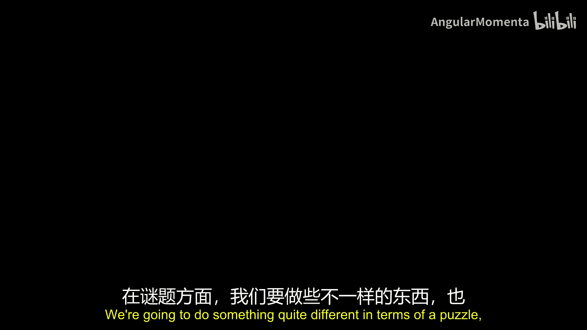
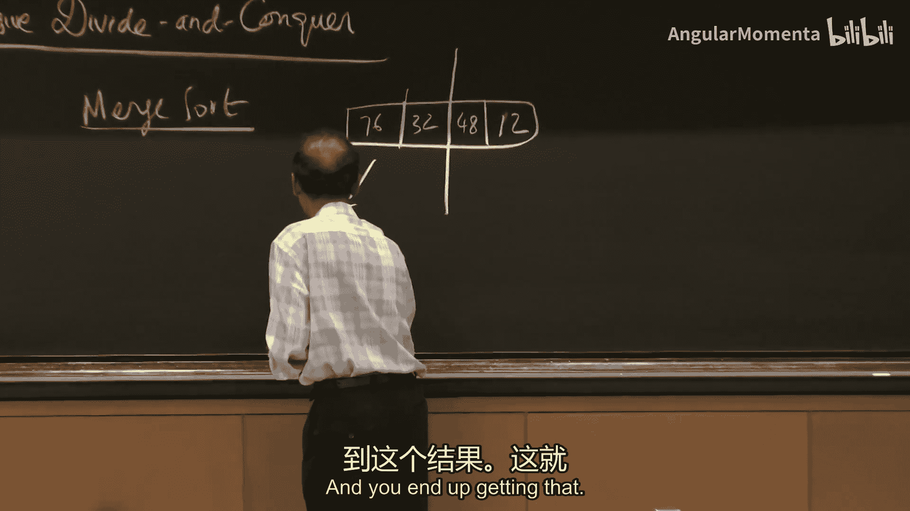
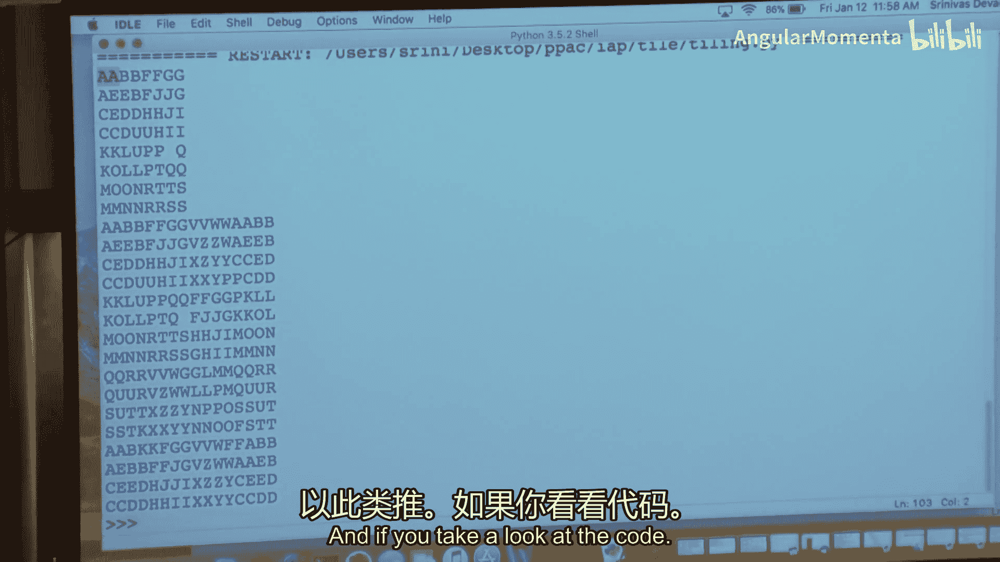

# 011：铺砖难题 🧩



在本节课中，我们将学习一个与递归相关的铺砖难题。这个难题与之前的N皇后问题不同，它将引导我们探索一种称为“递归分治”的经典算法思想。我们将首先通过归并排序来理解分治的概念，然后将其应用于解决一个庭院铺砖问题。

## 递归分治与归并排序 🔄

上一节我们介绍了递归的基本概念。本节中，我们来看看一种特殊的递归策略：递归分治。它与N皇后问题中的递归有本质区别。在分治策略中，我们将一个大问题分解成若干个**规模更小、结构相同**的子问题，分别解决后再合并结果。这通常能带来更高的效率。



归并排序是递归分治的经典范例。它的核心思想是：将一个无序列表不断二分，直到每个子列表只剩一个元素（此时自然有序），然后再将这些有序的子列表**两两合并**成一个新的有序列表。

以下是归并排序中“合并”步骤的核心逻辑（即“双指针算法”）：

```python
def merge(left, right):
    result = []
    i = j = 0
    # 比较两个子列表的头部元素，将较小的放入结果
    while i < len(left) and j < len(right):
        if left[i] <= right[j]:
            result.append(left[i])
            i += 1
        else:
            result.append(right[j])
            j += 1
    # 将剩余元素加入结果
    result.extend(left[i:])
    result.extend(right[j:])
    return result
```

归并排序的流程可以概括为以下步骤：
1.  **分解**：将待排序列表递归地分成两半。
2.  **解决**：递归地对两个子列表进行排序（当子列表长度为1时，直接返回）。
3.  **合并**：将两个已排序的子列表合并成一个完整的已排序列表。

理解了递归分治的思想后，我们现在可以回到最初的铺砖难题。

## 庭院铺砖难题 🏡

现在，我们来看一个具体的难题：如何用L形的三格砖（又称“三联骨牌”）铺满一个边长为 **2^n** 的正方形庭院？

首先，我们遇到一个基本问题：一个 `2^n × 2^n` 的庭院总共有 `(2^n)^2 = 2^{2n}` 个方格。而每块L形砖覆盖3个方格。由于 `2^{2n}` 不是3的倍数，因此**无法用L形砖恰好铺满**一个完整的正方形庭院。

为了解决这个问题，我们修改规则：庭院中有一个方格被一座雕像占据，无需铺砖。因此，需要铺砖的方格数变为 `2^{2n} - 1`。这个数字是3的倍数吗？是的，因为 `2^{2n} - 1 = (2^n - 1) × (2^n + 1)`，而 `(2^n - 1)`、`2^n`、`(2^n + 1)` 是三个连续整数，其中必有一个是3的倍数，因此它们的乘积 `(2^n - 1) × 2^n × (2^n + 1)` 能被3整除。虽然我们的表达式略有不同，但从数论上可以证明 `2^{2n} - 1` 总能被3整除。

所以，问题变为：给定一个 `2^n × 2^n` 的庭院，其中**任意一个方格**被雕像占据，能否用L形砖铺满剩余所有方格？

## 分治解决方案 🧱

我们可以借鉴归并排序的分治思想来解决这个二维铺砖问题。

核心思路是：将大庭院递归地分成四个更小的正方形子庭院。但这里有一个关键：直接分割后，只有包含雕像的那个子庭院是“有一个缺口的庭院”问题，其他三个是“完整庭院”问题，问题类型不统一。

为了让所有子问题变得相同，我们需要一个巧妙的操作：**在第一次分割的中心位置，放置一块L形砖**。这块砖会覆盖三个子庭院各一个角上的方格。这样，每个子庭院都变成了一个“边长为 `2^{n-1}` 且有一个缺口的正方形”问题，与原始问题类型完全一致，只是规模更小。

以下是解决问题的步骤概述：
1.  **基准情形**：如果庭院是 `2×2` 大小，那么它正好有一个缺口。此时，只需放置一块L形砖即可铺满剩余三格。
2.  **分解**：对于更大的庭院，找到中心点。将庭院分成四个大小相等的象限。
3.  **创造子问题**：判断雕像在哪个象限。然后在中心放置一块L形砖，使其**覆盖其他三个象限**各一个角（即不覆盖雕像所在的象限）。这样，每个象限都变成了一个“有一个缺口的更小庭院”问题。
4.  **递归解决**：对这四个子庭院递归地调用相同的铺砖算法。
5.  **合并**：递归调用完成后，所有子庭院都被铺满，整个大庭院也就铺满了。

算法的关键在于，每次递归调用都确保将问题转化为**四个完全相同类型**的更小子问题。放置第一块L形砖的位置和方向，取决于原始雕像所在的位置。



## 总结 📝


本节课中我们一起学习了递归分治的思想及其应用。我们首先通过**归并排序**理解了分治如何将问题分解、解决再合并。然后，我们将这一思想应用于**庭院铺砖难题**。通过巧妙地放置第一块L形砖，我们将一个带有单个缺口的 `2^n × 2^n` 庭院铺砖问题，分解为四个规模更小的同类型问题，从而递归地解决了它。这个难题生动地展示了分治策略在解决复杂几何组合问题上的威力。