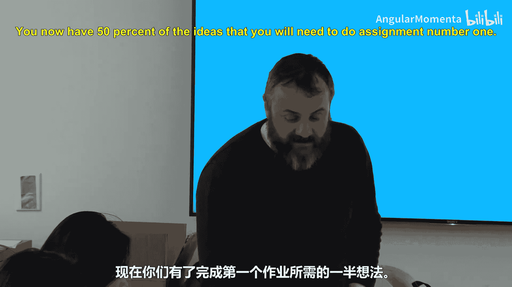
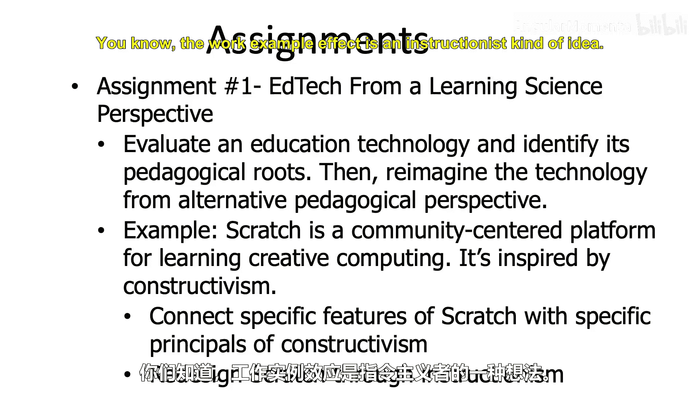

# 001：人们如何学习——认知负荷理论 🧠

在本节课中，我们将要学习认知负荷理论，这是一种关于人类如何学习的重要理论。我们将探讨人类认知结构的关键组成部分，以及这些组成部分如何影响教学设计的有效性。

---

## 课程导入：个人教育技术史

首先，我们进行一个简短的反思练习。请回顾你个人的教育技术使用历史，思考那些对你的学习轨迹产生过积极或消极影响的工具、平台或系统。

以下是具体步骤：
1.  回想一个对你学习产生积极影响的教育技术经历。
2.  回想一个对你学习产生消极影响的教育技术经历。
3.  与身边的同学组成小组，分享你们的经历，讨论大约五分钟。

---

## 案例分析：智能白板的启示

在刚才的讨论中，许多同学提到了智能白板。这是一个非常有趣的案例研究。大量资金被投入到这项技术中，但在许多地方，它似乎对学习没有产生任何积极影响。

智能白板失败的原因可能包括：
*   缺乏配套的教师培训。
*   没有与课程内容有效整合的教学材料。
*   教室的基础设施（如灯光）不匹配。
*   在许多情况下，它仅仅被当作一块昂贵的普通白板使用。

这个案例提醒我们，每一项教育技术的投入都有机会成本。学校花费的每一美元，本可以用于其他可能更有效地改善学习体验的资源上，如课程材料、教师专业发展或艺术用品。技术的有效性高度依赖于其应用的具体情境。

---

## 核心理论：人类认知架构

为了理解技术如何影响学习，我们需要先了解人是如何学习的。本节中，我们将探讨认知负荷理论所基于的人类认知架构模型。

请与你的小组合作，绘制一个视觉图表，展示人类认知架构的关键组成部分，并说明这些组成部分如何引出一系列教学原则。

---

### 认知架构的关键组件

根据各小组的图表，人类认知架构主要包含两个关键部分：工作记忆和长时记忆。

**长时记忆** 的特点包括：
*   **容量近乎无限**：目前尚未发现人类大脑存储信息的明确上限。
*   **以图式存储**：信息被组织成称为“图式”的、有意义的组块。
*   **处于无意识状态**：我们无法同时意识到长时记忆中的所有内容。
*   **存在遗忘**：信息会随着时间被遗忘，这是学习过程中一个重要因素。

**工作记忆** 的特点包括：
*   **容量极其有限**：在任何给定时间，只能同时处理 **3到5个** 信息单元。
*   **处理有意识信息**：我们当前正在思考、注意或操作的信息都位于工作记忆。
*   **是全人类的共同特征**：这是连接地球上所有人的一个认知共性。

在这个模型中，**学习** 被定义为将工作记忆中的信息存储到长时记忆的过程。**记忆** 则是将长时记忆中的信息提取到工作记忆的过程。心理学家丹尼尔·威林厄姆有一句名言：“记忆是思考的残留物。”

---

### 图式的作用：一个记忆实验

为了理解图式如何工作，我们进行一个简单的实验。

首先，尝试在10秒内记忆并写下这行梵文字符（对于非梵文使用者，这只是一系列无意义的线条）：
`（此处原为梵文图片，描述为一系列复杂线条）`

然后，尝试在10秒内记忆并写下这句英文短语：
`Let the entire world be happy.`

绝大多数人会发现，记住英文短语要容易得多。这是因为对于英语使用者来说，字母（如 L, E, T）和单词（如 “let”）已经是内化的图式。你可以将整个短语“Let the entire world be happy”作为一个有意义的组块来记忆。而对于梵文字符，由于缺乏图式，你不得不试图记住每一条独立线条的方向和顺序，这迅速超出了工作记忆的容量。

国际象棋大师记忆棋局的能力是另一个经典例子。新手需要记忆每个棋子的独立位置，而大师则将整个棋局识别为熟悉的战术模式（如“土耳其舰队弃兵”），这是一个复杂的图式。

---

## 教学启示：基于认知负荷理论的原则

基于对人类认知架构，特别是工作记忆有限性的理解，认知负荷理论提出了一系列教学原则，旨在优化学习过程，避免认知超载。

以下是认知负荷理论倡导的一些有效教学策略：
*   **示例效应**：向新手展示完整的问题解决步骤（例题），比让他们直接尝试解决开放性问题更有效。
*   **补全问题效应**：提供部分完成的解决方案，让学习者补全剩余部分，这比解决全新问题负担更小。
*   **模态效应**：用口语解释搭配视觉信息（如图表），比用书面文本搭配同样的视觉信息学习效果更好。这是因为听觉和视觉通道在工作记忆中似乎是分开处理的。
*   **空间邻近原则**：将相关的文字说明和图片在空间上紧密排列，而不是分开，可以减少寻找关联的认知负荷。

需要注意的是，这些原则对**新手**效果最显著。对于某个领域的**专家**，开放性问题解决和探索性学习可能更有效，这被称为“专家反转效应”。因为专家的相关图式已经建立，工作记忆有足够的空间进行更复杂的操作。

---

## 理论的边界与演变

我们阅读的迈克尔·珀尚的文章标题是《不是万有理论》，这提醒我们认知负荷理论的适用范围和局限性。

认知负荷理论主要关注**认知过程**，特别是工作记忆的瓶颈。它**并不直接解决动机、情感或社会文化背景**等问题。对于一位教师而言，学生缺乏学习动机可能是比认知超载更紧迫的挑战。因此，不同的学习理论（如下节课要讲的“情境学习理论”）会从其他角度切入。

此外，理论本身也在发展。例如，“相关认知负荷”这个概念曾被认为是促进图式构建的“好”负荷，但后续研究发现难以精确测量和应用，因此当前的研究中已较少强调。这说明了科学理论是在不断检验和修正中演进的。

---

## 课程总结与作业预告

本节课中，我们一起学习了认知负荷理论的核心内容。我们了解了人类认知架构中**工作记忆的有限性**是关键瓶颈，学习是将信息从工作记忆存储到长时记忆的过程，而**图式**是组织复杂信息、提升思维效率的关键。

基于此，认知负荷理论提出了一系列旨在减少“外在认知负荷”、优化学习过程的教学设计原则，如示例效应和模态效应。

现在，你已经掌握了完成第一次作业所需的一半知识。作业要求是：
1.  选择一项教育技术。
2.  分析它是更偏向于“讲授主义”（如认知负荷理论）还是“建构主义”（如下节课的情境学习理论）。
3.  重新想象并描述，如果从相反的哲学视角来设计这项技术，它会是什么样子。

下节课，我们将学习另一种重要的学习理论——情境学习理论，它将为我们提供理解学习的另一个有力视角。