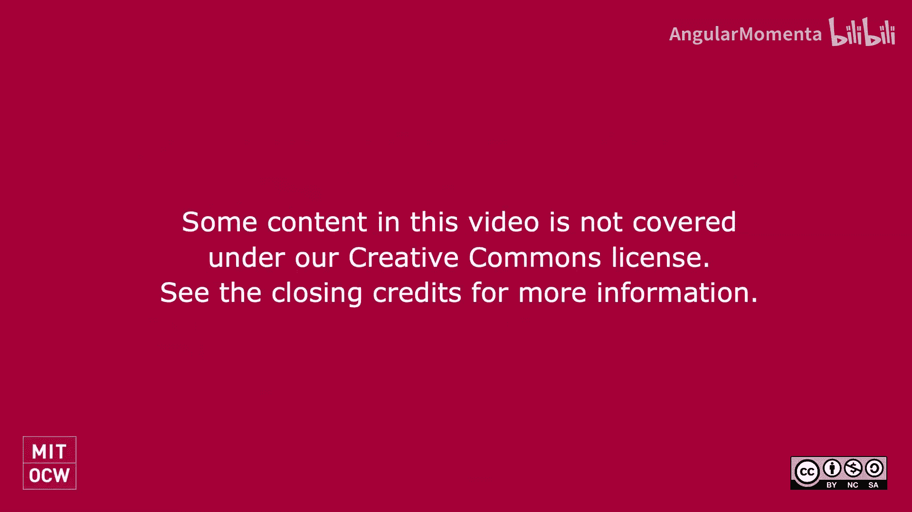
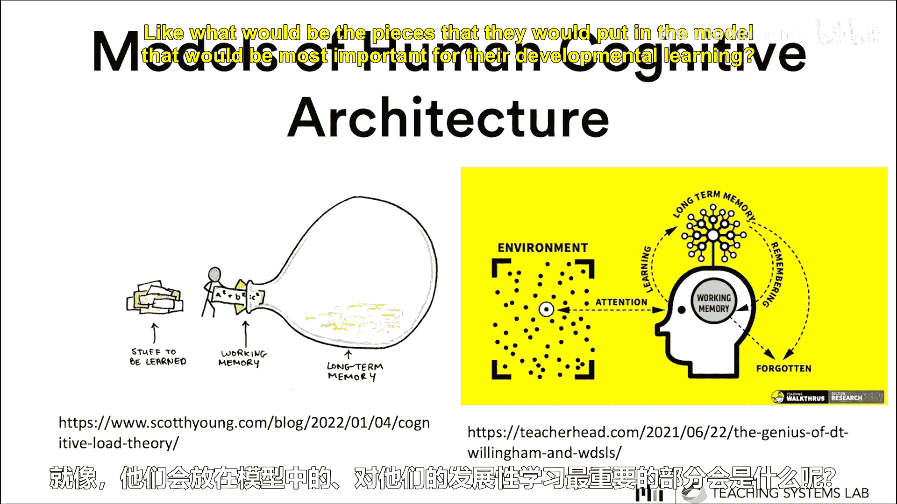
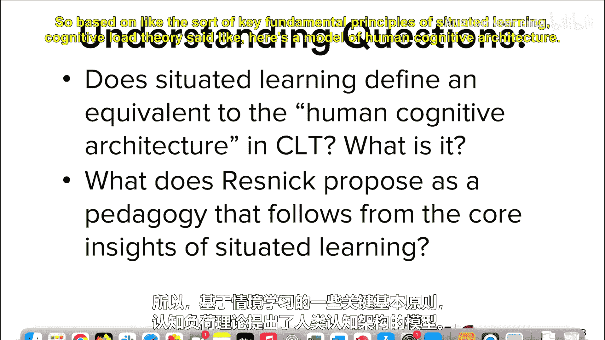
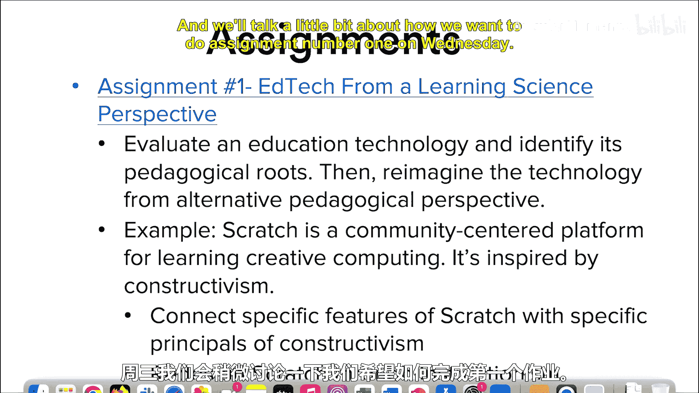
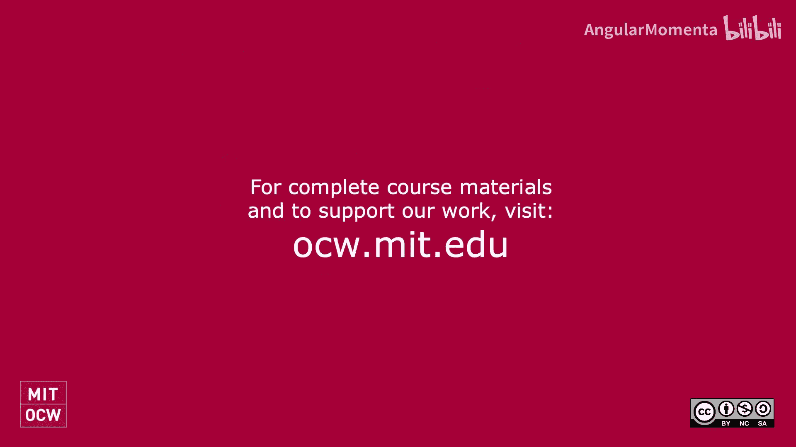

# 002：情境学习

在本节课中，我们将深入探讨“情境学习”这一核心学习理论。我们将通过对比“认知负荷理论”，分析婴儿的学习方式，并结合具体案例（如Logo编程语言和助产士学徒制），来理解情境学习的原则、方法及其在教育中的应用。

## 课程概述

上一节我们介绍了认知负荷理论，它强调通过精心设计的直接教学来优化工作记忆的负荷。本节中，我们来看看与之形成对比的“情境学习”理论。情境学习认为，学习本质上是一个社会性的、参与性的过程，是在特定社群实践中“成为其中一员”的过程，而非仅仅是知识的内部化。

## 婴儿的学习：对认知负荷理论的挑战

首先，让我们思考一个现象：婴儿在生命最初几年的学习速度和总量是惊人的。他们几乎每天都在掌握新技能，从语言到运动，学习速率远超成年人。

如果认知负荷理论是正确的，即学习需要避免工作记忆过载并依赖已有的长时记忆图式，那么婴儿的学习几乎不可能发生。因为对他们而言，周围环境中的一切都是全新的、离散的“外在认知负荷”，他们几乎没有长时记忆可以调用。然而，现实是婴儿的学习效率极高。

这与情境学习的观点产生了共鸣。婴儿的学习环境通常是开放式的、基于玩耍和探索的，充满了试错和社会互动，而不是结构化的“工作样例”教学。这种学习是自然的、充满乐趣的，并且深深植根于他们的日常活动和社交关系中。

## 情境学习的核心：从边缘性参与到完全参与

情境学习理论的代表人物让·莱夫和埃蒂安·温格提出了“合法的边缘性参与”这一核心概念。学习被看作是一个新手从实践共同体的边缘逐渐向中心移动，最终成为完全参与者的过程。

以下是这一过程的几个关键特征：

*   **在实践中学习**：学习发生在日常实践活动中，而非脱离情境的正式教学中。例如，助产士的女儿通过观察、跑腿、辅助按摩，自然而然地掌握了技能。
*   **身份形成**：学习知识与形成特定社群成员的身份是同一过程。你通过学习成为“物理学家”、“程序员”或“舞台管理员”。
*   **社会性与动机**：学习动力来自于成为社群一员的渴望，以及实践本身的意义。这与认知负荷理论中“克服困难”的叙事不同，更强调学习的自然愉悦和社会满足感。

## 案例研究：Logo编程与学徒制

为了更具体地理解情境学习，我们来看两个例子。

**1. Logo编程语言**
西摩·派珀特开发的Logo语言旨在让孩子们“用数学说话”。学生通过控制屏幕上的“海龟”绘图来学习几何和编程概念。学习过程是项目式的、充满玩耍和探索的。学生从制作简单图形开始，逐步组合成复杂作品（如一条鱼及其游动动画）。在这个过程中，学习是自我驱动的，计算机提供即时反馈，同伴之间相互教学，知识在有意义的创造情境中被掌握。

**2. 尤卡坦玛雅助产士**
人类学家布里吉特·乔丹的研究描述了玛雅助产士的学徒制。年轻女孩并非通过上课成为助产士，而是从小生活在助产士（通常是母亲或祖母）身边。她们通过观察、聆听故事、传递消息、准备用品等“边缘性”工作，逐渐吸收相关知识。直到自己生育后，才开始承担更核心的任务，如为产妇提供支持甚至进行产前按摩。整个过程中，正式的“教学”很少，学习完全融入生活与实践社群。

## 情境学习的原则与教学启示

基于上述理论，我们可以总结出情境学习倡导的一些教学原则，常被概括为“4P”：

*   **项目**：学习应围绕有意义的、开放式的项目展开，让学生制作或创作真实的事物。
*   **热情**：学习应与学习者的兴趣和热情相连，允许他们追随自己关心的领域。
*   **玩耍**：学习环境应鼓励探索、实验和冒险，容忍失败，保持轻松的氛围。
*   **同伴**：学习本质上是社会性的，应在实践共同体中通过与同伴和“老师傅”的互动进行。

从教学角度看，这意味着应尽早让学生“玩整个游戏”（如T-ball棒球），在真实或模拟的实践情境中学习，并重视学习社群的建设。

## 与认知负荷理论的比较与融合

虽然情境学习与认知负荷理论看似对立，但它们都致力于培养“专家”，即具备**精通、身份认同和创造力**的个体。分歧主要在于路径：

*   **认知负荷理论**倾向于“精通优先”：先通过结构化教学掌握基础知识和技能（精通），进而建立身份认同，最终实现创造性应用。
*   **情境学习**倾向于“创造力/身份优先”：先通过参与实践和玩耍激发兴趣、建立身份认同，从而产生掌握必要知识和技能的内在动机。

在实际教育中，很少有课程完全采用单一路径。例如，MIT的一些工程课程可能先让学生建造一个粗糙的机器人（情境/创造），再驱动他们去学习枯燥的控制系统理论（精通）；而生物导论课则可能先从细胞基础知识（精通）教起。有效的教学往往需要根据学习内容的复杂度和学习目标，灵活融合两种理念。

## 总结

本节课我们一起学习了情境学习理论。我们了解到，学习不仅仅是信息的摄入，更是一个在社会文化实践中构建身份、从边缘参与到核心参与的过程。通过分析婴儿的学习、Logo编程和传统学徒制，我们看到了基于项目、热情、玩耍和同伴的学习方式的强大力量。尽管与认知负荷理论路径不同，但两者都指向培养真正的专家。理解这些理论，能帮助我们在设计学习体验时，更好地平衡知识传递、动机激发和社群构建。