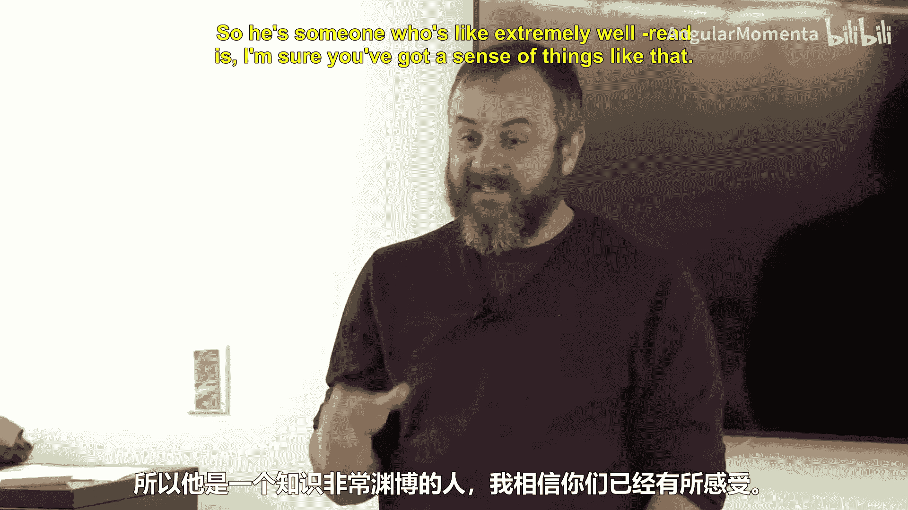

# 003：07. 互联网时代前的教育科技

在本节课中，我们将通过一个课堂练习，深入探讨在互联网时代之前，如电影、广播和电视等技术进入学校时所面临的复杂情况。我们将学习如何识别和分析影响技术实施的各种利益相关者及其动机。

---

为了参与接下来的练习，你需要从桌上拿一张索引卡，每张卡对应一种特定的技术。

看起来电影、广播和电视是剩下的选项。你将加入小组，并围绕这些技术展开工作。

以下是需要你做的事情。找到持有相同卡片的人，讨论你们从阅读材料中学到的内容。

任何让你印象深刻或想到的内容都可以讨论。然后，我希望你们制作一个图表，可以在白板或那边的蓝色纸上完成，主要捕捉三个核心想法。

首先，列出所有参与实施这项技术的利益相关者。

我认为拉里·库班做得特别出色的一点是，他让你感受到一项技术进入学校的过程中，所有经手的不同角色，以及技术在学校里时，所有与之互动的不同角色。这对于理解技术在实际中如何被使用至关重要，很多时候这与经典的设计模型不同。

我认为这在软件工程等课程中有所体现，比如那种认为存在一个程序员和一个用户的观念，用户就像是坐在键盘前、手指放在键盘上的一个人，这是你需要关注的对象。而在学校中，这种“设计者与用户”的两部分模型完全失效。

在学校里，有许多非常不同的人都可以被视为技术的用户。

拉里·库班另一个做得非常好的地方是，他帮助我们关注这些人拥有我称之为“不同利益”的东西。这里的“利益”不是指好奇心，而是指激励、利害关系，类似于政治学家使用“利益”一词的方式。

所有这些不同的利益相关者会因不同的事情获得回报。

他们也有我们称之为“无利益”或“负激励”的东西。

他们也在试图避免某些事情，或者会因为不同的事情受到惩罚。

因此，对于你选择并与同事讨论的技术，请思考所有你认为可以被视为该技术实施利益相关者的不同人群。

然后，为每个利益相关者想出他们的一些“利益”和一些“无利益”或“负激励”，或者会惩罚他们的事情。

这个练习的大致思路清楚了吗？我们共同尝试做的事情是，我们想要围绕这些技术重建当时的世界。

这就是拉里·库班如此出色的地方，他说，是的，一台电视机会被推进来，但它会被推进一个教室、一所学校和一个社区。而那里有所有这些人参与其中。这就是我们真正要理解的东西。

在我让你们开始之前，我要告诉你们的最后一件事是，拉里·库班本人有着非常迷人的历史。

他在20世纪50年代和60年代是一名社会研究教师，然后是一名校长，后来是一名督学。他实际上是弗吉尼亚州阿灵顿的督学，那是我妻子上学的地方。所以当我妻子还是小学生时，当时的督学就是拉里·库班。阿灵顿，弗吉尼亚。费尔法克斯，差不多。

是的。直到他作为一名教师、校长和督学度过了相当杰出的职业生涯后，他才去了斯坦福大学，获得了博士学位，成为教育历史学家，最终成为那里的教育史教授。

所以他是一个博览群书的人，我相信你们已经有所体会。但他也深刻理解使学校运转以及使学校里的人运转的种种因素。

这个练习清楚了吗？找到持有你卡片的人，移动你们的位置，在白板或这些蓝色纸上制作这个小图表。准备开始。

---

这些因素尤其重要。比如，教学实际发生在哪里？那里有某个需要上厕所、需要吃饭的人。我的意思是，这里有一个比电影更核心的例子，是关于电视的，他们发现人们在下午比在上午更可能使用电视。这完全与生物和文化有关，比如我们的大脑在上午工作得更好，到了下午我们都有点疲惫，诸如此类。

所以，是的，我认为任何构建技术的人都必须思考，比如，教师一天中的变化是什么？他们什么时候精力更充沛或更不充沛？技术如何适应这些周期？这些问题与我们拥有的考试成绩目标或其他任何事情一样真实。

---

这真的很好，这真的很好，再花几分钟，再花几分钟。我们正在思考他对学校的利益。当然，所以如果你是一所学校，什么会让你觉得……我不确定我是否想用电影做任何事情。那是1913年。无声电影大约在世纪之交开始认真出现，有少数人，其中最著名的是托马斯·爱迪生。

这个人发明了电灯泡，他站在国会面前说，你知道，首先在1913年。他说，我的意思是，我会读另一段引文。他说，十年内，教科书将被电影胶片取代。这就是这项新技术的强大之处。如果你是一名校长，什么会让你觉得……你挺聪明的，托马斯，但我不太确定这个。也许他们刚刚在教科书上投入了一大笔钱。

当然，是的，他们围绕现有技术建立了完整的基础设施。他们有墙上的书架。他们有装满书籍的图书馆。他们的每一位教师都接受过使用教科书教学的培训，而当这些技术首次引入时，他们的教师中没有一个人曾经作为学生通过电影学习过。

所以系统中存在着巨大的、固有的保守主义。这可能是一个原因。还有什么其他原因呢？

哦，好的，关键。是的，我的意思是，我想补充一点，但比如将其整合到课堂环境中，他们甚至……对于电影，整合的挑战是什么？你需要将什么技术放入教室或移动？对于电影，一些技术可能是什么？我的意思是，我不认为当时的投影仪……教室里的投影仪，它们足够便携，但它们是笨重的大型机器，房间……假设你经历了人口大幅增长。

所以有人在19世纪50年代建了一所学校，当时是每间教室12个孩子，现在你要放18个孩子进去。教室里没有空间来物理移动这台机器，这是一个完全合理的理由。

对于电影作为一种技术能够被实施，你还需要什么其他东西？所以你需要一台巨大的投影仪。你得把它放在轮子上。你还需要什么？一个实际投影的地方。好的。你得去所有的教室，在房间前面安装屏幕。这不是最大的挑战，但也不是免费的。谁来做这些事情？电影也存储在这些巨大的卷轴上，不只是像选择你的YouTube频道然后播放那样。在你的建筑里，你打算在哪里存放一个电影胶片库？谁来组织这些电影胶片库？如果你有四所小学，假设有四个一年级班级，你会买四份这部电影吗？这样每个人都可以同时观看。如果不，你打算如何物理组织和移动这个巨大的卷轴从一个地方到另一个地方？你可以想象校长会想，所有这些事情都要花钱。

所以这些都是托马斯·爱迪生没有考虑到的各种成本。他说你将通过这个东西获得100%高效的学习，这是潜在的收益。但没有人有任何证据，因为它还没有发生。你必须思考，所有这些成本是什么？所有这些物质上的变化是什么？是的，所以想想你如何阐述其中的一些事情。但是，当你真正做这个练习时，你必须思考，这项技术到底是什么？甚至物理上，它需要什么？你需要买多少这些东西？它们成本多少？所有这类事情。它们的可重用性如何？

---

好的，这真的很好。我们在这里休息一下怎么样。请回到你们原来的座位坐下。我认为每个人都写得足够广泛，我们从远处也能看到。

但是，是的，真的很好，真的很好。现在我需要为我找一个位置。每个人最后的笔记。是的，是的。现在是你们添加最后几笔的机会。好的，那么最少有多少利益相关者？这些人列出了最长的清单，他们是赢家。让我们大声读出来。管理员、家长、教师、学生、公司、制造商、教育科技投资者、开发者、政策制定者。很好。

作为一个起点，我的意思是，这里还出现了一些其他的，比如制片厂、广播公司、联邦通信委员会，不同的心理学家。是的，有很多人在这些决策中有利害关系。它们是复杂的、涉及多人的决策。这是一个好的开始。

让我读一下。考虑到这些事情如此复杂，为什么人们还对它们如此热情？让我们问问托马斯·爱迪生。托马斯·爱迪生对此有什么看法？

> 我相信电影注定要彻底改变我们的教育体系。在几年内，它将在很大程度上，即使不完全，取代教科书的使用。我应该说，平均而言，我们从今天的教科书中只获得了大约2%的效率。

你们在笑。你们在笑什么？托马斯·爱迪生在这里胡说八道。他说的2%毫无意义。他擅长电灯泡。在这方面可能没那么擅长。

> 未来的教育，正如我所见，将通过电影媒介进行，在那里应该有可能获得100%的效率。——托马斯·爱迪生，1922年。

你们会读到托马斯·爱迪生的其他一些引文，其中一段在《未能颠覆》这本书里。但在1913年，他站在国会面前说，十年内，教科书将完全被电影胶片取代，然后十年后的1923年，他又回去说，二十年内，教科书将完全被电影胶片取代。

我认为你今天可以找到许多类似的论点。我认为你很容易找到人告诉你，老式技术只有2%的效率，但新技术将是100%的效率。这就是承诺。

承诺是，如果我们考虑实施所有这些不同的技术，我们可以做得比现在好得多。

因此，你可以形成的一个直觉是，这是一个持续了一个世纪的事业。在过去的110年里，人们一直在思考如何将模拟技术，最终是数字技术，带入学校以改善学习。有数百万人在教育领域工作，其中许多人非常聪明。

从早期开始，你们读了一点关于个人电脑的内容，大约从70年代和80年代开始，比如Apple II Plus，这是我成长过程中使用的那一代电脑。但那实际上是从人们建造房间大小的计算机开始，大约20年后的事情。计算机科学家、教育工作者、学习科学家合作，试图找出是否有一些方法可以使用计算机来教人。

所以，仅仅计算，甚至不包括所有这些其他广播、电影等东西，计算本身就是一项长达70年的、试图改善学校的事业。在70年里，我们尝试并学到了很多东西。

因此，我希望你们从这门课中带走的一个直觉是，当你们思考任何形式或类型的教育技术问题，无论是设计问题、实施问题还是政策问题时，你们都应该想，我们以前可能做过类似的事情。没有什么东西是如此新颖、如此完全不同，以至于没有类似的例子可以帮助我们思考这些挑战。

让我们思考其中一些利益相关者，哪些利益相关者似乎出现在几乎所有列表中？谁似乎是普遍存在的利益相关者？教师。

让我们从他们开始，因为他们是最好的。我，我爱教师。我，我的意思是，我从事现在工作的原因之一就是我认为教师很棒。

什么事情会让教师兴奋？如果你想让教师使用教育技术，对他们来说真正重要的、感受到的需求是什么？这个可能在这些技术中相当一致，但我们也可以看看是否有差异。

减轻他们的工作量。好的，很好，我喜欢。减轻工作量。

为什么这对教师如此重要？他们有太多事情要做。这些人不是那种花大量时间坐着等电话响的人。在美国，教师的工作量在某些方面实际上比其他可比的经合组织国家要高得多。

所以，比如经济合作与发展组织，大约30或40个富裕国家。与我们在其他国家的同事相比，美国教师花在直接面对学生教学上的时间比许多其他地方都多。世界上许多其他国家，比如一个全职的有执照的教师会有更多的协作规划时间、更多的评分时间等等。

因此，与世界各地的同事相比，美国教师在拥有时间方面本来就落后。减轻工作量是他们关心的事情。他们还关心什么？比如它必须能激发兴趣。他们不希望孩子们感到无聊。

所以，他们的核心利益之一是，我如何让这些人保持动力？我如何让他们持续学习？他们还关心什么？关于实际高质量。好的，所以，学习效果提升、质量高非常重要。

教师非常认真地对待他们的专业性，并以各种方式被问责，这可能因不同类型的教师而异。所以在美国，我们主要以某些方式进行测试，我们测试的方式比其他国家多得多。没有哪个国家像我们这样每年测试所有学生三年级、八年级的阅读和数学。大多数其他国家是，如果你在三年级测试他们，你可能会等几年再测试，我的意思是，你给他们评估或考试之类的，但不会给他们像这样的大型全国性测试。因此，如果你是阅读或数学教师，你的考试成绩会受到仔细审查，而科学教师、艺术教师、健康教师等其他类型的教师则不会受到同样的审查。所以，即使在同一个国家，也可能存在不同的激励。

我作为一名历史教师总是喜欢的一点是，从来没有真正的考试让我以同样的方式为学生准备。我在私立学校，但即使是我的数学教师同事也觉得他们在为学生准备SAT、AP考试等。那从来不是我的关注点。因此，我花更少的时间思考，我带进教室的这个新东西是否会为某种近乎普遍的考试体验做准备，而我的数学教师同事总是不得不考虑这一点。我可以想，嗯，藏传佛教不在考试范围内，但它很棒，我们来学习它。所以，那是不同的。好的，其他种类的事情。是的，然后是萨布丽娜，可及性和包容性。

所以，比如，你多样化的群体中没有人被任何技术排除在外，是的。

这几十年来，这并不是一个普遍关注的问题。在30年代、40年代和50年代，人们更普遍地认为某些人有完全无法解决的学习障碍，社会应该以其他方式照顾他们的福利。然后在20世纪中叶，我们通过了《美国残疾人法案》，这彻底改变了我们的想法，事实上，为人们获得公平和适当的公共教育创造了联邦权利。

我还要说，随着社会总体上对包容性价值观越来越感兴趣，人们在20世纪80年代对个人电脑的包容性担忧，与现在他们对学生面前的电脑的担忧是非常不同的。这是一个很好的点。什么时候……能够跟踪学生进度。跟踪进度。评估。好的，是的，实际上有趣的是，在这个世纪里，一些最早的技术与此无关，比如广播和电影，但你们读到的最早的技术之一是物理教学机器，希望你们……我的意思是你们看到了一些图片。我今天刚看到，悉尼·普雷西是奥黛丽·沃特斯写到的人之一，有人在YouTube上发布了他演示其中一台教学机器的精彩两分钟片段，不幸的是，那个账户在今年课程开始前被删除了，也许我稍后会给你们发一个版本。唯一仍然存在的视频版本是一个叠加了非奥古瓦尔声音的视频。所以有人拿了一段非奥古瓦尔谈论edX能力的音频，在悉尼·普雷西演示教学机器时播放了音频，尽管相隔一个世纪，但这让人感到有点过于接近。但教学机器，它们有点像打字机，上面有四个按键。

所以它们一次显示一个问题。那是前扫描仪技术，然后会有四个可能的答案之一。这是最早的版本之一。它们后面有一个小薄荷糖库。所以当你按下正确的按钮时，会滚出一颗小糖果之类的东西，给你一种行为主义的积极强化。但是，它的主要优点之一是，哦，如果我们能让足够多的人拥有这些东西，那么我们几乎可以持续评估他们的进度，我们会确切知道他们在哪里。所以这个跟踪学生进度的想法，在我们这个数据驱动的世界里是特别迫切关注的事情，但在一个世纪前人们就已经感兴趣了。

教师的一些“负激励”是什么？如果你试图让教师采用新技术，哪些事情会成为他们的障碍？复杂性，为什么复杂性？有很多……有些教师更能适应新技术，而有些教师就是无法理解某些东西如何工作。

是的，所以，我认为能力是对的。我也认为，如果你从事教学，可能有两件事真正驱动你：一是你热爱你教的内容，这对中学教育者比早期小学教育者更适用，但可能两者都有一些。你可能热爱人。如果你不觉得人，尤其是年轻人，很有吸引力，就很难成为一名教师。那些觉得人有吸引力的人，可能只是觉得技术不那么有吸引力。他们不想一生都坐在电脑前打字。他们肯定想与人互动。

但我要说的另一件事是，许多教育工作者花了很多时间打磨他们的技艺，并且擅长他们现在教学的方式，以及过去十年的教学方式。因此，当他们看到一项新技术进来时，他们会想，这个东西真的会比我已经做了很久并且擅长的事情更好吗？当我整合这个新东西时，我将不得不失去什么？任何技术的采用都涉及损失。任何改变都涉及损失，你必须放弃一些东西。放弃的东西可能相当不错。我认为很多人认为年长的教师因为技术不熟练而不太可能采用技术，但与许多教师合作后，我确信年龄与技术采用之间没有关系。有对技术超级感兴趣的年轻教师，也有讨厌它的年轻教师。有年长的教师认为我对我所做的事情很在行，也有年长的教师之所以年长，是因为他们在过去20年里一直在尝试新事物，尝试变得更好。萨布丽娜，你的一个负激励是，学生分心。很好。

显然，其中一些技术比其他技术更容易导致分心。比如，如果你播放电影胶片之类的东西，你可能会吸引孩子的注意力，但当然，当我们进入计算机领域，任何需要每个学生负责自己注意力的东西都可能引起教师的担忧，因为孩子们喜欢关注各种事情。

还有什么会是负激励？比如教师被取代的感觉？他们觉得自己的工作被替代了？

嗯。所以教师是一个职业。你知道，这个职业通过执照等保护他们的工作安全，就像许多其他职业一样，比如医生、药剂师、律师等。是的，大多数专业人士对有可能取代他们职能的技术并不十分热情。好的。

让我们思考其他一些利益相关者。所以，这又是一个好的点。所以，再次，我们可以思考任何时候引入一项新技术。它会减轻工作量吗？它会激发兴趣吗？在这项新技术引入的前三周，它会激发兴趣吗？在这项技术引入两年后，它还会激发兴趣吗？它会高质量吗？我对质量有控制权吗？可及性和包容性。它会改善学习吗？它能够跟踪评估吗？它太复杂吗？它会让学生分心吗？它会取代我执行的基本职能吗？这是一组很好的问题，拉里·库班在某种程度上对广播、电影、电视、教学机器和计算机提出了这些问题，你也可以对人工智能、可汗学院、iCivics以及任何其他出现的东西提出这些问题。这些问题仍然是好问题。

现在让我们尝试触及其他一些利益相关者。哪些利益相关者让你感到惊讶？哪些是你觉得，在教育技术方面我不会想到的？奇怪的或独特的。

我的意思是，我的小组是教学机器，我们想到了提出这些技术背后理念的心理学家。比如，我从来没有真正想过，哦，你知道，是那些提出建构主义、情境学习等理念的人，然后激发了其他一切的兴趣。所以，人们有关于好的教学和学习应该是什么样的想法，这些想法在某种程度上似乎是普遍的，因为我们可以追溯到历史中找到它们，但它们总是被重新解释、更新。悉尼·普雷西处在一个行为主义是一套非常突出的思想的时刻。行为主义你们可能都很熟悉，当人们做错事时你惩罚他们，做对时奖励他们，通过这种方式调节他们的行为。所以他创造了一台体现这些思想的物理机器。然后西摩·佩珀特会出现并说，哦，为什么我们不能像去法国访问的孩子学习法语那样学习数学？为什么我们不能创造一个像数学乐园一样的东西？Logo可以是数学乐园。他有一套关于好的教学和学习应该是什么样的想法，并将这些想法融入其中。人们成为这些思想的拥护者。今天美国教育技术领域最突出的拥护者可能是萨尔·可汗，他对个性化学习有着非常具体的想法。我不知道你们是否知道他的个人经历，但他曾是对冲基金人士之类的，他的侄女在数学上遇到困难，他开始辅导他的侄女数学，并通过视频进行，所以他把视频放在网上，人们开始观看。他想，哇，如果每个人都能有这样一个个性化的导师会怎样？如果每个人都能按照自己的节奏学习数学会怎样？然后他建立了整个企业，并且现在仍然对人工智能非常热情，因为，哦，与其只是我为每个人录制一个导师视频，不如让AI为每个个体生成个性化的文本。这些想法，你知道，它们不是凭空出现的，有人倡导它们。你们都看到《纽约时报》或《华盛顿邮报》，有人写了一篇关于萨尔·可汗和人工智能的专栏文章。要么是在《华盛顿邮报》，要么是在《纽约时报》，但基本上是一篇庆祝性的文章，关于可汗学院。所以，这是一个不寻常的群体。今天，比如萨尔·可汗上《今日秀》告诉人们他的想法，他去投资者会议告诉人们他的想法，他每隔几年就被哈佛和麻省理工请来等等。所以这些人倡导他们的想法。想法不是从天上掉下来的。有一个利益相关者在推进这些想法。

还有哪些利益相关者看起来很重要？

我认为很奇怪的是，你可以想到像制造商和生产晶体管的人，比如台积电和ASML，因为美国各地的学校突然需要成千上万的iPad，并且有大量的积压订单，或者现在流行的任何东西，然后像台积电这样唯一真正生产晶体管的人就有了巨大的需求和很多钱。这些人然后组织成贸易团体，他们去……他们如何推进自己的利益？他们做一些事情，比如免费赠送一些材料给学校做演示，他们为他们的材料创建培训项目并分享，他们有销售和营销人员四处走动让人们对此产生兴趣，他们赞助会议，也许他们甚至不直接做广告，只是……他们的存在试图鼓励教师和其他团体支持它。我们每年在美国教育上花费巨额资金，其中最大的一部分用于支付工作人员的工资，另一大块用于供暖和空调，有人卖这些东西，但基本上，除了这两项之外，第三大块是我们为帮助人们学习而在学校购买的东西。所以，是的，有倡导者，你知道，这些人在这类事情上并非中立。苹果公司过去几年在这方面特别突出，试图塑造自己作为一家在学院、大学、学校内部具有特定作用的公司的形象。

我认为让我惊讶但也许并不那么令人惊讶的是，比如政府，政府测试等等，以及政府之间的竞争，因为上学期我们上的教育课，我们讨论了很多美国主义以及它与教育的联系，我知道这是一件大事，比如，哦，这个国家平均分数最高，也许是通过可汗学院之类的，所以有时真的只是政府之间相互竞争，试图看看谁是最好的。

很好，在美国，当我们谈论政府行为者时，我们可能想到的所有不同的政府行为者有哪些？所以有美国教育部。还有谁？所以有地方教育委员会。

美国教育部一个非常不寻常的事情是，美国教育系统极其分散，有13万所学校，1.3万个学区。在美国，最常见的民选官员是学校董事会成员。如果你是美国民选官员，你最有可能成为的就是学校董事会成员。学校董事会成员是有趣的利益相关者，他们在社区中……在许多社区，他们只是对教育特别感兴趣的社区成员，但他们也是那些……你知道，这是对政治生涯感兴趣的人的切入点。很多人从学校董事会成员成为州议员等等。这是一个特别……的时刻，对于那些有政治野心的人来说，尤其是美国右翼，学校改革已经成为在党内获得关注的一种方式。是的，全国各地有各种各样的城镇，你知道，我认为你们从阅读中得到一些，比如某个学校董事会认为，电影胶片会很棒，让我们大力推广电影胶片，或者闭路电视会很棒，拥有它会很有用。所以，甚至不是教师，不是督学，不是学校里的人，而是一些社区成员说，我们来做吧。

是的，你知道，在美国今天，可能有两种版本。肯定有一些学校董事会的身份是围绕成为一所尖端学校而形成的，比如在波士顿周围许多富裕的郊区城镇，比如韦尔斯利、牛顿，他们希望被认为是拥有真正优秀、尖端、前瞻性思维的学校。你知道，牛顿在他们建的上一所高中上花了2亿美元左右。所以，成为学校董事会成员的一种方式是，我要帮助学校系统现代化并拥抱技术等等。也可能相反。也可能有人进来，最常见的是在技术行业工作的人，他们说，你们不知道这些技术中内置了多少监控。每次我与校长或督学交谈时，他们都说，我们很难帮助家长理解这些东西为什么有用。比如，一个为谷歌或微软工作的人，知道这些工具的监控能力并对此感到担忧。

是的，我有个小轶事。我过去在教育出版业工作，主要做佛罗里达州的产品，这真的显示了这些学区有多大的权力，因为学校董事会会做出决定，比如佛罗里达州的一两个学区几次要求某个东西，这就会改变一个全国性产品的整个路线图。所以，就像佛罗里达州的几个人说，我们真的需要这个东西，然后阿肯色州的孩子们也以不同的方式学习。这绝对仍然是真的，由于网络出版和定制出版的能力，这种情况正在逐渐改变，但在20世纪后半叶的大部分时间和21世纪的前十年，出版商出版一本美国历史书时，他们如何决定内容？他们会说，哪些州是销售这本历史书最重要的州？佛罗里达是其中之一。其他还有哪些？你能说出它们，加利福尼亚、德克萨斯、纽约。加利福尼亚、德克萨斯、纽约、佛罗里达，这四个州仅凭人口就是最重要的州。所以现在你必须思考，每个州都有标准，这四个州的历史标准比缅因州和北达科他州的历史标准更重要。当历史上出现政治问题时，这种情况经常发生，在数学、阅读和其他方面也是如此。实际上，我曾经为历史教科书出版商做咨询，有一次我看到一个矩阵，列是所有可能的主题，行是所有州，标着X表示哪些主题被覆盖。另一件事是，比如，一大群波兰移民来到某个州，他们在教科书中看不到波兰人的代表，所以他们就会说，我们只采用那些谈论波兰裔美国人在历史中的重要性的书。出版公司说，好吧，加入波兰部分。然后意大利人也这样做，柬埔寨人也这样做，每个人都这样做，这就是为什么当你拿起你那本800页的历史教科书时，里面充满了所有这些奇怪的小片段。所以，是的，这些州级的影响，这里还有一个小特点但最终变得重要。有些州，主要在南部，教材采用是集中进行的，或者有某种集中功能。比如德克萨斯、佛罗里达，他们有州级委员会，规定只能采用通过这些委员会审核的书籍。马萨诸塞州是一个高度地方控制的州。如果州政府试图告诉马萨诸塞州的学区可以使用哪些教科书，学区的反应会很激烈，他们会说，再来一场革命，我们要从陆地到海洋，或者类似的话。他们就是不允许。但这意味着，那些有这种集中功能的州实际上对出版商有更大的影响力，因为他们说，看，你想在这里卖书。现在不仅仅是书，现在是网络程序之类的。现在正在打破这种垄断，虽然也带来一些问题的是，你知道，州可以说，好吧，我们要通过所有这些法律，效果是大幅减少黑人历史的教学，出版商可以说，好吧，你们的网络版本我们会删除这个、这个和这个，但在纽约或加利福尼亚等自由派州，你们可以保留所有那些内容。是的，有点像那个，平台在这些地方扮演着重要角色。以我自己的国家为例，每所公立学校都有一个扬声器系统，在一天开始时特别用来播放国歌，这是他们真正希望孩子们做的事情。就像，哦，有这么多技术。就这一件事。为什么这是唯一的……有某种激励去建造，比如，你知道，某种政治性的东西。然后这个广播系统在一天的其他时间也被使用吗？还是只在开学时使用？国歌之后，有些孩子，每个班级，他们会做一些村庄事务。一些阿拉伯诗歌，一些有趣的事实，不只是……我太喜欢这个了。我认为这是一个极好的例子。所以无论州政府是什么样，国家政府说每所学校必须每天播放国歌，那么这个国家的每一所学校都必须建立一个技术基础设施来实现这一点。然后，一旦这个技术基础设施存在，它也可以以其他方式被使用，或者不被使用，等等。你可以在其他国家找到类似的例子。目前教育政策制定者最感兴趣的国家之一是爱沙尼亚。大约每十年，某个人们不太关注的国家在国际考试中取得非常好的成绩。新加坡曾是这样一段时间，芬兰曾是这样一段时间，人们一度对芬兰着迷，而爱沙尼亚是最近的一个，人们会想，你们是谁？为什么你们阅读这么厉害？爱沙尼亚有时被称为“e-爱沙尼亚”。他们的政府以一种非常集中的方式真正拥抱了互联网。所以人们正在观察和思考教育技术在爱沙尼亚和其他地方是如何被采用的。但这不仅仅是一项针对学校的政策，他们想，我们要通过提供非常好的数字政府服务将爱沙尼亚置于地图上。而这个国家政策决策最终以各种方式影响学校孩子们的学习体验。是的，这是一个很好的例子。

学生，学生的利益和负激励是什么？一项技术的新颖性。好的，所以我们几乎所有人都喜欢新奇。这是技术的一个优势，尽管新奇的一个惊人之处在于它消退的速度快得惊人。我前几天在Reddit上读到这个。一位老师说，我带了一个任天堂Switch到课堂上，这样我们可以玩这些数学逻辑游戏。我的学生们说，哦，老师，我们能只做练习题吗？我说，好吧，那就做练习题吧。但是，比如玩一些在线游戏。这个班级曾经有过一个时刻，他们会觉得，什么？我们可以在课堂上玩电脑游戏？太棒了。但你知道，这是教育技术采用的一个有趣特点，新奇在短期内可能极具吸引力，但很快就会消退。

你对……有什么评论吗？为什么学生的默认选择又回到了纸笔？我的意思是，人们总是说教育几十年来一直如此，为什么即使我们改革了，它看起来还是这个样子？为什么默认是纸笔？好的。那么，让我们强调你观察到一个重要的事情，这也是我们在这里讨论过的，即学校是极其保守的机构。为什么是保守（小写c，不是指右翼）？有些是，但保守（小写c）意味着他们一遍又一遍地做同样的事情。可能的原因有哪些？一是，当你采访家长时，家长是另一个很多人提到的利益相关者，你问他们，你希望我们在你的孩子身上做多少实验？这个答案会相当低。人们对在孩子身上做实验的热情很低。第二，教育系统中的每个成年人都有所谓的“观察学徒期”。你们所有人都在学校待了大约13到18年，这塑造了你们的经验。所以，与你们教育水平大致相同的人进入学校成为教师，他们带来了那13、18、20年的教育经验，这塑造了他们认为学校应该如何展开的方式。

家长也会带来这些期望。我永远不会忘记这个。我曾经与犹他州一所学校交流，他们试图改用开放许可材料。那大概是15年前，18年前，他们试图摆脱教科书，让人们使用数字材料，特别是教师可以编辑的数字材料，以便根据学生情况定制。他们说，但他们仍然在教室里保留教科书，我不能告诉你这是否是真的，他们说，我们在教室里保留教科书的原因是，如果没有教科书，家长会不高兴。家长走进教室时，期望看到教科书。基本上，继续购买足够多的教科书放在所有教室里，比雇佣管理人员向家长解释为什么教室里不再有教科书要便宜。

所以，所有这些不同的利益相关者，这种保守的教育观是其中的一部分。一种可能性是，这真的很糟糕，实际上存在更好的方法，而我们如此保守，这真的拖累了我们。另一种可能性是，学校中存在的实践经过了几十年和几个世纪的完善，它们之所以是现在这个样子，是因为它们相当不错。我们继续做某些事情是因为它们有效。所以，你必须自己判断，当你听到学生采用旧实践的例子时，他们采用这些实践是因为它们真的很好用，因为他们喜欢它们，因为它们舒适和熟悉。有一种观点认为，特别是在我们这个时代，学生以一种几十年前可能没有的方式专注于成绩和表现，不是因为孩子们更物质主义了，而是因为经济不确定性。

因为随着贫富差距扩大，教育的赌注变得更高，人们更加专注于它。所以那些采用熟悉方式的孩子，他们是喜欢熟悉感，还是知道如何在熟悉感中表现出色？但是，再次，将我们谈论的所有事情与教育者试图实施新技术的决策联系起来。

你系统中的每个人都会有某种保守的冲动，一直到学生。这种保守冲动可能会被我们谈论的新奇效应所平衡，但它确实存在。所以，如果你希望一项新技术以某种有意义的方式被采纳，你可以采取的一个策略是让它与现有实践保持一致。你可以说，让我们采用那些已经在学校发生的事情的技术，那样就不会那么令人不安，需要更少的培训，引起更少的不安。它可能也不会带来太大帮助。我的意思是，卖技术的人不会这么说。但是，如果你只是将现有实践数字化，你通过数字化现有实践获得实质性收益的可能性有多大？或者也许你是一个雄心勃勃的改革者，说，不，不，我们可以做得更好。我们可以将学校的效率从2%提高到100%。我们只需要对我们的实践进行大的改变。然而，对实践进行大的改变需要说服人们改变所有这些事情。

这本书我读了很多遍。但我刚刚重温了。我喜欢里面的一段话。他说，在接近结尾的地方，他说，环境为其居住者制定了计划。

记住，他谈论的是教室的物理布局，但他使用了一个更广泛的社会学原则。环境为其居住者制定了计划。人们以某种方式在一个空间中互动，因为物理空间是以那种方式布置和建造的。

所以，我和这些人谈论电影胶片的一个问题。要在你的教室里放电影胶片，你必须拿一台巨大的带轮子的投影仪，把它推进空间。在20世纪初的一些城市学校教室里，挤满了大量涌入美国海岸的移民，他们的教室里没有空间放这个大东西。电影胶片另一个巨大的麻烦是这些巨大的电影卷轴。早期的电影卷轴真的非常大。你打算把这些东西放在哪里？你的城镇没有建一栋附有档案电影存储单元的建筑。假设你有一所大学校，有四个一年级班级，你想买一部电影。

你是要为所有四个一年级班级买四份同样的电影胶片吗？每个教室都要有自己的电影库吗？如果有一个集中的图书馆，你必须有一些方法来标记、存档、维护这些东西，并把它们带到教室里。所有这些事情的现代版本是，哦，你想给每个孩子一台设备。那个孩子的设备如何连接网络？他们如何登录？当他们忘记密码时谁来处理？当他们的设备坏了会发生什么？你会让家庭支付他们损坏的设备费用吗？你的孩子非常穷，他们负担不起，所以你要与保险公司签订合同。你的员工中谁有与保险公司签订计算设备保险合同的经验？你没有学过这个。我的意思是，我们周三会和教育学院院长们谈谈，但我很确定他们没有教学生如何管理保险合同。所有那些事情都成为，你知道，它们有一系列相关的激励和负激励。好的。

在我们得出结论之前，还有哪些其他人看起来对我们来说很重要，需要讨论一下？我们谈到了家长。是的，我，我，我的意思是，我不知道我们谈了多少。也许我们可以最后讨论一件事。

我们稍微谈了一下学校管理人员，但是，在学校里要特别注意的一点是，那里有多少不同类型的、角色不同的成年人。所以我们谈到了教师。还有校长之类的人。比如，如果你是一名校长，你在任何一天最紧迫的关注点是什么？作为校长，你的主要激励是什么？是的，你必须确保你能支付一切费用，教师不担心这个。教师会买……如果学校付钱，他们会想要多少技术就要多少。但校长必须平衡预算。我的意思是，奇怪的是，在美国，平衡预算可能根本不是校长的职责，可能完全是学区的职责。所以有些学区，学区会做出所有采购决策。其他一些学区，学区会拨一大笔钱给学校，说学校做出所有采购决策。

对校长来说还有什么超级重要？我正要说，比如维护校舍本身，为了学生安全。是的，学生安全，维护学校的物理建筑，确保一切正常运行。

他们也在管理关系，比如与学区、与家长等外部关系。校长是典型的组织行为学中的中层管理者。他们被授权做一些事情，但不是所有事情。他们对许多不同类型的利益相关者负责。他们所做的工作中有各种各样的复杂性。他们中的许多人很大程度上是根据考试成绩来评估的，特别是在学生有考试不及格风险的地方，并且根据政策基础设施，考试成绩对他们真的很重要。安全和学校的有序运行，比如，大楼里的每个人都希望学校有序，但当学校无序时，处理最多的人是助理校长或校长。这只是给他们更多的工作。你知道，比如让所有孩子都有手机，然后打架爆发，各种事情发生，教师必须处理，校长真的必须处理。我只是想简短地评论一下，当你问我们校长做什么时，我一生都在他们周围，我就像，我只能想到两三件我知道校长实际做的事情，我只是觉得这真的很奇怪，大多数人不会坐下来告诉你，这个人是为你处理X、Y、Z事情的人。

是的，围绕这些组织，很好。所以，你可以从那个见解中把握几件事。首先，学校简直复杂得令人难以置信。过去20年我基本上什么都没做，只是在思考学校。我仍然不理解那里发生的所有事情。它们就像一个生态系统，复杂得令人难以置信，也令人着迷。第二，如果你决定从事教育工作，从学生转变为教育工作者，你必须重新学习所有这些东西。从学生到从事教育工作的人，有很多事情对你来说是隐藏的，或者对你来说不重要。比如，你们中任何人是真正麻烦制造者的几率相当低，因为你们在麻省理工。但是，你知道，某个地方坐满了一个教室的人，他们非常了解校长，因为他们因为所做的事情在校长办公室待了很多时间。所以，很好，是的。

如果这门课发生在你身上的部分事情是，很多时候在社会科学中，我们谈论使熟悉的事物变得陌生。你一生都在看的东西，你会想，哇，看看那里所有这些我以前没有注意到或没有意识到的东西。

那些事情。也许这里有一个非常具体的事情。让我们想想像学生信息系统或Canvas这样的东西。让我们想想像学习管理系统这样的东西。谁花最多时间使用Canvas？告诉我其他使用Canvas的人。学生花很多小时登录，在Canvas上看东西。还有谁看Canvas？教师，教师。谁购买Canvas？不是学生和教师。在商学院，我想他们会称之为第三方支付者问题。所以，如果你是一家制作学习管理系统的公司。谁是你的利益相关者？谁最有权力决定你的东西是否被购买？比如某个教育技术主管之类的人，某个IT人员。所以，如果你曾经想过，比如，为什么这个这么糟糕？它不是为你设计的。在某些重要方面，它字面上不是为你设计的。它是为了解决某个将要购买这些东西的中层信息技术经理的问题而构建的。所以第三方支付者问题在教育技术领域比比皆是。我的意思是，从经典经济学的角度来看，第三方支付者问题的问题在于激励错位。你知道，在某些方面，你可以说改善Canvas上的教学和学习体验是一种成本。显然，你必须让它足够好，这样，你知道，如果有足够多的教师使用的话。你们有人曾经必须使用Blackboard吗？好的。很好。我曾经见过制作Blackboard的人。我只是站在他后面排队什么的，我在想，制作了一个数百万人讨厌的软件会是什么感觉？给世界带来这么多不快乐会是什么感觉？我想在自助餐队伍里问他这个问题会很不礼貌。

关于谁购买这些东西，我还有一件事要说。这也非常重要，特别是你们中任何对创办教育初创公司或其他事情感兴趣的人。

在学校里，谁能购买技术？可能购买技术的人有哪些头衔？我们提到了几个。图书管理员可以购买技术。系主任，系主任可以购买技术。教师，教师，他们是最不可能的人之一。实际上，有时人们认为教育系统的一个问题是，很难有一个真正的自下而上的市场效应。在大多数地方，教师很少有可自由支配的资金来决定。这就是为什么他们举行大型义卖活动，当你成为家长时，你的老师会要求你带纸巾盒之类的东西，你会想，我们生活在什么样的失败国家，你竟然不能简单地购买你需要的所有纸巾？每个学期为所有学生买两令纸？所以教师……在某些情况下他们有，但在很多情况下，校长可以买东西，教学技术主管可以买东西，助理督学可以买东西，督学可以买东西，学校董事会在某些地方可以直接授权购买东西，虽然可能更罕见，但他们可以推动。但重点是，在这个国家的1.3万个学区和13万所学校中，谁能购买东西这个问题的答案在所有那些背景下都是不同的。这使得创办一家教育技术公司非常非常困难。当你去某个地方时，你甚至不知道谁能买这个东西。比如，你甚至不知道你在向谁推销。现在，有人知道谁购买所有这些东西。在美国，唯一知道每个学区每所学校谁有权购买东西的人是大型出版商。培生、霍顿·米夫林，你工作的公司是什么？麦格劳-希尔。他们有一支销售大军。