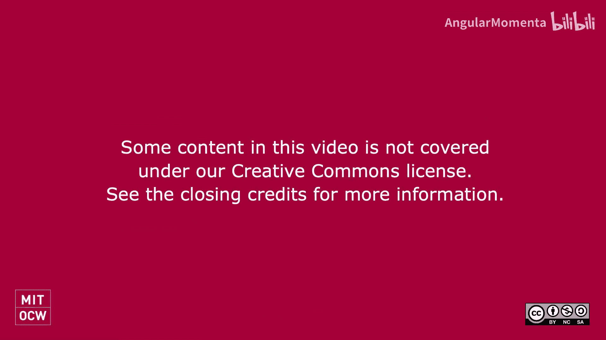
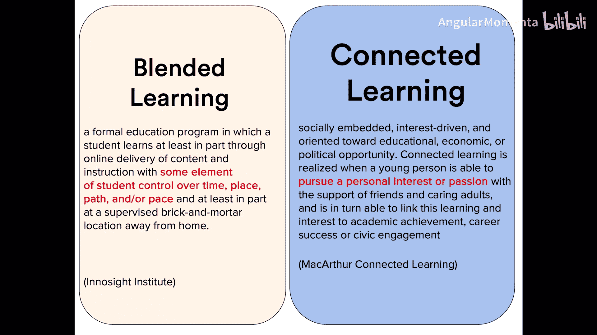
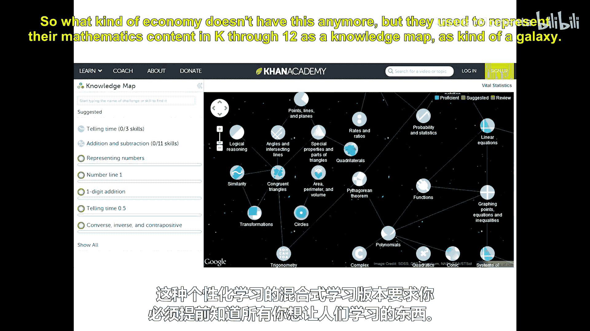
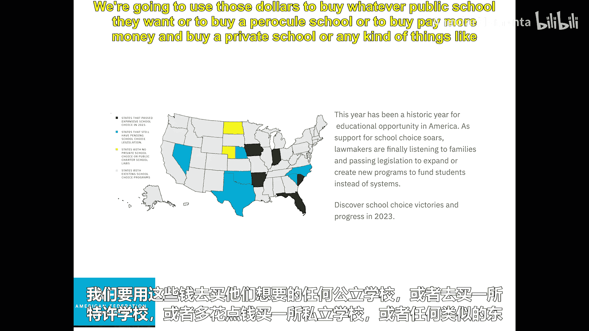
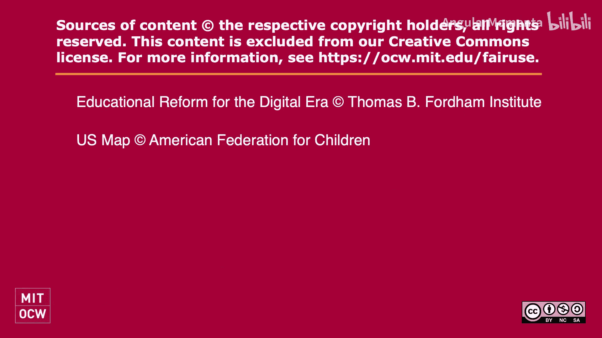

# 005：智能导师

## 概述
在本节课中，我们将探讨算法引导的大规模学习，特别是智能导师系统。我们将回顾其历史背景、核心原理、实际应用效果以及相关的教育理念与政治经济背景。

## 论文二作业说明
上一节我们讨论了大规模开放在线课程（MOOCs），本节中我们来看看本课程的第二个主要作业。

对于论文二，你需要完成以下任务：
*   识别一个具体的学习环境（例如，麻省理工学院的物理系、你曾就读的中学、你参与过的课后项目或图书馆）。
*   反思一项特定的教育技术。
*   根据该学习环境的具体情况，论证是否推荐采用这项技术。

你需要撰写一份备忘录，提交给该环境中的特定利益相关者（如系主任、课程教学助理学监、图书馆馆长等）。在论证时，你需要：
*   评估该技术开发者所做的宣传。
*   查阅相关的研究证据。
*   分析该技术发挥作用所需的条件是否与目标环境匹配。

作业的详细说明已在教学大纲中列出，提交日期大约在一个月后。

## 回顾MOOCs的三大赌注及其结果
在上一讲中，我们讨论了MOOCs曾许下的三大赌注。现在，我们来总结一下它们的结果。

第一个赌注是为缺乏机会的人提供接受高等教育的新途径。第二个赌注是重组、颠覆和解构高等教育。第三个赌注，也是我参与最多的一个，是创建数据驱动的学习科学。

然而，现实情况是：
*   这些技术并未颠覆教育系统，反而被教育系统“驯化”了。
*   关于数据驱动学习科学的愿景也未能实现。尽管我们记录了海量的点击数据，但很难从中洞察学习者内心的认知过程。大多数研究得出的结论类似于“做得更多的人学得更好”，这并非深刻的发现。
*   我们曾尝试通过课前小干预（如计划制定、价值肯定）来提升学习效果，在初期小规模实验中效果显著，但当推广到数十万人时，效果却消失了。

因此，MOOCs的宏大愿景大多未能实现。如今，它们更多地被应用于企业高管培训等成熟领域，而非彻底变革教育。

## 算法引导的大规模学习：智能导师
现在，让我们进入本节课的核心主题：算法引导的大规模学习，通常被称为“智能导师”系统。

### 核心原理：项目反应理论
许多同学在K-12教育阶段都接触过这类系统（如IXL、Khan Academy）。其核心思想是根据学习者的实时表现，提供个性化的学习路径。

这种个性化评估的基础是**项目反应理论**。该理论通过逻辑函数对测试题目的难度进行建模。
*   在坐标图中，横轴代表学习者的能力值，纵轴代表答对该题的概率。
*   不同的题目会形成不同的曲线。系统可以根据学习者的答题情况，估算其能力值，并选择最能有效测量其水平或提供适当挑战的下一道题目。

这套统计工具最初用于确保标准化考试的安全性，后来被用于开发能够动态调整题目顺序的计算机化系统。

### 个性化学习的两种愿景
“个性化学习”是一个被广泛使用但含义不同的概念。主要存在两种愿景：

1.  **混合式学习**：学生部分时间通过在线学习，并对学习的时间、地点、路径或进度有一定控制权。其目标是利用算法为每个学生规划出掌握特定知识体系（如数学）的最优路径。
2.  **联通式学习**：学习是社交性的、兴趣驱动的，并与教育、经济或政治机会相连。其目标是支持学习者基于个人兴趣和热情，在朋友和成人的帮助下进行探索。

这两种愿景分别呼应了我们之前讨论过的“授导主义”与“建构主义”传统。

### 现实效果与挑战
尽管智能导师的概念充满魅力（如本杰明·布鲁姆提出的“两西格玛问题”：一对一辅导效果极佳），但其实际应用面临挑战：
*   **学科局限性**：现有证据表明，这类系统在**数学**（尤其是程序性技能练习）上效果相对较好，但在阅读、科学等需要深度概念理解的学科上效果较弱。
*   **对“有效”的定义**：所谓“提高数学成绩”，通常指的是在州标准化测试中得分提高。但这些测试往往无法衡量问题提出、建模、解释等更重要的数学实践能力。
*   **实施挑战**：系统的效果高度依赖于教师的实施。如果教师只是偶尔使用，而非将其有机整合到课程中，效果会大打折扣。
*   **技术发展**：尽管经历了数十年的发展，许多智能导师系统的基本模式与几十年前相比变化并不大。

可汗学院创始人萨尔曼·可汗的认知转变是一个例证：他从最初倡导“用视频重塑教育”的变革性愿景，转变为建议“每周在传统教学基础上，使用30-60分钟可汗学院作为补充练习”。这更像是教育系统对技术的“驯化”，而非颠覆。

## 个性化学习的政治经济维度
个性化学习不仅是一种教学法，也常与更广泛的政治经济项目相关联。

一种观点认为，应该“解构”学校教师的职责，让明星教师（如可汗）负责最擅长的讲授部分，而课堂教师则专注于机器无法替代的辅导、关怀和评估工作。

更进一步的观点则主张“解构”学校本身，将教育资金直接赋予学生（如教育券、学生背包基金等形式），让学生和家长在市场上自由选择甚至组合各种教育服务（从数学课到性教育课）。这背后是“资助学生而非系统”的市场化教育改革理念。

因此，关于个性化学习的讨论，常常与关于学校公共性、教育公平和政府角色的深层政治辩论交织在一起。

## 总结
本节课我们一起探讨了算法引导的智能导师系统。
*   我们了解了其基于项目反应理论的核心工作原理。
*   我们分析了它在实践中（尤其在数学练习上）显示出的效果及其局限性。
*   我们区分了“混合式学习”与“联通式学习”两种不同的个性化愿景。
*   最后，我们认识到，个性化学习的技术理念常常与更大范围的教育市场化、学校解构等政治经济议题紧密相连。

下一讲，我们将更深入地审视关于智能导师有效性的具体研究证据。