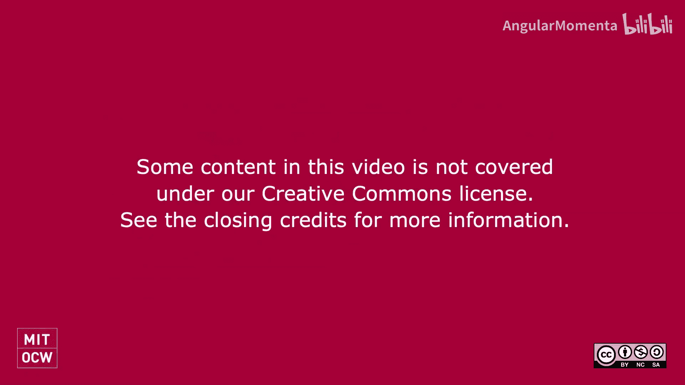
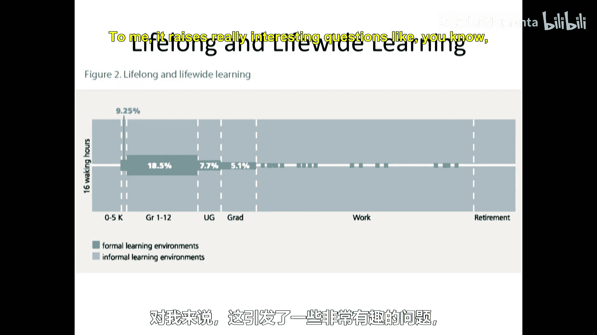
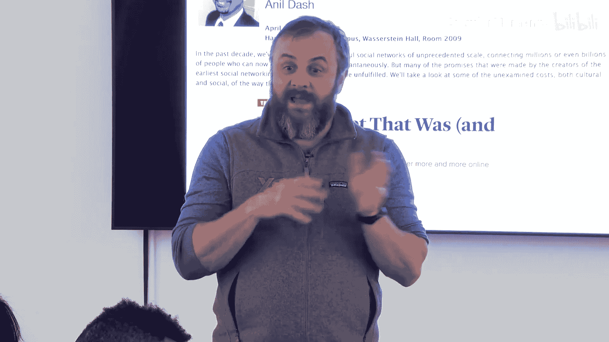
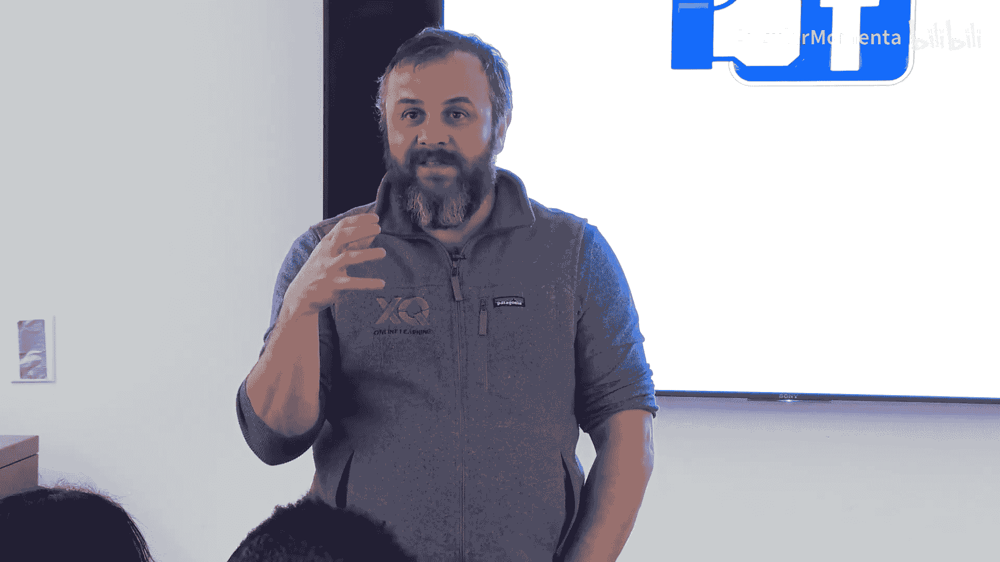
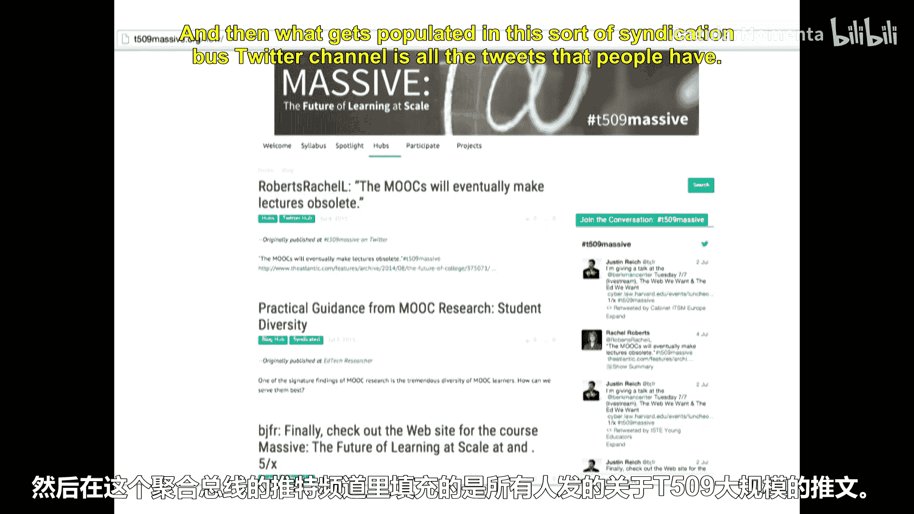
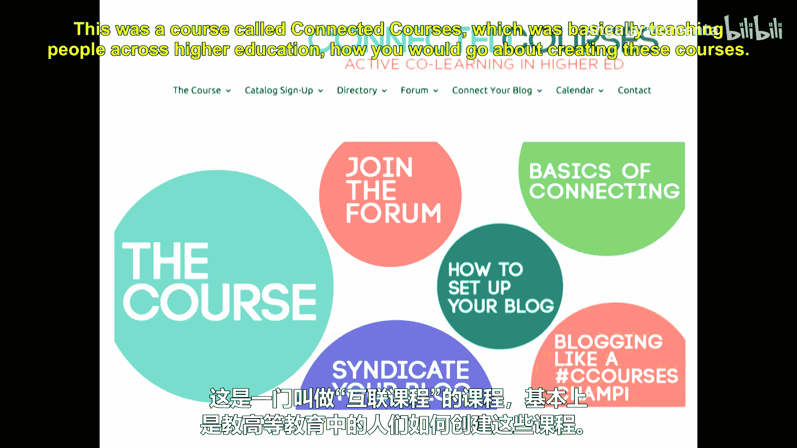
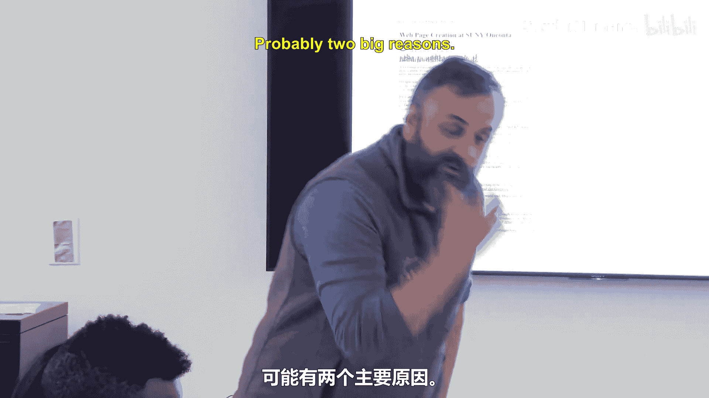
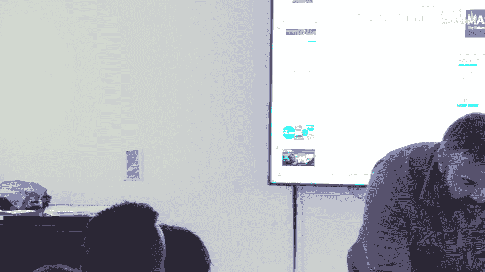
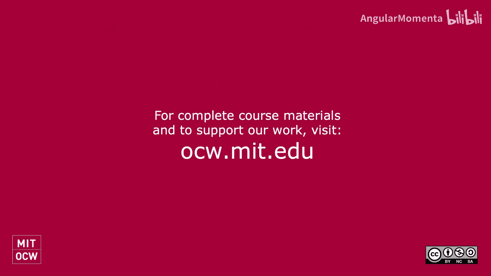

# 006：兴趣驱动学习

## 概述
在本节课中，我们将要探讨大规模同伴引导式学习。我们将从个人兴趣驱动的非正式学习实践出发，分析其核心特征，并审视将这些模式引入正规教育机构（尤其是高等教育）的尝试与挑战。

## 从个人兴趣到在线学习
上一节我们讨论了技术如何塑造学习环境，本节中我们来看看兴趣如何驱动人们利用在线资源进行学习。

课程开始时，教授邀请学生们分享自己利用网络资源学习爱好的经历。以下是几位学生的分享：

*   **摄影学习**：Omar分享了他如何通过YouTube教程、Reddit论坛和专业摄影网站，自学了摄影技术，甚至学会了如何选购一台有50年历史的胶片相机。他从手机摄影开始，逐步构建了自己的知识体系和设备库，现在甚至开始指导他人。
*   **算法引导的兴趣探索**：Ja谈到，YouTube等平台的推荐算法有时会引导他的兴趣在不同爱好间快速切换，例如从吉他学习转向其他领域，这让他感觉兴趣被算法所驱动。
*   **时尚与设计**：有学生利用YouTube和Pinterest等平台追踪时装周动态、观看评论和分析，以理解时尚的社会与艺术层面。Pinterest被用作收集、分类和整合灵感的工具。
*   **烹饪学习**：Dana通过在线食谱文章和TikTok短视频学习烹饪。她提到，看到非专业厨师分享的“你也能做”类视频，会让她感觉更亲切、更容易上手。
*   **数学科普**：Ron提到了像“Numberphile”这样的YouTube频道，它们以有趣的方式讲解数学概念（如分数维），成为一种兴趣驱动的学习途径。
*   **游戏社区**：教授回忆了早期文本游戏的攻略本（甚至用隐形墨水书写答案），并对比了当今围绕每个视频游戏形成的Wiki、Reddit论坛、Discord社区和YouTube频道，这些构成了深入且亲密的非正式学习网络。

这些例子表明，**非正式、兴趣驱动的在线学习已成为许多人生活中的常态**。人们为了工作、爱好或热情，不断利用网络社区和资源发展新技能。

## 非正式学习与正规教育的鸿沟
这些技术深刻地改变了我们在校外追求学习的方式，但学校作为机构，却对这些学习形式表现出显著的抵抗力。

核心论点在于：**虽然技术在非正式学习领域引发了革命，但正规教育体系（尤其是学校）在吸纳这些同伴引导、大规模、兴趣驱动的学习模式方面却举步维艰**。大多数学生不觉得八年级物理课的学习体验与通过YouTube学习摄影的体验相似。学校的设计与组织方式，使得这类学习环境难以融入。

教授提出，今天分享的一些高等教育领域的重大尝试，更像是**一个有趣但未能成功的探索**。研究失败与研究成功同样重要，因为它能帮助我们更清晰地理解事物运作的真正原因。

## 案例：彩虹织机与网络学习社区
一个标志性的例子是2013年左右风靡的“彩虹织机”。孩子们利用简单的塑料织机制作彩色橡皮筋手链。媒体报道称赞其让孩子们“离开了手机”，但实际上，孩子们在整个过程中都离不开手机。例如，两个女孩制作的“彩虹织机星爆手链”教学视频获得了数千万的观看量，远超官方内容。

这展示了**高度去中心化的网络学习机制**。在互联网时代之前，一种新工艺的传播可能需要依靠实体店、俱乐部或电视节目。而如今，学习者可以通过网络自主连接，形成分散但强大的学习社区。这甚至实现了早期思想家（如Ivan Illich在《去学校化社会》中）对“学习网络”的预言。

这种现象甚至能支持精英级别的技能获取。例如，肯尼亚标枪运动员Julius Yego早期主要依靠YouTube视频学习技术，并最终获得了奥运会银牌。这体现了在线资源在**打破地域和专业基础设施限制方面的民主化潜力**。

## 大规模开放在线课程中的混合学习
早期的大规模开放在线课程学习者并不仅仅使用平台提供的材料。他们还会搜索维基百科、购买相关书籍、加入相关的Facebook学习小组等。这表明，**结构化的课程学习与非正式的、基于网络的探索之间的界限是模糊的**。

许多大学生也有类似体验：在课堂上没听懂时，会上网搜索教学视频；不满足于某位教授的讲解时，会去观看其他教授（例如通过MIT OpenCourseWare）讲授同一主题的课程；课程讨论板（如Piazza）不够用时，会转向Stack Overflow等专业社区。

编程领域尤其依赖这种非正式学习。程序员必须擅长利用在线资源和社区解决问题。积极参与这些社区（如贡献开源项目、在Stack Overflow上回答问题）甚至能带来职业发展机会。这表明，**非正式学习环境与正式学习环境之间的边界是可以渗透的**。

## 教育者的责任：为终身学习做准备
将技术整合进学校学习的一个重要理由是：对于大多数人而言，毕业后的终身学习将更类似于围绕爱好的学习，而非传统的课堂学习。

这引发了一个深刻的问题：**学校是否有责任帮助学生熟练掌握通过在线社区进行自我学习的技能？** 如果K-12或大学教育的目标之一是让学生毕业后能自如地利用网络资源自学烹饪、摄影或音乐，那么今天的教育应该如何设计？

有学生提到，数字素养教育至关重要。她中学的计算机课程教授了打字、创建LinkedIn资料、建立个人作品集网站等技能，并通过个人项目教授研究方法。关键在于，**教育者需要不断判断，哪些新兴技能值得投入宝贵的教学时间**。十年前，有人曾认为MOOC至关重要，但如今其影响力已不如预期。当前，教育者正对AI在教育中的角色感到焦虑和困惑。

## 人工智能是同伴引导学习吗？
关于AI是否可被视为一种同伴引导学习形式，讨论认为：如果一个同伴引导学习网络包含由先前人类生成的大量学习资源，那么由生成式预训练Transformer来生成有用的学习序列似乎是可能的。然而，有学者对人与聊天机器人的直接互动效果持怀疑态度，认为AI代理或许更适合介入**两人之间的对话**，例如在论坛讨论中帮助引导问题或连接不同观点。

一个核心挑战是：**AI生成的内容对专家比对新手更有用**。专家能辨别其中的合理与荒谬之处，而新手可能全盘接受那些表述自信但可能错误的信息。这是教育者未来必须应对的重大问题。

## Web 2.0的兴衰与教育平台的标准化
回顾互联网发展，Web 2.0技术曾让任何人都能轻松在线发布内容（博客、微博等）。人们曾预测，年轻一代需要学习如何在社交网络中连接。然而，大约从2015年开始，社交媒体格局变化，许多开放的博客空间被Facebook等平台吸纳和标准化。个人拥有的、可控的网络空间减少，转向由企业控制的平台。David Weinberger评论道：“博客圈未能规模化……Facebook实现了博客的梦想，但方式不同。”

**高等教育也发生了类似的故事**。早期大学网页是个人化、风格各异的“波浪号空间”（如 `web.mit.edu/~username`）。它们体现了个人控制和网络特色。随后，Blackboard、Canvas等学习管理系统兴起，它们标准化了课程页面格式，带来了便利，但也**消除了多样性，并将学习产出的控制权从个人转移到了机构手中**。更甚的是，这些课程网站通常会在学期结束后被删除。

这引发了思考：是否存在一种替代方案，既能协调学习，又能让学生拥有自己的学习成果，发展技术能力，并建立持久连接？

## 连接主义与开放网络教育实验
一些教育者（如Stephen Downes）提出了“连接主义”学习理论，认为学习和知识更多地存在于人与人之间，而非个体头脑中。学习不仅是获取内容，更是**融入社群、建立连接**。在这种观点下，课程内容甚至可以被视为推动连接发生的“麦高芬”。

受连接主义和开放网络精神启发，一些教育者尝试构建替代学习管理系统的架构。例如，教授曾运营一门课程，要求学生**在自己的网络空间（如个人博客、Twitter、Flickr）完成所有作业**。然后，课程通过“联合总线”技术（利用RSS订阅）将这些分散的内容聚合到一个中心站点。这样，学生拥有自己的数据，课程则能展示和连接所有人的工作。

这种方式鼓励学生为自己的学习设定目标、创建评价标准，并将写作与更广泛的专业社区连接。类似的课程（如数字讲故事课程DS106）也强调创造性任务和网络化分享。

## 实验为何未能普及？
尽管这些实验令人兴奋，但它们并未成为主流。主要原因有二：

1.  **“熟悉度的诅咒”**：这种方式太奇特、太不同，学习成本高。学生需要花时间学习使用博客、Twitter等工具，而这些时间本可能用于学习课程核心内容。
2.  **公平与安全风险**：要求所有人公开写作，但并非所有人都平等地承受公开表达可能带来的后果（如网络骚扰、人肉搜索）。在课堂上，学生需要能够试验不成熟或具有挑战性的想法，而公开环境可能抑制这种探索，并对某些群体构成更大风险。

此外，像Reclaim Hosting这样的公司曾试图简化这种个人网络空间的搭建流程，但整体上，这种模式因**技术复杂性、上升时间成本以及日益严峻的在线安全环境**，而更多地成为一个值得研究的“有趣的死胡同”。

## 总结
本节课中我们一起探讨了兴趣驱动的非正式在线学习的强大力量，以及将其原则整合进正规教育体系所面临的挑战。我们回顾了从彩虹织机社区到连接主义教学实验的案例，分析了其背后的理念、优势以及最终在制度化教育中难以扎根的原因。关键启示在于：**虽然学校环境难以完全复制非正式学习的活力，但理解这种鸿沟以及那些失败的整合尝试，能帮助我们更好地思考如何设计更能培养学生终身学习能力、更能连接真实世界网络的教育体验。** 下周我们将继续探讨在K-12教育环境中类似的尝试与挑战。