# 007：学习游戏 🎮

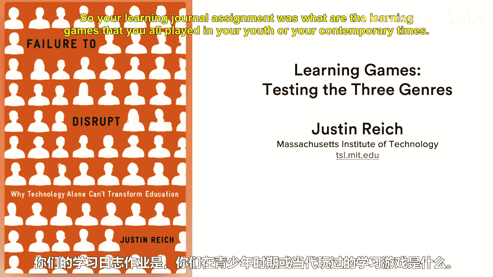

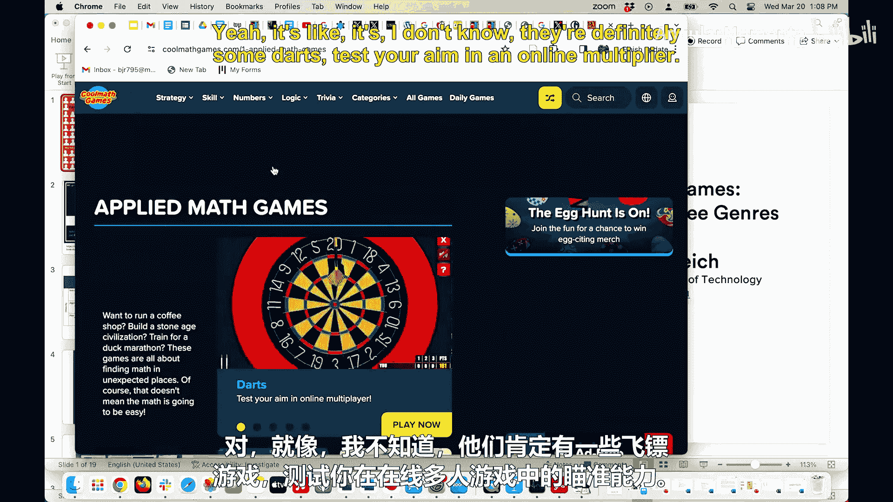

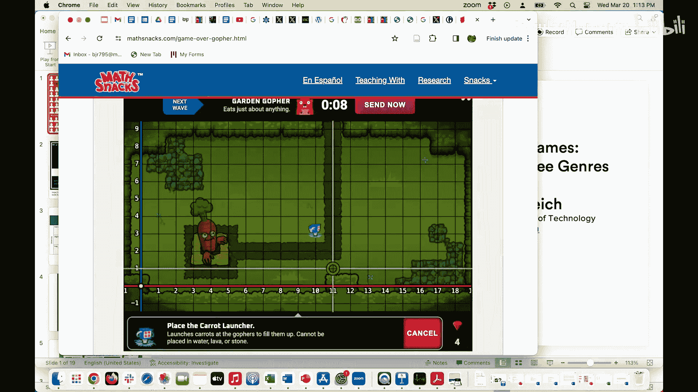

在本节课中，我们将探讨学习游戏的概念，分析不同类型的教育游戏，并讨论一个核心问题：在游戏中获得的技能能否有效地迁移到其他领域。

## 概述

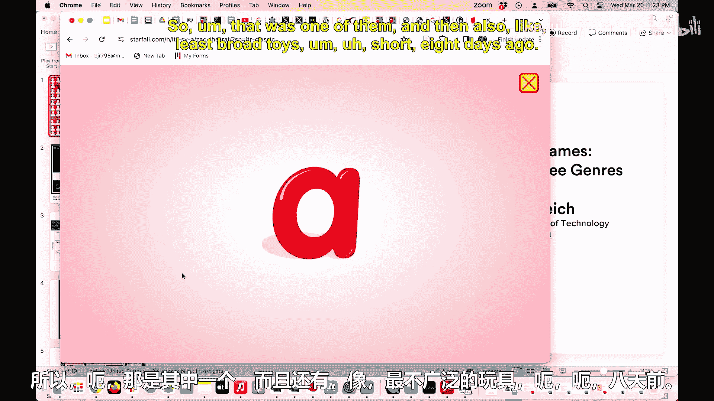

我们首先回顾了大家童年或近期玩过的学习游戏，从经典的《数学冲击波》到现代的《多邻国》。接着，我们通过试玩和分析几款游戏，探讨了它们背后的学习理论。最后，我们深入讨论了“学习迁移”这一关键概念，即在一个情境中学到的知识或技能能否应用于另一个不同的情境。

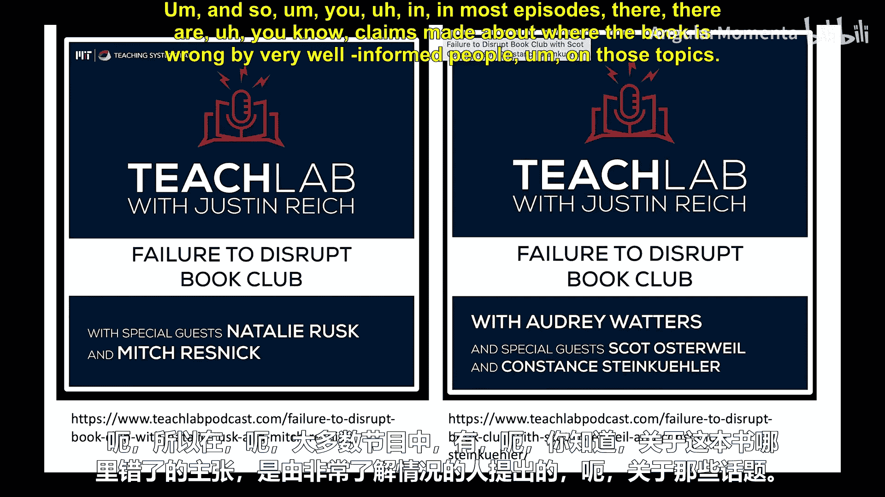

## 游戏回忆与讨论

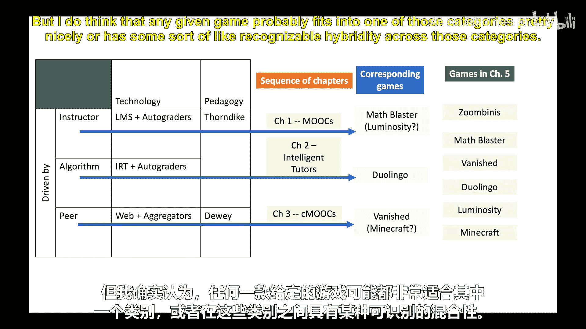

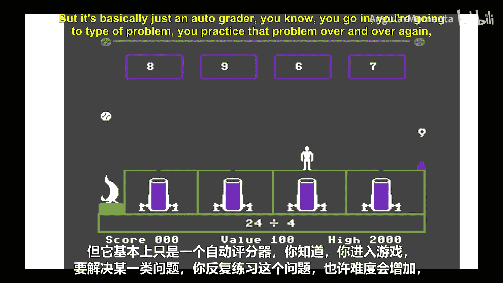

以下是同学们分享的一些具有代表性的学习游戏体验：

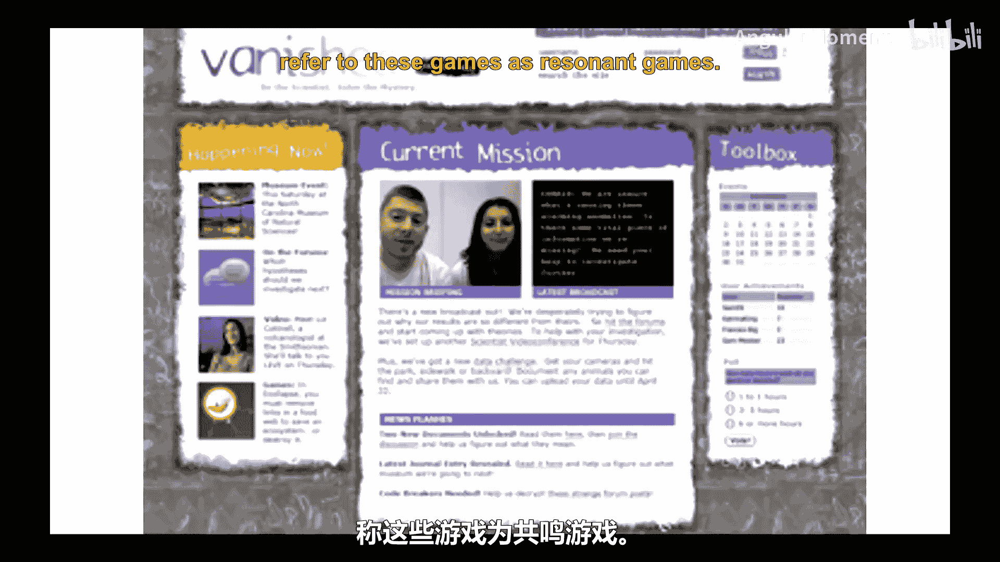

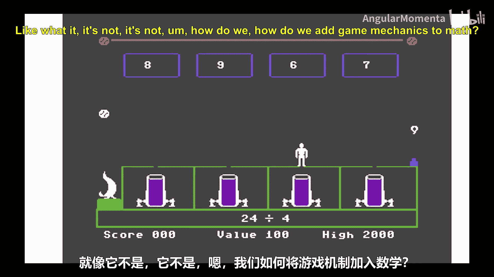

*   **数学游戏**：例如《数学24点》和《酷数学游戏》网站上的游戏。这些游戏通常将数学练习（如算术、乘法）包装在有趣的互动形式中。
*   **角色扮演与沟通游戏**：例如《抵抗组织》和《狼人杀》。这类游戏主要锻炼玩家的推理、沟通、团队合作和说服能力。
*   **基于坐标系统的游戏**：例如早期的《苹果大战》和《打地鼠》变体。玩家需要理解并快速运用坐标概念来完成游戏目标。
*   **课堂互动工具**：例如 **Kahoot**。它将知识问答竞赛化，通过实时排行榜、竞争机制和趣味性界面提高课堂参与度。
*   **开放式创造与模拟游戏**：例如《我的世界》。它提供了一个沙盒环境，玩家可以自由探索、建造和解决问题。
*   **早期教育软件与玩具**：例如《星落》和跳跳蛙玩具。它们通过互动故事和活动教授阅读、数学等基础技能。

## 游戏类型与学习理论

上一节我们回顾了各种游戏，本节中我们来看看如何用三种“规模化学习”的理论框架来分析它们。

游戏并不严格属于某一种框架，但具体游戏的设计往往更贴近其中一种，或呈现混合特征。

*   **《数学冲击波》与“巧克力裹西兰花”**：这类游戏本质上是**算法引导的规模化学习**。它将传统的练习题（如数学运算）包装上游戏外壳（如射击外星人）。其核心是重复练习和即时反馈（自动评分），类似于一个有趣的自动评分系统。这种设计有时被称为“巧克力裹西兰花”，旨在让枯燥的学习内容变得更有吸引力，但游戏机制与学习内容本身关联较弱。
*   **《祖宾斯的逻辑之旅》与“共鸣游戏”**：这款游戏更接近**情境化学习**的理念。它没有明确的指令，而是将玩家沉浸在一个需要运用组合逻辑和问题解决技能的世界中。学习是通过探索、试错和叙事驱动自然发生的。这类“共鸣游戏”不是给学习内容套上游戏外壳，而是挖掘学科内容本身固有的趣味性和游戏性。
*   **《多邻国》的混合设计**：《多邻国》巧妙地融合了多种方法。它采用**算法引导**来个性化学习路径和控制难度（如瞄准“最近发展区”）。同时，它也运用了大量**游戏化**元素来提升用户粘性，例如：
    *   `streak`（连续学习天数）
    *   丰富的视觉和声音反馈
    *   建立与“多邻鸟”的拟社会关系
    *   徽章和社区互动
    此外，其某些功能（如模拟弹钢琴）也试图创造**情境化**的体验。

## 核心挑战：学习的迁移

在讨论了不同类型的学习游戏后，一个根本性问题浮现出来：在游戏中学到的东西，到底有多大用处？

这就是**学习迁移**问题：在一个情境（如游戏）中获得的知识或技能，能否被有效地应用到另一个不同的、通常更现实的情境中。

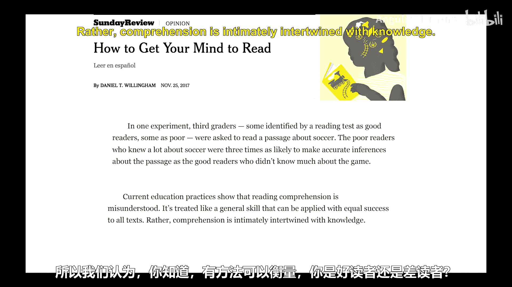

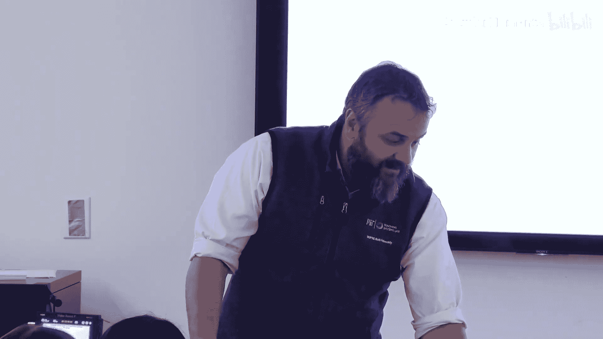

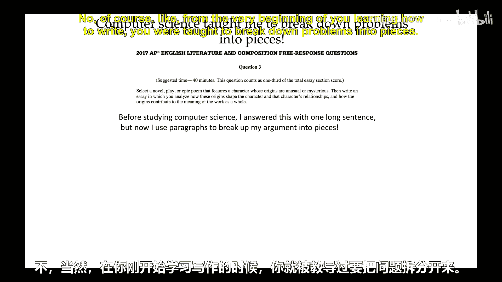

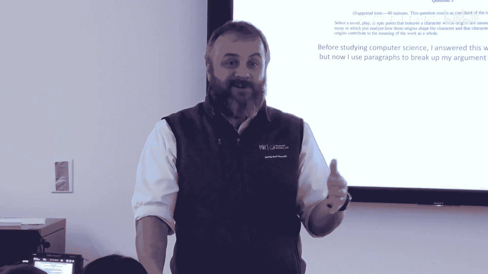

*   **迁移的困难性**：大量教育心理学研究表明，迁移是困难的。例如：
    *   擅长估算矩形面积，并不能让你更好地估算圆形面积。
    *   精通国际象棋，未必能提升学业成绩。
    *   历史学家擅长在档案中辨别真伪，但在评估网站可信度时，表现可能不如专业的事实核查员。因为后者掌握了一套**特定于网络环境**的核查技能（如离开原网站进行横向搜索）。
*   **对通用技能的质疑**：许多我们认为是“通用”的技能，其实高度依赖于具体领域的知识。例如：
    *   **阅读理解**：一个对足球知识丰富的“差”读者，在阅读足球文章时，可能比一个对足球一无所知的“好”读者理解得更深入。理解力与**领域知识**紧密交织。
    *   **计算思维**：常有人说编程教会人“将大问题分解为小问题”。但写作从一开始就教人将大观点分解为段落和句子。这种“分解”能力在不同领域（文学 vs. 编程）的体现和应用方式差异很大，没有具体的领域知识，你甚至不知道从哪里开始“分解”。
*   **对游戏价值的启示**：这对评价《我的世界》等游戏的教育价值至关重要。玩家在游戏中确实学到了很多（如协作、信息检索、目标设定）。但关键问题是：这些在《我的世界》中学到的技能，能否帮助他们在学校项目、未来工作或其他生活场景中做得更好？目前的研究尚无定论，这也是教育游戏设计者和研究者面临的核心挑战之一。

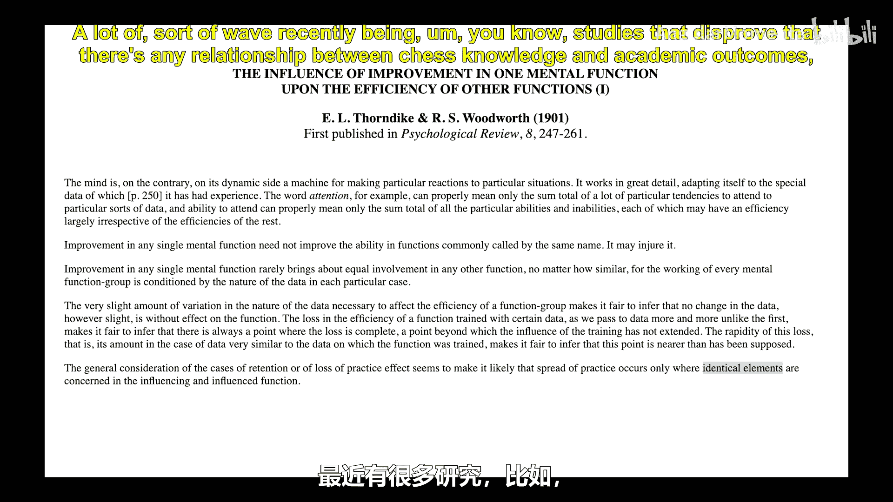

## 总结

本节课中，我们一起学习了学习游戏的多样性和它们背后的设计理念。我们分析了从“巧克力裹西兰花”式的技能练习游戏，到“共鸣游戏”式的情境化体验。最重要的是，我们探讨了**学习迁移**这一核心概念，认识到将特定情境中学到的技能应用于新领域并非易事。这一认识促使我们更审慎地思考教育游戏的设计目标与实际效果，也让我们明白，声称能培养“通用技能”时需要坚实的证据支持。