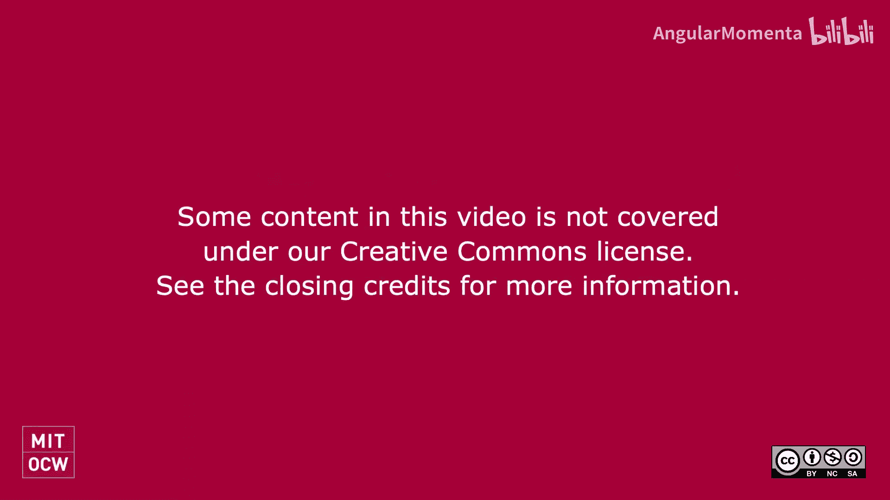
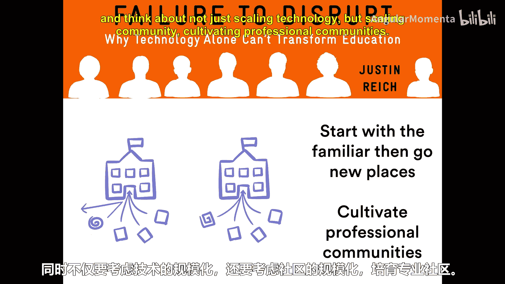
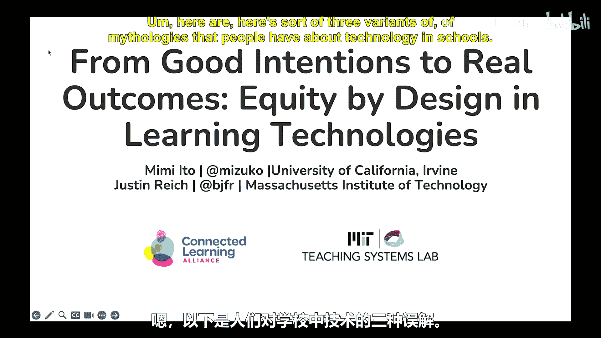
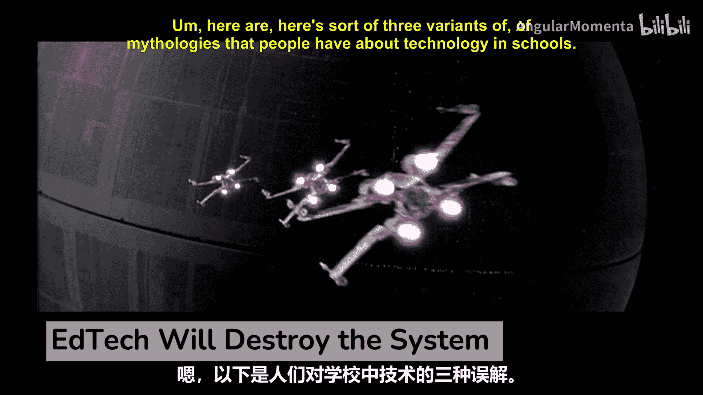
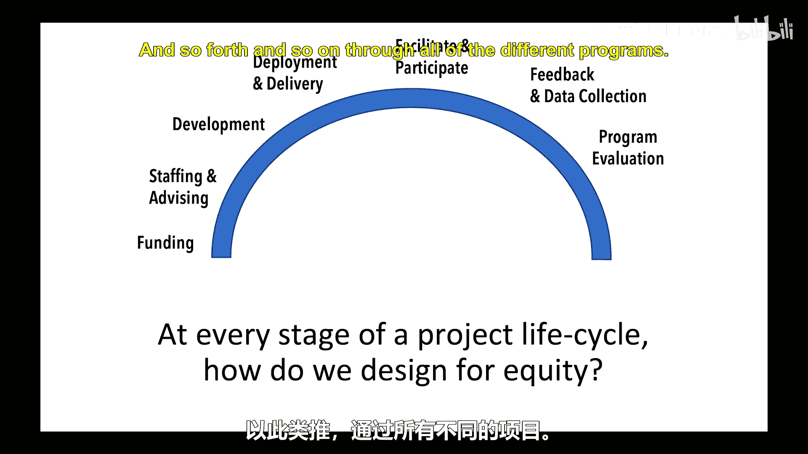
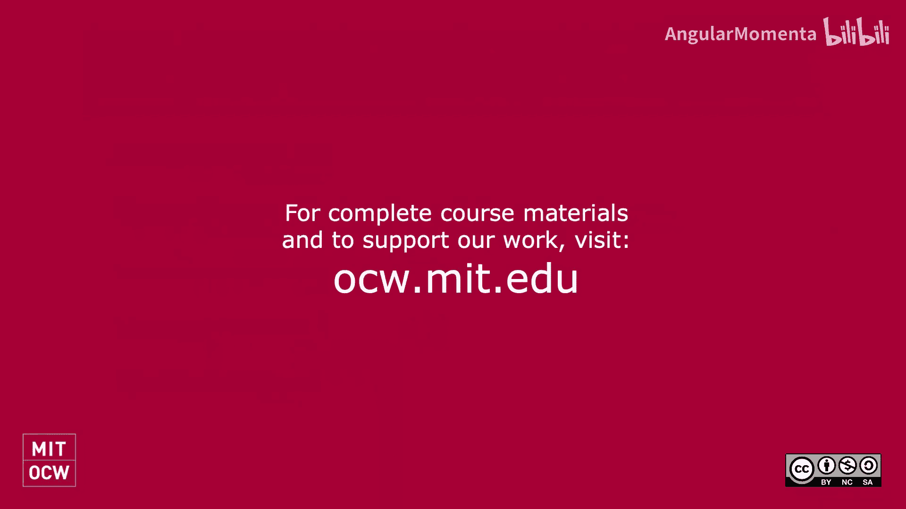

# 008：初创公司与熟悉感的诅咒

## 概述
在本节课中，我们将探讨教育技术领域两个“尚未解决的困境”：**熟悉感的诅咒**和**教育技术的马太效应**。我们将分析为何许多新技术未能如预期般变革教育，并讨论一些可能突破这些困境的策略。

---

## 熟悉感的诅咒

上一节我们讨论了教育技术规模化应用的几种模式及其局限性。本节中，我们来看看第一个困境：熟悉感的诅咒。

这个概念指的是，许多教育技术创新者倾向于将旧的教学理念和方法（如抽认卡）进行数字化包装，使其看起来是新的，但本质上并未带来根本性的变革。这种做法有其优点，例如易于被保守的教育系统接受，但也限制了技术发挥其变革潜力。

以下是关于熟悉感的诅咒的一些核心讨论要点：

*   **定义与表现**：将旧理念重新包装，使其看似新颖，但实质未变。例如，Quizlet 本质上是数字化的抽认卡。
*   **产生原因**：创新者可能缺乏对教育史的了解，或者为了适应现有保守、厌恶风险的教育机构而将新技术“弯曲”以符合旧模式。
*   **优点**：熟悉的技术更容易被教师、学生和家长接受和采用，因为它们符合现有的教学安排和期望，降低了使用门槛和风险。
*   **缺点**：这种做法可能无法解决教育的深层次问题，只是对现有实践的微小改进，无法带来变革性的影响。

那么，是否存在策略能够帮助我们突破熟悉感的诅咒，利用技术实现真正不同的教学方式呢？目前有两种被认为可能有效的策略。

### 策略一：从熟悉之处入手，导向新领域
开发一种技术，让用户从熟悉的功能开始，但逐渐引导他们探索和采用全新的、更具变革性的使用方式。其核心设计理念是 **“低门槛、高天花板”** ，即入门简单，但能实现复杂、有深度的创作。

### 策略二：培育专业社群
推广新技术最大的挑战往往不是技术本身的扩散，而是与之配套的新教学理念和实践的传播。关键在于**培育教育者社群**，促进他们之间分享新想法、新教学法。成功的案例如Scratch和Desmos，它们不仅推广了工具，更通过会议、工作坊、在线社区等方式，成功地规模化了一个实践新教学法的教育者社群。

改变教学实践本质上是**一个同伴学习问题**。教师最愿意尝试新实践，通常是因为看到同行（尤其是处境相似的同行）的成功。然而，教育领域缺乏像医学那样强大的、能制定和推广最佳实践的专业组织，这使得培育社群变得尤为重要且困难。

---

## 教育技术的马太效应

接下来，我们探讨第二个困境：教育技术的马太效应。这个效应描述了新技术往往不成比例地惠及已经具备优势的群体，而非如人们所期望的那样“民主化”教育或缩小差距。

人们常希望新技术能“民主化”教育，但大量证据表明，实际情况更可能是：新技术**不成比例地使优势群体受益更多**。即使技术本身是免费或可广泛获取的，使用方式、支持系统和文化环境上的差异也会导致新的不平等。

以下是一些关键的研究发现和例证：

*   **MOOC参与者画像**：对哈佛和MIT的MOOC平台数据分析显示，参与者普遍比美国普通民众更富裕、父母受教育程度更高。虽然全球各地都有人成功，但主体仍是已具备优势的群体。
*   **“第一道”与“第二道”数字鸿沟**：保罗·阿特威尔指出，数字鸿沟不仅是**访问鸿沟**（谁有设备/网络），更是**使用鸿沟**。即使访问平等，低收入学生也更可能将技术用于**机械练习**，而高收入学生则更多用于**创造性应用和模拟**。这种模式在1996年和2011年的数据中惊人地一致。
*   **文化信息的差异**：一项对三所技术装备水平相似的学校的研究发现，学校社区传递的文化信息截然不同。在富裕的白人学校，“捣鼓”技术受到鼓励；在亚裔中产阶级学校，则被视为对学业的威胁；在拉丁裔工薪阶层学校，则基本被忽视。这影响了学生与技术互动的方式。
*   **社交媒体的退缩**：近期研究发现，由于网络极化等原因，来自边缘化背景的年轻人比富裕的白人男性更倾向于从社交媒体上的公共学习中退缩，这构成了新的社会文化排斥。

面对这个根深蒂固的问题，我们能否采取行动？虽然尚无完美解决方案，但以下是一些有前景的探索方向：

*   **联结家庭、学校与社区**：设计技术或项目，帮助所有家庭（而不仅是高知家庭）支持孩子的学习，例如“家庭创造性学习”项目。
*   **对接学生兴趣与身份**：从年轻人现有的兴趣（如游戏、舞蹈、时尚）切入，引导至学术学习，这是“联结学习”的核心。
*   **有针对性地降低关键成本**：识别并消除对弱势群体构成实质性障碍的成本。例如，Desmos将图形计算器成本降为零，OpenStax提供顶尖的免费大学教科书，这对社区学院学生意义重大。
*   **设计针对子群体需求的干预**：在课程或产品中，为可能面临 stereotype threat（刻板印象威胁）或缺乏支持的学生设计增强归属感或提供额外支持的环节。
*   **支持关键过渡阶段**：关注教育轨迹中的关键过渡点（如高中升大学），为缺乏系统知识的学生（如家庭第一代大学生）提供“助推”信息和支持。
*   **实现全球平台与本地定制的结合**：利用可定制的开源技术平台（如Open edX），允许本地运营者根据特定语言、文化和需求进行适配，在规模化和情境化之间取得平衡。

总之，如果我们不有意地将边缘化群体的需求置于中心，那么开发的教育技术几乎可以肯定会不成比例地惠及优势群体。我们需要在整个项目生命周期中，持续探索如何更公平地服务多样化的人群。

---

## 总结
本节课我们一起探讨了教育技术领域的两个核心困境。**熟悉感的诅咒**揭示了新技术为何常被旧框架束缚，而**教育技术的马太效应**则警示我们技术可能加剧而非缓解不平等。我们讨论了诸如“从熟悉到创新”、“培育专业社群”、“降低关键成本”、“对接学生兴趣”等可能的突破路径。理解这些困境是未来设计更公平、更有效的教育技术的第一步。