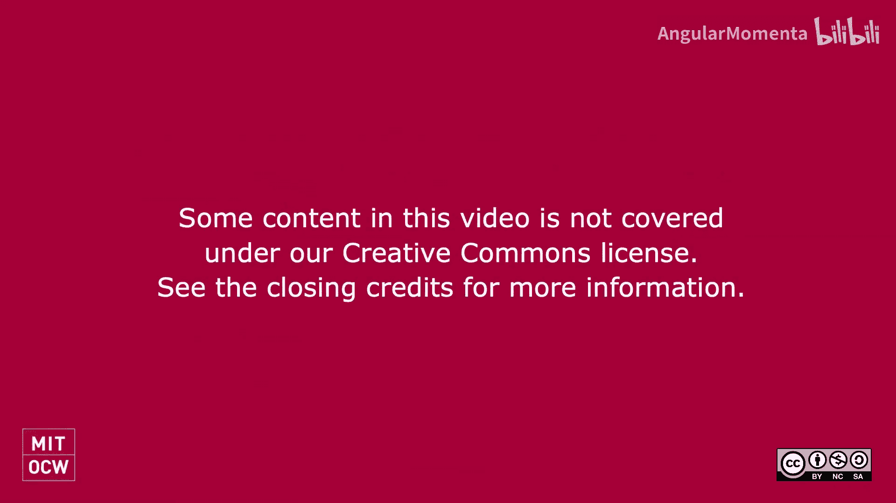
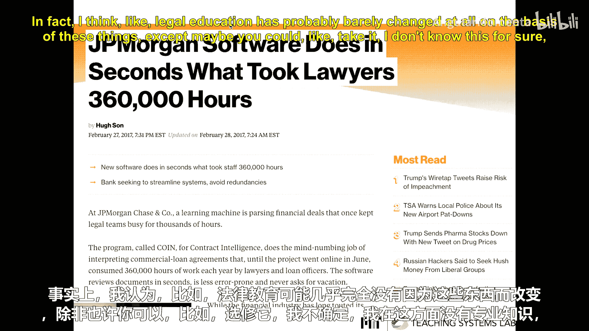
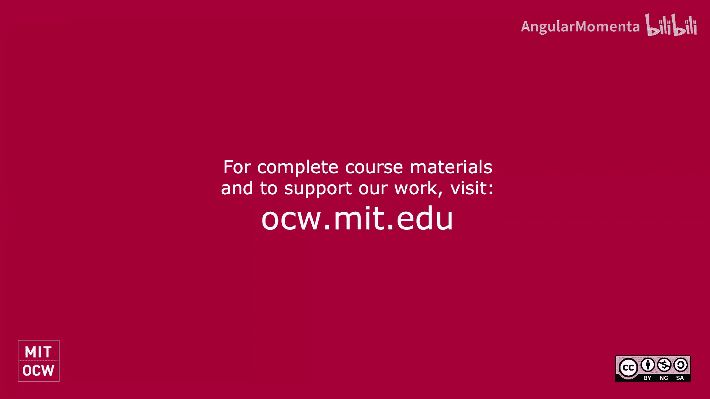

# 009：常规评估的陷阱

在本节课中，我们将探讨教育技术中的一个核心困境：常规评估的陷阱。我们将分析为何现有的评估技术倾向于测量那些计算机已经擅长、且人类未来可能不再需要亲自执行的任务，以及这对教育目标意味着什么。

## 课程概述

上一节我们讨论了“熟悉性诅咒”和“教育技术马太效应”。本节中，我们来看看“常规评估的陷阱”。这个陷阱的核心在于：我们能够大规模评估的技能，往往与计算机能够自动化的技能高度重叠。这导致教育系统可能过度关注那些即将被技术取代的能力，而忽视了人类在未来社会真正需要的、更复杂的技能。

## 常规评估的核心困境

任何想要阐述常规评估陷阱核心难题的人？其核心难题在于，教师教授学生学科知识，而学校体系非常强调期末考试和标准化考试的准备。但同时，我们也在与“计算机能评分什么”这一理念作斗争。如果你试图标准化某种评分方式，你只能真正专注于教授计算机能做的事情。但如果计算机已经能做这件事，那为什么它还是我们教学的重点？这就像一个维恩图：我们真正应该关注的教学领域，与实际因为便于评估而只关注的重叠部分，并不一致。

很好。我们现有的评估技术在某种程度上限制了我们在任何规模上能够评估的内容。

还有人想补充达纳最初观点之外的重要内容吗？我认为阅读材料中您也提到了这与劳动力市场的联系。学校本应帮助我们为劳动力市场做准备，但我们学习的却是正在被自动化取代的常规事务。这如何真正实现学校应有的功能？

好的。学校运作于几个不同事物之间。一是我们需要孩子做什么，这会随着新技术的发展而随时间变化。随着计算机能力的扩展，我们对于教人们什么的想法也在改变。与此同时，随着计算机技术的扩展，我们可能有更新、不同的方式将它们用于评估。这两件事一直在相互影响。

还有其他重要的引入点吗，奥马尔？就像我们并不是说不教乘法表之类的东西，那些是计算机可以评估的，但却是学生为进一步学习打基础所必需掌握的根本内容。

很好。这使得整个对话更加复杂，因为有些事是人们生活中需要能够做的。可能还有一类事情被称为“为了能做那些复杂事情而需要学习的东西”。即使计算机能做那些更简单的事。所以，有一类计算机能做的事，我们可能不再需要人类去做了。但像一位数乘法则不同，计算机可以轻松完成，但人类学习它实际上非常重要。所以这类事情中存在一些复杂性。

关于常规评估陷阱的初步框架，还有人想补充吗？我想再补充一点，我们的社会重视这些常规评估，所以即使你试图改变并拓展我们教学生的内容，他们仍然总是受到市场本身的约束，教师最终不得不与之抗争。

所以，几乎任何教育工作者都会同意，标准化考试并非捕捉学生应知所有重要事项的良好机制。但更棘手的问题是，存在一类对学生很重要但我们不擅长评估的事情。在教育体系中很难优先考虑这些事情，因为我们不知道如何衡量，或者不知道如何以我们想要用于高风险评估（如毕业考试或大学入学考试）的那种公平方式进行系统性衡量。

## 劳动力市场的演变与教育的挑战

我认为我们可以从蒂的建议出发，回顾大约20年前，上一次计算机真正让教育工作者和劳动经济学家感到不安的时刻。现在随着大语言模型的兴起，我们再次处于这样的时刻。回顾个人电脑普及到大多数美国家庭和工作场所，以及互联网的引入，都曾引发过类似的问题。

关于这场辩论，一篇很好的总结性文章是2015年左右两位经济学家弗兰克·利维和理查德·默南的论文《与机器人共舞》。早期经济学家的一个预测是：计算机将补充高薪工人，并取代低薪工人。但利维和默南认为事情会更复杂。他们思考了人们在工作中所做的具体事情以及这些工作如何变化。

你们有多少人曾直接与真人交谈办理登机手续？大多数人现在是通过机器办理登机。有趣的是，这些与真人的对话是高度标准化、高度常规化的。随着计算技术变得更复杂、用户界面更先进，有人想到可以把这些对话编程到机器里。但尽管如此，只要有机场自助值机亭，总有一些情况是机器无法应对的。于是，仍然有一个人在这排机器后面，负责处理所有机器无法进行的对话。作为一个劳动经济学家，这是个有趣的问题：那个人在做什么是我们无法编程到所有机器里的？

另一个有趣的例子是关于管道工的。过去，管道工学徒学习焊接管道和做一些基本的电工活。但现在，安装一个按需热水系统可能需要管道工具备计算机编程能力来解决系统无法自行诊断的非结构化问题。即使职位名称保持不变，工作内容也被技术能力所改变。

《新劳动力分工》的研究分析了劳工部收集的工作描述，发现可以将工作大致分为四类：
*   **常规体力劳动**：如搬运、移动物品等。
*   **常规认知劳动**：如归档、标准化对话（如值机）等。
*   **非结构化问题解决**：解决那些你不知道需要什么输入、输出应该是什么样子、正确答案是什么的问题。
*   **复杂沟通任务**：需要与人交流来解决问题，如市场营销、家庭健康助理等。

他们的基本论点是：常规性工作正在从美国劳动力市场中消失。这对想要稳定社会的我们来说是个大问题。而正在增长的工作是那些需要非结构化分析技能和社交技能的工作。

如果你是一名教育工作者，你必须思考：我们面前有一项不同的任务。仅仅培养人们从事需要常规认知或体力劳动的工作已经不够了，因为这些工作正在劳动力市场中消失。即使相同的职位名称仍然存在，比如仍然有管道工，但管道工越来越多地被要求进行非结构化问题解决和复杂沟通。

## 评估技术与现实需求的错位

常规评估陷阱的核心在于：计算机擅长评估的事物，几乎完全与计算机擅长执行的事物重叠，而这些正是我们不再需要人类去做的事情。我们能够构建的、擅长评估人类表现的工具，其评估范围几乎总是与计算机擅长的领域紧密重叠。

以下是几个例子：

**数学建模框架**：大约15年前，共同核心州立标准的一个重大变化是，我们希望教学生不仅做数学程序性计算，还能进行数学建模练习。数学建模练习可以大致分为五个步骤：
1.  在现实世界中发现问题。
2.  将其建立为模型（方程、示意图、表格等）。
3.  在模型内计算某种解决方案。
4.  用现实世界的术语解释你的解决方案。
5.  解释为什么你的解决方案是合理的。

在这五个步骤中，我们有什么技术可以评估？我们唯一能可靠地用计算机评估的，是你能否计算出解决方案。但如果你在职业中使用数学，你几乎永远不会做哪一步？计算解决方案。计算机会为你做数学。然而，在任何级别的标准化数学考试中，你将花费大部分时间进行计算。这是一个真正的问题。

研究测试的心理测量学家有一个术语来描述我们对测试的误解，叫做“具体化谬误”。给某物贴上“数学测试”的标签，并不意味着它就是全面的数学测试。测试实际上是在对一个领域进行抽样。问题在于，我们过度抽样了“计算”，而对所有其他种类的技能抽样不足。

**计算机编程**：哈尔·阿贝尔森曾写道：“首先，我们希望确立这样一种观念：计算机语言不仅仅是让计算机执行操作的一种方式，而是一种表达方法论思想的新颖形式媒介。因此，程序必须为人阅读而写，只是顺便让机器执行。” 当你们提交编程作业进行自动评分时，这些系统擅长评估你们编程的哪些特征？它们检查你的代码是否通过一系列预设的测试用例，是否运行高效，可能还有代码风格检查器。这些主要评估的是“顺便让机器执行”的部分。风格检查器可能是朝着评估“为人阅读”部分迈出的合理第一步，但评估人类相互理解和沟通的代码特征要困难得多。

## 讨论：其他领域与未来展望

以下是其他可能面临类似困境的领域，以及我们对未来突破常规评估陷阱的乐观展望。

**写作评估**：在写作领域，我们很难用计算机触及重要的东西。长篇文章的标准化评估质量令人失望。虽然我们已经开发了自动作文评分工具，对于特定问题，其可靠性大致与人类评分员相当，但它们无法评估写作中所有重要的方面，尤其是对于新颖的题目。

**语言学习**：计算机可以轻松评估词汇量、词形变化或语法，但这并不是语言学习的重点。语言学习很大程度上是关于说和听，尤其是考虑到口音和地区差异，评估某人是否真正流利非常困难。不过，自动发音检测器在语言学习课堂环境中可能是一个进步，它能提供比人类教师更高效、更专注的反馈。

**艺术分析**：计算机可以分析色彩构成、创作年代、客观吸引力，但未必能深入艺术家的背景、作品背后的情感信息或创作缘由。计算机擅长触及表面层次，但可能完全错过了整体的意义和信息。

**未来乐观展望**：在未来五年，我们最有可能在哪些领域看到突破常规评估陷阱的最大进展？

1.  **写作形成性反馈**：许多系统正在开发中，为学生写作提供形成性反馈。这些系统可以检查文章是否具备主题句、过渡句、论据等要素。更重要的挑战是让机器能像有经验的教师一样，从众多可评论的问题中，判断出学习者当前最应该关注哪一两个问题。
2.  **理解基础原理**：随着AI工具能完成更多具体任务，教学重点可能转向让学生理解事物如何从底层运作，从而能够从零开始构建事物，培养更根本的解决问题的能力。
3.  **人机协作评估**：未来的评估系统可能不是完全自动化的，而是人机协作。例如，机器处理常规可评估的部分，而人类教师专注于需要专业判断、情境理解和个性化指导的复杂评估部分。

## 总结与反思

本节课中，我们一起深入探讨了“常规评估的陷阱”。我们了解到，由于评估技术的限制，教育体系可能不自觉地侧重于测量那些易于自动化、且未来价值可能降低的常规技能。我们回顾了劳动力市场如何向需要非结构化问题解决和复杂沟通技能的方向演变，并分析了数学、编程等领域中评估与现实需求的错位。

这个陷阱给教育者带来了持续的挑战：我们很难预测哪些技能在未来至关重要，哪些将被技术取代。同时，教育系统本身也不擅长快速纳入全新的教学内容。面对以大型语言模型为代表的新技术浪潮，教育者需要在拥抱技术赋能与坚守人类独特价值之间找到平衡，思考如何设计评估，才能真正衡量和培养那些让人类在未来社会中持续保有竞争力的核心能力。