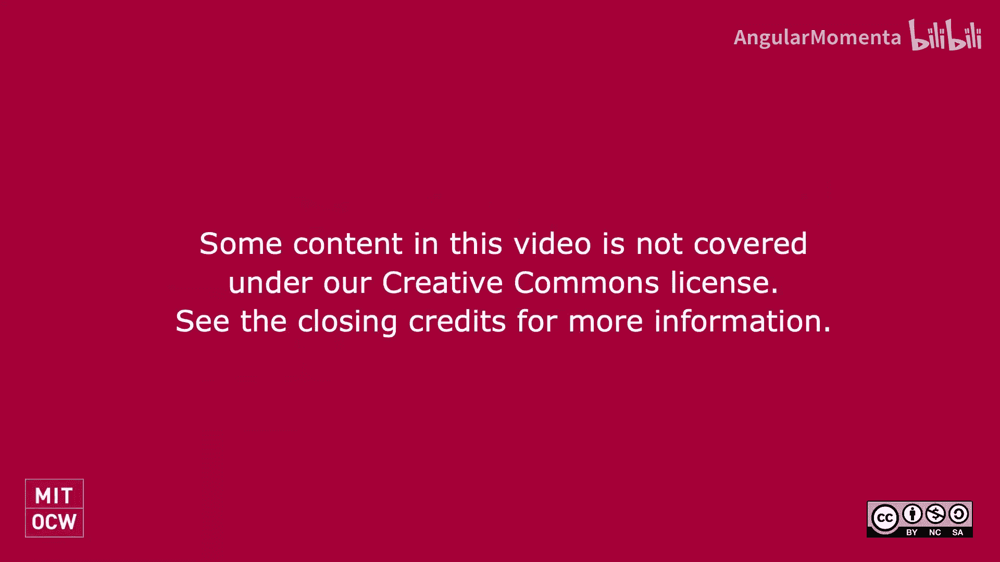
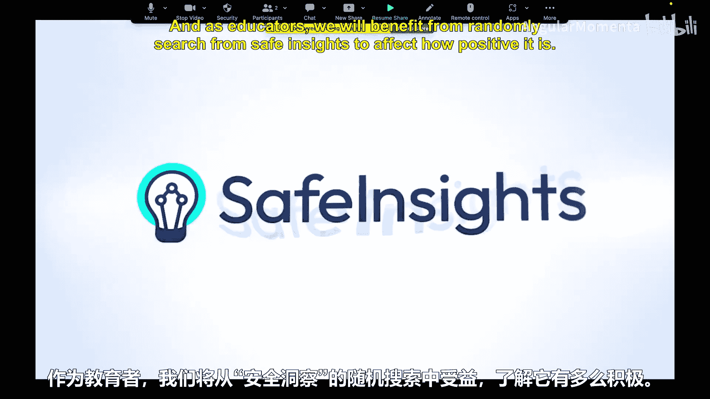
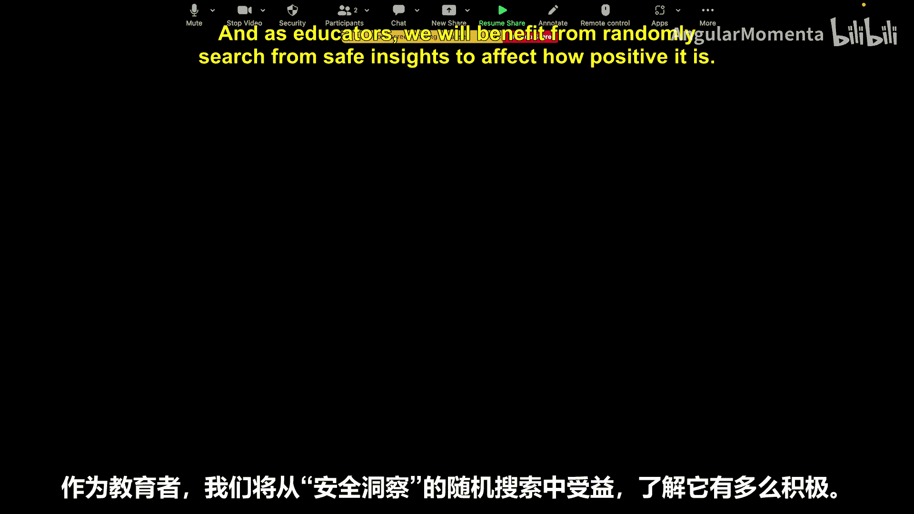
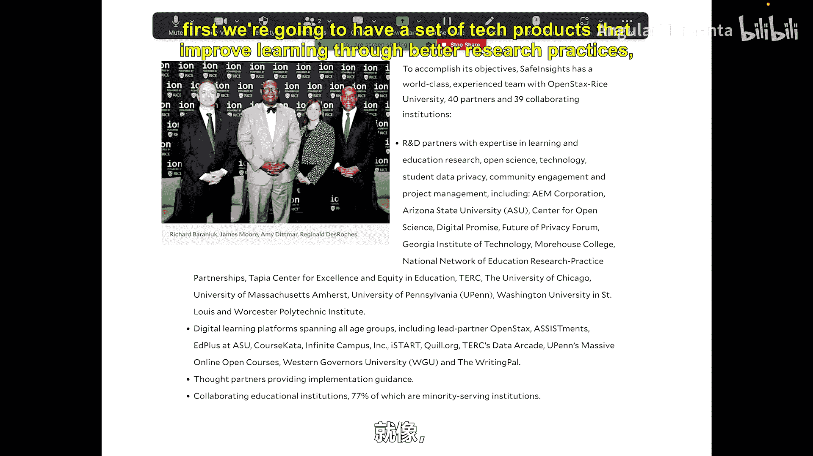
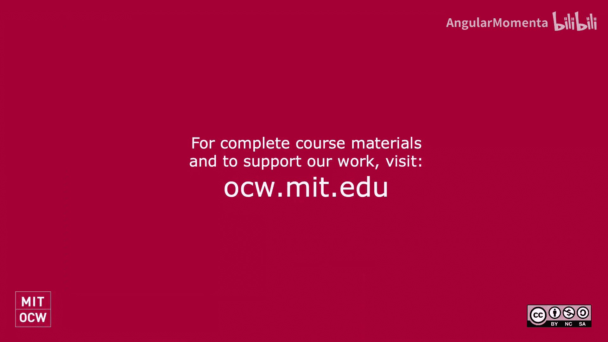

# 010：数据与实验的毒性力量 🧪📊

在本节课中，我们将探讨教育领域中数据收集与实验的“毒性力量”。我们将审视学校（以麻省理工学院为例）收集学生数据的广度，讨论这些数据带来的机遇与风险，并分析在教育环境中进行随机实验的伦理与实践困境。

---

## 数据收集的广度与深度

上一节我们讨论了评估的陷阱，本节中我们来看看教育机构掌握学生数据的惊人规模。让我们以麻省理工学院（MIT）为例，进行一次思想实验：MIT可能拥有关于你的哪些数据？

以下是MIT可能收集的数据类别与示例：

*   **财务信息**：家庭收入、个人收入、银行账户信息。
*   **健康记录**：疫苗接种史、处方药记录、过敏信息、心理咨询记录、保险信息。
*   **身份与人口统计信息**：社会安全号、性取向、性别认同、旅行记录（特别是国际旅行）。
*   **学术记录**：成绩、课程注册信息、考试分数、在线学习平台（如Canvas）上的每一次点击、出勤记录。
*   **位置与活动数据**：校园内住所、Wi-Fi设备连接记录、门禁刷卡记录、健身房使用记录、社团活动参与情况。
*   **通信与在线活动**：全部电子邮件记录、VPN使用记录、Google Drive文件、在线注册信息。
*   **生活细节**：洗衣频率（通过校园洗衣应用）、宿舍钥匙信息、宿舍检查记录、校园内购买历史（如通过学生卡消费）、包裹收发记录。

这些数据的颗粒度在过去十年发生了巨大变化。从1980年代仅有的成绩单和选课记录，到今天几乎涵盖所有在线和线下活动的海量数据。关键在于，这些数据不仅由学校直接持有，也通过授权给第三方服务提供商（如学习管理系统、洗衣应用）而间接存在。

---

## 数据的“毒性”与双重力量

“毒性”一词借用于安全研究员布鲁斯·施奈尔。他的论点是，有毒物质具有强大力量：化疗药物有毒，却能拯救生命；与之互动有时是好事，但它们也具危险性。核心观点是：**不应让有毒物质长期闲置**。

将数据视为“有毒资产”：收集和存储大量数据本身存在风险。数据闲置越久，就越容易受到数据泄露、被恶意行为者利用等威胁。因此，更负责任的做法可能是只收集必要数据，并尽快处理掉其余部分。

然而，从教育研究者的视角看，这些海量数据也蕴含着巨大机遇。

---

## 数据赋能的研究机遇

以下是利用聚合数据可能实现的强大研究：

例如，一项关于挪威中学禁止手机的研究显示，禁令显著降低了女生因心理症状就医的比例，减少了男女生的欺凌现象，提高了女生成绩，并增加了她们进入学术高中轨道的可能性，对低社会经济背景学生效果尤为明显。

要完成此类研究，需要整合多种数据：学生成绩、升学去向、医疗系统就诊记录、年度幸福感与欺凌问卷调查数据。正是国家层面收集的这些庞大而详细的数据，使得我们能够进行复杂的分析，得出有意义的结论，从而可能改善学生的生活和学习成果。

这体现了数据的双重力量：既能用于有益的、亲社会的研究，也因其敏感性和聚合性而带有“毒性”风险。

---

## 教育环境中的随机实验

接下来，我们探讨在教育软件中进行随机实验的案例。2018年，教育出版巨头培生（Pearson）在其计算机科学学习软件中测试了“成长型思维”干预信息。

*   **实验设计**：随机让一部分学生收到鼓励性的成长型思维消息（如“答错了，但继续努力，你会进步”），另一部分学生（控制组）则收到标准反馈。
*   **支持实验的观点**：
    1.  有研究基础表明成长型思维干预可能有效。
    2.  在特定产品、特定人群中测试效果，比直接全面推广更科学。
    3.  教育本身充满变化（教师不同教法、教材版本更新），随机实验只是将这种变化系统化，以便我们从中学习。随机分配是确保两组可比性、准确归因效果的最佳方法。
    4.  数字系统可以很好地实现随机化，确保无偏。
    5.  美国“通用规则”将“典型教育实践”研究列为豁免类别，允许在无需严格知情同意的情况下进行。
*   **反对与担忧**：
    1.  **公平性质疑**：如果干预有效，控制组学生则被剥夺了潜在益处，这不公平。
    2.  **知情同意缺失**：学生通常不知情，感觉被“监视”或“实验”，令人不安。
    3.  **代表性疑虑**：实验对象（如使用该软件的大学生）可能无法代表更广泛的学生群体。
    4.  **“操纵”感**：“社会心理信息”的表述可能让人感觉像是在进行宣传或心理操纵。

这与我们日常使用的软件（如亚马逊、谷歌）持续进行A/B测试形成对比。这些测试是产品改进的核心，但人们对其“ creepiness”（诡异感）的容忍度似乎高于教育场景。这种差异可能源于教育的选择性（特别是K-12教育的强制性）、对儿童数据的更高敏感性，以及教育成果对人生的深远影响。

---

## 集中化数据管理的尝试与挑战

面对数据碎片化在各服务商手中的问题，曾有过集中化管理的尝试。2013年，由盖茨基金会等支持的 **inBloom** 项目启动。

*   **目标**：建立一个非营利性中介，集中存储来自学校的学生数据，第三方服务商通过该平台获取所需数据，旨在解决数据分散、学校IT能力不足、隐私保护薄弱的问题。
*   **潜在优势**：
    1.  非营利实体可能比营利性公司更受信任。
    2.  专业机构在数据处理、安全和隐私保护上更专业。
    3.  可以精确控制向第三方提供的数据范围，最小化数据暴露。
*   **失败原因**：
    1.  **时机与舆论**：项目启动时（2013年），正值斯诺登事件后公众对数据监控高度敏感，远不如当今一代对数据收集“习以为常”。
    2.  **叙事风险**：“将所有孩子数据放在一个地方”的说法极易引发公众恐慌和反对，尽管现状（数据分散在各处且保护不力）可能更糟。
    3.  **信任问题**：与州教育机构合作，未能充分建立公众信任。来自家长（尤其是科技行业家长）和新兴的学生隐私倡导组织的强烈反对，导致各州相继退出。
    4.  **注意力悖论**：试图修复一个糟糕但未被注意的现状，反而会吸引对修复方案本身的审查和抵制。

inBloom的失败催生了许多州级学生隐私法律，但也留下了如何安全、有效管理教育数据的基础设施问题。

---

## 新的尝试：Safe Insights

2024年，一项新的尝试——**Safe Insights**——启动。它由美国国家科学基金会资助9000万美元，由莱斯大学（以开发开源教材OpenStax闻名）牵头。

*   **与inBloom的对比与演进**：
    1.  **信任锚点**：依托备受信任的研究型大学（莱斯大学）和国家科学基金会，而非基金会或州政府。
    2.  **叙事转变**：强调“生成见解”、“进行研究”，而非“数据仓库”。品牌名突出“安全”和“洞察”。
    3.  **技术路径**：可能采用“差分隐私”等技术，允许在不集中原始数据的情况下进行跨数据集查询，旨在实现聚合研究的好处，同时避免数据集中带来的风险。
    4.  **合作伙伴**：初期与多家数字学习平台（如Kahoot!）和教育机构合作，更具协作性和开放性。
    5.  **聚焦群体**：更侧重于高等教育（学生选择入学）和成人学习者，而非强制性的K-12教育，可能涉及更少的代理权争议。

Safe Insights的设计明显吸取了inBloom的教训，试图在数据效用与隐私保护、公众信任之间找到新的平衡点。它的成功与否，将取决于能否产出显著改善学习成果的研究，以及能否持续与公众、教育者进行透明沟通。

---

## 总结与前行之路

本节课中，我们一起学习了教育数据与实验的复杂性。我们认识到：

1.  教育机构掌握着关于学生**极其广泛和深入的数据**，这些数据既有“毒性”（隐私和安全风险），也有强大力量（驱动有益研究）。
2.  **随机控制实验**是评估教育干预效果的有力工具，但在教育环境中面临独特的伦理挑战（如公平性、知情同意）和公众接受度问题。
3.  管理教育数据的基础设施建设充满挑战。**inBloom**的失败揭示了公众信任、叙事方式和时机的重要性。
4.  新的尝试如**Safe Insights**，正试图通过不同的信任锚点、技术方案和沟通策略，重新探索这条道路。

最终，要缓解公众对数据收集和实验的“诡异感”，关键在于：**产出能够明确、显著改善学习成果的研究证据**，并**持续进行透明、负责任的公众沟通**。教育永远存在差异与变化，而系统化的数据收集与实验，或许是帮助我们理解何种变化真正有效的关键途径。

---
**下一步**：请开始着手你们的最终项目，并将思考延伸至教育科技在学校中的实施层面。我们将在下节课继续探讨相关议题。