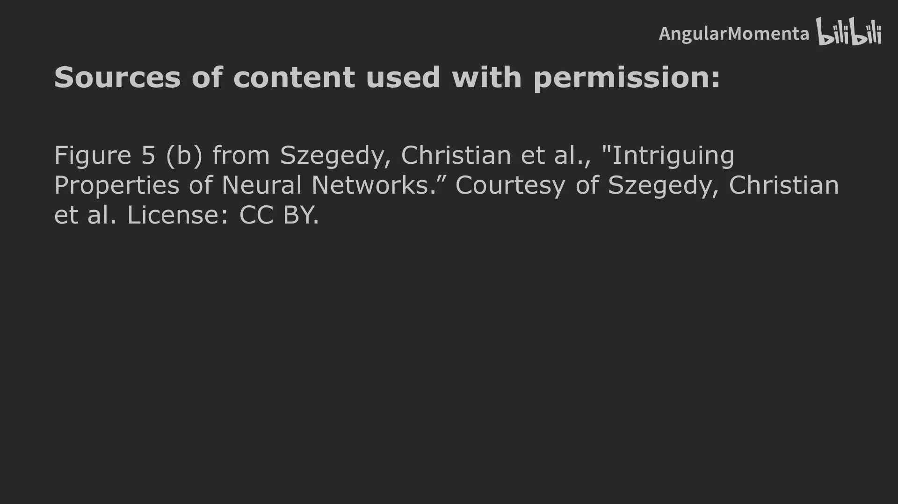

# 001：大数据与机器学习的数学基础

以下内容采用知识共享许可协议提供。您的支持将帮助麻省理工开放课程持续提供高质量的免费教育资源。如需捐款或查看来自数百门MIT课程的其他材料，请访问 [ocw.mit.edu](http://ocw.mit.edu)。

在本节课中，我们将探讨大数据与机器学习背后的核心数学思想。我们将从基本的数学概念出发，理解如何将这些强大的工具应用于看似非传统的数据类型，如图像和文本。

## 理想与现实：数学的桥梁

我们从一个非常基础的数学概念开始：圆。圆可以被定义为所有到一个固定点距离相等的点的集合。这是一个完美的、理想的数学概念。

然而，我们知道自然界中并不存在完美的圆。即使是我们绘制的圆，放大后也会由像素块组成。这个近似过程——我们拥有一个理想的数学概念，但知道它在现实中并不完美存在——是我们思考问题的一种高效方式。这种对理想形状的思考与操作，并将结果带回现实世界的方法，是许多科学和工程领域的基础，其思想根源可追溯到约2500年前的柏拉图哲学。

这种数学概念能如此有效地描述自然世界（以及虚拟世界），有时被称为“数学的不可思议的有效性”。

## 线性模型的力量

在大多数科学和工程领域的入门课程中，核心的理论基础通常是**线性模型**。例如，物理学中的 F=ma，或化学中的反应速率方程。

我们喜欢线性模型，是因为它们允许我们进行**外推**。如果我们有证据支持某个线性关系（如图中的实线），我们就可以相对有信心地预测没有数据区域的趋势，或将其应用到新领域。线性模型使我们能够进行这种推理。

当然，存在许多重要的非线性现象。但分析和计算非线性通常更复杂，需要更多数据和计算资源，并且外推能力非常有限。

## 线性与大数据

我们希望能在新兴的**大数据**领域，做到在其他领域已成功做到的事情。大数据通常涉及文本、图像等非传统科学数据。问题在于：如何将强大的线性概念引入这个感觉完全不同的领域？

首先，我们需要准确理解“线性”的数学含义。线性不仅仅指一条直线。其核心是**分配律**，例如：`2*(3+4) = 2*3 + 2*4`。这个性质是数学在其最基本层面上“有效”的原因。

关键在于，不仅传统的算术加法和乘法满足分配律。存在其他运算对也满足此性质，从而允许我们为不同类型的数据构建线性模型。

以下是几个重要的运算对示例：

*   **传统算术**：`⊕` 为普通加法 (`+`)，`⊗` 为普通乘法 (`×`)。
*   **Max-Plus代数**：`⊕` 为取最大值 (`max`)，`⊗` 为普通加法 (`+`)。这在机器学习和神经网络（如ReLU激活函数）以及金融领域中非常重要。
*   **集合代数**：`⊕` 为并集 (`∪`)，`⊗` 为交集 (`∩`)。这是关系型数据库查询优化的数学基础。

通过使用不同的运算对，我们可以线性地推理各种类型的数据。这是本课程的核心：揭示允许我们以线性方式思考那些原本不具明显线性特征的数据的数学原理。

## 从数字到复杂对象

我们可以进一步扩展这个概念。在分配律方程中，变量 A、B、C 不仅可以是简单的数字（标量），还可以是更复杂的对象：

*   **电子表格**：A、B、C 可以是整个数据表。这是大数据处理的关键——将数据作为整体集合进行推理和转换。
*   **数据库表**：与电子表格类似，结合并集/交集运算对，可以对整个数据库表进行线性推理。
*   **矩阵**：对于学过线性代数的人来说，这是最熟悉的例子。矩阵运算与线性性紧密相连。
*   **图与网络**：通过矩阵与图之间的对偶关系，我们可以用矩阵表示图或神经网络，并同样应用这些线性方程。

## 机器学习的突破与挑战

现在，让我们将话题转向机器学习，这是过去十年最令人兴奋的突破之一。深度学习神经网络自2015年左右兴起，实现了诸如计算机视觉和自然语言理解等曾被认为近乎不可能的任务。

机器学习领域的核心技术和问题早已有之。早在20世纪50年代中期的首次机器学习会议上，讨论的主题就包括神经网络、语言处理和视觉识别，其中多篇开创性论文来自MIT林肯实验室。当时，拥有4096字节内存的计算机已被认为能力超强，人们乐观地预计相关问题将在十年内解决。

然而，实际用了大约**五十年**。如今，我们知道了**如何**让深度学习工作，但仍不完全理解**为何**它工作得如此之好。历史上，从“如何”到“为何”的理解通常需要约二十年。本课程旨在提供更深的数学基础，以帮助获得这种理解，或许你们这一代能更快地找到答案。

## 神经网络揭秘

一个典型的神经网络结构如下：左侧是输入向量 **y₀**（例如，一张猫图片的像素值）。中间是多个**隐藏层**，每个圆圈代表一个**神经元**。连接神经元的线具有**权重 W**。每个神经元还有一个**阈值**或偏置 **b**。右侧是输出层，每个神经元代表一个可能的类别（如“猫”、“狗”）。

整个网络的前向传播过程可以用一个相对简洁的方程描述：
**yᵢ₊₁ = H( yᵢ W + b )**

其中：
*   **yᵢ** 是第 i 层的向量。
*   **W** 是连接第 i 层到第 i+1 层的权重矩阵。
*   **b** 是偏置向量。
*   **H** 是一个非线性函数，通常是**线性整流单元 (ReLU)**，其规则很简单：如果输入值大于0则输出该值，否则输出0。

这个非线性函数 **H** 至关重要。如果没有它，整个多层网络可以合并为单一的矩阵乘法，就无法学习复杂模式。

机器学习的挑战在于：我们不知道权重 **W**、偏置 **b**、层数以及每层神经元数量应该是多少。解决方法是**训练**：使用大量已知标签的数据（如图片和对应的“猫”、“狗”标签），通过**反向传播**算法，根据网络预测与真实标签的误差，一点点调整所有 **W** 和 **b**。使用训练好的网络对新数据进行预测的过程称为**推理**。

理解这个核心方程，就能在数学原理层面理解大多数机器学习工作。

## 理解原理的重要性

为什么理解“为何”有效很重要？主要有两个原因：

1.  **推广到新领域**：如果你想将机器学习应用到语言、视觉以外的领域，需要理论指导来评估某个方法是否可能奏效，减少盲目试错。
2.  **安全与鲁棒性**：研究表明，可以对图像进行人眼难以察觉的微小改动，使神经网络做出完全错误的判断（例如将贵宾犬识别为鸵鸟）。构建**鲁棒的、抗欺骗的**机器学习系统至关重要，而这离不开对其理论基础的深入理解。

## 本课程的核心思想

那么，本课程将如何帮助我们更深入地理解数据呢？核心思想体现在一种称为**声明式数学数据**的概念中。

我们引入一个名为**关联数组**的数学概念及其对应的代数。它统一了数据库、图和矩阵中使用的数据，并将其全部纳入一个线性系统。其关键运算包括我们之前讨论的加法 (`⊕`)、乘法 (`⊗`)，以及最重要的**矩阵乘法**（或数组乘法），我们将其表示为 `A ⊕.⊗ B`。这个运算将是本课程后续内容的主要工具。

本节课中，我们一起学习了数学理想化与线性思维的力量，探讨了如何通过不同的代数运算对将线性模型应用于大数据，并概述了深度学习神经网络的基本原理及其面临的理论挑战。我们从基础的圆和分配律出发，最终指向了一个能够统一多种数据形式的强大数学框架，为后续深入探讨数据库上的信号处理奠定了概念基础。